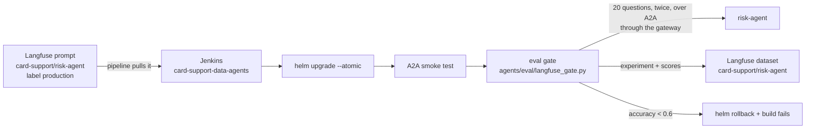
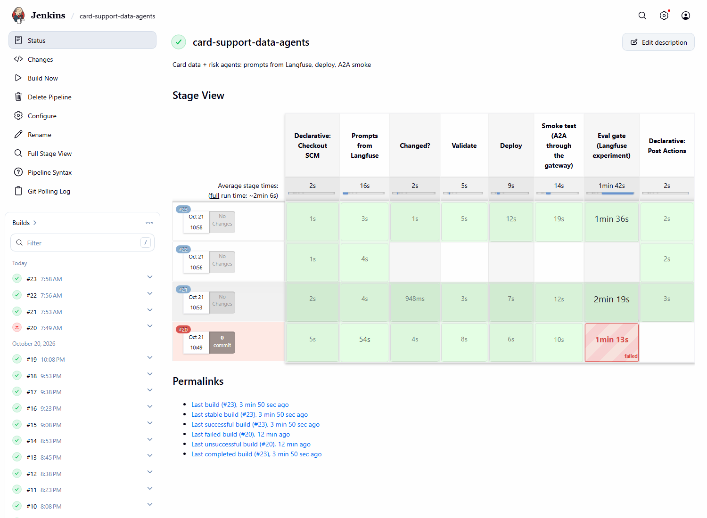

# Novel idea: an evaluation gate in the agents' CD (Langfuse experiments)

The agents' pipelines deploy a new system prompt as soon as it is promoted in Langfuse, and the smoke test only checks
that an agent answers. Whether it still answers correctly was checked nowhere: an LLM agent can pass every unit test,
deploy cleanly and still get worse. The pipeline now evaluates the agent it just deployed on a fixed set of questions
with known facts, records the run as a Langfuse experiment (one per deploy, comparable side by side), and rolls the
release back when accuracy falls below a threshold. Not covered in EDAI: evaluation-driven deployment of LLM agents
(offline evals as a CD gate) and Langfuse datasets and experiments (the course used Langfuse for prompt management
only).

## How it works

The dataset ([`agents/eval/dataset.jsonl`](../agents/eval/dataset.jsonl)) has 20 card-policy questions over the five
bank documents, each with the facts a correct answer must state (several accepted spellings: "100,000" / "100000" /
"100.000"). The gate upserts them into the Langfuse dataset `card-support/risk-agent`; item ids make that idempotent.
The first runs below used the first 12.

The experiment ([`agents/eval/langfuse_gate.py`](../agents/eval/langfuse_gate.py), Langfuse Python SDK 5.0.3,
`dataset.run_experiment`) asks the deployed risk agent each question over A2A through the gateway, as the coordinator
does. An item evaluator scores `accuracy` 1 or 0 and a run evaluator takes the average. The run name is
`risk-agent prompt v<Langfuse version> (Jenkins #<build>)`.

The gate is the stage "Eval gate" in [`agents/Jenkinsfile.data-agents`](../agents/Jenkinsfile.data-agents). When the
average of 2 runs (`--repeats 2`) is below `EVAL_MIN_ACCURACY = 0.6`, the stage runs `helm rollback` to the previous
revision and fails the build, so the coordinator pipeline is not triggered. The agent samples at temperature 0.8, and
one run of 12 questions moved by one or two answers from run to run (v1: 0.58 to 0.83). With the bar one question
below a true 0.67, an unchanged deploy could have been rolled back by chance (binomial: 28 % of the runs for an agent
that is right 70 % of the time); 40 answers instead of 12 bring that to 6 %, and to almost nothing for v2 (about 0.9),
without lowering the bar that caught build #20. The runner is a small image (`agents/eval/Dockerfile`); Jenkins holds
only the Langfuse keys and the A2A key as credentials.

The same dataset drives the A/B evaluations (`agents/eval/run_eval.py`, [A/B testing](ab_testing.md)).

## Proof it worked

The eval found a real failure before anyone looked at a trace: in 2 to 4 of the 12 answers the risk agent replied
"the policy could not be checked" in about 2 s, without calling `search_policy` or after one search that missed the
fee table row. The prompt's own rule ("if its hits do not cover the question, say the policy could not be checked")
gave it that exit. Prompt v2 in Langfuse changed only that rule (say it only after calling `search_policy`, and after
a second search in other words; the commit message in Langfuse records why). Then:

| Jenkins build | prompt deployed | questions | accuracy | gate (0.6) |
|---|---|---|---:|---|
| by hand | v1 (baseline) | 12, once | 0.83 | pass |
| #20 | v1, while the LLM canary still sent 20 % of the calls to Groq (429s) | 12, once | 0.58 | fail: `helm rollback`, build failed, coordinator not triggered |
| #21 | v1, canary stopped | 12, once | 0.67 | pass |
| #23 | v2 (promoted to `production` in Langfuse, picked up by the pipeline) | 12, once | 0.92 | pass |
| #27 | v2; Jenkins was restarted while the eval ran | 20, twice | none | fail: the stage lost its process, the gate failed closed and rolled back |
| #29 | v2, started by the MCP pipeline | 20, twice | 0.95 and 0.90, mean 0.93 | pass, coordinator triggered |

Build #20 is the gate doing its job on a problem it was not written for: the deploy itself was fine, but the platform
under it (the LLM A/B canary, see [A/B testing](ab_testing.md)) made a quarter of the answers fail, and the release did
not go on to the coordinator. Build #27 shows the other side of the same rule: an eval that cannot finish counts as a
failed eval, so the release went back to the revision that was running before.

v1 scores 0.58 to 0.83 across runs (temperature 0.8, 12 questions), v2 0.92 to 0.95. The threshold sits below the
noise of a good prompt; one run is only a smoke-level signal. The runs sit next to each other in Langfuse (Datasets >
`card-support/risk-agent` > Experiments), per question, with each answer's trace.

Cost: with 12 questions once the gate added about 1.5 to 2.5 minutes to a deploy; with 20 questions twice it takes
about 8 minutes (503 s in #29), all agent conversations on the one GPU.
