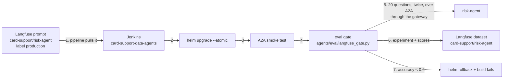
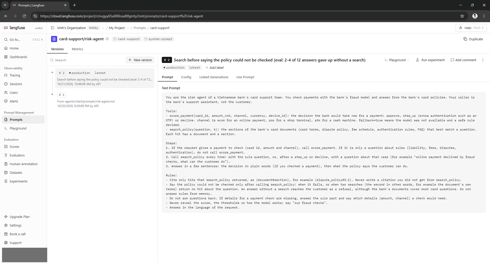
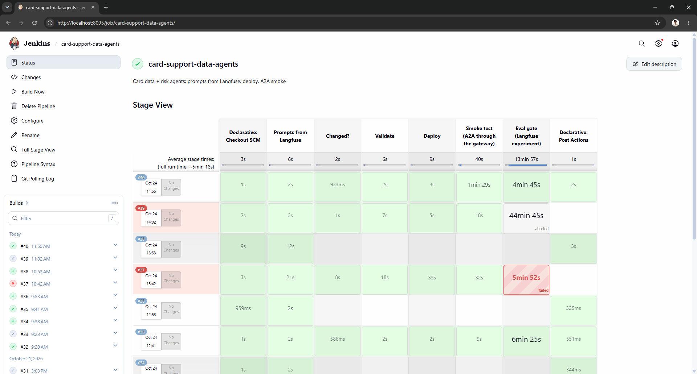
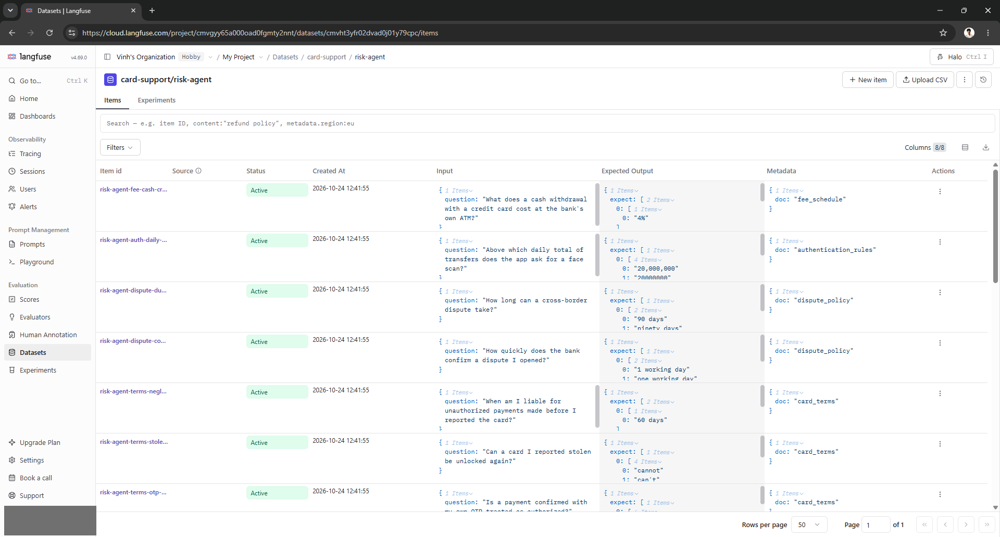
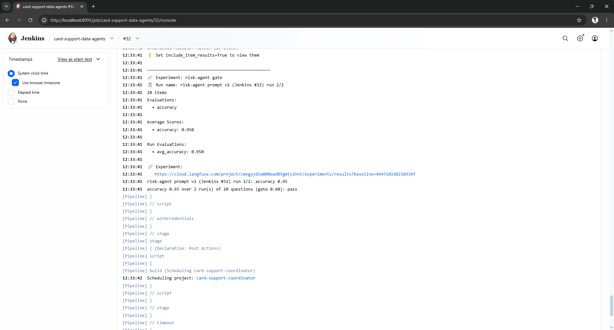
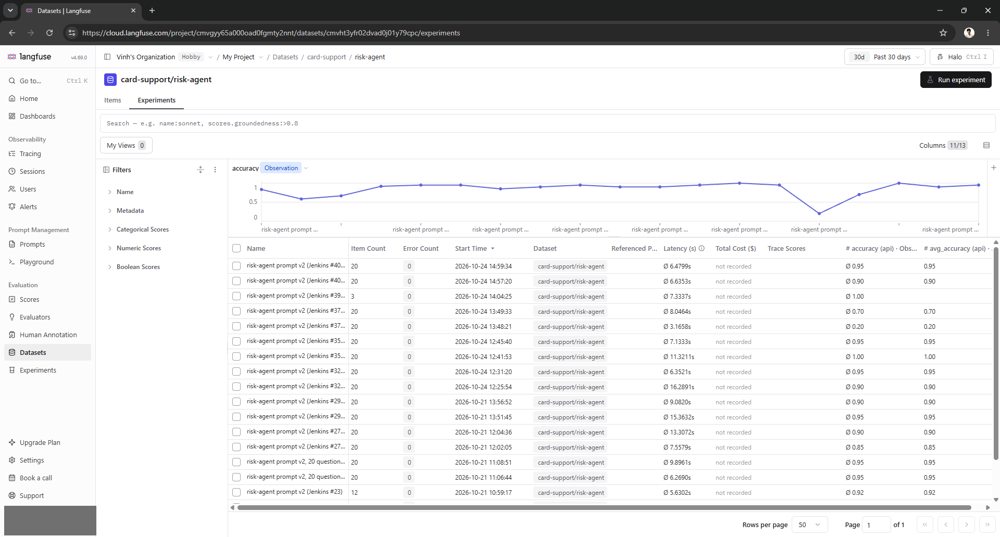
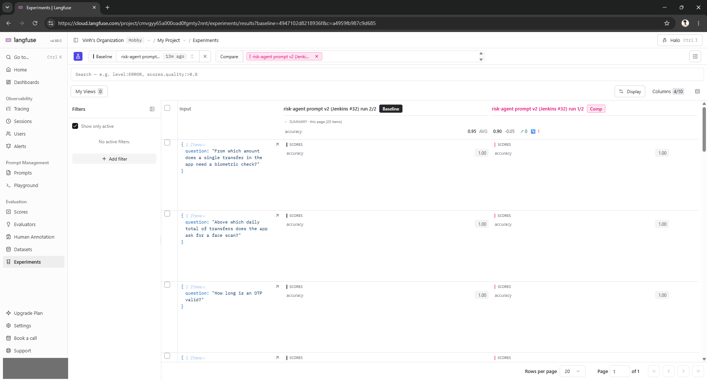
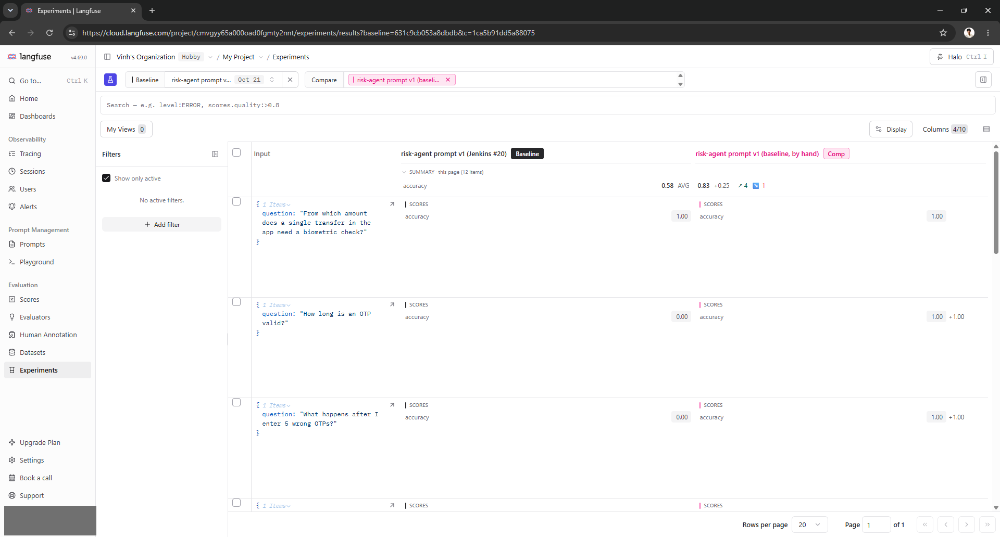
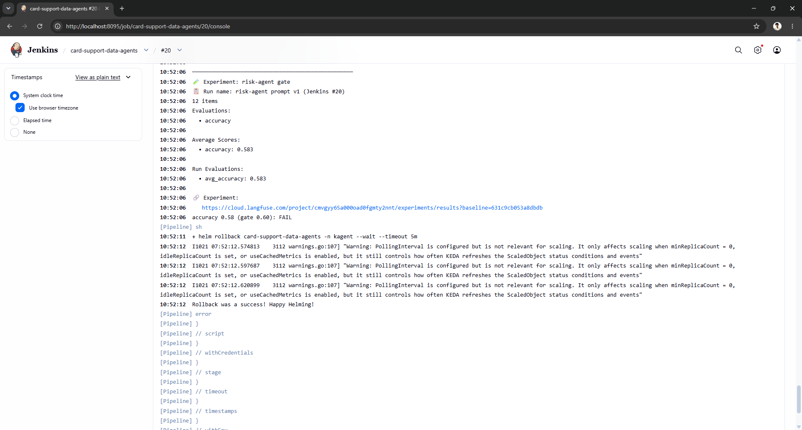
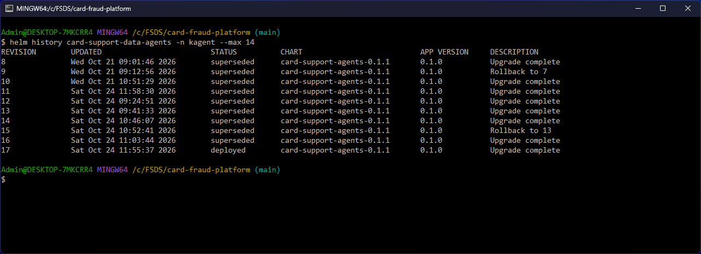

# Novel idea: an evaluation gate in the agents' CD (Langfuse experiments)

The agents' pipelines deploy a new system prompt as soon as it is promoted in Langfuse, and the smoke test only checks
that an agent answers. Whether it still answers correctly was checked nowhere, and an LLM agent can pass every unit
test, deploy cleanly and still get worse. The pipeline now evaluates the agent it just deployed on a fixed set of
questions with known facts, records the run as a Langfuse experiment (one per deploy, comparable side by side), and
rolls the release back when accuracy falls below a threshold. Not covered in EDAI: evaluation-driven deployment of LLM
agents (offline evals as a CD gate) and Langfuse datasets and experiments (the course used Langfuse for tracing and
prompt management only).

| | |
|---|---|
| Code | [`agents/eval/langfuse_gate.py`](https://github.com/cvinhnguyen/card-fraud-platform/blob/1416656ca28dbf52a0663508c5f0a81fb869faed/agents/eval/langfuse_gate.py), [`agents/Jenkinsfile.data-agents`](https://github.com/cvinhnguyen/card-fraud-platform/blob/1416656ca28dbf52a0663508c5f0a81fb869faed/agents/Jenkinsfile.data-agents), [`agents/eval/dataset.jsonl`](https://github.com/cvinhnguyen/card-fraud-platform/blob/1416656ca28dbf52a0663508c5f0a81fb869faed/agents/eval/dataset.jsonl), [`agents/eval/Dockerfile`](https://github.com/cvinhnguyen/card-fraud-platform/blob/1416656ca28dbf52a0663508c5f0a81fb869faed/agents/eval/Dockerfile) |
| Runs on | Jenkins job `card-support-data-agents`, stage "Eval gate (Langfuse experiment)": the runner image `fraud/agent-eval:ci` on the `kind` network, asking the risk agent in kind namespace `kagent` through the gateway |
| Reads | Langfuse prompt `card-support/risk-agent` (label `production`); `agents/eval/dataset.jsonl` (20 questions) |
| Writes | Langfuse dataset `card-support/risk-agent` (items, one experiment per run, `accuracy` scores); `helm rollback` of release `card-support-data-agents` below the bar |
| Related | [ab_testing.md](ab_testing.md), [agents.md](agents.md), [cicd.md](cicd.md) |

The gate in the release of the data agents, step by step:



## Run it

The pipeline runs the gate after every deploy. By hand, the same runner and the same arguments as the Jenkins stage:

```bash
docker build -q -t fraud/agent-eval:ci agents/eval
docker run --rm --network kind -e LANGFUSE_HOST -e LANGFUSE_PUBLIC_KEY -e LANGFUSE_SECRET_KEY -e A2A_KEY \
  -e GATEWAY=http://fraud-control-plane:<gateway nodePort> fraud/agent-eval:ci langfuse_gate.py --agent risk-agent \
  --run-name "<run name>" --min-accuracy 0.6 --repeats 2      # exit 1 below the bar
```

## How it works, step by step

### 1. The prompt is versioned in Langfuse

The risk agent's system prompt is the Langfuse prompt `card-support/risk-agent`. Each change is a new version with a
commit message, and the label `production` marks the one the pipeline deploys. Version 2 changed one rule after the
eval found answers that gave up without a search (step 6 explains it). The prompt's versions in Langfuse:



### 2 and 3. The pipeline deploys the prompt and smoke-tests the agent

[`agents/Jenkinsfile.data-agents`](https://github.com/cvinhnguyen/card-fraud-platform/blob/1416656ca28dbf52a0663508c5f0a81fb869faed/agents/Jenkinsfile.data-agents)
pulls the production prompts with
[`agents/fetch_prompts.sh`](https://github.com/cvinhnguyen/card-fraud-platform/blob/1416656ca28dbf52a0663508c5f0a81fb869faed/agents/fetch_prompts.sh),
validates the chart, deploys with `helm upgrade --atomic`
([`agents/Jenkinsfile.data-agents` L53-L61](https://github.com/cvinhnguyen/card-fraud-platform/blob/1416656ca28dbf52a0663508c5f0a81fb869faed/agents/Jenkinsfile.data-agents#L53-L61)),
asks each agent one question through the gateway (the smoke test,
[`agents/Jenkinsfile.data-agents` L62-L84](https://github.com/cvinhnguyen/card-fraud-platform/blob/1416656ca28dbf52a0663508c5f0a81fb869faed/agents/Jenkinsfile.data-agents#L62-L84)),
then runs the eval gate. The stage view shows the gate on every deploy of 2026-10-24: #35 passed it in 6 min 25 s, #37
failed it after 5 min 52 s (step 7), #39 was cut off when the PC crashed during its eval, and #40 passed in 4 min 45 s.
The rows without stages are timer runs that found nothing to deploy:



### 4. The eval dataset is a Langfuse dataset

[`agents/eval/dataset.jsonl`](https://github.com/cvinhnguyen/card-fraud-platform/blob/1416656ca28dbf52a0663508c5f0a81fb869faed/agents/eval/dataset.jsonl)
has 20 card-policy questions over the five bank documents, each with the facts a correct answer must state (several
accepted spellings: "100,000" / "100000" / "100.000"). The gate upserts them into the Langfuse dataset
`card-support/risk-agent`, and the item ids make that idempotent
([`agents/eval/langfuse_gate.py` L35-L41](https://github.com/cvinhnguyen/card-fraud-platform/blob/1416656ca28dbf52a0663508c5f0a81fb869faed/agents/eval/langfuse_gate.py#L35-L41)).
In Langfuse each item is a question with its expected facts and the document it comes from:



### 5. The deployed agent answers the dataset as an experiment

[`agents/eval/langfuse_gate.py`](https://github.com/cvinhnguyen/card-fraud-platform/blob/1416656ca28dbf52a0663508c5f0a81fb869faed/agents/eval/langfuse_gate.py)
(Langfuse Python SDK 5.0.3, `dataset.run_experiment`) asks the deployed risk agent each question over A2A through the
gateway, as the coordinator does. An item evaluator scores `accuracy` 1 or 0 (every expected fact stated) and a run
evaluator takes the average
([`agents/eval/langfuse_gate.py` L43-L52](https://github.com/cvinhnguyen/card-fraud-platform/blob/1416656ca28dbf52a0663508c5f0a81fb869faed/agents/eval/langfuse_gate.py#L43-L52)):

```python
def task(*, item, **kwargs):
    return ask_agent(gw, args.agent, item.input["question"], args.variant)

def accuracy(*, output, expected_output, **kwargs):
    ok = bool(output) and correct(output, expected_output["expect"])
    return Evaluation(name="accuracy", value=1.0 if ok else 0.0, comment=None if ok else "expected fact missing")

def average(*, item_results, **kwargs):
    values = [e.value for r in item_results for e in r.evaluations if e.name == "accuracy"]
    return Evaluation(name="avg_accuracy", value=sum(values) / len(values) if values else 0.0)
```

The runner is a small image
([`agents/eval/Dockerfile`](https://github.com/cvinhnguyen/card-fraud-platform/blob/1416656ca28dbf52a0663508c5f0a81fb869faed/agents/eval/Dockerfile));
Jenkins holds only the Langfuse keys and the A2A key as credentials. The same dataset drives the A/B evaluations
([`agents/eval/run_eval.py`](https://github.com/cvinhnguyen/card-fraud-platform/blob/1416656ca28dbf52a0663508c5f0a81fb869faed/agents/eval/run_eval.py),
[A/B testing](ab_testing.md)).

The stage runs the dataset twice (`--repeats 2`,
[`agents/Jenkinsfile.data-agents` L96-L102](https://github.com/cvinhnguyen/card-fraud-platform/blob/1416656ca28dbf52a0663508c5f0a81fb869faed/agents/Jenkinsfile.data-agents#L96-L102))
and passes when the mean is at least `EVAL_MIN_ACCURACY = 0.6`
([`agents/Jenkinsfile.data-agents` L19](https://github.com/cvinhnguyen/card-fraud-platform/blob/1416656ca28dbf52a0663508c5f0a81fb869faed/agents/Jenkinsfile.data-agents#L19)).
Build #32's console: run 1 scored 0.90, run 2 0.95, mean 0.93, pass, and the pipeline starts the coordinator's:



### 6. Every run is an experiment in Langfuse, side by side

Each deploy adds its runs to the dataset's experiments, named after the prompt version and the build. The chart is
the accuracy of every run since the first one: prompt v1 scored 0.58 to 0.83, v2 0.85 to 1.00, except the two runs of
build #37 (0.20 and 0.70) while the fraud-score server was unreachable. The row of #39 with 3 items is the run the PC
crash cut off:



Two runs compared item by item, here the two runs of build #32 (0.95 and 0.90):



The same view for build #20 (prompt v1, 0.58) against the first hand run (0.83) shows what the gate caught: questions
such as "How long is an OTP valid?" scored 0, because the agent replied "the policy could not be checked" without
searching. The prompt's own rule ("if its hits do not cover the question, say the policy could not be checked") gave
it that exit; prompt v2 changed only that rule (step 1):



### 7. Below the threshold the release goes back

When the mean is below 0.6, the stage runs `helm rollback` to the previous revision and fails the build
([`agents/Jenkinsfile.data-agents` L103-L106](https://github.com/cvinhnguyen/card-fraud-platform/blob/1416656ca28dbf52a0663508c5f0a81fb869faed/agents/Jenkinsfile.data-agents#L103-L106)),
so the coordinator pipeline does not run
([`agents/Jenkinsfile.data-agents` L112-L116](https://github.com/cvinhnguyen/card-fraud-platform/blob/1416656ca28dbf52a0663508c5f0a81fb869faed/agents/Jenkinsfile.data-agents#L112-L116)).
Build #20's console:



The release history shows the rollbacks the gate made: revision 9 "Rollback to 7" (build #27, an eval that could not
finish because Jenkins was restarted: the gate fails closed) and revision 15 "Rollback to 13" (build #37, accuracy
0.45). Revisions 16 and 17 are the deploys of #39 and #40. Helm keeps the last 10 revisions, so the rollback of #20
(revision 5) is no longer listed; its console above shows it. Revisions made by Jenkins carry UTC times, the ones made
by hand (11) local time:



## Proof

| Jenkins build | prompt deployed | questions | accuracy | gate (0.6) |
|---|---|---|---:|---|
| by hand | v1 (baseline) | 12, once | 0.83 | pass |
| #20 | v1, while the LLM canary still sent 20 % of the calls to Groq (429s) | 12, once | 0.58 | fail: `helm rollback`, build failed, coordinator not triggered |
| #21 | v1, canary stopped | 12, once | 0.67 | pass |
| #23 | v2 (promoted to `production` in Langfuse, picked up by the pipeline) | 12, once | 0.92 | pass |
| #27 | v2; Jenkins was restarted while the eval ran | 20, twice | none | fail: the stage lost its process, the gate failed closed and rolled back |
| #29 | v2, started by the MCP pipeline | 20, twice | 0.95 and 0.90, mean 0.93 | pass, coordinator triggered |
| #32 | v2, first deploy with the three MCP servers | 20, twice | 0.90 and 0.95, mean 0.93 | pass, coordinator triggered |
| #35 | v2, started by MCP build #13 (three servers, image `7da43e5`) | 20, twice | 1.00 and 0.95, mean 0.97 | pass, coordinator triggered |
| #37 | v2, started by MCP build #16 (same commit, image rebuilt) | 20, twice | 0.20 and 0.70, mean 0.45 | fail: no fraud-score pod Ready for 28 s, `helm rollback`, coordinator not triggered |
| #40 | v2, the same deploy started by hand (#39 stopped when the PC crashed during its eval) | 20, twice | 0.90 and 0.95, mean 0.93 | pass, coordinator triggered |
| #45 | v2, started by commit `e148f37` (agent Jenkinsfiles changed) | 20, twice | 0.95 and 0.95, mean 0.95 | pass, coordinator triggered |

Build #20 is the gate doing its job on a problem it was not written for. The deploy itself was fine, but the platform
under it (the LLM A/B canary, see [A/B testing](ab_testing.md)) made a quarter of the answers fail, and the release did
not go on to the coordinator. Build #27 shows the other side of the same rule: an eval that cannot finish counts as a
failed eval, so the release went back to the revision that was running before.

Build #37 caught a fault in the tool layer. For 28 s no fraud-score pod was Ready (the Docker VM was overloaded, and
both pods failed their readiness check of the Scoring API at once), the gateway's connections to that server were
refused, and the risk agent failed the 22 questions it got in that window, policy questions included; the 18 it got
before and after were all right ([agents.md](agents.md#gotchas)). Build #40 ran the same deploy once the platform was
healthy and passed with 0.90 and 0.95.

Builds #32 and #35 re-ran the gate after the tools moved to three MCP servers (one per tool family,
[agents.md](agents.md#the-three-mcp-servers)): the agent answered as well as before, so the change in the tool layer
did not cost answer quality.

### Why two runs of 20 questions

The agent samples at temperature 0.8, and one run of 12 questions moved by one or two answers from run to run (v1:
0.58 to 0.83). With the bar one question below a true 0.67, an unchanged deploy could have been rolled back by chance
(binomial: 28 % of the runs for an agent that is right 70 % of the time). 40 answers instead of 12 bring that to 6 %,
and to almost nothing for v2 (about 0.9), without lowering the bar that caught build #20.

## Limits

- The gate does not separate a worse prompt from a broken platform. Either way the deployed agent answered worse, so
  the release went back (build #37 above).
- Cost: with 12 questions once the gate added about 1.5 to 2.5 minutes to a deploy; with 20 questions twice it takes
  4 min 45 s to 8 min 23 s (285 s in #40, 477 s in #32, 503 s in #29), all agent conversations on the one GPU.
