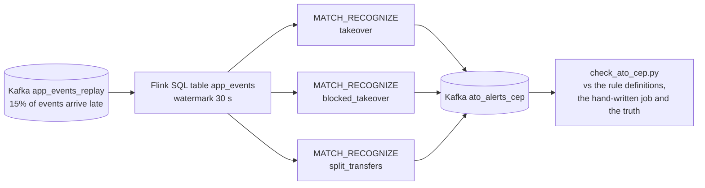
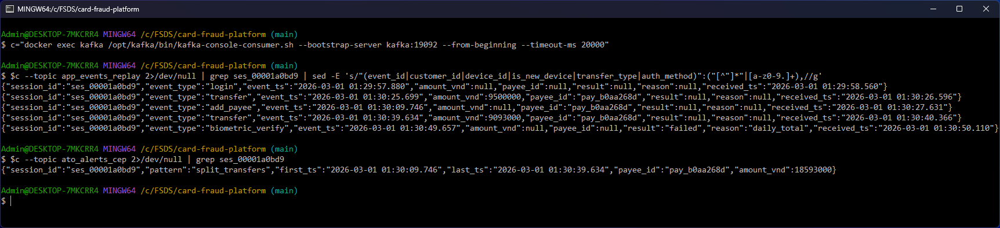
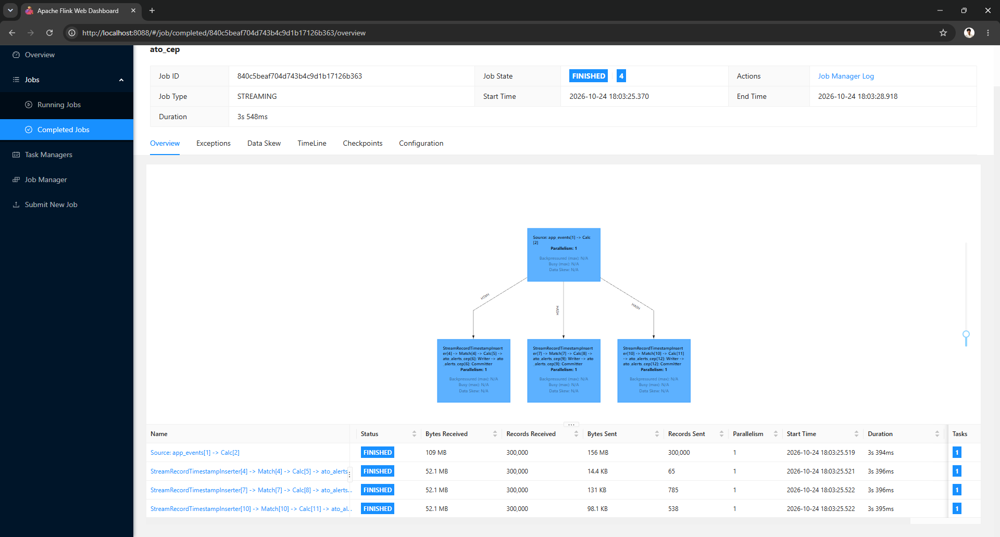
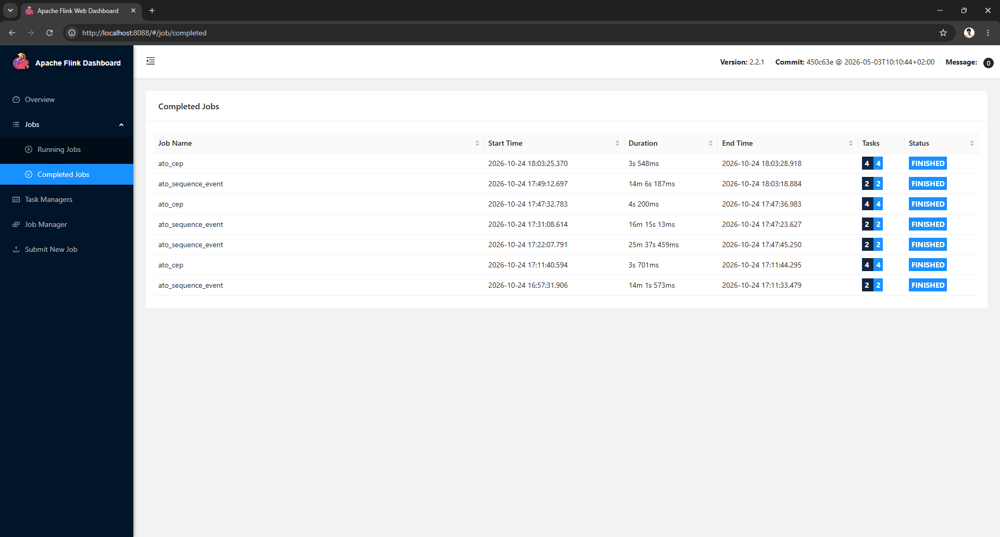
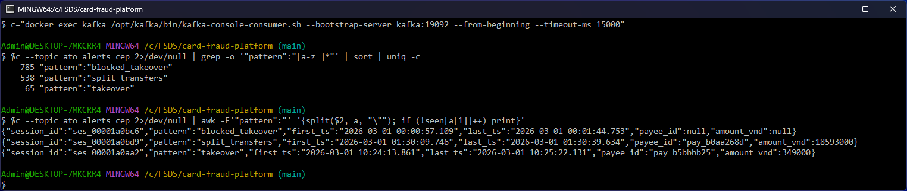
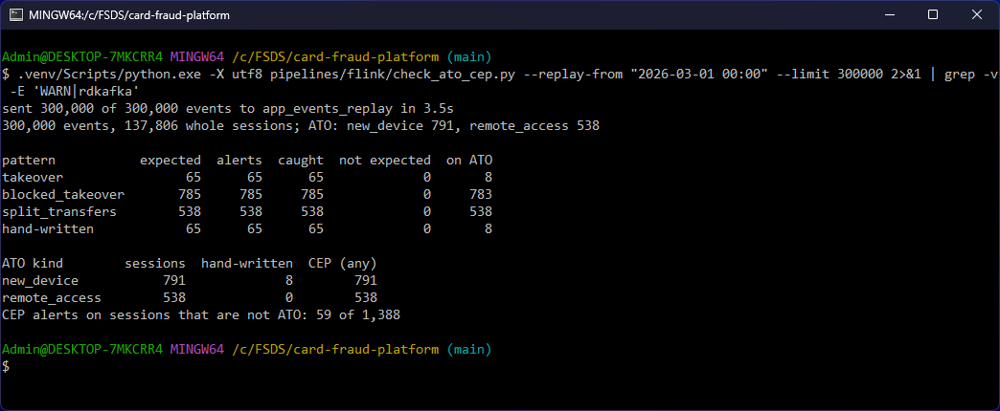

# Novel idea: account takeover patterns with Flink CEP (MATCH_RECOGNIZE)

Layer 1 novel idea: account takeovers in the bank app's events are found with Flink CEP, through Flink SQL's
`MATCH_RECOGNIZE`. One job runs three takeover patterns and orders each session's events by event time without the
hand-written buffer of the streaming job `ato_sequence.py`, in about 4 s per run against 14 to 26 minutes on the same
300,000 events. Not covered in EDAI: complex event processing (row pattern recognition with `MATCH_RECOGNIZE`, the
Flink CEP library). The course covered Flink windows, watermarks and keyed state, which is what the hand-written job
uses.

| | |
|---|---|
| Code | [`pipelines/flink/ato_cep.py`](https://github.com/cvinhnguyen/card-fraud-platform/blob/612ffdc2aa8a38f9098d6190f54bd46c2ea70315/pipelines/flink/ato_cep.py), [`pipelines/flink/check_ato_cep.py`](https://github.com/cvinhnguyen/card-fraud-platform/blob/612ffdc2aa8a38f9098d6190f54bd46c2ea70315/pipelines/flink/check_ato_cep.py) |
| Runs on | compose profile `stream` (the Flink session cluster of [flink_jobs.md](flink_jobs.md)) |
| Reads | Kafka `app_events_replay` |
| Writes | Kafka `ato_alerts_cep` |
| Related | [flink_jobs.md](flink_jobs.md) |

The job, from the Kafka replay to the alerts:



## Run it

`check_ato_cep.py` loads a replay into `app_events_replay`, runs the hand-written job and the CEP job, and compares
their alerts (step 4 below):

```bash
docker compose -f infra/docker-compose.yaml --profile core --profile stream up -d --build
python pipelines/flink/check_ato_cep.py --replay-from "2024-09-01 00:00" --limit 300000   # development window
python pipelines/flink/check_ato_cep.py --replay-from "2026-03-01 00:00" --limit 300000   # held-out window
docker exec flink-jobmanager flink run -py /opt/flink/jobs/ato_cep.py                     # the CEP job alone, replay loaded
```

## Problem

The bank app's events (`app_events`: login, password reset, add payee, transfer, identity check) show an account
takeover as a sequence inside one session. Since Decision 2345 (identity checks from 2024-07-01: a face scan for a new
device, for a transfer of 10M VND or more and above 20M VND a day), takeovers look different. Most stop at a failed
identity check, and malware that drives the victim's own phone needs no password reset: it adds a payee and splits
the money into transfers just below 10M. The Layer 1 streaming job
[`pipelines/flink/ato_sequence.py`](https://github.com/cvinhnguyen/card-fraud-platform/blob/612ffdc2aa8a38f9098d6190f54bd46c2ea70315/pipelines/flink/ato_sequence.py)
([flink_jobs.md](flink_jobs.md#out-of-order-app-events)) codes one sequence (password reset, add payee, transfer) as a
state machine with its own event-time buffer and timers. On the replays below it flags 10 and 8 takeover sessions out
of about 1,340, and it is slow: a Python operator per event.

## The three patterns

Flink CEP, through Flink SQL's `MATCH_RECOGNIZE`, describes each sequence as a pattern over the rows of a partition
in event time, much like a regular expression over events.
[`pipelines/flink/ato_cep.py`](https://github.com/cvinhnguyen/card-fraud-platform/blob/612ffdc2aa8a38f9098d6190f54bd46c2ea70315/pipelines/flink/ato_cep.py)
runs three patterns in one job. The SQL operator sorts each session's events by event time once the watermark
passes, so the hand-written buffer is gone.

| Pattern | Sequence in one session | Takeover it describes |
|---|---|---|
| `takeover` | `password_reset`, then `add_payee`, then `transfer`, within 10 minutes | the attacker resets the password on a new phone and empties the account (the hand-written job's sequence) |
| `blocked_takeover` | `password_reset`, then a failed `biometric_verify` for a new device or for the amount, within 10 minutes | the same attempt, stopped by the identity check: the account is still at risk, the password is known |
| `split_transfers` | `add_payee`, then two transfers of 9,000,000 to 9,999,999 VND to that payee, within 30 minutes | remote control of the victim's phone: no reset, no new device, amounts kept under the 10M check |

The patterns (`X*?` and `Y*?` let any other events sit in between), in
[`pipelines/flink/ato_cep.py` L20-L39](https://github.com/cvinhnguyen/card-fraud-platform/blob/612ffdc2aa8a38f9098d6190f54bd46c2ea70315/pipelines/flink/ato_cep.py#L20-L39):

```python
PATTERNS = {
    "takeover": """
        MEASURES R.ts AS first_ts, T.ts AS last_ts, T.payee_id AS payee_id, T.amount_vnd AS amount_vnd
        ONE ROW PER MATCH AFTER MATCH SKIP PAST LAST ROW
        PATTERN (R X*? P Y*? T) WITHIN INTERVAL '10' MINUTE
        DEFINE R AS R.event_type = 'password_reset', P AS P.event_type = 'add_payee', T AS T.event_type = 'transfer'""",
    "blocked_takeover": """
        MEASURES R.ts AS first_ts, V.ts AS last_ts, CAST(NULL AS STRING) AS payee_id, CAST(NULL AS BIGINT) AS amount_vnd
        ONE ROW PER MATCH AFTER MATCH SKIP PAST LAST ROW
        PATTERN (R X*? V) WITHIN INTERVAL '10' MINUTE
        DEFINE R AS R.event_type = 'password_reset',
               V AS V.event_type = 'biometric_verify' AND V.`result` = 'failed' AND V.reason IN ('new_device', 'amount')""",
    "split_transfers": """
        MEASURES A.ts AS first_ts, S2.ts AS last_ts, A.payee_id AS payee_id, S1.amount_vnd + S2.amount_vnd AS amount_vnd
        ONE ROW PER MATCH AFTER MATCH SKIP PAST LAST ROW
        PATTERN (A X*? S1 Y*? S2) WITHIN INTERVAL '30' MINUTE
        DEFINE A AS A.event_type = 'add_payee',
               S1 AS S1.event_type = 'transfer' AND S1.payee_id = A.payee_id AND S1.amount_vnd BETWEEN 9000000 AND 9999999,
               S2 AS S2.event_type = 'transfer' AND S2.payee_id = A.payee_id AND S2.amount_vnd BETWEEN 9000000 AND 9999999""",
}
```

Each pattern becomes `INSERT INTO ato_alerts_cep SELECT ... FROM app_events MATCH_RECOGNIZE (PARTITION BY session_id
ORDER BY ts ...)`, and the three inserts run as one statement set, so Kafka is read once
([`pipelines/flink/ato_cep.py` L65-L71](https://github.com/cvinhnguyen/card-fraud-platform/blob/612ffdc2aa8a38f9098d6190f54bd46c2ea70315/pipelines/flink/ato_cep.py#L65-L71)).
The source table takes `event_ts` as event time with a 30 s watermark
([`pipelines/flink/ato_cep.py` L50](https://github.com/cvinhnguyen/card-fraud-platform/blob/612ffdc2aa8a38f9098d6190f54bd46c2ea70315/pipelines/flink/ato_cep.py#L50));
the app delays an event by 20 s at most.

## How it works, step by step (2026-10-24)

### 1. A session's events arrive out of order

Replay of 300,000 app events from 2026-03-01 into Kafka (`app_events_replay`), as the producer sends them, by
`received_ts`. Session `ses_00001a0bd9` is a remote-access takeover: login, add payee, transfer of 9,500,000, transfer
of 9,093,000, then the 20M daily-total check fails. The first transfer (event time 01:30:25) reached Kafka before
the `add_payee` it depends on (event time 01:30:09). Matched in arrival order, the pattern would start after the
first transfer and miss this session. The alert of the CEP job starts at the `add_payee` (01:30:09.746) and ends at
the second transfer, 18,593,000 VND to `pay_b0aa268d`:



### 2. One job, three pattern operators

The job in the Flink UI: one Kafka source feeds the three `Match` operators. All three read the 300,000 events and
wrote 65, 785 and 538 alerts, and the job took 3.5 s:



The hand-written job reads the same events through a Python operator. Every run of it on 300,000 events took 14 to
26 minutes; every CEP run took about 4 s:



### 3. Alerts in Kafka

Each match is one JSON message in `ato_alerts_cep`: the session, the pattern, the first and last event of the match,
and for transfers the payee and the amount. Counts per pattern and the first alert of each:



### 4. Checked against the rule definitions and the truth

[`pipelines/flink/check_ato_cep.py`](https://github.com/cvinhnguyen/card-fraud-platform/blob/612ffdc2aa8a38f9098d6190f54bd46c2ea70315/pipelines/flink/check_ato_cep.py)
loads the replay, runs the hand-written job and the CEP job, and compares their alerts with:

- the sessions each rule should flag, recomputed with pandas from the Parquet files in event time (an independent
  implementation of the same definitions,
  [`pipelines/flink/check_ato_cep.py` L26-L48](https://github.com/cvinhnguyen/card-fraud-platform/blob/612ffdc2aa8a38f9098d6190f54bd46c2ea70315/pipelines/flink/check_ato_cep.py#L26-L48));
- the generator's list of takeover sessions (`new_device`, `remote_access`).

The run on the held-out window (2026-03-01 to 2026-05-03), in Git Bash:



## How the result is judged

The data is synthetic, and the generator that wrote it also decides what a takeover looks like. Patterns written
by someone who read the generator will find what it generated, so the takeover numbers cannot be read as a fraud
detection rate. The proof is split into what the numbers can show and what they cannot.

### The technique works, independent of the data

For every pattern, the CEP alerts are exactly the sessions the pandas implementation of the same rule finds: 0
missing, 0 extra, on both windows. The shared rule (`takeover`) gives the same sessions as the hand-written job. 15%
of the events arrive after the next event of their session, so a match in arrival order would miss sessions (the
hand-written job's arrival-order mode misses 3 in 10, [flink_jobs.md](flink_jobs.md#out-of-order-app-events)); the
SQL operator orders by event time without any buffer code. The cost is about 4 s per run against 14 to 26 minutes,
and a new pattern is five lines of SQL against a new state machine.

### Coverage of the known takeover types, bounded by the data

The patterns encode the takeover types of the data design, so finding them is a coverage check, an upper bound, and
nothing more. To keep it honest, the patterns were written on a development window (300,000 events from 2024-09-01)
and then frozen. On that window the first version of `blocked_takeover` (new-device check only) caught 717 of 788
`new_device` takeovers; the 71 it missed had passed the face scan for the new phone and failed it at the transfer
amount, so the rule was widened to both checks. That was the only change. The frozen patterns then ran once on a
window they had not seen, 18 months later.

The development run, before the frozen rules went to the held-out window:


### What a fraud team would pay for, not defined by the generator

Legitimate sessions come from the generator's own customer behaviour (1% password resets, 10% new payees, transfer
amounts drawn from a lognormal), not from the patterns, so the alerts they raise are the cost of each pattern.

| Window | Pattern | Alerts | = expected | On takeover sessions | On other sessions |
|---|---|---:|---:|---:|---:|
| development, 2024-09-01 | `takeover` | 107 | 107 | 10 | 97 |
| | `blocked_takeover` | 779 | 779 | 778 | 1 |
| | `split_transfers` | 557 | 557 | 557 | 0 |
| | hand-written job | 107 | 107 | 10 | 97 |
| held-out, 2026-03-01 | `takeover` | 65 | 65 | 8 | 57 |
| | `blocked_takeover` | 785 | 785 | 783 | 2 |
| | `split_transfers` | 538 | 538 | 538 | 0 |
| | hand-written job | 65 | 65 | 8 | 57 |

| Window | Takeover type | Sessions | Hand-written job | CEP, any pattern |
|---|---|---:|---:|---:|
| development | `new_device` | 788 | 10 | 788 |
| | `remote_access` | 557 | 0 | 557 |
| held-out | `new_device` | 791 | 8 | 791 |
| | `remote_access` | 538 | 0 | 538 |

`takeover` is mostly noise after the identity-check rule: 57 of its 65 held-out alerts are customers who forgot their
password and paid someone new. It stays because it is the hand-written job's rule (the comparison), but a fraud team
would route it as low priority. `blocked_takeover` and `split_transfers` flag almost only takeovers.

## Limits

- The thresholds are fixed numbers: 9,000,000 to 9,999,999 VND, two transfers, 30 and 10 minutes. A fraudster who
  sends three transfers of 6.5M, waits 31 minutes or uses two payees passes `split_transfers`. CEP rules cover takeover
  types that are already known and give an alert an analyst can read; types nobody has described yet are left to a
  model (the Layer 2 fraud model scores card payments, not app sessions, so it does not cover them either).
- One session per match (`PARTITION BY session_id`). A pattern across sessions, such as one attacker phone on many
  accounts, would partition by device and needs a longer window and more state.
- Events later than the watermark (30 s) are dropped by the SQL operator. The app's 20 s maximum delay fits; a client
  that buffers events for minutes would need a longer watermark, which delays every alert by as much.
- The numbers come from synthetic data (see [How the result is judged](#how-the-result-is-judged)).
