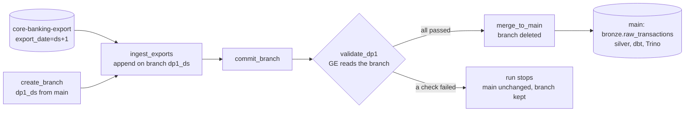
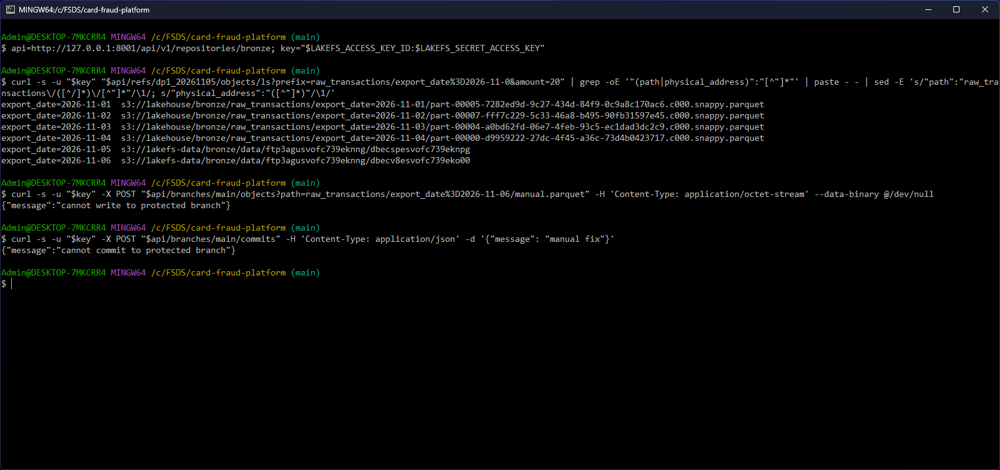
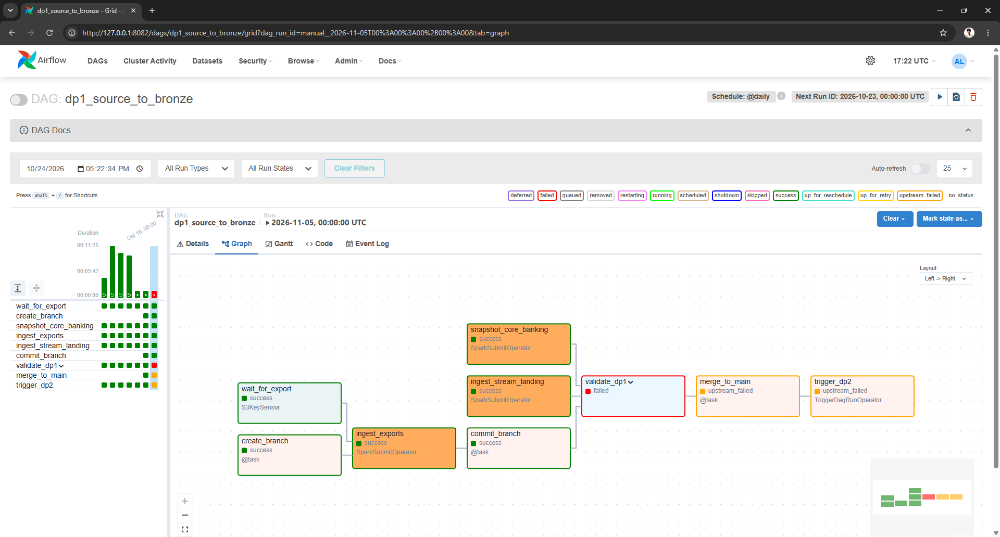
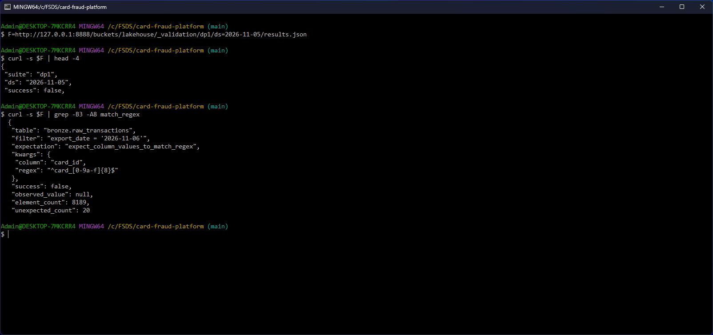
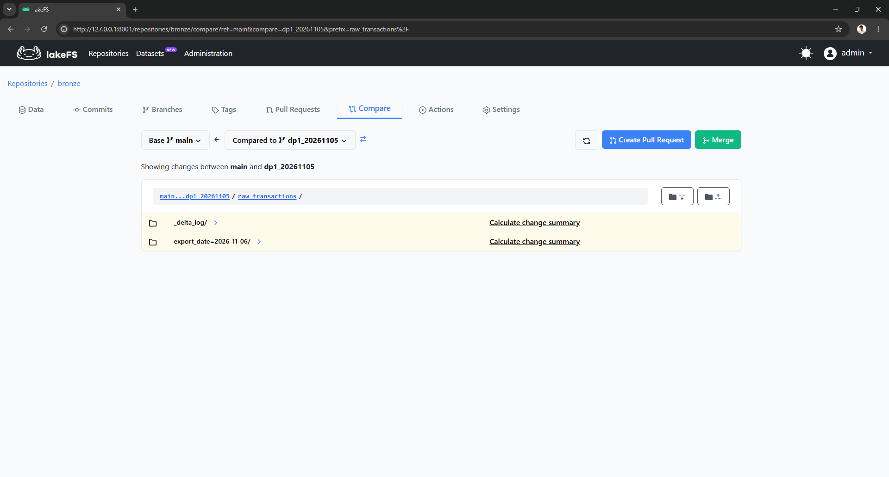
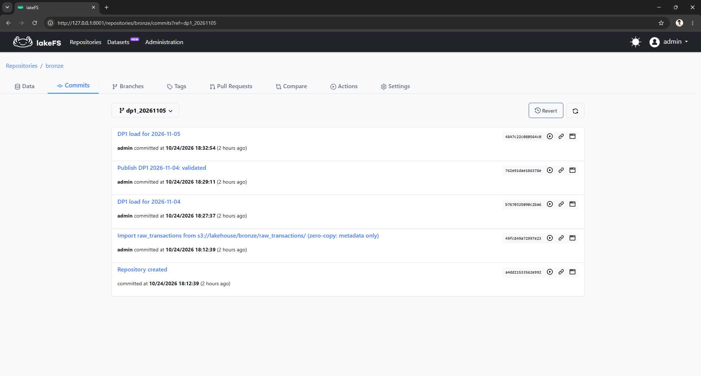
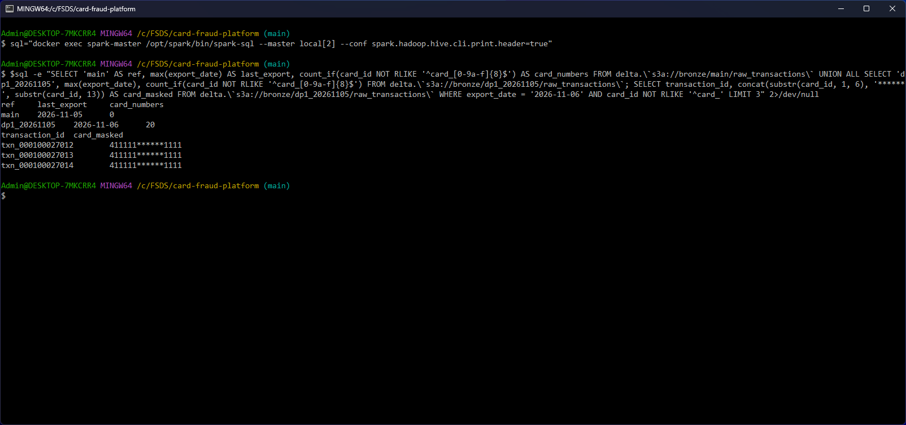
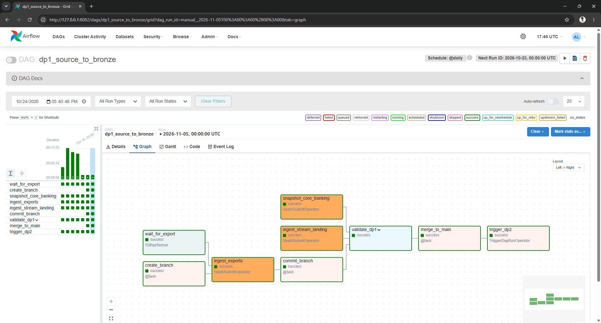
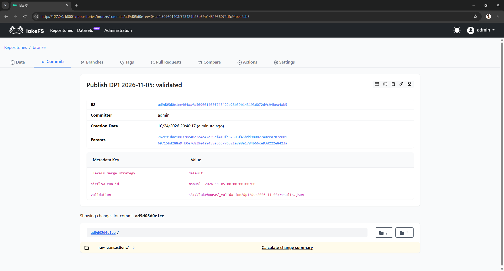
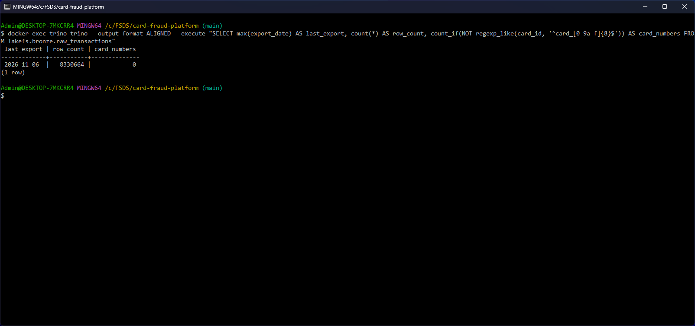

# Novel idea: Write-Audit-Publish for the nightly export with lakeFS

Every night the core banking system exports the card transactions of the business day as Parquet files into the
bucket `core-banking-export`. Another department runs that system and delivers the files; DP1 appends them to
`bronze.raw_transactions`, which silver, dbt and every Trino user read. DP1 already checks each export with Great
Expectations, but it used to check after the append: when a check failed, DP2 did not start, and the rows were already
in the table that everyone queries. Taking them out again means a Delta `DELETE` and, because older table versions
keep the files, a `VACUUM` after the retention period.

The worst bad delivery for this table is an export that carries real card numbers (PAN) instead of the tokens
`card_xxxxxxxx`. PCI DSS v4.0 requirement 3.5.1 asks for the PAN to be unreadable anywhere it is stored, so those rows
must never reach a table people can query.

[lakeFS](https://docs.lakefs.io/) puts Git-like branches, commits and merges over object storage. DP1 now follows the
Write-Audit-Publish pattern: each run writes the new export on its own branch, the checks read that branch, and only a
run that passed is merged into `main`, the branch every reader sees. A failed run leaves `main` as it was and keeps its
branch for the source team to inspect. Not covered in EDAI: data version control over a data lake (branches, commits,
merges, zero-copy import with lakeFS) and Write-Audit-Publish. The course covered Delta Lake (versions of one table)
and Great Expectations, which this uses unchanged.



## Scope: one table, chosen by who delivers it

| Bronze source | Delivered by | Write | Through lakeFS |
|---|---|---|---|
| `raw_transactions` (nightly Parquet export) | another department, as files | append | yes |
| `raw_customers`, `raw_cards`, ... (Postgres snapshot) | read by DP1 itself over JDBC | overwrite | no |
| `raw_card_authorizations` (Flink landing files) | the platform's own stream job | append | no |

The export is the only input the platform does not produce or read itself. The snapshot and landing tables stay on
SeaweedFS as before.

## How it is wired

- [`infra/docker-compose.yaml` L162-L188](../infra/docker-compose.yaml#L162-L188): lakeFS 1.88 in the `batch` profile.
  Objects go to the SeaweedFS bucket `lakefs-data`, the metadata to a local key-value store in the volume
  `lakefs_data`. `LAKEFS_EMAIL_SUBSCRIPTION_ENABLED=false` removes the first-start form that asks for a company e-mail;
  the admin user and its keys come from `infra/.env`.
- [`spark-defaults.conf` L19-L24](../infra/conf/spark/spark-defaults.conf#L19-L24) and
  [`hive-site.xml` L14-L17](../infra/conf/hive/hive-site.xml#L14-L17): an S3A setting for the bucket `bronze` only.
  `s3a://bronze/<branch>/...` goes to the lakeFS S3 gateway, every other bucket still goes to SeaweedFS, so no job
  changes how it reads other tables.
- [`infra/init_lakefs.py`](../infra/init_lakefs.py), run once: creates the repository `bronze`, imports the existing
  table into `main` without copying it, protects `main` (no direct writes or commits, only merges) and points the
  metastore table at `s3a://bronze/main/raw_transactions`. Silver and dbt read the same table name as before.
- [`infra/conf/trino/catalog/lakefs.properties`](../infra/conf/trino/catalog/lakefs.properties): Trino reads the table
  as `lakefs.bronze.raw_transactions`; every other table stays in the catalog `delta`.
- [`pipelines/airflow/dags/common.py` L130-L175](../pipelines/airflow/dags/common.py#L130-L175): the tasks
  `create_branch`, `commit_branch` and `merge_to_main`, three calls to the lakeFS API. The commit carries the Airflow
  run id; the merge commit also carries the path of the validation results.
- [`dp1_source_to_bronze.py` L34-L52](../pipelines/airflow/dags/dp1_source_to_bronze.py#L34-L52): the run's branch
  `dp1_<ds>`, `ingest_exports` and `validate_dp1` with `--txn-root s3a://bronze/dp1_<ds>`, and the order
  `ingest -> commit -> validate -> merge -> trigger DP2`.

`ingest_bronze.py` refuses to append an export to `main` (`--txn-root` is required and must be a branch), and
`rewind_days.py` deletes days on a branch of its own and merges it, since `main` takes no direct writes.

## How it works, step by step (2026-10-24)

### 1. The table moves into lakeFS without a copy

`init_lakefs.py` imported `s3://lakehouse/bronze/raw_transactions/` into `main`: 1,970 objects in 2 s, one commit.
lakeFS records where each object already is and copies nothing. Spark counted 8,314,171 rows through `main` and through
the old path, and Trino's `lakefs.bronze.raw_transactions` returned the same.

The listing below comes from a later run branch. Exports up to 2026-11-04 are the imported objects and still point at
their old place in `s3://lakehouse/...`; the exports DP1 appended through lakeFS afterwards (2026-11-05 and 2026-11-06)
are new objects in `s3://lakefs-data/...`. The last two commands try to write and to commit on `main` directly and get
`403`:



### 2. A good export is published

The run for business day 2026-11-04 created `dp1_20261104`, appended the export of 2026-11-05 there (8,322,475 rows on
the branch), committed it, passed 45 of 45 checks and merged into `main`. The three lakeFS tasks finished within 0.2 s
of the task before them; the run took about 4 minutes, almost all of it Spark.

### 3. A broken export is held on its branch

To test the gate, 20 of the 8,189 rows in the export of 2026-11-06 got the card number 4111 1111 1111 1111 in
`card_id` (a public test number that belongs to no card). The run for 2026-11-05 appended it on `dp1_20261105` and
committed it. The check that every `card_id` is a token failed, so `validate_dp1` failed and `merge_to_main` and
`trigger_dp2` never ran:



The validation results that DP1 writes for every run name the check and the count: 20 unexpected values of 8,189.



The broken export is on the branch only. lakeFS shows the difference between `main` and the branch, one new export
folder and one new Delta log entry, and the branch's commit on top of `main`'s history:





Spark reads both refs of the same table. `main` ends at the export of 2026-11-05 and holds no card number; the branch
holds the new export with the 20 card numbers (masked in the query):



The rerun in step 4 reused the Airflow run id, the branch name and the results path of this day, so Airflow, the
branch list and `_validation/dp1/ds=2026-11-05/results.json` now show the run that passed. The blocked load is kept as
the lakeFS tag `dp1_20261105_blocked` on commit `4847c22c`, and can still be read:

```bash
docker exec spark-master /opt/spark/bin/spark-sql --master 'local[2]' -e "SELECT max(export_date), count_if(card_id NOT RLIKE '^card_[0-9a-f]{8}$') FROM delta.\`s3a://bronze/dp1_20261105_blocked/raw_transactions\`"
# 2026-11-06	20
```

### 4. The corrected export is published

The source team delivers the export again (here: the original file put back) and the same run is started again.
`create_branch` replaces the old `dp1_20261105` with a fresh branch from `main`, the run appends the export, commits
(`69715bd2`), passes 45 of 45 checks and merges, then starts DP2 for the day:



The merge commit on `main` has two parents, `main` before (`762e91da`) and the run's commit, and its metadata names the
Airflow run and the validation results it was merged on:



Trino reads `main` through the catalog `lakefs`: the export of 2026-11-06 is there, 8,330,664 rows, no card number:



DP2 for the day then built silver and gold from `main` like any other day; every task succeeded.

## How the result is judged

What the runs show:

- Readers never saw the bad rows. After the failed run `main` still pointed at commit `762e91da`, ended at the export
  of 2026-11-05 and held 0 card numbers. Silver, dbt and Trino read `main` only, and DP2 never started.
- Publishing is one step. The merge moves `main` to a new commit, so a reader sees either the day before or the whole
  new export, and the merge commit names the Airflow run and the validation results that allowed it.
- `main` cannot be written around the gate. A direct upload and a direct commit are refused (`403`); the only way in
  is a merge.
- The cost is one more service, which used 536 MiB of the 8 GB Docker VM during the runs, and three API calls per run
  that take well under a second. The checks and the Spark jobs are the same as before.

What they do not show: the broken export is simulated (a test number in 20 rows), and the check that caught it was
already in DP1. lakeFS changes where the rows are while the check runs, which decides who can read them if it fails.
The same gate would stop any other failed check on the export (row count, nulls, schema) in the same way.

## Limits

- Only `raw_transactions` goes through a branch. The Postgres snapshot tables are overwritten in place before the
  checks, as before; a failed check on them still stops the run, but their new version is already visible.
- `main` keeps reading the imported files in `s3://lakehouse/bronze/raw_transactions/`. Deleting, cleaning or
  `VACUUM`-ing that path breaks `main`; it belongs to lakeFS now.
- Deleting a branch does not delete its objects. The 20 card numbers stay in `s3://lakefs-data` until lakeFS garbage
  collection (a Spark job with retention rules) runs, which is not set up here; the demo tag keeps them on purpose. A
  real incident would need garbage collection and no tag.
- The validation results are one file per suite and day, so a rerun overwrites the result of the failed run. The
  lakeFS commit keeps the data that failed, but not the check result.
- Two branches that append to the same Delta table write the same log file name and conflict on merge. DP1 runs one
  day at a time (`max_active_runs=1`), so this does not happen in the pipeline; a manual load next to a run would hit it.
- One lakeFS server with its metadata in the Docker volume `lakefs_data`: no high availability, and losing the volume
  (`docker compose down -v`, a Docker Desktop reset) breaks `bronze.raw_transactions`. The objects stay in SeaweedFS,
  but every export appended through lakeFS sits under a generated name in `s3://lakefs-data`, and only the lakeFS
  metadata maps it back to the table, so silver, DP2 and Trino fail on the table. Recovery: delete the leftover
  `s3://lakefs-data/bronze/` prefix, run `infra/init_lakefs.py` again (it imports the table as it was at the import,
  exports up to 2026-11-04), then rerun DP1 for every business day after that; the export files are still in
  `core-banking-export`. lakeFS can also dump a repository's refs and restore them (`lakectl refs-dump` and
  `refs-restore`), which is not set up here.
- Trino's `delta.bronze.raw_transactions` no longer works (that catalog cannot reach the bucket `bronze`); use
  `lakefs.bronze.raw_transactions`.
