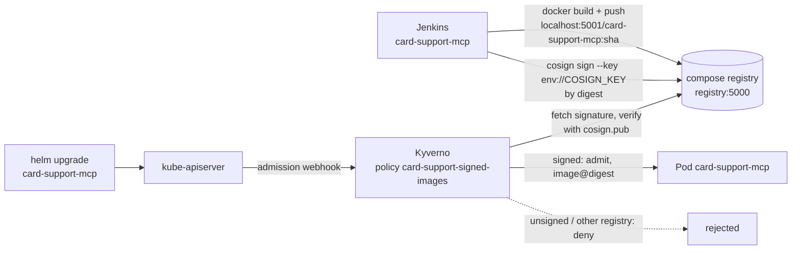
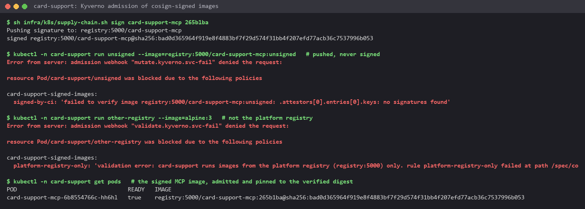

# Novel idea: only signed images run (cosign + Kyverno admission)

**Idea.** Everything else in the platform checks who calls what (API keys at the gateway, NetworkPolicies, Vault),
but not what runs: anyone who can push to the registry or edit a Deployment could run any image next to the
customers' card data, and a tag can be moved to other content after it was tested. The MCP server pipeline now signs
every image it builds with a key only CI holds ([cosign](https://github.com/sigstore/cosign)), and an admission
policy ([Kyverno](https://kyverno.io)) refuses a Pod in `card-support` unless its image comes from the platform
registry and carries a valid signature, then pins the Pod to the digest it verified. Not covered in EDAI: software
supply-chain security (image signing and signature verification at admission).

## Pieces

- **Keys**: `cosign generate-key-pair` once; the private key `infra/.secrets/cosign.key` (gitignored) is encrypted
  with `COSIGN_PASSWORD` (`infra/.env`, from `make_env.py`); Jenkins gets both as credentials (`cosign-key`,
  `cosign-password`, Docker secrets in `infra/docker-compose.yaml` and `infra/jenkins/casc.yaml`). The public half is
  [`infra/k8s/supply-chain/cosign.pub`](../infra/k8s/supply-chain/cosign.pub) and is written into the policy.
- **Signing** ([`infra/k8s/supply-chain.sh sign <repo> <tag>`](../infra/k8s/supply-chain.sh), cosign v2.6.5 in a
  container): looks up the tag's digest in the registry and signs `registry:5000/<repo>@<digest>`; the key reaches the
  container only through its environment (`--key env://COSIGN_KEY`). The signature is a separate artifact in the same
  registry. No upload to the public Rekor transparency log: the registry and its images are private.
- **CI** ([`services/card_support_mcp/Jenkinsfile`](../services/card_support_mcp/Jenkinsfile)): stage "Sign image
  (cosign)" between "Build + push image" and "Deploy"; an image the pipeline did not sign cannot be deployed.
- **Admission** ([`infra/k8s/supply-chain/signed-images.yaml`](../infra/k8s/supply-chain/signed-images.yaml)),
  Kyverno 1.19.1 (chart 3.9.1, only the admission controller: [`kyverno-values.yaml`](../infra/k8s/supply-chain/kyverno-values.yaml)):
  rule `platform-registry-only` (images of `card-support` Pods come from `registry:5000`), rule `signed-by-ci`
  (`verifyImages`: required, signature by `cosign.pub`, `mutateDigest` + `verifyDigest`, so the Pod runs exactly the
  bytes that were verified even if the tag moves later).
- **Registry name**: images are pushed to `localhost:5001` from the host but referenced as `registry:5000/...` in the
  cluster, the name both the kind node (containerd `certs.d`, `infra/k8s/up.sh`) and the Kyverno pod resolve; the
  registry speaks plain HTTP, so Kyverno runs with `registryClient.allowInsecure` (transport only; the signature
  check is unchanged).

## Proof it worked

- The MCP image `265b1ba` was signed; the Helm release now references `registry:5000/card-support-mcp`, and the Pod
  Kubernetes runs is `registry:5000/card-support-mcp:265b1ba@sha256:bad0d365...`: Kyverno verified the signature and
  replaced the tag by the digest.
- The same repository with a tag that was pushed but never signed (`card-support-mcp:unsigned`) is refused:
  `failed to verify image ... no signatures found`.
- An image from another registry (`alpine:3`) is refused by `platform-registry-only` before any signature check,
  in any container list: a signed main container with an `alpine:3` init container is refused at
  `/spec/initContainers/0/image`, and ephemeral containers (`kubectl debug`) are matched through the
  `Pod/ephemeralcontainers` subresource.
- `cosign verify --key cosign.pub` on the image confirms the signature outside the cluster.

## Limits

- `kyverno.io/v1 ClusterPolicy` is deprecated in Kyverno 1.19 in favour of `ImageValidatingPolicy` (CEL); it still
  enforces, and the migration is a rewrite of this one file.
- The policy covers `card-support` (the MCP server, our own image). The agents run kagent's published images, which
  are not ours to sign; Kyverno could verify them against the kagent project's keys the same way.
