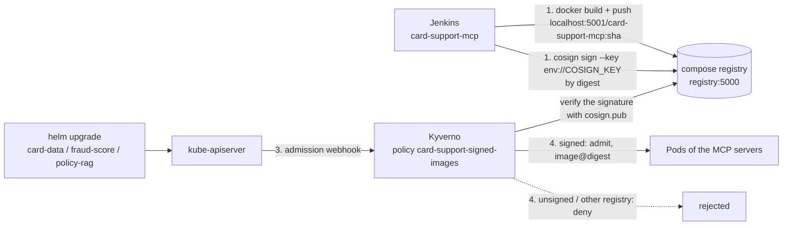
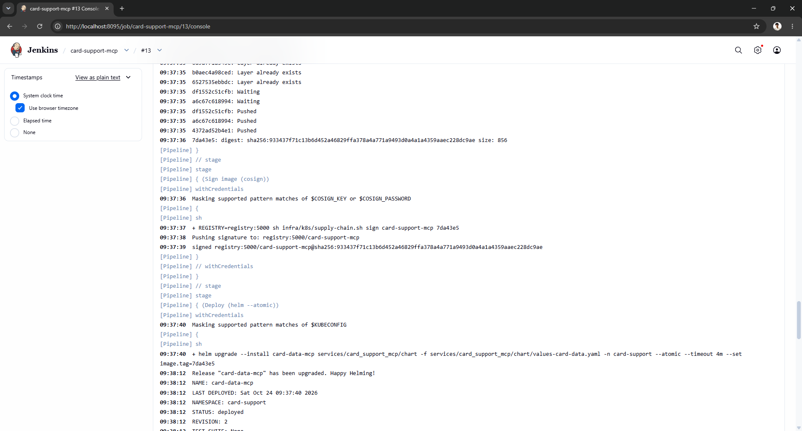
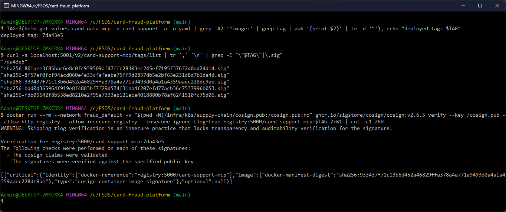
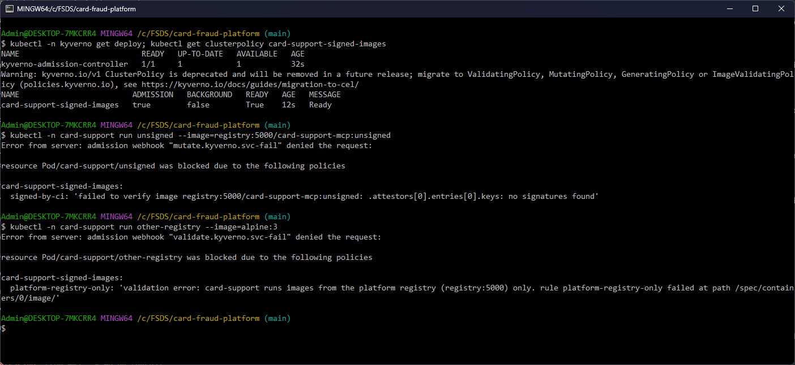
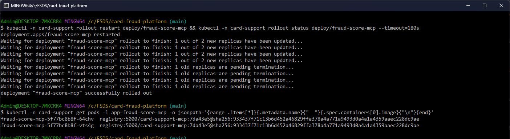

# Novel idea: only signed images run (cosign + Kyverno admission)

The rest of the platform checks who calls what (API keys at the gateway, NetworkPolicies, Vault). Nothing checked
what runs: anyone who can push to the registry or edit a Deployment could run any image next to the customers' card
data, and a tag can be moved to other content after it was tested. The MCP servers' pipeline now signs every image it
builds with a key only CI holds ([cosign](https://github.com/sigstore/cosign)), and an admission policy
([Kyverno](https://kyverno.io)) refuses a Pod in `card-support` unless its image comes from the platform registry and
carries a valid signature, then pins the Pod to the digest it verified. Not covered in EDAI: software supply-chain
security (image signing and signature verification at admission).

## Pieces

The key pair comes from `cosign generate-key-pair`, run once. The private key `infra/.secrets/cosign.key`
(gitignored) is encrypted with `COSIGN_PASSWORD` (`infra/.env`, from `make_env.py`); Jenkins gets both as credentials
(`cosign-key`, `cosign-password`, Docker secrets in `infra/docker-compose.yaml` and `infra/jenkins/casc.yaml`). The
public half is [`infra/k8s/supply-chain/cosign.pub`](../infra/k8s/supply-chain/cosign.pub) and is written into the
policy.

[`infra/k8s/supply-chain.sh sign <repo> <tag>`](../infra/k8s/supply-chain.sh) signs with cosign v2.6.5 in a
container: it looks up the tag's digest in the registry and signs `registry:5000/<repo>@<digest>`, and the key reaches
the container only through its environment (`--key env://COSIGN_KEY`). The signature is a separate artifact in the
same registry. Nothing is uploaded to the public Rekor transparency log, because the registry and its images are
private.

Admission is [`infra/k8s/supply-chain/signed-images.yaml`](../infra/k8s/supply-chain/signed-images.yaml) on Kyverno
1.19.1 (chart 3.9.1, only the admission controller: [`kyverno-values.yaml`](../infra/k8s/supply-chain/kyverno-values.yaml)).
Rule `platform-registry-only` requires the images of `card-support` Pods to come from `registry:5000`. Rule
`signed-by-ci` (`verifyImages`: required, signature by `cosign.pub`, `mutateDigest` + `verifyDigest`) makes the Pod run
exactly the bytes that were verified, even if the tag moves later.

Images are pushed to `localhost:5001` from the host but referenced as `registry:5000/...` in the cluster, the name
both the kind node (containerd `certs.d`, `infra/k8s/up.sh`) and the Kyverno pod resolve. The registry speaks plain
HTTP, so Kyverno runs with `registryClient.allowInsecure`; that setting covers the transport only, and the signature
check is unchanged.

## How it works, step by step (2026-10-24)

### 1. CI signs the image it built

In [`services/card_support_mcp/Jenkinsfile`](../services/card_support_mcp/Jenkinsfile) the stage "Sign image
(cosign)" sits between "Build + push image" and "Deploy", so an image the pipeline did not sign is never deployed.
Build #13 pushed `card-support-mcp:7da43e5` (digest `sha256:933437f7...`), signed that digest with the `cosign-key`
credential (Jenkins masks it in the log), and only then deployed the three servers with `helm --atomic`:

### 2. The signature sits next to the image and verifies with the public key

From Git Bash: the tag the servers run, the signature artifacts in the registry (one `sha256-<digest>.sig` per signed
image, `933437f7...` among them), and `cosign verify` with the public key from the repo, run in the cosign container
on the compose network:

### 3 and 4. Kyverno refuses what is not signed by CI and pins what is

`sh infra/k8s/supply-chain.sh` installs Kyverno and the policy. Then, in `card-support`, an image of the platform
registry that was pushed but never signed is refused by `signed-by-ci` ("no signatures found"), and an image from
another registry (`alpine:3`) is refused by `platform-registry-only` before any signature check:

A rollout of fraud-score with Kyverno enforcing is admitted, and the pods run the image by the digest Kyverno
verified, `registry:5000/card-support-mcp:7da43e5@sha256:933437f7...`, the same digest CI signed in step 1:

## Proof it worked

- CI signs before it deploys: build #13 signed `sha256:933437f7...` and deployed it; on 2026-10-21 build #9 stopped at
  "Sign image (cosign)" (the key credential was empty, see Limits) and never deployed
  ([cicd.md](cicd.md#mcp-servers)).
- The signature verifies outside the cluster with the repo's public key (step 2).
- Unsigned images and images of other registries do not start in `card-support`; signed ones start pinned to the
  digest CI signed (steps 3 and 4). The same holds for any container list: a signed main container with an
  `alpine:3` init container is refused at `/spec/initContainers/0/image`, and ephemeral containers (`kubectl debug`)
  are matched through the `Pod/ephemeralcontainers` subresource.
- One signature covers the three MCP servers: they are three releases of one image ([agents.md](agents.md#the-three-mcp-servers)).
- A tag is a pointer that can move. Build #16 rebuilt commit `7da43e5`, pushed it under the same tag with a new
  digest (`sha256:0b9c88d6...`) and signed that digest too. A Pod admitted before keeps running the digest Kyverno
  pinned (`933437f7...`); only a new admission verifies and pins the new one.

## Limits

- On this machine Kyverno is installed only for the demo and then removed. With it, kube-apiserver grew from about
  1.2 to 2.0 GB (Kyverno watches many resource kinds) and the 8 GB Docker VM ran out of memory with the rest of the
  platform up. `sh infra/k8s/supply-chain.sh` installs it and the policy in under a minute once the images are cached;
  `helm uninstall kyverno -n kyverno` plus deleting the `*kyverno*` webhook configurations removes it (they fail
  closed, so a leftover one would block every Pod). The CI keeps signing every image either way, and the cluster keeps
  pulling `registry:5000/...`, so turning enforcement on needs no other change. On a real cluster it stays on.
- `cosign generate-key-pair` run in its container writes the key as its own user with mode 600; mounted as a Docker
  secret, Jenkins could not read it and the credential came out empty (`invalid pem block` in the first CI run).
  The key file has to be written by the host user (it stays encrypted with `COSIGN_PASSWORD`).
- The registry is plain HTTP: `cosign verify` needs `--allow-http-registry --allow-insecure-registry`, and with no
  Rekor upload, `--insecure-ignore-tlog=true` (cosign warns about it, as in step 2).
- `kyverno.io/v1 ClusterPolicy` is deprecated in Kyverno 1.19 in favour of `ImageValidatingPolicy` (CEL); it still
  enforces, and the migration is a rewrite of this one file.
- The policy covers `card-support` (the MCP servers, our own image). The agents run kagent's published images, which
  are not ours to sign; Kyverno could verify them against the kagent project's keys the same way.
