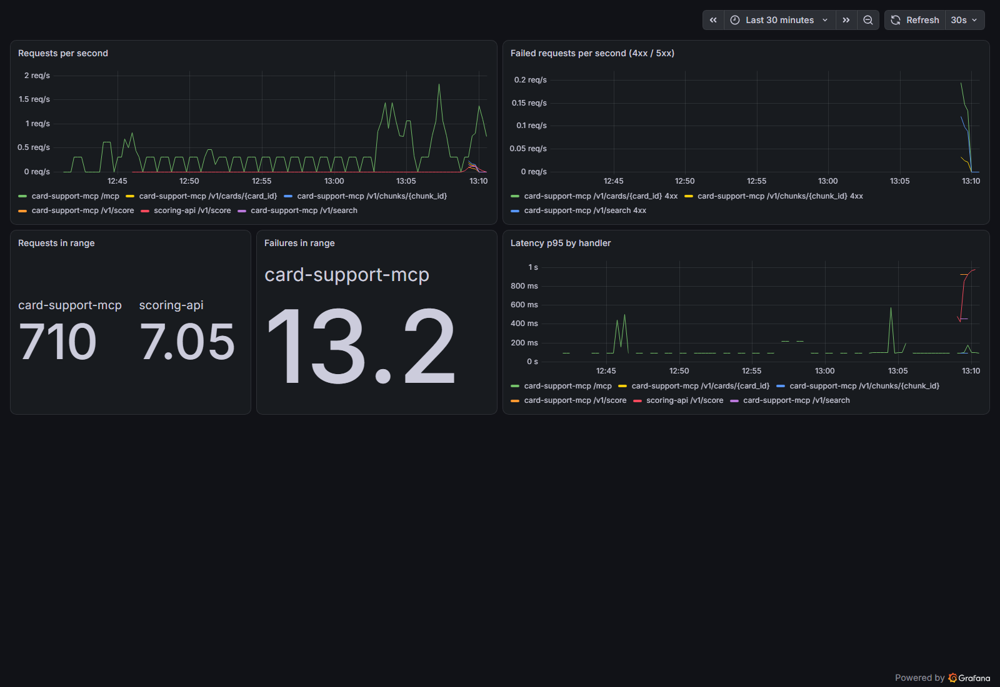
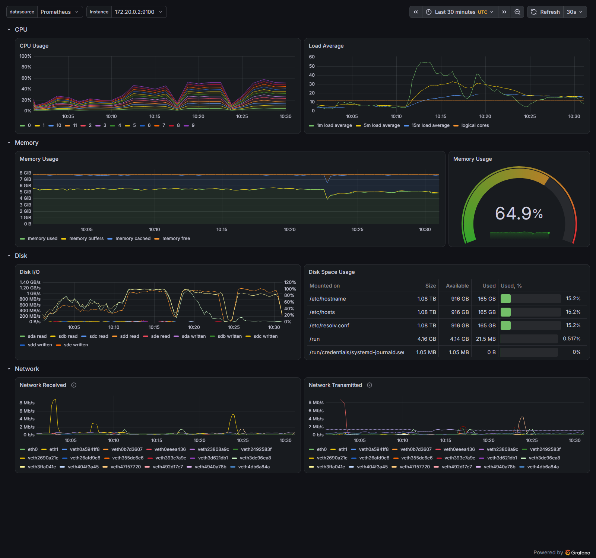
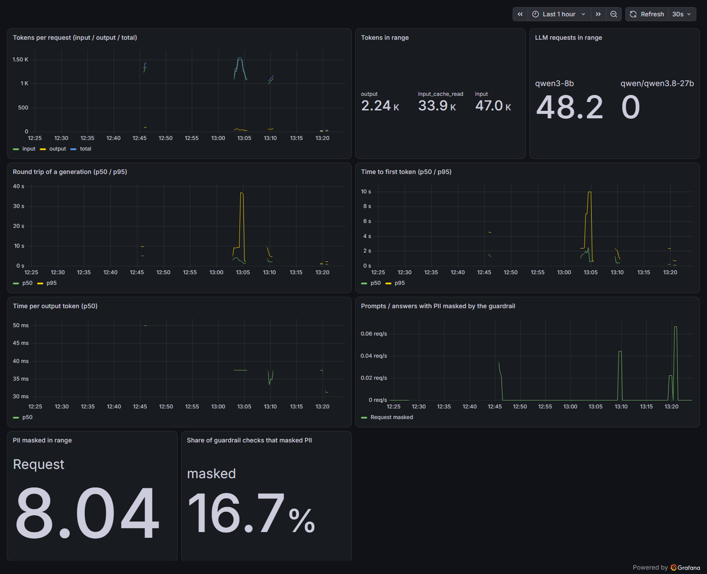
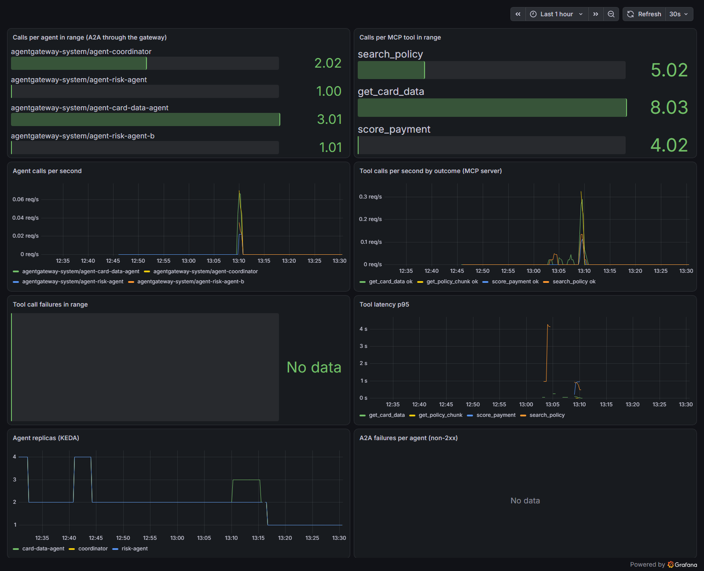
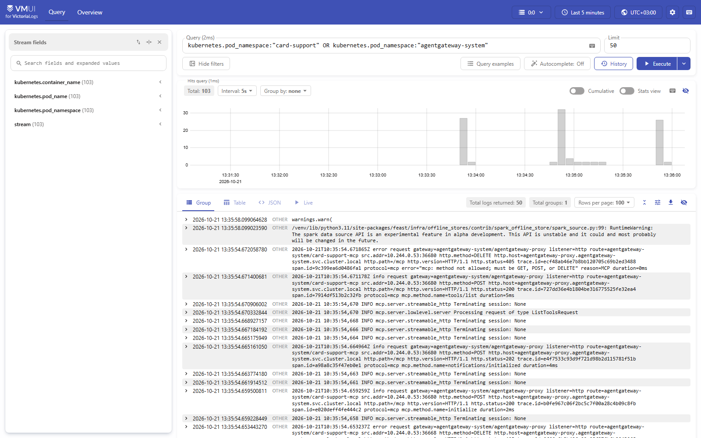
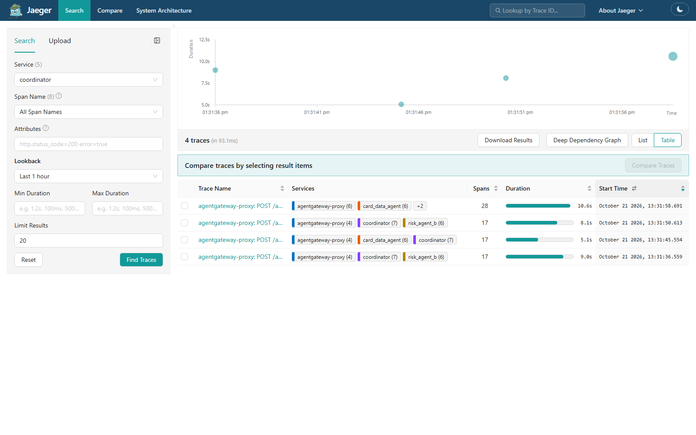
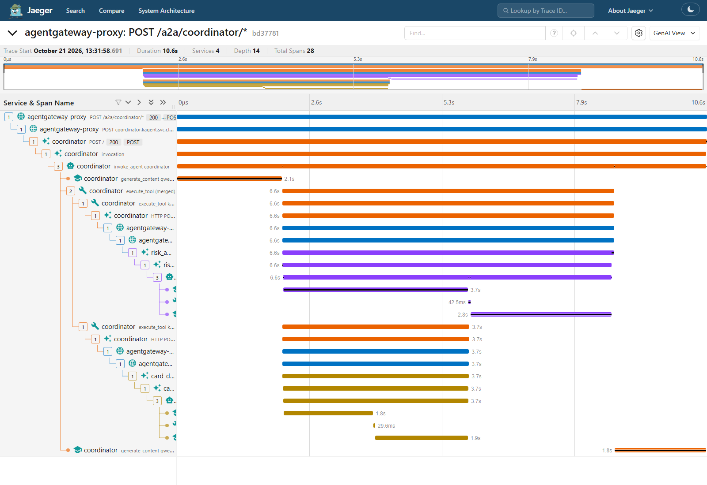

# Observability: metrics, logs and traces

One stack watches the Layer 3 platform, installed by [`infra/k8s/observability.sh`](../infra/k8s/observability.sh)
into the `monitoring` namespace and published by NGINX at `https://grafana|logs|traces.<domain>`
([edge_security.md](edge_security.md)). This page covers rubric A46 to A51.

| Signal | Tool | Where it comes from |
|---|---|---|
| Metrics | Prometheus + Grafana (kube-prometheus-stack 91.9.0) | node-exporter and kube-state-metrics (compute), the `/metrics` of the three MCP servers (one ServiceMonitor per release, [`servicemonitor.yaml`](../services/card_support_mcp/chart/templates/servicemonitor.yaml)), agentgateway's proxy (PodMonitor in [`monitors.yaml`](../infra/k8s/monitors.yaml)), the Layer 2 Scoring API (ScrapeConfig; both in [`monitors.yaml` L5-L26](https://github.com/cvinhnguyen/card-fraud-platform/blob/35d4295a1e5a409fa242bc6aa9eff9b06038c111/infra/k8s/monitors.yaml#L5-L26)) |
| Logs | VictoriaLogs v1.53 + its Vector agent | every pod's stdout, shipped by the Vector DaemonSet, kept 3 days ([`observability.sh` L26-L30](https://github.com/cvinhnguyen/card-fraud-platform/blob/35d4295a1e5a409fa242bc6aa9eff9b06038c111/infra/k8s/observability.sh#L26-L30)) |
| Traces | Jaeger 2.21 (OTLP) | agentgateway's tracing policy ([`tracing.yaml`](../infra/k8s/tracing.yaml)) for every LLM, MCP and A2A request, plus the spans the kagent agents export themselves ([`llm-platform.sh` L50](https://github.com/cvinhnguyen/card-fraud-platform/blob/35d4295a1e5a409fa242bc6aa9eff9b06038c111/infra/k8s/llm-platform.sh#L50)); joined by the W3C `traceparent` header |

The four dashboards are code: [`infra/k8s/dashboards/*.json`](../infra/k8s/dashboards), loaded into ConfigMaps
labelled `grafana_dashboard=1`, which Grafana's sidecar picks up
([`infra/k8s/observability.sh` L20-L25](https://github.com/cvinhnguyen/card-fraud-platform/blob/35d4295a1e5a409fa242bc6aa9eff9b06038c111/infra/k8s/observability.sh#L20-L25)). The fourth one, A/B tests, is described in
[ab_testing.md](ab_testing.md).

## Web API metrics

Dashboard "Card Support - Web API" ([`card-support-api.json`](../infra/k8s/dashboards/card-support-api.json)), from
`http_requests_total` and `http_request_duration_seconds` of the three MCP servers (prometheus-fastapi-instrumentator,
[`services/card_support_mcp/app/main.py` L137](../services/card_support_mcp/app/main.py#L137); jobs `card-data-mcp`,
`fraud-score-mcp`, `policy-rag-mcp`) and of the Scoring API: requests per second per handler, failed requests per
second (4xx and 5xx), requests and failures in the time range, p95 latency per handler. The screenshot was taken before
the split into three servers, when all handlers ran under one job, `card-support-mcp`; the dashboard's job filter
matches the three new jobs. It was not retaken: with Grafana started on top of the rest of the platform, the 8 GB
Docker VM ran out of memory and started killing pods on failed liveness probes (2026-10-24).



The last half hour: 710 requests to the MCP server (agents' MCP calls on `/mcp` and REST calls through NGINX), 7 to
the Scoring API, and 13 failures, the 404s and 422s a test script sent on purpose (unknown card and chunk ids, a
question that is too short).

## Compute metrics

Grafana's "Node Exporter / Nodes" dashboard (from kube-prometheus-stack) shows CPU, load, memory, disk I/O, disk space
and network of the kind node, which is the whole Docker VM; "Kubernetes / Compute Resources / Namespace (Pods)" breaks
CPU and memory down per pod.



The load spike and the disk reads around 10:12 are the VM running out of page cache while Prometheus, Grafana and
the agents ran together; this machine's limits are in the README.

## LLM telemetry

Dashboard "Card Support - LLM telemetry" ([`llm-telemetry.json`](../infra/k8s/dashboards/llm-telemetry.json)). Every
number comes from agentgateway, which sees every LLM call of every agent, so no agent needs code for it:

| Rubric metric | Metric | Panel |
|---|---|---|
| tokens per request: input, output, total | `agentgateway_gen_ai_client_token_usage` (sum / count, by token type) | Tokens per request; Tokens in range (input, output and input read from llama.cpp's prompt cache) |
| total round trip of a generation | `agentgateway_gen_ai_server_request_duration` | p50 / p95 |
| time to first token | `agentgateway_gen_ai_server_time_to_first_token` | p50 / p95 |
| (extra) time per output token | `agentgateway_gen_ai_server_time_per_output_token` | p50 |
| how often the PII guardrail caught a prompt | `agentgateway_guardrail_checks_total{action="Mask"}`, by phase (request / response) | masked per second, masked in range, share of checks that masked |



In the hour shown: 48 LLM requests to Qwen3-8B and none to the A/B side B, 47.0k input tokens (33.9k of them served
from llama.cpp's prompt cache) and 2.24k output tokens; 8 requests had personal data masked, 16.7% of the guardrail
checks. Totals over a range come from Prometheus `increase()`, which extrapolates, hence the decimals.

## Agent telemetry

Dashboard "Card Support - Agent telemetry" ([`agent-telemetry.json`](../infra/k8s/dashboards/agent-telemetry.json)):

| Rubric metric | Metric |
|---|---|
| calls per agent | `agentgateway_requests_total` on the agents' A2A backends (every agent call passes the gateway) |
| calls per MCP tool | `agentgateway_mcp_requests_total` by tool name, at the gateway |
| failures per tool call | `card_support_tool_calls_total{outcome="error"}`, counted per tool by the MCP server that serves it, plus non-2xx A2A responses per agent |
| (extra) | tool calls per second by outcome, tool latency p95 (`card_support_tool_seconds`), agent replicas set by KEDA |

Each MCP server counts and times every tool call in one wrapper that all its tools go through, the same code in
the three servers ([`services/card_support_mcp/app/main.py` L71-L93](../services/card_support_mcp/app/main.py#L71-L93)):

```python
    calls = Counter("card_support_tool_calls_total", "Tool calls by tool and outcome", ["tool", "outcome"],
                    registry=registry)
    latency = Histogram("card_support_tool_seconds", "Tool latency", ["tool"], registry=registry,
                        buckets=(0.01, 0.025, 0.05, 0.1, 0.25, 0.5, 1, 2.5, 5))
...
    async def run(tool: str, call):
        """Run one tool call, counting it by outcome and timing it (agent telemetry)."""
        start = time.perf_counter()
        try:
            result = await call
        except Exception as e:
            calls.labels(tool, "error").inc()
            log.exception("tool %s failed", tool)
            # what the agent reads: some errors (httpx.ReadTimeout) have an empty message
            raise RuntimeError(f"{tool} unavailable: {type(e).__name__}") from e
        finally:
            latency.labels(tool).observe(time.perf_counter() - start)
        calls.labels(tool, "ok").inc()
        return result
```



In the hour shown the gateway counted about 2 calls to the coordinator, 3 to the card data agent, 1 to the risk agent
and 1 to its B variant; the MCP tools ran 8 `get_card_data`, 5 `search_policy` and 4 `score_payment` calls, and none
failed ("No data" in the failure panels means no failed call in the range). The replica panel shows KEDA scaling the
agents between 2 and 4; the drop to 1 at 13:16 comes from a manual pause of KEDA
(`autoscaling.keda.sh/paused-replicas`) to free memory on this machine.

## Logs

VictoriaLogs keeps every pod's log lines with their Kubernetes labels, queried with LogsQL in its UI (`/select/vmui`).
The query below shows the MCP server and the gateway: the gateway's request log lines carry the route, the MCP
method, the status and a `trace.id`, the key into Jaeger.



## Traces

The gateway's spans come from one policy on the whole Gateway
([`infra/k8s/tracing.yaml` L43-L56](https://github.com/cvinhnguyen/card-fraud-platform/blob/35d4295a1e5a409fa242bc6aa9eff9b06038c111/infra/k8s/tracing.yaml#L43-L56)):

```yaml
# Gateway-wide (all routes): sample every request, a demo-sized load
apiVersion: agentgateway.dev/v1alpha1
kind: AgentgatewayPolicy
metadata:
  name: tracing
  namespace: agentgateway-system
spec:
  targetRefs: [{group: gateway.networking.k8s.io, kind: Gateway, name: agentgateway-proxy}]
  frontend:
    tracing:
      url: http://jaeger.monitoring.svc.cluster.local:4318
      protocol: HTTP
      path: /v1/traces
      randomSampling: "true"
```

A support question becomes one trace across the gateway, the coordinator and the agents it asks:





This conversation took 10.6 s: the coordinator's first LLM call (2.1 s) decides to ask both agents, the risk agent
(6.6 s) and the card data agent (3.7 s) run in parallel through the gateway, each with its own LLM calls and MCP tool
call, and the coordinator's last LLM call (1.8 s) writes the answer.

## Gotchas

- When VictoriaLogs restarts, the Vector agent backs off and sends nothing until it is restarted itself
  (`kubectl -n monitoring rollout restart ds/victoria-logs-vector`).
- Jaeger 2's API is `/api/v3/...` (`/api/services` is 404) and it keeps traces in memory (20,000 at most): a restart
  empties it.
- Grafana needs 640Mi here: at 384Mi its search API timed out and the liveness probe killed it
  ([`infra/k8s/observability-values.yaml` L15-L17](https://github.com/cvinhnguyen/card-fraud-platform/blob/35d4295a1e5a409fa242bc6aa9eff9b06038c111/infra/k8s/observability-values.yaml#L15-L17)).
