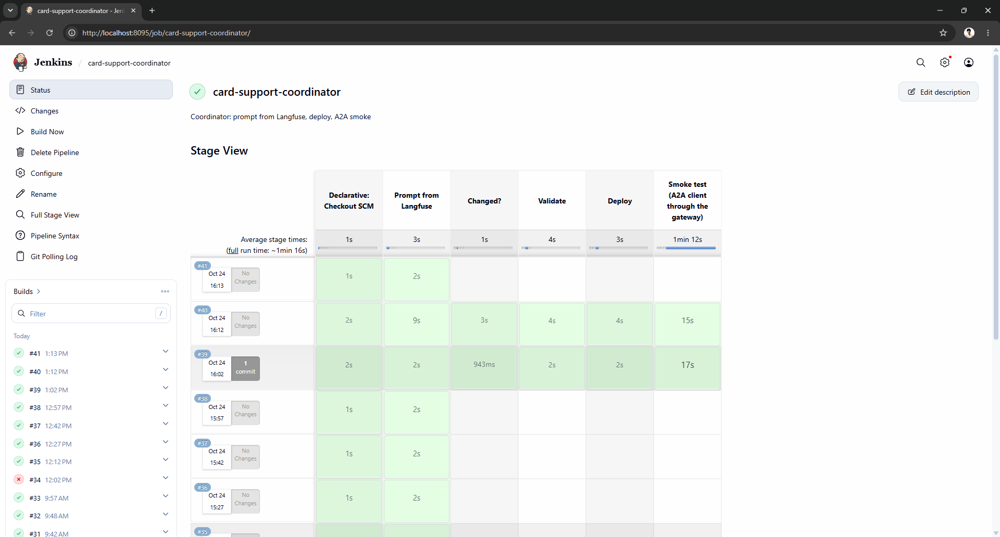

# CI/CD with Jenkins

Jenkins (CI/CD: continuous integration and delivery) ships every change to a service, model, agent prompt or data
pipeline tested and the same way every time. It runs 11 pipelines, one Jenkinsfile per deployable unit, next to the
code it ships. Each ends with a check against the running platform, and a failed check puts back the version that ran
before, so a green build means the new version answers.

- Layer 1: the batch pipelines (Airflow DAGs, Spark jobs, dbt), the Flink jobs, the two push jobs that feed the
  feature store
- Layer 2: the training pipeline, the model server (KServe), the Scoring API, the Drift API
- Layer 3: the RAG (retrieval-augmented generation) data pipeline, the three MCP (Model Context Protocol) tool
  servers, the two data agents, the coordinator

| | |
|---|---|
| Code | [`infra/jenkins/`](https://github.com/cvinhnguyen/card-fraud-platform/tree/54d21eddbf6e602ae13fed46a1a9e0ef265d23cd/infra/jenkins), the Jenkinsfiles in [Pipelines](#pipelines) |
| Runs on | compose service `jenkins` (profile `cicd`, UI on `127.0.0.1:8095`); deploys into kind namespaces `card-support`, `kagent`, `agentgateway-system` and `serving`, and to compose, Airflow, Kubeflow and Flink |
| Reads | GitHub `main` (polled every 5 minutes), production prompts in Langfuse, the model aliases in MLflow |
| Writes | our images in GHCR (`ghcr.io/cvinhnguyen`) with their cosign signatures, Helm releases in `card-support` and `kagent`, the InferenceServices in `serving`, the compose services `scoring-api`, `drift-api`, `push-online` and `push-offline`, the Airflow Variables `batch_release`, `train_release` and `rag_image`, the Kubeflow pipeline versions, the live Flink jobs |
| Related | [airflow.md](../data-platform/airflow.md#releases-cicd), [flink_jobs.md](../data-platform/flink_jobs.md#releases-cicd), [ml_training.md](../ml-platform/ml_training.md#releases-cicd), [serving.md](../ml-platform/serving.md#model-release-pipeline), [rag_pipeline.md](../llm-platform/rag_pipeline.md), [agents.md](../llm-platform/agents.md), [novel_eval_gate.md](../llm-platform/novel_eval_gate.md), [novel_supply_chain.md](novel_supply_chain.md), [testing.md](testing.md) |

## Where it fits

- The CI/CD row of the overview and the C flow of the Layer 3 picture
  ([architecture.md](../architecture.md#system-diagram-layer-3)).
- Fed by GitHub, and every 15 minutes by the production prompts in Langfuse and the model aliases in MLflow.
- Deploys to kind (tool servers, agents, model server), compose (the two APIs, the push jobs), Airflow (batch and RAG
  pipelines), Kubeflow (training pipeline) and Flink (the always-on jobs).
- Its tests, signatures and eval gate: [testing.md](testing.md), [novel_supply_chain.md](novel_supply_chain.md),
  [novel_eval_gate.md](../llm-platform/novel_eval_gate.md).

## How it works

1. Each pipeline watches its own paths; the model server and agent pipelines also start on a moved MLflow alias or a
   new production prompt ([Jenkins setup](#jenkins-setup)).
2. Before a deploy: unit tests, then the image, tagged with its version and pushed to GHCR. The two APIs and the tool
   servers also pass a 90% coverage gate and a mutation test ([Pipelines](#pipelines)).
3. The deploy uses each unit's own tool: `helm upgrade --atomic`, `kubectl apply`, a recreated compose container, a
   release folder, an Airflow Variable or a savepoint restart ([Pipelines](#pipelines)).
4. A check against the running platform follows (a smoke test, for agents over A2A, the agent-to-agent protocol;
   the eval gate; a DP2 silver run; a Flink checkpoint). If it fails, or the build is aborted after the deploy, the
   failure handler puts back the previous version.
5. Tool servers, data agents and coordinator chain, each starting the next on success; a new challenger model waits
   for a person to approve its A/B test ([Agents](#agents)).
6. Secrets come from `infra/.env` as Docker secrets and become Jenkins credentials, masked in the logs
   ([Credentials](#credentials)).

## Run it

Start the kind cluster first (`infra/k8s/up.sh`), then:

```bash
sh infra/jenkins/setup.sh     # deploy ServiceAccount + its kubeconfig, then the Jenkins container (profile cicd)
```

Before the first push, once:

1. Put `GHCR_USER` (the GitHub user) and two classic personal access tokens in `infra/.env`: `GHCR_TOKEN` with
   `write:packages`, used only by Jenkins to push (credential `ghcr`), and `GHCR_PULL_TOKEN` with only `read:packages`,
   the model server's pull Secret (credential `ghcr-pull`). The token that can push never sits in the cluster.
2. After the first push of `card-support-mcp`, `fraud-scoring-api`, `fraud-drift-api` and `fraud-ml-train`, set each
   package to Public (GitHub profile, Packages, Package settings) and link it to the repository, so the kind node,
   compose and Kyverno pull without a login. They hold only code that is public anyway.
3. Keep `fraud-predictor` Private (new packages start Private; check Package settings): its images hold the model and
   its `reference_profile.json`, the distribution of every feature. The pods in `serving` pull it with the Secret
   `ghcr-pull`, which the predictor pipeline updates from the `ghcr-pull` credential before each deploy
   ([serving.md](../ml-platform/serving.md#run-it)).

## Pipelines

| Jenkins job | Jenkinsfile | Runs when | Rubric |
|---|---|---|---|
| `rag-pipeline` | [`pipelines/rag/Jenkinsfile`](https://github.com/cvinhnguyen/card-fraud-platform/blob/54d21eddbf6e602ae13fed46a1a9e0ef265d23cd/pipelines/rag/Jenkinsfile) | RAG steps, DAG, documents or ml image changed | C33 |
| `card-support-mcp` | [`services/card_support_mcp/Jenkinsfile`](https://github.com/cvinhnguyen/card-fraud-platform/blob/54d21eddbf6e602ae13fed46a1a9e0ef265d23cd/services/card_support_mcp/Jenkinsfile) | `services/card_support_mcp/**` changed | B34 |
| `card-support-data-agents` | [`agents/Jenkinsfile.data-agents`](https://github.com/cvinhnguyen/card-fraud-platform/blob/54d21eddbf6e602ae13fed46a1a9e0ef265d23cd/agents/Jenkinsfile.data-agents) | `agents/**` changed, after the MCP pipeline, or a new production prompt in Langfuse | C34 |
| `card-support-coordinator` | [`agents/Jenkinsfile.coordinator`](https://github.com/cvinhnguyen/card-fraud-platform/blob/54d21eddbf6e602ae13fed46a1a9e0ef265d23cd/agents/Jenkinsfile.coordinator) | `agents/**` changed, after the data agents, or a new production prompt | C35 |
| `stream-feature-jobs` | [`ml/jobs/Jenkinsfile.stream`](https://github.com/cvinhnguyen/card-fraud-platform/blob/54d21eddbf6e602ae13fed46a1a9e0ef265d23cd/ml/jobs/Jenkinsfile.stream) | push jobs, ML library, Feast repo or ml image changed | B36 |
| `fraud-predictor` | `services/predictor/Jenkinsfile` | an MLflow alias (`production`, `challenger`) moved (checked every 15 min), `services/predictor/**` or the KServe manifests changed | |
| `fraud-scoring-api` | `services/scoring_api/Jenkinsfile` | `services/scoring_api/**` changed | |
| `fraud-drift-api` | `services/drift_api/Jenkinsfile` | `services/drift_api/**` changed | |
| `batch-pipelines` | `pipelines/airflow/Jenkinsfile` | the Airflow DAGs, the Spark jobs, dbt or the ml code they run changed | |
| `training-pipeline` | `ml/pipelines/Jenkinsfile` | the training pipeline, the ML library, the Feast repo or the ml image changed | |
| `flink-jobs` | `pipelines/flink/Jenkinsfile` | `pipelines/flink/**` changed | |

What each pipeline checks, ships and deploys, and what its failure handler does:

| Jenkins job | Before deploy | Ships and deploys | After deploy | A bad release |
|---|---|---|---|---|
| `rag-pipeline` | unit tests, DAG check | `ghcr.io/cvinhnguyen/fraud-ml-train:<commit>`, released to Airflow (Variable `rag_image`), then the DAG `rag_ingest` runs | reads the run's validation results | `rag_image` goes back to the image released before. The DAG's checks run after its write step, so bad chunks stay in the store until the next run, on the old image, writes them again |
| `card-support-mcp` | unit tests with a 90% coverage gate, mutation test, cosign signature | image of the three MCP servers; one `helm upgrade --atomic` per server (one Helm release each) in `card-support` | smoke test of each server | `--atomic` rolls back a server that never gets Ready, and the pipeline stops before the next one. After a later failure (rollout wait, smoke test), `helm rollback` runs on every server already upgraded, tries all of them even when one fails, and names the failed ones |
| `card-support-data-agents` | prompts from Langfuse, chart validation with `helm upgrade --dry-run=server` | card-data-agent and risk-agent: `helm upgrade --atomic` of one Helm release in `kagent`, then `agents/wait_ready.sh` waits until each Agent is Ready on its current generation | A2A smoke test through the gateway, then the eval gate (Langfuse experiment) | `--atomic` rolls back a release that does not get Ready; a failed readiness wait, smoke test or eval gate leads to `helm rollback` ([novel_eval_gate.md](../llm-platform/novel_eval_gate.md)) |
| `card-support-coordinator` | as the data agents | coordinator, Helm release in `kagent`, then `agents/wait_ready.sh` | A2A smoke test through the gateway | as the data agents, without the eval gate |
| `stream-feature-jobs` | unit tests | `ghcr.io/cvinhnguyen/fraud-ml-train:<commit>`; recreates the compose services `push-online` and `push-offline` (Kafka to Redis and Delta) | one marked message must reach Redis and Delta | both containers go back to their previous image; their last log lines are printed |
| `fraud-predictor` | the MLflow aliases compared with what runs (a missing alias, HTTP 404 on older MLflow and HTTP 400 on MLflow 3.16, counts as no alias), the model fetched from MLflow, a pytest release check in the image (loads, scores, right version), cosign signature | `ghcr.io/cvinhnguyen/fraud-predictor:v<model version>-<commit>`; `kubectl apply` of the InferenceServices `card-fraud` and `card-fraud-challenger` with the annotation `fraud.platform/model-version`; the A/B split after a person approves | rollout and Ready wait, then a predict call must answer with the released version. A new production model becomes the Drift API's reference. The A/B steps change the split only on a running `scoring-api` | each InferenceService gets back the image and version it ran before, read from the live object before the deploy ([serving.md](../ml-platform/serving.md#model-release-pipeline)) |
| `fraud-scoring-api` | unit tests with a 90% coverage gate, mutation test | `ghcr.io/cvinhnguyen/fraud-scoring-api:<commit>`; recreates the compose service `scoring-api`, keeping its `AB_PERCENT` | `/readyz`, then one `POST /v1/score` must be scored by the model | the container goes back to its previous image |
| `fraud-drift-api` | as the Scoring API | `ghcr.io/cvinhnguyen/fraud-drift-api:<commit>`; recreates `drift-api` with the host path of its reference profile read from the running container | `/readyz`, then `/v1/drift` must report a model version | the container goes back to its previous image |
| `batch-pipelines` | lint, unit tests, every DAG imports in the Airflow image, `dbt parse` | a release of that commit's DAGs, Spark jobs and dbt, copied to `/opt/release/<commit>`; the link `/opt/release/current` moves to them, so Airflow and Spark switch together | the scheduler must parse the release, then a check-only DP2 silver run must pass its checks (it skips its publish, so it starts no gold run on old data) | the link moves back, the silver tables are restored to their Delta versions from before the check run, and the failed check run is deleted (the DAGs use `depends_on_past`) |
| `training-pipeline` | unit tests (registry, training, the compiled pipeline's image pin) | `ghcr.io/cvinhnguyen/fraud-ml-train:<commit>` and the Kubeflow pipeline version `<commit>` pinned to it; then the Airflow Variable `train_release`, which the drift pipeline starts | every step of the uploaded version must run that image | the Variable moves last, so a failed build leaves the drift pipeline on the release it had |
| `flink-jobs` | lint, every job imports in the Flink image | the always-on Flink jobs (`rt_features`, `device_seen`, `raw_landing`), each stopped with a savepoint and submitted again from it on the commit's files; the jobs run by hand only get the lint and import checks | the new job must restore the savepoint and complete a checkpoint within 3 minutes | the new job is cancelled and the previous code is submitted from the same savepoint, so no state is lost |

### What is live

| Unit | Where the version is |
|---|---|
| images | the tag is the commit (`v<model version>-<commit>` for the model server), and the label `org.opencontainers.image.revision` |
| InferenceServices | the annotation `fraud.platform/model-version` |
| Agents | the annotation `card-support/prompt`, with the Langfuse prompt and its version |
| batch pipelines | the Airflow Variable `batch_release` and the tag `release:<commit>` on every DAG |
| training pipeline | the Airflow Variable `train_release` |
| RAG pipeline | the Airflow Variable `rag_image` |
| Flink jobs | the commit is in the job's name |

A green release of `scoring-api`, `drift-api` or the push jobs also tags its image as the compose default
`fraud/<name>:latest` (`fraud/scoring-api:latest`, `fraud/drift-api:latest`, `fraud/ml-train:latest`), so a
`docker compose up` by hand keeps the release; `docker ps` then shows `:latest`. To see what is live:

```bash
docker inspect scoring-api drift-api push-online push-offline --format '{{.Name}} {{.Config.Image}} {{index .Config.Labels "org.opencontainers.image.revision"}}'
kubectl -n serving get isvc -o custom-columns='NAME:.metadata.name,MODEL:.metadata.annotations.fraud\.platform/model-version,IMAGE:.spec.predictor.containers[0].image'
helm list -n card-support    # the MCP servers: the chart's image.tag is the commit
kubectl -n kagent get agents -o custom-columns='NAME:.metadata.name,PROMPT:.metadata.annotations.card-support/prompt'
docker exec flink-jobmanager flink list    # the live Flink jobs: <job> <commit>
```

## Jenkins setup

Jenkins 2.580.1 runs in compose (profile `cicd`, UI on `127.0.0.1:8095`, login required;
[`infra/docker-compose.yaml`
L786-L807](https://github.com/cvinhnguyen/card-fraud-platform/blob/54d21eddbf6e602ae13fed46a1a9e0ef265d23cd/infra/docker-compose.yaml#L786-L807)).
Its image
([`infra/jenkins/Dockerfile`](https://github.com/cvinhnguyen/card-fraud-platform/blob/54d21eddbf6e602ae13fed46a1a9e0ef265d23cd/infra/jenkins/Dockerfile))
adds the Docker CLI with buildx and compose, kubectl v1.37.0, Helm v3.22.1, jq and the plugins in
[`infra/jenkins/plugins.txt`](https://github.com/cvinhnguyen/card-fraud-platform/blob/54d21eddbf6e602ae13fed46a1a9e0ef265d23cd/infra/jenkins/plugins.txt).
[`infra/jenkins/casc.yaml`](https://github.com/cvinhnguyen/card-fraud-platform/blob/54d21eddbf6e602ae13fed46a1a9e0ef265d23cd/infra/jenkins/casc.yaml)
(Jenkins Configuration as Code, JCasC) creates the admin user, the credentials and the jobs. The jobs poll because no
webhook reaches this machine; one executor runs one pipeline at a time, since two image builds do not fit in RAM.

Every Jenkinsfile wraps its stages in a `when { changeset ... }` on its own paths (the RAG pipeline's:
[`pipelines/rag/Jenkinsfile`
L23-L30](https://github.com/cvinhnguyen/card-fraud-platform/blob/54d21eddbf6e602ae13fed46a1a9e0ef265d23cd/pipelines/rag/Jenkinsfile#L23-L30));
polls with nothing to build show only "Checkout SCM" in the stage views.

### Credentials

Secrets start in the gitignored `infra/.env` (or `infra/.secrets/` for files), reach the container as Docker secrets
under `/run/secrets/`, and JCasC turns each into a Jenkins credential
([`infra/jenkins/casc.yaml`
L13-L30](https://github.com/cvinhnguyen/card-fraud-platform/blob/54d21eddbf6e602ae13fed46a1a9e0ef265d23cd/infra/jenkins/casc.yaml#L13-L30)).
A Jenkinsfile names the credential id in `withCredentials`; Jenkins masks the value in the log. API keys reach curl
on stdin (`curl -K -`) and containers through the environment (`docker run -e NAME`), never the process list.

| Credential id | Used by |
|---|---|
| `kubeconfig` | every deploy (ServiceAccount `ci/jenkins-deployer`) |
| `langfuse-public-key`, `langfuse-secret-key` | agent pipelines: system prompts and the eval experiment |
| `a2a-key-coordinator`, `a2a-key-support-app` | A2A smoke tests through agentgateway |
| `edge-admin-password` | MCP smoke test of the Web API over HTTPS through NGINX |
| `cosign-key`, `cosign-password` | signing our images (MCP servers, model server) |
| `ghcr` | username/password: GitHub user and a classic PAT with `write:packages`, for `docker login ghcr.io` before a push |
| `ghcr-pull` | username/password: GitHub user and a classic PAT with only `read:packages`; the predictor pipeline turns it into the pull Secret `ghcr-pull` in `serving` |
| `ml-db-password`, `redis-password`, `s3-access-key`, `s3-secret-key` | stream jobs deploy and smoke test; `ml-db-password` and `redis-password` also recreate `scoring-api` and `drift-api` |
| `airflow-admin` | RAG pipeline: release and run through the Airflow REST API |

Manage Jenkins, Credentials, global domain hides the values (`admin/******` and `cvinhnguyen/******` for the
username/password credentials):


### Access to the cluster and Docker

Jenkins deploys with its own ServiceAccount
([`infra/jenkins/rbac.yaml`](https://github.com/cvinhnguyen/card-fraud-platform/blob/54d21eddbf6e602ae13fed46a1a9e0ef265d23cd/infra/jenkins/rbac.yaml)),
whose kubeconfig
[`infra/jenkins/setup.sh`](https://github.com/cvinhnguyen/card-fraud-platform/blob/54d21eddbf6e602ae13fed46a1a9e0ef265d23cd/infra/jenkins/setup.sh)
writes to `infra/.secrets/jenkins-kubeconfig`. Its role is bound only in `card-support`, `kagent` and
`agentgateway-system`, where the MCP and agents charts write; in `serving` a narrower Role allows InferenceServices,
Broker and Trigger, and of the Secrets only `ghcr-pull`. So `kubectl` and `helm` cannot touch Vault, the monitoring
stack or kube-system. Secrets are allowed because Helm keeps its release records there. The role does not limit what a
Jenkinsfile can run ([Limits](#limits)).

Jenkins keeps the host's Docker socket to build images. Airflow only runs the RAG image, so it reaches Docker through
`docker-proxy` on an internal network
([`infra/docker-compose.yaml`
L471-L489](https://github.com/cvinhnguyen/card-fraud-platform/blob/54d21eddbf6e602ae13fed46a1a9e0ef265d23cd/infra/docker-compose.yaml#L471-L489)),
which allows the container and image API calls and denies exec, build, volumes and the rest. The DAG accepts as
`rag_image` only a release in GHCR (`ghcr.io/cvinhnguyen/fraud-ml-train:<commit>`) or the local build `fraud/ml-train`
([`pipelines/airflow/dags/rag_ingest.py`
L41-L46](https://github.com/cvinhnguyen/card-fraud-platform/blob/54d21eddbf6e602ae13fed46a1a9e0ef265d23cd/pipelines/airflow/dags/rag_ingest.py#L41-L46)).

## RAG data pipeline

[`pipelines/rag/Jenkinsfile`](https://github.com/cvinhnguyen/card-fraud-platform/blob/54d21eddbf6e602ae13fed46a1a9e0ef265d23cd/pipelines/rag/Jenkinsfile)
tests the steps of the DAG `rag_ingest` (chunk the bank documents, embed, write to the Feast knowledge base,
validate). Each step runs as a container of the image in the Variable `rag_image`, so a release is one Variable update
([rag_pipeline.md](../llm-platform/rag_pipeline.md)).

| Stage | What it does |
|---|---|
| Unit tests | builds the `test` stage of [`ml/Dockerfile`](https://github.com/cvinhnguyen/card-fraud-platform/blob/54d21eddbf6e602ae13fed46a1a9e0ef265d23cd/ml/Dockerfile) and runs [`ml/jobs/tests/test_rag_ingest.py`](https://github.com/cvinhnguyen/card-fraud-platform/blob/54d21eddbf6e602ae13fed46a1a9e0ef265d23cd/ml/jobs/tests/test_rag_ingest.py) |
| DAG check | imports [`pipelines/airflow/dags/rag_ingest.py`](https://github.com/cvinhnguyen/card-fraud-platform/blob/54d21eddbf6e602ae13fed46a1a9e0ef265d23cd/pipelines/airflow/dags/rag_ingest.py) in the Airflow image and asserts its 5 tasks |
| Build + push image | `ghcr.io/cvinhnguyen/fraud-ml-train:<commit>` |
| Release + run | Airflow REST API: sets Variable `rag_image` to the new tag, unpauses the DAG, triggers a run, waits for `success` or `failed` ([`pipelines/rag/Jenkinsfile` L66-L93](https://github.com/cvinhnguyen/card-fraud-platform/blob/54d21eddbf6e602ae13fed46a1a9e0ef265d23cd/pipelines/rag/Jenkinsfile#L66-L93)) |
| Validation results | prints the checks the `validate_rag.run_checks` task logged |

Build #2, started by hand because the pipeline needs the Airflow profile up: 6 unit tests passed, the DAG imported
with its 5 tasks, `rag_image = fraud/ml-train:8f40d6a` was released, and run `ci-8f40d6a-1792528682` succeeded
(`chunk_documents` 4 s, `embed_chunks` 6 s, `write_feature_store` 10 s, `validate_rag.run_checks` 13 s,
`validate_rag.publish_results` 1 s). Its checks:

```text
ok   expect_table_row_count_to_be_between         observed=57
ok   expect_column_values_to_be_unique            observed=0
ok   expect_column_values_to_not_be_null          observed=0
ok   expect_column_value_lengths_to_be_between    observed=0
ok   expect_embedding_dimension_to_equal          observed=[1024]
ok   expect_every_document_to_have_chunks         observed=['authentication_rules', 'card_terms', 'dispute_policy', 'faq', 'fee_schedule']
ok   expect_online_store_to_match_offline         observed=57/57 chunks identical online
```


## MCP servers

[`services/card_support_mcp/Jenkinsfile`](https://github.com/cvinhnguyen/card-fraud-platform/blob/54d21eddbf6e602ae13fed46a1a9e0ef265d23cd/services/card_support_mcp/Jenkinsfile)
ships the three MCP servers the data agents use (card-data, fraud-score, policy-rag,
[agents.md](../llm-platform/agents.md#the-three-mcp-servers)): one image, tested and signed once, deployed as one Helm
release per server.

| Stage | What it does |
|---|---|
| Unit tests + coverage gate | `docker build --target test`, then pytest in it; fails under 90% coverage ([testing.md](testing.md#layer-3-the-card-support-mcp-servers)) |
| Mutation test | mutmut on the tool rules; fails under 80% of mutants killed |
| Build + push image | runtime stage of the multi-stage Dockerfile, pushed to GHCR as `ghcr.io/cvinhnguyen/card-support-mcp:<commit>` |
| Sign image (cosign) | signs the image by digest with the CI key ([novel_supply_chain.md](novel_supply_chain.md)) |
| Deploy (helm --atomic) | per server, `helm upgrade --install <server>-mcp -f values-<server>.yaml --atomic` into `card-support`, rolling update with maxUnavailable 0 |
| Smoke test | the card-data Web API over HTTPS through NGINX must return a real card, and the three kagent RemoteMCPServers must accept the new releases |
| post: success | `build job: 'card-support-data-agents'` |
| post: failure | `helm rollback` of every server listed in `deployed.txt` |

The coverage threshold sits in
[`services/card_support_mcp/pytest.ini`
L4](https://github.com/cvinhnguyen/card-fraud-platform/blob/54d21eddbf6e602ae13fed46a1a9e0ef265d23cd/services/card_support_mcp/pytest.ini#L4),
so the test container itself exits non-zero; the stage computes the mutation score from mutmut's results
([`services/card_support_mcp/Jenkinsfile`
L31-L48](https://github.com/cvinhnguyen/card-fraud-platform/blob/54d21eddbf6e602ae13fed46a1a9e0ef265d23cd/services/card_support_mcp/Jenkinsfile#L31-L48)):

```groovy
        stage('Unit tests + coverage gate') {
          // EP/BVA, hypothesis properties, REST + MCP + adapter tests; pytest.ini fails the stage under 90 % coverage
          steps {
            sh 'docker build --target test -t card-support-mcp:test-$TAG $SVC'
            sh 'docker run --rm card-support-mcp:test-$TAG'
          }
        }
        stage('Mutation test') {
          // mutmut on the code with the tool rules (setup.cfg); fails under 80 % killed
          steps {
            sh '''
              docker run --rm card-support-mcp:test-$TAG sh -c 'mutmut run >/dev/null 2>&1; mutmut results --all true' > mutmut.txt || true
              total=$(grep -c ': ' mutmut.txt || true); killed=$(grep -c ': killed' mutmut.txt || true)
              echo "mutation score: $killed / $total killed"; grep -E ': (survived|timeout|suspicious)' mutmut.txt || true
              [ "$total" -gt 0 ] && [ $((killed * 100 / total)) -ge 80 ]
            '''
          }
        }
```

### Builds of the MCP pipeline

| Build | Result |
|---|---|
| #9 | failed at "Sign image" ([Gotchas](#gotchas)) |
| #10 | passed: 97 tests at 97.84% coverage, 243 of 245 mutants killed, image `a1d4e12` signed (`sha256:8f57ef0f...`), Helm revision 11, `Web API: card data OK over HTTPS`, both RemoteMCPServers `Accepted`, then `Scheduling project: card-support-data-agents` |
| #11 | by hand after the trigger fix ([Gotchas](#gotchas)), 89 s: 97 tests, image `b5bd125` signed (`sha256:fdb05642...`), Helm revision 12, started data agents #29 |
| #13 | 2026-10-24, by hand, commit `7da43e5` that split the server into three: 118 tests at 98.31%, 243 of 245 killed, image `7da43e5` signed (`sha256:933437f7...`), `card-data-mcp`, `fraud-score-mcp` and `policy-rag-mcp` upgraded one after the other in 83 s, `Web API: card data OK over HTTPS`, the three RemoteMCPServers `Accepted`, then data agents #35 ran the eval gate on them |
| #16 | by hand, same commit, about 10 minutes: 118 tests (98.31%), 243 of 245 killed, signed under a new digest (`sha256:0b9c88d6...`), releases upgraded in 2 min 14 s, then data agents #37 (eval failed, rolled back) and #40 (by hand, passed; [novel_eval_gate.md](../llm-platform/novel_eval_gate.md#proof)) |

The builds of 2026-11-21 are in [CI test run of 2026-11-21](#ci-test-run-of-2026-11-21).


## Agents

The agents' system prompts live in Langfuse (prompt `card-support/<agent>`, label `production`).
[`agents/fetch_prompts.sh`](https://github.com/cvinhnguyen/card-fraud-platform/blob/54d21eddbf6e602ae13fed46a1a9e0ef265d23cd/agents/fetch_prompts.sh)
pulls each into `agents/chart/prompts/<agent>.md` and returns Helm flags with the prompt versions, which the chart
writes into an annotation on each Agent. Every 15 minutes both agent pipelines compare the deployed versions with
production ([`agents/Jenkinsfile.data-agents`
L22-L37](https://github.com/cvinhnguyen/card-fraud-platform/blob/54d21eddbf6e602ae13fed46a1a9e0ef265d23cd/agents/Jenkinsfile.data-agents#L22-L37)),
so promoting a prompt in Langfuse redeploys the agent without a commit; with nothing new, the run stops there. For a
tool change, each pipeline in the chain starts the next when it succeeds (the data agents only when they deployed
something).

### Data agents

[`agents/Jenkinsfile.data-agents`](https://github.com/cvinhnguyen/card-fraud-platform/blob/54d21eddbf6e602ae13fed46a1a9e0ef265d23cd/agents/Jenkinsfile.data-agents)
deploys card-data-agent and risk-agent (Helm release `card-support-data-agents`).

| Stage | What it does |
|---|---|
| Prompts from Langfuse | fetches the production prompts, compares their versions with the deployed ones |
| Changed? | also deploys on a change under `agents/` or a manual / upstream start |
| Validate | a release an aborted build left `pending-*` gets `helm rollback` first; then `helm lint` and Helm's own server-side dry run (`helm upgrade --install ... --dry-run=server`) |
| Deploy | `helm upgrade --atomic`, then `agents/wait_ready.sh` waits until kagent has processed each Agent's current generation and both are Ready |
| Smoke test (A2A through the gateway) | one question per agent through agentgateway, as the coordinator calls it (coordinator key, header `x-kagent-host`); the answer must complete and match the expected pattern (the fee question: its citation `fee_schedule` / "fee schedule" or the 2.5% fact) |
| Eval gate (Langfuse experiment) | the risk agent answers the eval dataset as a Langfuse experiment; below 0.6 accuracy the build fails and the failure handler runs `helm rollback` ([novel_eval_gate.md](../llm-platform/novel_eval_gate.md)) |

The eval gate stage and the failure handler
([`agents/Jenkinsfile.data-agents`](../../agents/Jenkinsfile.data-agents)):

```groovy
  stage('Eval gate (Langfuse experiment)') {
    // the risk agent just deployed answers the eval dataset as a Langfuse experiment (agents/eval/langfuse_gate.py);
    // below EVAL_MIN_ACCURACY the build fails and the release goes back to its previous revision (post)
    when { environment name: 'DEPLOY', value: 'true' }
    steps {
      withCredentials([string(credentialsId: 'langfuse-public-key', variable: 'LANGFUSE_PUBLIC_KEY'),
                       string(credentialsId: 'langfuse-secret-key', variable: 'LANGFUSE_SECRET_KEY'),
                       string(credentialsId: 'a2a-key-coordinator', variable: 'A2A_KEY'),
                       file(credentialsId: 'kubeconfig', variable: 'KUBECONFIG')]) {
        sh 'docker build -q -t fraud/agent-eval:ci agents/eval >/dev/null'
        script {
          def gate = sh(returnStatus: true, script: '''
            gw="http://fraud-control-plane:$(kubectl -n agentgateway-system get svc agentgateway-proxy -o jsonpath='{.spec.ports[0].nodePort}')"
            prompt=$(printf '%s' "$PROMPT_FLAGS" | grep -o 'risk-agent=[0-9]*' | cut -d= -f2)
            docker run --rm --network kind -e LANGFUSE_HOST -e LANGFUSE_PUBLIC_KEY -e LANGFUSE_SECRET_KEY -e A2A_KEY \
              -e GATEWAY="$gw" fraud/agent-eval:ci langfuse_gate.py --agent risk-agent \
              --run-name "risk-agent prompt v$prompt (Jenkins #$BUILD_NUMBER)" --min-accuracy "$EVAL_MIN_ACCURACY" --repeats 2
          ''')
          if (gate != 0) { error "eval gate failed" }
        }
      }
    }
  }
}
post {
  success {
    script { if (env.DEPLOY == 'true') { build job: 'card-support-coordinator', wait: false } }
  }
  unsuccessful {   // failed or aborted: an abort after the deploy rolls back too
    // a release that is live but failed its readiness wait, smoke test or eval gate goes back to the previous revision
    script {
      if (env.DEPLOYED == 'true') {
        withCredentials([file(credentialsId: 'kubeconfig', variable: 'KUBECONFIG')]) {
          sh 'helm rollback $RELEASE -n kagent --wait --timeout 5m'
        }
        echo "$RELEASE rolled back to its previous revision"
      }
    }
  }
}
```

These builds ran the earlier Jenkinsfile: the gate stage ran `helm rollback` itself, and a failed smoke test left the
release in place. Since 2026-11-12 the failure handler covers every step after the upgrade, and it has rolled back four releases:
coordinator #42 (2026-11-13, failed smoke test), and data-agents #51 and #53 and coordinator #45 (2026-11-21,
failed readiness wait, fixed in `e4bc9e3`). Each log ends with `Rollback was a success`, and `helm history` shows
the rollback revisions (coordinator 17 "Rollback to 15", data-agents 23 "Rollback to 21" and 26 "Rollback to 24").
#20 and #23 asked the 12-question dataset once; the gate now asks 20 questions twice.

| Build | Started by | Result |
|---|---|---|
| #20 | a commit under `agents/` | eval 0.583 against the 0.6 gate: rolled back, build failed |
| #23 | risk-agent prompt v2 promoted in Langfuse | saw `risk-agent=1` deployed and `risk-agent=2` in production, deployed v2. Smoke answers: `The card made 3 payments in the last 30 days.` and the foreign fee with `(fee_schedule#2)`. Eval 0.917, pass |
| #27 | | Jenkins restarted during the eval (to load the corrected cosign credential) and the shell step lost its process; the gate treated it as a failed eval and rolled back (prompt v2 stayed) |
| #29 | MCP #11, with the trigger fix | eval 0.95 and 0.90, `accuracy 0.93 over 2 run(s) of 20 questions (gate 0.60): pass`; started the coordinator |
| #32 | 2026-10-24, the commit that split the MCP server into three | tools now from `card-data-mcp`, `fraud-score-mcp` and `policy-rag-mcp`; eval 0.90 and 0.95, pass |
| #35 | MCP #13 | eval 1.00 and 0.95, pass |
| #37 | MCP #16 | eval 0.20 and 0.70 (mean 0.45), rolled back: for 28 s both fraud-score pods were not Ready, so the risk agent failed every question then ([agents.md](../llm-platform/agents.md#gotchas)) |
| #39 | | stopped by a crash of the PC during its eval |
| #40 | by hand | eval 0.90 and 0.95, pass; started the coordinator |
| #45 | the commit `e148f37` that changed both agent Jenkinsfiles | eval 0.95 and 0.95, pass, then coordinator #40 |


### Coordinator

[`agents/Jenkinsfile.coordinator`](https://github.com/cvinhnguyen/card-fraud-platform/blob/54d21eddbf6e602ae13fed46a1a9e0ef265d23cd/agents/Jenkinsfile.coordinator)
deploys the coordinator (Helm release `card-support-coordinator`) with the same first four stages ("Prompt from
Langfuse" fetches one prompt). Its smoke test, "Smoke test (A2A client through the gateway)", calls it as a client
does: the public A2A route `/a2a/coordinator` with the support-app key and a question needing card data and policy ([`agents/Jenkinsfile.coordinator`
L63-L83](https://github.com/cvinhnguyen/card-fraud-platform/blob/54d21eddbf6e602ae13fed46a1a9e0ef265d23cd/agents/Jenkinsfile.coordinator#L63-L83)). The answer must complete and state the fee from the policy: its citation `fee_schedule` / "fee schedule"
or the 2.5% fact.

Build #24 (commit under `agents/`): `coordinator: completed | The card made 3 payments in the last 30 days. The
foreign transaction fee is 2.5% for debit cards and 3.0% for credit cards (fee_schedule#2).` Build #26, started by
data agents #29, answered the same way. Build #18 failed because the LLM canary sent part of the traffic to Groq's
free tier, which answered 429; the canary was stopped ([ab_testing.md](../llm-platform/ab_testing.md)).

On 2026-10-24 builds #29 and #30 failed with correct answers: one wrote "(fee schedule#2)", the other gave the 2.5% fee
without a source, and the check wanted the exact text `fee_schedule`. The check now accepts either spelling or the fee
itself
([`agents/Jenkinsfile.coordinator`
L77-L79](https://github.com/cvinhnguyen/card-fraud-platform/blob/54d21eddbf6e602ae13fed46a1a9e0ef265d23cd/agents/Jenkinsfile.coordinator#L77-L79)):

```sh
            printf '%s' "$out" | jq -e '.result.status.state == "completed"' >/dev/null
            # the fee came from the policy search: its citation (written fee_schedule#2 or "fee schedule") or the fact itself
            printf '%s' "$answer" | grep -q -i -E 'fee[_ ]schedule|2[.,]5 ?%'
```

Coordinator #34 failed the same way after data agents #40: Jenkins builds what is on GitHub, and the fix was pushed
later, in commit `e148f37`. Coordinator #39 (by hand) then passed with the fee and no source; data agents #45 deployed
the commit and started coordinator #40, which passed with `(fee_schedule#2)`.



## Stream feature jobs

[`ml/jobs/Jenkinsfile.stream`](https://github.com/cvinhnguyen/card-fraud-platform/blob/54d21eddbf6e602ae13fed46a1a9e0ef265d23cd/ml/jobs/Jenkinsfile.stream)
ships the two push jobs that write the streaming features to the feature store, compose services on the ml image:
`push-online` (Kafka to Redis) and `push-offline` (Kafka to the Delta table behind the push source).

| Stage | What it does |
|---|---|
| Unit tests | the `test` stage of [`ml/Dockerfile`](https://github.com/cvinhnguyen/card-fraud-platform/blob/54d21eddbf6e602ae13fed46a1a9e0ef265d23cd/ml/Dockerfile): the push jobs, the RAG steps and the model registry ([`ml/jobs/tests/test_registry.py`](https://github.com/cvinhnguyen/card-fraud-platform/blob/54d21eddbf6e602ae13fed46a1a9e0ef265d23cd/ml/jobs/tests/test_registry.py): every trained model is registered, only one that passed gets an alias) |
| Build + push image | `ghcr.io/cvinhnguyen/fraud-ml-train:<commit>` |
| Deploy | starts Kafka if it is down, keeps the image the containers run, recreates `push-online` and `push-offline` on the new tag (`PUSH_JOBS_IMAGE`); a failed smoke test puts the kept image back |
| Smoke test | [`ml/tools/stream_smoke.py`](https://github.com/cvinhnguyen/card-fraud-platform/blob/54d21eddbf6e602ae13fed46a1a9e0ef265d23cd/ml/tools/stream_smoke.py) sends one marked authorization summary (`ci_smoke_<random>`, never a real card) to Kafka; it must reach the online store and the offline table within 180 s ([`ml/jobs/Jenkinsfile.stream` L64-L74](https://github.com/cvinhnguyen/card-fraud-platform/blob/54d21eddbf6e602ae13fed46a1a9e0ef265d23cd/ml/jobs/Jenkinsfile.stream#L64-L74)) |

Build #2 (by hand): 15 tests passed, both containers recreated, and the smoke message arrived:
`ci_smoke_fabe0b34: online 12.4 s, offline 8.4 s (s3://lakehouse/gold/feat_card_auth_rt)`.


## CI test run of 2026-11-21

Each pipeline was tested in Jenkins on 2026-11-21 (RAG on 2026-10-20), and every one works:

| Pipeline | Build | Result | What it showed |
|---|---|---|---|
| `batch-pipelines` | #5 | green | on `1e05e5c`: release switched, every DAG parsed as `release:1e05e5c`, check-only DP2 silver run passed, `publish_silver` skipped |
| `flink-jobs` | #1 | failed | `OutOfMemoryError: Direct buffer memory` in the TaskManager with three live jobs |
| `flink-jobs` | #2 | green | `rt_features`, `device_seen` and `raw_landing` stopped with a savepoint and resubmitted on `58700cd`, state restored |
| `stream-feature-jobs` | #18 | failed | base image `fraud/ml:0.1` missing on the host; rebuilt from `infra/ml` |
| `stream-feature-jobs` | #19 | green | image `fraud-ml-train:58700cd`; smoke message in the online store in 35.8 s, the offline store in 33.8 s |
| `training-pipeline` | #2 | green | 4 tests; image `fraud-ml-train:d5c46da`; KFP pipeline version `d5c46da` with every step on that image; Variable `train_release` set |
| `fraud-predictor` | #1 | green | `fraud-predictor:v1-1fbccdd` and `v3-1fbccdd` pushed (private) and signed; `card-fraud` runs v1, `card-fraud-challenger` v3 with no traffic, each answering with its own version and thresholds; Drift API reference v1. A/B test approved by admin (`AB_PERCENT=10`): of 200 test payments 176 scored by v1, 23 by v3, 1 by the amount rule (feature timeout); 0 of 30 cards changed arm on a second payment. Then the alias `challenger` was removed and build #21 removed the challenger |
| `fraud-scoring-api` | #1 | failed | GHCR denied the first push of the new package once (transient) |
| `fraud-scoring-api` | #2 | green | 115 tests at 100% coverage, mutation 165 of 179 killed; image `fraud-scoring-api:1fbccdd`; smoke payment scored by model v1 (`fallback` false) |
| `fraud-drift-api` | #1 | green | 57 tests at 100% coverage; image `ghcr.io/cvinhnguyen/fraud-drift-api:58700cd`; `/readyz` and `/v1/drift` reported model v1 |
| `rag-pipeline` | #2 | green | the DAG embedded the documents and every check passed (57 of 57 chunks identical online and offline); run on 2026-10-20, since its embedding model runs on llama.cpp, which runs on this PC only with Docker stopped |
| `card-support-mcp` | #20 | failed | release passed, but a downstream job disabled for the test failed the post step; the rollback then showed Kyverno refusing the old unsigned image and the loop stopping at the first server |
| `card-support-mcp` | #21 | green | 119 tests at 98.32% coverage, mutation 243 of 245; image `card-support-mcp:c935dd1` signed; Kyverno admitted the pods pinned to the digest; smoke: Web API over HTTPS, all three RemoteMCPServers accepted |
| `card-support-data-agents`, `card-support-coordinator` | #40, #40 | green | the answers through the LLM: smoke test and eval gate on 2026-10-24 ([novel_eval_gate.md](../llm-platform/novel_eval_gate.md)); on 2026-11-21 data-agents #56 and #57 showed the release, readiness wait, rollback and abort handling working after the fixes below (the chat model runs on llama.cpp, which runs on this PC only with Docker stopped) |

The bugs it found:

| Pipeline | Bug | Fix |
|---|---|---|
| `flink-jobs` | TaskManager out of direct memory with three live jobs | `c92f0a5`: `taskmanager.memory.task.off-heap.size` 256m |
| `batch-pipelines` | a failed check run held back later runs through `depends_on_past` | `c92f0a5`: the failure handler deletes the check run |
| `batch-pipelines` | `build_labels.py` failed with `int(None)` when the MERGE changed nothing | `617f897`: the counts default to 0 |
| `batch-pipelines` | the check run's silver publish started a gold run on old data, whose checks failed | `1e05e5c`: conf `check_only` skips the publish |
| `fraud-predictor` | a missing alias is HTTP 400 on MLflow 3.16, taken as an error | `76eb802`: HTTP 400 "alias ... not found" counts as no alias |
| `fraud-predictor` | the A/B steps recreated a stopped `scoring-api`, which failed its health check | `d5c46da`: act only on a running `scoring-api` |
| `card-support-mcp` | the rollback stopped at the first failed server | `c935dd1`: every server is tried, the failed ones named |
| agent pipelines | Validate: `helm template` piped to a kubectl server-side dry run kept the `systemMessageFrom` an older release set next to the new inline `systemMessage`, which kagent rejects | `f0341fe`: `helm upgrade --dry-run=server`, whose three-way merge drops the old field |
| agent pipelines | the readiness wait never ended after a spec change that left the pod as it was | `e4bc9e3`: `agents/wait_ready.sh` |
| every pipeline with a rollback | an aborted build skipped it: data-agents #55, aborted after its upgrade, left revision 27 live without its smoke test | `87706aa`: the rollback runs on failure and on abort; Flink lists each job before its stop |
| agent pipelines, `card-support-mcp` | an abort that cut `helm rollback` off left the release `pending-rollback` (data-agents #56), and every later upgrade failed | `c72b6e6`: a `pending-*` release gets `helm rollback` before the upgrade (tested on #57) |
| every pipeline with a rollback | Jenkins terminated an aborted build's steps after 15 s, cutting the rollback off; in `flink-jobs` the new job could start after the rollback checked for it (#5) | `54d21ed`: 15 minutes for an aborted build (`termGracePeriod=900s`); Flink waits for an in-flight submit (#6, #7 rolled back cleanly) |
| compose services | a `docker compose up` by hand put the old local build back | `1fbccdd`: a green release becomes the compose default image |

The silver restore (`9811592`) was tested by hand: `silver.stg_customers` restored from version 25 to 24.

## Gotchas

- `reading key: invalid pem block` at "Sign image" (`card-support-mcp` #9): the Jenkins user could not read the key
  file, so cosign got an empty key. Deploy never ran and the cluster kept its release. #10 passed after the fix.
- Runs started by an upstream pipeline checked the prompts and stopped without deploying (data agents #28 after MCP
  #10, coordinator #11, #19 and #21): `Changed?` tested `triggeredBy 'UpstreamCause'`, but the `build` step records a
  `BuildUpstreamCause`. The agents kept working, since the MCP service address and tool names did not change, but the
  redeploy and eval gate after a tool change were skipped. Commit `b5bd125` added `triggeredBy 'BuildUpstreamCause'`
  to both agent Jenkinsfiles
  ([`agents/Jenkinsfile.data-agents`
  L38-L43](https://github.com/cvinhnguyen/card-fraud-platform/blob/54d21eddbf6e602ae13fed46a1a9e0ef265d23cd/agents/Jenkinsfile.data-agents#L38-L43)).
  The next chain ran end to end: MCP #11, data agents #29 ("Started by upstream project card-support-mcp build
  number 11"), coordinator #26, which had no change of its own (#25 had built that commit) and deployed only because
  #29 started it.

## Limits

- The trust boundary is the host's Docker socket. A Jenkinsfile can run any container, also one on the kind node
  with its admin kubeconfig, so whoever can change a Jenkinsfile on `main` is as strong as a cluster admin.
- `docker-proxy` still allows creating a container, so a DAG could start a privileged one.
