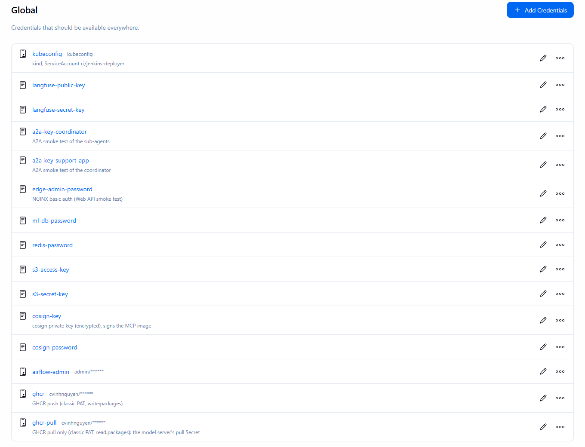
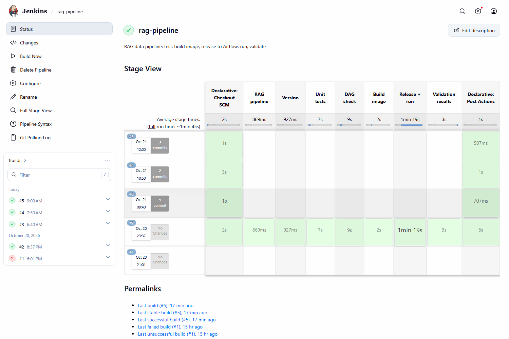
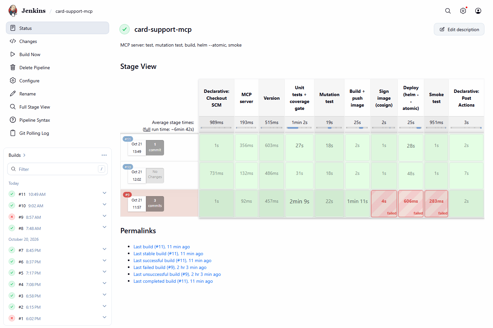
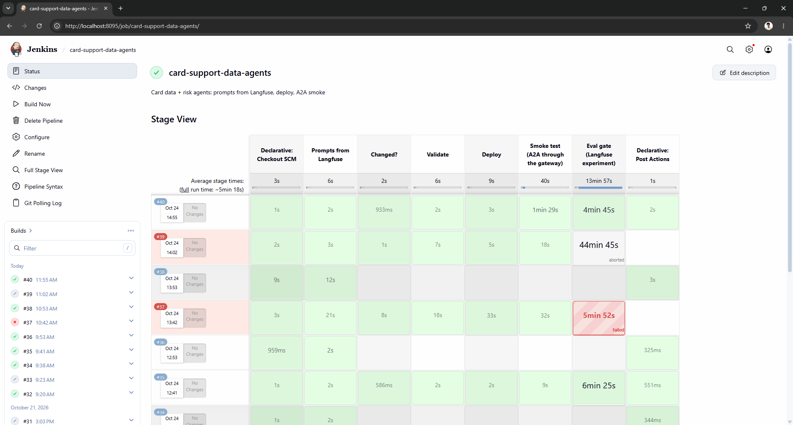
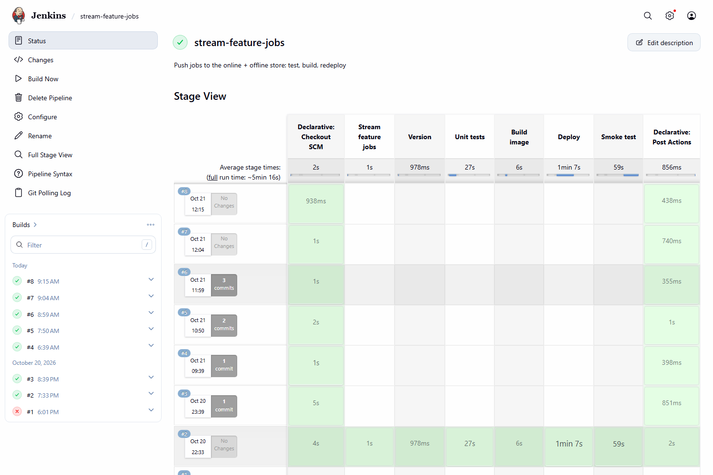

# CI/CD with Jenkins

A change to a service, a model, an agent prompt or a data pipeline should reach the running platform tested, the
same way every time, and a broken release should never stay up. Jenkins (CI/CD: continuous integration and delivery)
does that with 11 pipelines, one per deployable unit:

- Layer 1: the batch pipelines (Airflow DAGs, Spark jobs, dbt), the Flink jobs, and the two push jobs that feed the
  feature store
- Layer 2: the training pipeline, the model server (KServe), the Scoring API and the Drift API
- Layer 3: the RAG (retrieval-augmented generation) data pipeline, the three MCP (Model Context Protocol) tool
  servers, the two data agents and the coordinator

Each pipeline is a Jenkinsfile next to the code it ships. Each one ends with a check against the running platform,
and a failed check leaves the version before running, so a green build means the new version answers.

| | |
|---|---|
| Code | [`infra/jenkins/`](https://github.com/cvinhnguyen/card-fraud-platform/tree/822721cab1ac597d118f100f1c49949f137f8a7d/infra/jenkins), the Jenkinsfiles in [Pipelines](#pipelines) |
| Runs on | compose service `jenkins` (profile `cicd`, UI on `127.0.0.1:8095`); deploys into kind namespaces `card-support`, `kagent`, `agentgateway-system` and `serving`, and to compose, Airflow, Kubeflow and Flink |
| Reads | GitHub `main` (polled every 5 minutes), production prompts in Langfuse, the model aliases in MLflow |
| Writes | our images in GHCR (`ghcr.io/cvinhnguyen`) with their cosign signatures, Helm releases in `card-support` and `kagent`, the InferenceServices in `serving`, the compose services `scoring-api`, `drift-api`, `push-online` and `push-offline`, the Airflow Variables `batch_release`, `train_release` and `rag_image`, the Kubeflow pipeline versions, the live Flink jobs |
| Related | [airflow.md](../data-platform/airflow.md#releases-cicd), [flink_jobs.md](../data-platform/flink_jobs.md#releases-cicd), [ml_training.md](../ml-platform/ml_training.md#releases-cicd), [serving.md](../ml-platform/serving.md#model-release-pipeline), [rag_pipeline.md](../llm-platform/rag_pipeline.md), [agents.md](../llm-platform/agents.md), [novel_eval_gate.md](../llm-platform/novel_eval_gate.md), [novel_supply_chain.md](novel_supply_chain.md), [testing.md](testing.md) |

## Where it fits

Jenkins is the CI/CD row of the overview and the C flow of the Layer 3 picture
([architecture.md](../architecture.md#system-diagram-layer-3)). It polls GitHub `main` every 5 minutes, and every 15
minutes it checks the production prompts in Langfuse and the model aliases in MLflow. It deploys into the kind
cluster (the tool servers, the agents and the model server), into compose (the Scoring API, the Drift API and the two
push jobs), into Airflow (the batch pipelines and the RAG data pipeline), into Kubeflow (the training pipeline) and into
Flink (the always-on jobs). The tests it runs are in [testing.md](testing.md), the image signatures in
[novel_supply_chain.md](novel_supply_chain.md) and the eval gate in
[novel_eval_gate.md](../llm-platform/novel_eval_gate.md).

## How it works

1. Each pipeline watches its own paths. A poll that finds commits elsewhere in the repo checks out and stops. The
   model server and the agent pipelines also start on a moved MLflow alias or a new production prompt.
2. Before a deploy: unit tests, then, for a unit that runs as an image, the image tagged with its version and
   pushed to GHCR. The Scoring API, the Drift API
   and the tool servers also pass a 90% coverage gate and a mutation test. The tool server and model server images
   get a cosign signature. The agent pipelines pull their prompts from Langfuse and validate the Helm chart. The batch
   and Flink pipelines check that every DAG and job imports.
3. The deploy uses the tool of each unit: `helm upgrade --atomic` for the tool servers and the agents, `kubectl apply`
   for the model server, recreated containers in compose for the APIs and the push jobs, a new release folder for the
   batch pipelines, an Airflow Variable for the RAG and training pipelines, and a restart from a savepoint for the
   Flink jobs.
4. After the deploy, a check against the running platform: a smoke test (one real request; for the agents it goes
   over A2A, the agent-to-agent protocol, through the gateway), the eval gate for the data agents, a DP2 silver run
   for the batch pipelines, a completed checkpoint for the Flink jobs. When the check fails, the pipeline's failure
   handler puts back the version that ran before: `helm rollback`, the previous image, Variable or release folder, or
   the previous Flink code from the same savepoint.
5. The pipelines chain: tool servers, then data agents, then coordinator. Each starts the next when it succeeds, so
   the agents are deployed against the tool servers that just passed. A new challenger model waits for a person to
   approve its A/B test in Jenkins.
6. Secrets stay out of the Jenkinsfiles. They come from `infra/.env` as Docker secrets and become Jenkins
   credentials, masked in the logs ([Jenkins setup](#jenkins-setup)).

## Run it

Jenkins runs in compose and deploys into the kind cluster, so the cluster comes first (`infra/k8s/up.sh`):

```bash
sh infra/jenkins/setup.sh     # deploy ServiceAccount + its kubeconfig, then the Jenkins container (profile cicd)
```

Before the first push, once: put `GHCR_USER` (the GitHub user) and two classic personal access tokens in
`infra/.env`. `GHCR_TOKEN` has the scope `write:packages` and only Jenkins uses it, to push (credential `ghcr`).
`GHCR_PULL_TOKEN` has only `read:packages` and becomes the model server's pull Secret (credential `ghcr-pull`), so the
token that can push never sits in the cluster. After the first push of
each code image (`card-support-mcp`, `fraud-scoring-api`, `fraud-drift-api`, `fraud-ml-train`), open the package on
GitHub (profile, Packages, the package, Package settings), set its visibility to Public, and link it to the
repository. Then the kind node, compose and Kyverno pull the images and signatures without a login. These images
hold only code that is public on GitHub anyway.

`fraud-predictor` stays Private (a new package starts Private; check it in Package settings): its images hold the
model and its `reference_profile.json`, the distribution of every feature. The pods in `serving` pull it with the
Secret `ghcr-pull`, which the predictor pipeline creates or updates from the `ghcr-pull` credential before each deploy
([serving.md](../ml-platform/serving.md#run-it)).

## Pipelines

| Jenkins job | Jenkinsfile | Runs when | Ships | Rubric |
|---|---|---|---|---|
| `rag-pipeline` | [`pipelines/rag/Jenkinsfile`](https://github.com/cvinhnguyen/card-fraud-platform/blob/822721cab1ac597d118f100f1c49949f137f8a7d/pipelines/rag/Jenkinsfile) | RAG steps, DAG, documents or ml image changed | `ghcr.io/cvinhnguyen/fraud-ml-train:<commit>`, released to Airflow (Variable `rag_image`) and run | C33 |
| `card-support-mcp` | [`services/card_support_mcp/Jenkinsfile`](https://github.com/cvinhnguyen/card-fraud-platform/blob/822721cab1ac597d118f100f1c49949f137f8a7d/services/card_support_mcp/Jenkinsfile) | `services/card_support_mcp/**` changed | image of the three MCP servers, one Helm release per server in `card-support` | B34 |
| `card-support-data-agents` | [`agents/Jenkinsfile.data-agents`](https://github.com/cvinhnguyen/card-fraud-platform/blob/822721cab1ac597d118f100f1c49949f137f8a7d/agents/Jenkinsfile.data-agents) | `agents/**` changed, after the MCP pipeline, or a new production prompt in Langfuse | card-data-agent and risk-agent, Helm release in `kagent` | C34 |
| `card-support-coordinator` | [`agents/Jenkinsfile.coordinator`](https://github.com/cvinhnguyen/card-fraud-platform/blob/822721cab1ac597d118f100f1c49949f137f8a7d/agents/Jenkinsfile.coordinator) | `agents/**` changed, after the data agents, or a new production prompt | coordinator, Helm release in `kagent` | C35 |
| `stream-feature-jobs` | [`ml/jobs/Jenkinsfile.stream`](https://github.com/cvinhnguyen/card-fraud-platform/blob/822721cab1ac597d118f100f1c49949f137f8a7d/ml/jobs/Jenkinsfile.stream) | push jobs, ML library, Feast repo or ml image changed | `ghcr.io/cvinhnguyen/fraud-ml-train:<commit>`, compose services `push-online` and `push-offline` (Kafka to Redis and Delta) | B36 |
| `fraud-predictor` | `services/predictor/Jenkinsfile` | an MLflow alias (`production`, `challenger`) moved (checked every 15 min), `services/predictor/**` or the KServe manifests changed | `ghcr.io/cvinhnguyen/fraud-predictor:v<model version>-<commit>`, InferenceServices `card-fraud` and `card-fraud-challenger`, the A/B split after a person approves | |
| `fraud-scoring-api` | `services/scoring_api/Jenkinsfile` | `services/scoring_api/**` changed | `ghcr.io/cvinhnguyen/fraud-scoring-api:<commit>`, compose service `scoring-api` | |
| `fraud-drift-api` | `services/drift_api/Jenkinsfile` | `services/drift_api/**` changed | `ghcr.io/cvinhnguyen/fraud-drift-api:<commit>`, compose service `drift-api` | |
| `batch-pipelines` | `pipelines/airflow/Jenkinsfile` | the Airflow DAGs, the Spark jobs, dbt or the ml code they run changed | a release of that commit's DAGs, Spark jobs and dbt, which Airflow and Spark switch to together | |
| `training-pipeline` | `ml/pipelines/Jenkinsfile` | the training pipeline, the ML library, the Feast repo or the ml image changed | `ghcr.io/cvinhnguyen/fraud-ml-train:<commit>` and the Kubeflow pipeline version `<commit>` the drift pipeline starts | |
| `flink-jobs` | `pipelines/flink/Jenkinsfile` | `pipelines/flink/**` changed | the always-on Flink jobs (`rt_features`, `device_seen`, `raw_landing`), upgraded from a savepoint; the jobs run by hand only get the lint and import checks | |

What each pipeline checks, where it deploys, and what happens when a release is bad:

| Jenkins job | Before deploy | Deploys to | After deploy | A bad release |
|---|---|---|---|---|
| `rag-pipeline` | unit tests, a DAG check, the image build and push | Airflow: sets the Variable `rag_image` to the new image, then starts the DAG `rag_ingest` | reads the run's validation results | the failure handler sets `rag_image` back to the image released before. The DAG's checks run after its write step, so the bad chunks stay in the store until the next run, on the old image, writes them again |
| `card-support-mcp` | unit tests with a 90% coverage gate, mutation test, image build and push, cosign signature | kind: one `helm upgrade --atomic` per MCP server in `card-support` | smoke test of each server | a server that never gets Ready is rolled back by `--atomic`, and the pipeline stops before the next server; a later failure (rollout wait, smoke test) makes the failure handler run `helm rollback` on every server already upgraded |
| `card-support-data-agents` | prompts from Langfuse, chart validation | kind: `helm upgrade --atomic` of the release in `kagent` | A2A smoke test through the gateway, then the eval gate (Langfuse experiment) | `--atomic` rolls back a release that does not get Ready; a failed readiness wait, smoke test or eval gate makes the failure handler run `helm rollback` ([novel_eval_gate.md](../llm-platform/novel_eval_gate.md)) |
| `card-support-coordinator` | prompt from Langfuse, chart validation | kind: `helm upgrade --atomic` of the release in `kagent` | A2A smoke test through the gateway | `--atomic` rolls back a release that does not get Ready; a failed readiness wait or smoke test makes the failure handler run `helm rollback` |
| `stream-feature-jobs` | unit tests, the ml image build and push | compose: recreates the containers `push-online` and `push-offline` on the new image | smoke test: one marked message must reach Redis and Delta | the failure handler recreates both containers on the image they ran before, and prints their last log lines |
| `fraud-predictor` | the model fetched from MLflow, a pytest release check in the image (loads, scores, right version), image build and push, cosign signature | kind: `kubectl apply` of the InferenceService with the new image and the annotation `fraud.platform/model-version` | rollout and Ready wait, then a predict call must answer with the released version; a new challenger then waits for a person to approve the A/B test | the failure handler re-applies the image and version each InferenceService ran before, read from the live object before the deploy ([serving.md](../ml-platform/serving.md#model-release-pipeline)) |
| `fraud-scoring-api` | unit tests with a 90% coverage gate, mutation test, image build and push | compose: recreates `scoring-api` on the new tag, keeping its `AB_PERCENT` | `/readyz`, then one `POST /v1/score` must be scored by the model | the failure handler recreates the container on the image it ran before |
| `fraud-drift-api` | unit tests with a 90% coverage gate, mutation test, image build and push | compose: recreates `drift-api` on the new tag, with the host path of its reference profile read from the running container | `/readyz`, then `/v1/drift` must report a model version | the failure handler recreates the container on the image it ran before |
| `batch-pipelines` | lint, unit tests, every DAG imports in the Airflow image, `dbt parse` | Airflow and Spark: the commit's files are copied to `/opt/release/<commit>` and the link `/opt/release/current` moves to them | the scheduler must parse the release, then a DP2 silver run must pass its checks | the failure handler moves the link back to the release before |
| `training-pipeline` | unit tests (registry, training, the compiled pipeline's image pin), image build and push | Kubeflow: uploads the pipeline version `<commit>`, pinned to that image; then sets the Airflow Variable `train_release` | every step of the uploaded version must run that image | the Variable moves last, so a failed build leaves the drift pipeline on the release it had |
| `flink-jobs` | lint, every job imports in the Flink image | Flink: each always-on job stops with a savepoint and is submitted again from it, on the commit's files | the new job must restore the savepoint and complete a checkpoint within 3 minutes | the new job is cancelled and the code that ran before is submitted from the same savepoint, so no state is lost |

Each running unit records the version it runs. An image tag is the commit (or `v<model version>-<commit>` for the
model server), and the image carries the label `org.opencontainers.image.revision`. The InferenceServices carry the
annotation `fraud.platform/model-version`, and each Agent the annotation `card-support/prompt` with its Langfuse prompt
and version. The batch release is the Airflow Variable `batch_release` and the tag `release:<commit>` on every DAG, the
training release the Variable `train_release`, the RAG image the Variable `rag_image`. A live Flink job has the commit
in its name. To see what is live:

```bash
docker inspect scoring-api drift-api push-online push-offline --format '{{.Name}} {{.Config.Image}} {{index .Config.Labels "org.opencontainers.image.revision"}}'
kubectl -n serving get isvc -o custom-columns='NAME:.metadata.name,MODEL:.metadata.annotations.fraud\.platform/model-version,IMAGE:.spec.predictor.containers[0].image'
helm list -n card-support    # the MCP servers: the chart's image.tag is the commit
kubectl -n kagent get agents -o custom-columns='NAME:.metadata.name,PROMPT:.metadata.annotations.card-support/prompt'
docker exec flink-jobmanager flink list    # the live Flink jobs: <job> <commit>
```

## Jenkins setup

Jenkins 2.580.1 runs in compose (profile `cicd`, UI on `127.0.0.1:8095`, login required;
[`infra/docker-compose.yaml`
L753-L774](https://github.com/cvinhnguyen/card-fraud-platform/blob/822721cab1ac597d118f100f1c49949f137f8a7d/infra/docker-compose.yaml#L753-L774)).
The image
([`infra/jenkins/Dockerfile`](https://github.com/cvinhnguyen/card-fraud-platform/blob/822721cab1ac597d118f100f1c49949f137f8a7d/infra/jenkins/Dockerfile))
adds the Docker CLI with buildx and compose, kubectl v1.37.0, Helm v3.22.1 and jq, plus the plugins in
[`infra/jenkins/plugins.txt`](https://github.com/cvinhnguyen/card-fraud-platform/blob/822721cab1ac597d118f100f1c49949f137f8a7d/infra/jenkins/plugins.txt).
Nothing is clicked together in the UI:
[`infra/jenkins/casc.yaml`](https://github.com/cvinhnguyen/card-fraud-platform/blob/822721cab1ac597d118f100f1c49949f137f8a7d/infra/jenkins/casc.yaml)
(Jenkins Configuration as Code, JCasC) creates the admin user, the credentials and the jobs. The jobs poll GitHub
`main` every 5 minutes, because no webhook can reach this machine. One executor runs one pipeline at a time, since two
image builds do not fit in the machine's RAM.

Every Jenkinsfile wraps its stages in a `when { changeset ... }` on its own paths (the RAG pipeline's:
[`pipelines/rag/Jenkinsfile`
L20-L27](https://github.com/cvinhnguyen/card-fraud-platform/blob/822721cab1ac597d118f100f1c49949f137f8a7d/pipelines/rag/Jenkinsfile#L20-L27)).
A poll that finds commits elsewhere in the repo checks out and stops: these are the rows with only "Checkout SCM" in the
stage views below.

Secrets never appear in a Jenkinsfile. They start in the gitignored `infra/.env` (or `infra/.secrets/` for files),
reach the container as Docker secrets under `/run/secrets/`, and JCasC turns each into a Jenkins credential
([`infra/jenkins/casc.yaml`
L13-L30](https://github.com/cvinhnguyen/card-fraud-platform/blob/822721cab1ac597d118f100f1c49949f137f8a7d/infra/jenkins/casc.yaml#L13-L30)).
A Jenkinsfile names the credential id inside `withCredentials` and Jenkins masks the value in the console log. The API
keys go to curl on stdin (`curl -K -`) and to containers through the environment (`docker run -e NAME`), so they do not
show up in the process list or the build log.

| Credential id | Used by |
|---|---|
| `kubeconfig` | every deploy (ServiceAccount `ci/jenkins-deployer`) |
| `langfuse-public-key`, `langfuse-secret-key` | agent pipelines: system prompts and the eval experiment |
| `a2a-key-coordinator`, `a2a-key-support-app` | A2A smoke tests through agentgateway |
| `edge-admin-password` | MCP smoke test of the Web API over HTTPS through NGINX |
| `cosign-key`, `cosign-password` | signing our images (MCP servers, model server) |
| `ghcr` | username/password: GitHub user and a classic PAT with `write:packages`, for `docker login ghcr.io` before a push |
| `ghcr-pull` | username/password: GitHub user and a classic PAT with only `read:packages`; the predictor pipeline turns it into the pull Secret `ghcr-pull` in `serving` |
| `ml-db-password`, `redis-password`, `s3-access-key`, `s3-secret-key` | stream jobs deploy and smoke test; `ml-db-password` and `redis-password` also recreate `scoring-api` and `drift-api` |
| `airflow-admin` | RAG pipeline: release and run through the Airflow REST API |

Jenkins shows the same credentials under Manage Jenkins, Credentials, global domain. The page lists ids and
descriptions and hides the values; the username/password credential shows only `admin/******`:



Jenkins deploys with its own ServiceAccount
([`infra/jenkins/rbac.yaml`](https://github.com/cvinhnguyen/card-fraud-platform/blob/822721cab1ac597d118f100f1c49949f137f8a7d/infra/jenkins/rbac.yaml))
instead of the cluster admin.
[`infra/jenkins/setup.sh`](https://github.com/cvinhnguyen/card-fraud-platform/blob/822721cab1ac597d118f100f1c49949f137f8a7d/infra/jenkins/setup.sh)
writes the ServiceAccount's kubeconfig to `infra/.secrets/jenkins-kubeconfig`. The role is bound only in `card-support`,
`kagent` and `agentgateway-system`, the namespaces the MCP and agents charts write to (in `serving` the model server
pipeline gets a narrower Role: InferenceServices, Broker and Trigger, and of the Secrets only `ghcr-pull`), so a pipeline's `kubectl` and
`helm` calls cannot touch Vault, the monitoring stack or kube-system. The role allows Secrets in those namespaces,
because Helm keeps its release records there. The role does not limit what a Jenkinsfile can run ([Limits](#limits)).

Jenkins keeps the host's Docker socket because it builds images. Airflow only runs the RAG image, so it reaches
Docker through `docker-proxy` on an internal network
([`infra/docker-compose.yaml`
L437-L455](https://github.com/cvinhnguyen/card-fraud-platform/blob/822721cab1ac597d118f100f1c49949f137f8a7d/infra/docker-compose.yaml#L437-L455)).
The proxy allows the container and image API calls and denies exec, build, volumes and the rest ([Limits](#limits)). The
DAG itself only accepts the ml code image as `rag_image`: a release in GHCR (`ghcr.io/cvinhnguyen/fraud-ml-train:<commit>`) or the local build `fraud/ml-train` ([`pipelines/airflow/dags/rag_ingest.py`
L40-L45](https://github.com/cvinhnguyen/card-fraud-platform/blob/822721cab1ac597d118f100f1c49949f137f8a7d/pipelines/airflow/dags/rag_ingest.py#L40-L45)).

## RAG data pipeline

[`pipelines/rag/Jenkinsfile`](https://github.com/cvinhnguyen/card-fraud-platform/blob/822721cab1ac597d118f100f1c49949f137f8a7d/pipelines/rag/Jenkinsfile)
tests the steps of the Airflow DAG `rag_ingest` (chunk the bank documents, embed the chunks, write them to the Feast
knowledge base, validate), builds the image the steps run in, releases that image to Airflow and runs the DAG. The DAG
starts each step as a container of the image named in the Airflow Variable `rag_image`, so releasing a new version is
one Variable update. More on the pipeline itself: [rag_pipeline.md](../llm-platform/rag_pipeline.md).

| Stage | What it does |
|---|---|
| Version | short commit hash, used as the image tag |
| Unit tests | builds the `test` stage of [`ml/Dockerfile`](https://github.com/cvinhnguyen/card-fraud-platform/blob/822721cab1ac597d118f100f1c49949f137f8a7d/ml/Dockerfile) and runs [`ml/jobs/tests/test_rag_ingest.py`](https://github.com/cvinhnguyen/card-fraud-platform/blob/822721cab1ac597d118f100f1c49949f137f8a7d/ml/jobs/tests/test_rag_ingest.py) |
| DAG check | imports [`pipelines/airflow/dags/rag_ingest.py`](https://github.com/cvinhnguyen/card-fraud-platform/blob/822721cab1ac597d118f100f1c49949f137f8a7d/pipelines/airflow/dags/rag_ingest.py) in the Airflow image and asserts its 5 tasks |
| Build + push image | `ghcr.io/cvinhnguyen/fraud-ml-train:<commit>` |
| Release + run | Airflow REST API: sets Variable `rag_image` to the new tag, unpauses the DAG, triggers a run, waits for `success` or `failed` ([`pipelines/rag/Jenkinsfile` L53-L77](https://github.com/cvinhnguyen/card-fraud-platform/blob/822721cab1ac597d118f100f1c49949f137f8a7d/pipelines/rag/Jenkinsfile#L53-L77)) |
| Validation results | prints the checks the `validate_rag.run_checks` task logged |

Build #2 (started by hand, since the pipeline needs the Airflow profile up): 6 unit tests passed, the DAG imported
with its 5 tasks, `rag_image = fraud/ml-train:8f40d6a` was released and run `ci-8f40d6a-1792528682` succeeded
(`chunk_documents` 4 s, `embed_chunks` 6 s, `write_feature_store` 10 s, `validate_rag.run_checks` 13 s,
`validate_rag.publish_results` 1 s). The checks it printed:

```text
ok   expect_table_row_count_to_be_between         observed=57
ok   expect_column_values_to_be_unique            observed=0
ok   expect_column_values_to_not_be_null          observed=0
ok   expect_column_value_lengths_to_be_between    observed=0
ok   expect_embedding_dimension_to_equal          observed=[1024]
ok   expect_every_document_to_have_chunks         observed=['authentication_rules', 'card_terms', 'dispute_policy', 'faq', 'fee_schedule']
ok   expect_online_store_to_match_offline         observed=57/57 chunks identical online
```

In the stage view of `rag-pipeline`, build #2 ran every stage and the later polls stopped after checkout:



## MCP servers

[`services/card_support_mcp/Jenkinsfile`](https://github.com/cvinhnguyen/card-fraud-platform/blob/822721cab1ac597d118f100f1c49949f137f8a7d/services/card_support_mcp/Jenkinsfile)
ships the three MCP servers the data agents use (card-data, fraud-score, policy-rag,
[agents.md](../llm-platform/agents.md#the-three-mcp-servers)): one code base and one image, tested, mutation-tested and
signed once, then deployed as one Helm release per server.

| Stage | What it does |
|---|---|
| Version | short commit hash, used as the image tag |
| Unit tests + coverage gate | `docker build --target test`, then pytest in it; fails under 90% coverage ([testing.md](testing.md#layer-3-the-card-support-mcp-servers)) |
| Mutation test | mutmut on the tool rules; fails under 80% of mutants killed |
| Build + push image | runtime stage of the multi-stage Dockerfile, pushed to GHCR as `ghcr.io/cvinhnguyen/card-support-mcp:<commit>` |
| Sign image (cosign) | signs the image by digest with the CI key ([novel_supply_chain.md](novel_supply_chain.md)) |
| Deploy (helm --atomic) | for each server, `helm upgrade --install <server>-mcp -f values-<server>.yaml --atomic` into `card-support`: rolling update with maxUnavailable 0; a release whose pods never get Ready is rolled back and stops the stage before the next server |
| Smoke test | the card-data Web API over HTTPS through NGINX must return a real card, and the three kagent RemoteMCPServers must accept the new releases |
| post: success | `build job: 'card-support-data-agents'` |
| post: failure | `helm rollback` of every server already upgraded (listed in `deployed.txt`) |

The two test gates: the coverage threshold sits in
[`services/card_support_mcp/pytest.ini`
L4](https://github.com/cvinhnguyen/card-fraud-platform/blob/822721cab1ac597d118f100f1c49949f137f8a7d/services/card_support_mcp/pytest.ini#L4),
so the test container itself exits non-zero, and the mutation score is computed from mutmut's results in the stage
([`services/card_support_mcp/Jenkinsfile`
L31-L48](https://github.com/cvinhnguyen/card-fraud-platform/blob/822721cab1ac597d118f100f1c49949f137f8a7d/services/card_support_mcp/Jenkinsfile#L31-L48)):

```groovy
        stage('Unit tests + coverage gate') {
          // EP/BVA, hypothesis properties, REST + MCP + adapter tests; pytest.ini fails the stage under 90 % coverage
          steps {
            sh 'docker build --target test -t card-support-mcp:test-$TAG $SVC'
            sh 'docker run --rm card-support-mcp:test-$TAG'
          }
        }
        stage('Mutation test') {
          // mutmut on the code with the tool rules (setup.cfg); fails under 80 % killed
          steps {
            sh '''
              docker run --rm card-support-mcp:test-$TAG sh -c 'mutmut run >/dev/null 2>&1; mutmut results --all true' > mutmut.txt || true
              total=$(grep -c ': ' mutmut.txt || true); killed=$(grep -c ': killed' mutmut.txt || true)
              echo "mutation score: $killed / $total killed"; grep -E ': (survived|timeout|suspicious)' mutmut.txt || true
              [ "$total" -gt 0 ] && [ $((killed * 100 / total)) -ge 80 ]
            '''
          }
        }
```

Build #9 failed at "Sign image" ([Gotchas](#gotchas)). After the key file was fixed, build #10 passed every stage:
97 tests at 97.84% coverage, 243 of 245 mutants killed, image `a1d4e12` pushed and signed (`sha256:8f57ef0f...`),
Helm revision 11 rolled out,
`Web API: card data OK over HTTPS`, both RemoteMCPServers `Accepted`, then
`Scheduling project: card-support-data-agents`. Build #11 (started by hand after the trigger fix in
[Gotchas](#gotchas)) did the same in 89 s: 97 tests, image `b5bd125` signed (`sha256:fdb05642...`), Helm revision 12,
and it started data agents #29.

Build #13 (2026-10-24, started by hand, commit `7da43e5` that split the server into three) ran the same gates on the
new code: 118 tests at 98.31% coverage, 243 of 245 mutants killed, image `7da43e5` pushed and signed
(`sha256:933437f7...`), the three releases `card-data-mcp`, `fraud-score-mcp` and `policy-rag-mcp` upgraded one
after the other in 83 s, `Web API: card data OK over HTTPS`, the three RemoteMCPServers `Accepted`, then data agents
#35 ran the eval gate on them. Build #16, started by hand on the same commit, passed every stage again in about 10
minutes: 118 tests (98.31%), 243 of 245 mutants killed, the image rebuilt and signed under a new digest
(`sha256:0b9c88d6...`), the three releases upgraded in 2 min 14 s, smoke test passed, then data agents #37. The eval
gate of data agents #37 failed while the fraud-score server had no Ready pod, and the gate rolled the agents back;
data agents #40 re-ran the deploy by hand and passed
([novel_eval_gate.md](../llm-platform/novel_eval_gate.md#proof)).

The full stage view of `card-support-mcp` shows #16 passing every stage and #15 as a poll with nothing to build:



## Agents

The agents' system prompts live in Langfuse (prompt `card-support/<agent>`, label `production`).
[`agents/fetch_prompts.sh`](https://github.com/cvinhnguyen/card-fraud-platform/blob/822721cab1ac597d118f100f1c49949f137f8a7d/agents/fetch_prompts.sh)
pulls each one into `agents/chart/prompts/<agent>.md` and returns Helm flags with the prompt versions, which the chart
writes into an annotation on each Agent. Every 15 minutes both agent pipelines compare the deployed versions with
production ([`agents/Jenkinsfile.data-agents`
L22-L37](https://github.com/cvinhnguyen/card-fraud-platform/blob/822721cab1ac597d118f100f1c49949f137f8a7d/agents/Jenkinsfile.data-agents#L22-L37)).
Promoting a new prompt version in Langfuse therefore redeploys the agent without a commit, and a run with nothing new
stops after this check.

The chain for a tool change is MCP server, then data agents, then coordinator: each pipeline starts the next one when
it succeeds (the data agents only when they deployed something). The chain did not work at first; the trigger fix is
in [Gotchas](#gotchas).

### Data agents

[`agents/Jenkinsfile.data-agents`](https://github.com/cvinhnguyen/card-fraud-platform/blob/822721cab1ac597d118f100f1c49949f137f8a7d/agents/Jenkinsfile.data-agents)
deploys card-data-agent and risk-agent (Helm release `card-support-data-agents`).

| Stage | What it does |
|---|---|
| Prompts from Langfuse | fetches the production prompts, compares their versions with the deployed ones |
| Changed? | also deploys on a change under `agents/` or a manual / upstream start |
| Validate | `helm lint`, then `helm template` through a server-side dry run against the cluster |
| Deploy | `helm upgrade --atomic`, then waits until both Agents are Ready |
| Smoke test (A2A through the gateway) | asks each agent one question through agentgateway, the way the coordinator calls it (coordinator key, header `x-kagent-host`); the answer must complete and match the expected pattern (the fee question: its citation `fee_schedule` / "fee schedule" or the 2.5% fact) |
| Eval gate (Langfuse experiment) | the risk agent answers the eval dataset as a Langfuse experiment; below 0.6 accuracy the build fails and the failure handler runs `helm rollback` ([novel_eval_gate.md](../llm-platform/novel_eval_gate.md)) |

The eval gate stage and the failure handler
([`agents/Jenkinsfile.data-agents`](../../agents/Jenkinsfile.data-agents)):

```groovy
    stage('Eval gate (Langfuse experiment)') {
      // the risk agent just deployed answers the eval dataset as a Langfuse experiment (agents/eval/langfuse_gate.py);
      // below EVAL_MIN_ACCURACY the build fails and the release goes back to its previous revision (post)
      when { environment name: 'DEPLOY', value: 'true' }
      steps {
        withCredentials([string(credentialsId: 'langfuse-public-key', variable: 'LANGFUSE_PUBLIC_KEY'),
                         string(credentialsId: 'langfuse-secret-key', variable: 'LANGFUSE_SECRET_KEY'),
                         string(credentialsId: 'a2a-key-coordinator', variable: 'A2A_KEY'),
                         file(credentialsId: 'kubeconfig', variable: 'KUBECONFIG')]) {
          sh 'docker build -q -t fraud/agent-eval:ci agents/eval >/dev/null'
          script {
            def gate = sh(returnStatus: true, script: '''
              gw="http://fraud-control-plane:$(kubectl -n agentgateway-system get svc agentgateway-proxy -o jsonpath='{.spec.ports[0].nodePort}')"
              prompt=$(printf '%s' "$PROMPT_FLAGS" | grep -o 'risk-agent=[0-9]*' | cut -d= -f2)
              docker run --rm --network kind -e LANGFUSE_HOST -e LANGFUSE_PUBLIC_KEY -e LANGFUSE_SECRET_KEY -e A2A_KEY \
                -e GATEWAY="$gw" fraud/agent-eval:ci langfuse_gate.py --agent risk-agent \
                --run-name "risk-agent prompt v$prompt (Jenkins #$BUILD_NUMBER)" --min-accuracy "$EVAL_MIN_ACCURACY" --repeats 2
            ''')
            if (gate != 0) { error "eval gate failed" }
          }
        }
      }
    }
  }
  post {
    success {
      script { if (env.DEPLOY == 'true') { build job: 'card-support-coordinator', wait: false } }
    }
    failure {
      // a release that is live but failed its readiness wait, smoke test or eval gate goes back to the previous revision
      script {
        if (env.DEPLOYED == 'true') {
          withCredentials([file(credentialsId: 'kubeconfig', variable: 'KUBECONFIG')]) {
            sh 'helm rollback $RELEASE -n kagent --wait --timeout 5m'
          }
          echo "$RELEASE rolled back to its previous revision"
        }
      }
    }
  }
```

The builds below ran the earlier Jenkinsfile, in which the gate stage ran `helm rollback` itself and a failed smoke test
left the release in place. Since 2026-11-12 the failure handler covers every step after the upgrade; it has not run
in Jenkins yet.

- #20 (a commit under `agents/`): deploy and smoke test passed, the eval scored 0.583 against the 0.6 gate, Helm rolled
  the release back and the build failed.
- #23 (risk-agent prompt v2 promoted in Langfuse): the first stage logged `risk-agent=1` deployed and `risk-agent=2` in
  production, so it deployed v2. Smoke answers: `The card made 3 payments in the last 30 days.` and the foreign fee
  with its source `(fee_schedule#2)`. Eval 0.917, pass. Builds #20 and #23 ran the 12-question dataset once; the gate
  now asks 20 questions twice.
- #27: Jenkins was restarted while the eval container ran (to load the corrected cosign credential), the shell step
  lost its process and returned an error. The gate treats that like a failed eval: it rolled the release back to the
  revision that was running before (prompt v2 still in place) and failed the build.
- #29 (started by MCP #11, with the trigger fix): deploy and smoke test passed, then the eval gate asked the 20
  questions twice: 0.95 and 0.90, `accuracy 0.93 over 2 run(s) of 20 questions (gate 0.60): pass`. It then started the
  coordinator pipeline.
- #32 (2026-10-24, the commit that split the MCP server into three): the agents now take their tools from
  `card-data-mcp`, `fraud-score-mcp` and `policy-rag-mcp`; deploy, smoke test, eval 0.90 and 0.95, pass. #35, started
  by MCP #13: eval 1.00 and 0.95, pass.
- #37 (started by MCP #16): deploy and smoke test passed, then the eval scored 0.20 and 0.70 (mean 0.45). For 28 s
  both fraud-score pods had failed their readiness check, so the risk agent could not reach that server and failed
  every question asked in that window ([agents.md](../llm-platform/agents.md#gotchas)). The gate rolled the release
  back. #39 was stopped by a crash of the PC during its eval; #40, started by hand, passed with 0.90 and 0.95 and
  started the coordinator.
- #45 (started by the commit `e148f37` that changed both agent Jenkinsfiles): deploy, smoke test, eval 0.95 and 0.95,
  pass, then coordinator #40.

The stage view of `card-support-data-agents` shows #35 and #40 deploying and passing the eval gate, #37 failing it and
rolling back, and #39 aborted:



### Coordinator

[`agents/Jenkinsfile.coordinator`](https://github.com/cvinhnguyen/card-fraud-platform/blob/822721cab1ac597d118f100f1c49949f137f8a7d/agents/Jenkinsfile.coordinator)
deploys the coordinator (Helm release `card-support-coordinator`) with the same first four stages. Its smoke test calls
it the way a client application does: the public A2A route `/a2a/coordinator` with the support-app key, and a question
that needs both data agents ([`agents/Jenkinsfile.coordinator`
L58-L78](https://github.com/cvinhnguyen/card-fraud-platform/blob/822721cab1ac597d118f100f1c49949f137f8a7d/agents/Jenkinsfile.coordinator#L58-L78)).

| Stage | What it does |
|---|---|
| Prompt from Langfuse | fetches the coordinator's production prompt, compares the version with the deployed one |
| Changed? | also deploys on a change under `agents/` or a manual / upstream start |
| Validate | `helm lint` and a server-side dry run |
| Deploy | `helm upgrade --atomic`, waits until the coordinator is Ready |
| Smoke test (A2A client through the gateway) | one question needing card data and policy; the answer must complete and state the fee from the policy (its citation `fee_schedule` / "fee schedule" or the 2.5% fact) |

Build #24 (commit under `agents/`): `coordinator: completed | The card made 3 payments in the last 30 days. The
foreign transaction fee is 2.5% for debit cards and 3.0% for credit cards (fee_schedule#2).` Build #26, started by
data agents #29, answered the same question the same way. Build #18 failed its smoke test while the LLM canary sent
part of the traffic to Groq's free tier, which answered 429; that is why the canary was stopped
([ab_testing.md](../llm-platform/ab_testing.md)).

On 2026-10-24 builds #29 and #30 failed the smoke test with correct answers: one wrote the source as
"(fee schedule#2)", the other gave the 2.5% fee without a source, and the check wanted the exact text `fee_schedule`.
The check now accepts the citation in either spelling or the fee itself
([`agents/Jenkinsfile.coordinator`
L72-L74](https://github.com/cvinhnguyen/card-fraud-platform/blob/822721cab1ac597d118f100f1c49949f137f8a7d/agents/Jenkinsfile.coordinator#L72-L74)):

```sh
            printf '%s' "$out" | jq -e '.result.status.state == "completed"' >/dev/null
            # the fee came from the policy search: its citation (written fee_schedule#2 or "fee schedule") or the fact itself
            printf '%s' "$answer" | grep -q -i -E 'fee[_ ]schedule|2[.,]5 ?%'
```

Coordinator #34 failed the same way after data agents #40 ("(fee schedule#2)"), because Jenkins builds what is on
GitHub and the fix was not pushed yet. The fix was pushed in commit `e148f37`. Coordinator #39, started by hand, then
passed with an answer that gave the 2.5% fee without a source, which the old check would have refused. After that the
chain ran by itself: data agents #45 saw the commit, deployed, passed the eval gate with 0.95 and 0.95, and started
coordinator #40, which passed with `(fee_schedule#2)` in the answer.

The stage view of `card-support-coordinator` shows #39 and #40 passing the client smoke test and #34 red in the build
list:


## Stream feature jobs

[`ml/jobs/Jenkinsfile.stream`](https://github.com/cvinhnguyen/card-fraud-platform/blob/822721cab1ac597d118f100f1c49949f137f8a7d/ml/jobs/Jenkinsfile.stream)
ships the two push jobs that write the streaming features to the feature store: `push-online` (Kafka to Redis) and
`push-offline` (Kafka to the Delta table behind the push source). They run as compose services on the ml image.

| Stage | What it does |
|---|---|
| Version | short commit hash, used as the image tag |
| Unit tests | the `test` stage of [`ml/Dockerfile`](https://github.com/cvinhnguyen/card-fraud-platform/blob/822721cab1ac597d118f100f1c49949f137f8a7d/ml/Dockerfile): tests of the push jobs, the RAG steps and the model registry ([`ml/jobs/tests/test_registry.py`](https://github.com/cvinhnguyen/card-fraud-platform/blob/822721cab1ac597d118f100f1c49949f137f8a7d/ml/jobs/tests/test_registry.py): every trained model is registered, only one that passed gets an alias) |
| Build + push image | `ghcr.io/cvinhnguyen/fraud-ml-train:<commit>` |
| Deploy | starts Kafka if it is down, keeps the name of the image the containers run, then recreates `push-online` and `push-offline` on the new tag (`PUSH_JOBS_IMAGE`). A failed smoke test puts the kept image back |
| Smoke test | [`ml/tools/stream_smoke.py`](https://github.com/cvinhnguyen/card-fraud-platform/blob/822721cab1ac597d118f100f1c49949f137f8a7d/ml/tools/stream_smoke.py) sends one marked authorization summary (`ci_smoke_<random>`, never a real card) to Kafka; it must reach the online store and the offline table within 180 s ([`ml/jobs/Jenkinsfile.stream` L55-L65](https://github.com/cvinhnguyen/card-fraud-platform/blob/822721cab1ac597d118f100f1c49949f137f8a7d/ml/jobs/Jenkinsfile.stream#L55-L65)) |

Build #2 (started by hand): 15 tests passed, both containers were recreated on the new image, and the smoke message
arrived in both stores: `ci_smoke_fabe0b34: online 12.4 s, offline 8.4 s (s3://lakehouse/gold/feat_card_auth_rt)`.

In the stage view of `stream-feature-jobs`, build #2 ran every stage and the later polls stopped after checkout:



## Gotchas

- Build #9 of `card-support-mcp` failed at "Sign image": the signing key file was not readable by the Jenkins user,
  so cosign got an empty key (`reading key: invalid pem block`). Deploy and smoke test never ran and the cluster kept
  the release it had. Build #10 passed once the key file was fixed.
- The upstream chain did not trigger deploys at first. The `Changed?` stage of both agent pipelines tested
  `triggeredBy 'UpstreamCause'`, but the `build` step records a `BuildUpstreamCause`, so the runs started by an
  upstream pipeline (data agents #28 after MCP #10, coordinator #11, #19 and #21) checked the prompts and stopped
  without deploying. The running agents still used the new MCP release, because its service address and tool names
  stayed the same, but the redeploy and the eval gate that should follow a tool change did not run. Commit `b5bd125`
  added `triggeredBy 'BuildUpstreamCause'` to both agent Jenkinsfiles
  ([`agents/Jenkinsfile.data-agents`
  L38-L43](https://github.com/cvinhnguyen/card-fraud-platform/blob/822721cab1ac597d118f100f1c49949f137f8a7d/agents/Jenkinsfile.data-agents#L38-L43)).
  The next chain ran end to end: MCP #11, then data agents #29 ("Started by upstream project card-support-mcp build
  number 11": deploy, smoke test, eval gate passed), then coordinator #26. Coordinator #25 had already built that
  commit, so #26 had no change to deploy; it deployed and ran its smoke test only because data agents #29 started it,
  which is the case the fix is for.

## Limits

- The trust boundary is the host's Docker socket. A Jenkinsfile can run any container, also one on the kind node
  with its admin kubeconfig, so whoever can change a Jenkinsfile on `main` is as strong as a cluster admin.
- `docker-proxy` still allows creating a container, so a DAG could start a privileged one.
- Jenkins passes the released image of a compose service only while it runs compose (`PUSH_JOBS_IMAGE`,
  `SCORING_API_IMAGE`, `DRIFT_API_IMAGE`); nothing stores it. A `docker compose up` by hand therefore recreates
  `push-online`, `push-offline`, `scoring-api` and `drift-api` on the default image of the compose file, an older local
  build. After such a run, check the image column of `docker ps` or run the pipeline again. A Docker restart keeps the
  released containers.
