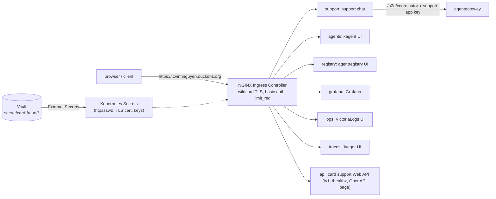
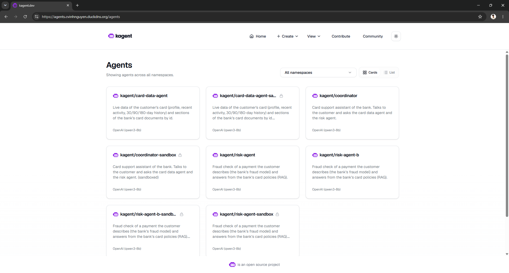
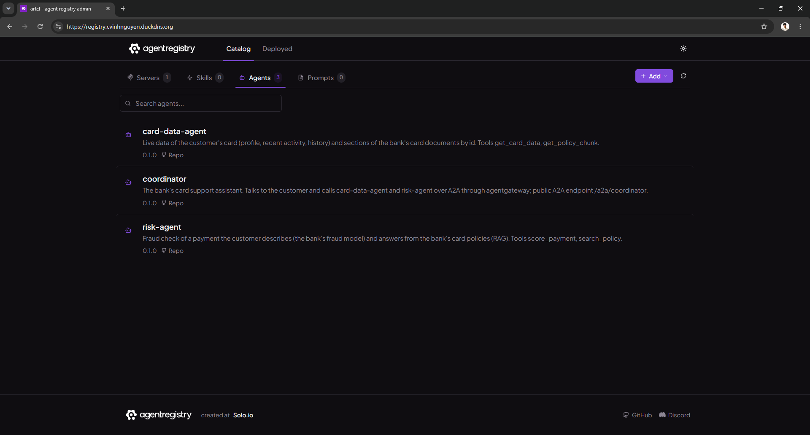
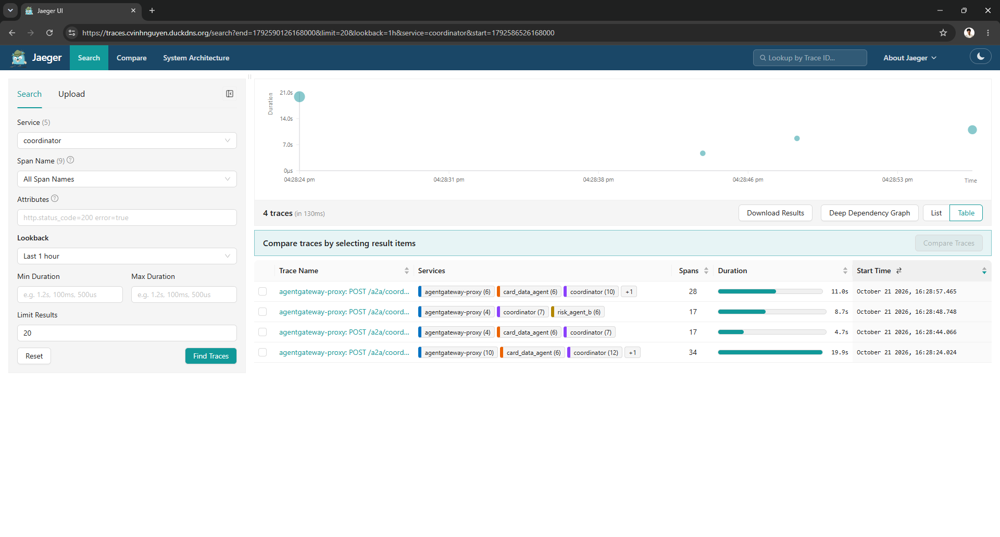
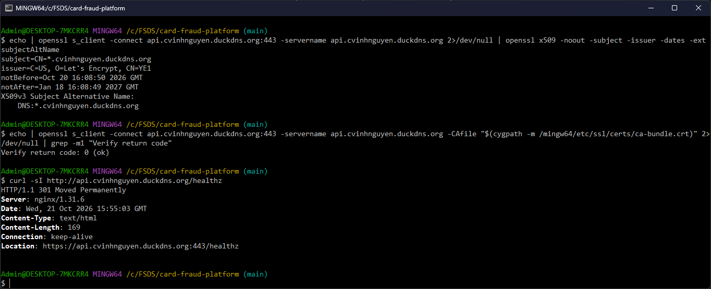
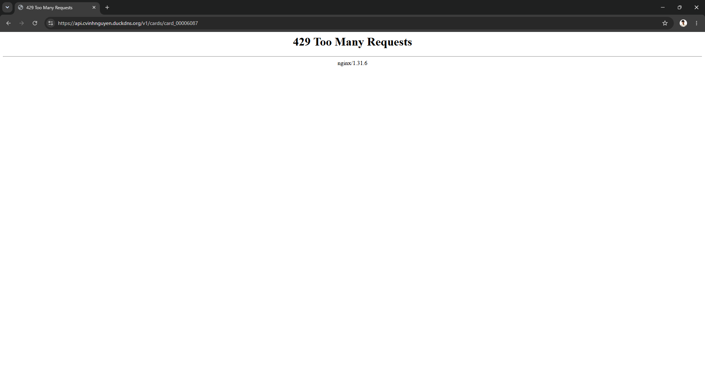

# Edge routing, HTTPS and secrets

The platform holds card data, so there is one way in: every UI and the public Web API sit behind one NGINX Ingress
Controller, each on its own host name under a real domain, with HTTPS, a login and a rate limit. Nobody reaches the
cluster through a port-forward or a NodePort. Every secret lives in HashiCorp Vault, and the External Secrets Operator
(ESO) copies each into a Kubernetes Secret for the pods that need it, so no password sits in the code.

| | |
|---|---|
| Code | [`infra/k8s/edge.sh`](https://github.com/cvinhnguyen/card-fraud-platform/blob/54d21eddbf6e602ae13fed46a1a9e0ef265d23cd/infra/k8s/edge.sh), [`infra/k8s/edge/`](https://github.com/cvinhnguyen/card-fraud-platform/tree/54d21eddbf6e602ae13fed46a1a9e0ef265d23cd/infra/k8s/edge), [`infra/k8s/tls.sh`](https://github.com/cvinhnguyen/card-fraud-platform/blob/54d21eddbf6e602ae13fed46a1a9e0ef265d23cd/infra/k8s/tls.sh), [`infra/k8s/vault.sh`](https://github.com/cvinhnguyen/card-fraud-platform/blob/54d21eddbf6e602ae13fed46a1a9e0ef265d23cd/infra/k8s/vault.sh), [`infra/k8s/secrets.sh`](https://github.com/cvinhnguyen/card-fraud-platform/blob/54d21eddbf6e602ae13fed46a1a9e0ef265d23cd/infra/k8s/secrets.sh) |
| Runs on | kind namespaces `nginx-ingress` (the controller and the `edge` chart's release; each Ingress sits in the namespace of its service), `vault` (Vault, dev mode) and `external-secrets` (External Secrets Operator) |
| Reads | secret values from the gitignored `infra/.env`; the DuckDNS API for the DNS-01 challenge |
| Writes | Vault `secret/card-fraud/<namespace>/<name>`, one ExternalSecret and Kubernetes Secret per secret, the wildcard certificate in `nginx-ingress/wildcard-tls` |
| Related | [serving.md](../ml-platform/serving.md), [agents.md](../llm-platform/agents.md), [cicd.md](cicd.md) |

How a request from a browser or client reaches a service:



## Where it fits

- The front door of Layer 3 (LLM and agent platform) in the kind cluster, the A1 arrow of the Layer 3 picture
  ([architecture.md](../architecture.md#system-diagram-layer-3)).
- In front of the UIs (support chat, kagent, agentregistry, Grafana, VictoriaLogs, Jaeger) and the Web API.
- Vault and External Secrets feed NGINX and the pods the htpasswd file, the certificate and every key or password
  ([agents.md](../llm-platform/agents.md), [cicd.md](cicd.md)).

## How it works

1. NGINX listens on the kind node's ports 80 and 443 (`127.0.0.1` on the PC), with one Ingress per route generated
   from a values file: host, service, login, rate limit ([NGINX Ingress Controller](#nginx-ingress-controller)).
2. `cvinhnguyen.duckdns.org` points at `127.0.0.1` (`tls.sh` sets it through the DuckDNS API); one Let's Encrypt
   wildcard certificate, from lego's DNS-01 challenge, covers every host ([Domain and HTTPS](#domain-and-https)).
3. Every host asks for a login (basic auth with the user `admin`; Grafana uses its own). NGINX allows 20 requests per
   second per client IP, 5 for the Web API and the support chat, and answers 429 above that
   ([Login and rate limit](#login-and-rate-limit)).
4. The Web API publishes only `/v1`, `/healthz` and the OpenAPI page; the MCP endpoint and `/metrics` stay inside.
5. Every secret is written once into Vault from the gitignored `infra/.env`; External Secrets copies it to the
   namespace that needs it and refreshes it hourly. No value is in git, on a command line or in a log
   ([Secrets](#secrets-hashicorp-vault--external-secrets)).

## Run it

In the kind cluster, after `infra/k8s/up.sh` (each script is idempotent and reads `infra/.env`):

```bash
sh infra/k8s/vault.sh     # Vault + External Secrets, then secrets.sh (once after up.sh; again after a cluster restart)
sh infra/k8s/edge.sh      # NGINX Ingress Controller + one Ingress per route (after observability.sh)
sh infra/k8s/tls.sh       # Let's Encrypt wildcard certificate (DNS-01), then secrets.sh and edge.sh turn HTTPS on
sh infra/k8s/secrets.sh   # after a value in infra/.env changes or a namespace is added
```

## NGINX Ingress Controller

F5 NGINX Ingress Controller 5.6.3 (chart 2.7.3) runs on the kind node's ports 80 and 443, which
[`infra/k8s/kind.yaml`
L12-L14](https://github.com/cvinhnguyen/card-fraud-platform/blob/54d21eddbf6e602ae13fed46a1a9e0ef265d23cd/infra/k8s/kind.yaml#L12-L14)
maps to `127.0.0.1`;
[`infra/k8s/edge.sh`](https://github.com/cvinhnguyen/card-fraud-platform/blob/54d21eddbf6e602ae13fed46a1a9e0ef265d23cd/infra/k8s/edge.sh)
installs it and the chart
[`infra/k8s/edge/`](https://github.com/cvinhnguyen/card-fraud-platform/tree/54d21eddbf6e602ae13fed46a1a9e0ef265d23cd/infra/k8s/edge):
one Ingress per route, generated from
[`infra/k8s/edge/values.yaml`](https://github.com/cvinhnguyen/card-fraud-platform/blob/54d21eddbf6e602ae13fed46a1a9e0ef265d23cd/infra/k8s/edge/values.yaml)
by
[`infra/k8s/edge/templates/ingresses.yaml`](https://github.com/cvinhnguyen/card-fraud-platform/blob/54d21eddbf6e602ae13fed46a1a9e0ef265d23cd/infra/k8s/edge/templates/ingresses.yaml).

| Host | Service | Rubric | Login | Rate limit per client IP |
|---|---|---|---|---|
| `grafana.<domain>` | Grafana (metrics) | C37 | Grafana's own login | 20 r/s, burst 60 |
| `logs.<domain>` | VictoriaLogs UI | C38 | basic auth | 20 r/s, burst 60 |
| `traces.<domain>` | Jaeger UI | C39 | basic auth | 20 r/s, burst 60 |
| `support.<domain>` | support chat, where support users ask the coordinator, through agentgateway ([agents.md](../llm-platform/agents.md#support-chat-gateway-first)) | | basic auth | 5 r/s, burst 20; no buffering, 300 s reads (answers can take minutes) |
| `agents.<domain>` | kagent UI, the agents' admin and test console | C40, C42 | basic auth | 20 r/s, burst 60; no buffering, 300 s reads (streamed answers) |
| `registry.<domain>` | agentregistry UI | C41 | basic auth | 20 r/s, burst 60 |
| `api.<domain>` | card support Web API, only `/v1`, `/healthz` and the OpenAPI page (`/docs`, `/openapi.json`) | C43 | basic auth | 5 r/s, burst 10 |

The template's annotations:

| Annotation | Effect |
|---|---|
| `nginx.org/basic-auth-secret` | `edge-basic-auth`, an htpasswd file for `admin` from Vault |
| `nginx.org/limit-req-rate`, `limit-req-burst` | the per-IP limit |
| `limit-req-reject-code: 429` | the answer above it |
| `redirect-to-https` | plain HTTP to HTTPS |

[`infra/k8s/edge/templates/ingresses.yaml`
L9-L29](https://github.com/cvinhnguyen/card-fraud-platform/blob/54d21eddbf6e602ae13fed46a1a9e0ef265d23cd/infra/k8s/edge/templates/ingresses.yaml#L9-L29):

```yaml
  annotations:
    {{- if $r.auth }}
    nginx.org/basic-auth-secret: {{ $.Values.basicAuthSecret }}
    nginx.org/basic-auth-realm: "Card fraud platform"
    {{- end }}
    nginx.org/limit-req-rate: {{ $r.rate }}
    nginx.org/limit-req-burst: {{ $r.burst | quote }}
    nginx.org/limit-req-no-delay: "true"
    nginx.org/limit-req-reject-code: "429"
    {{- if $r.streaming }}
    nginx.org/proxy-buffering: "false"
    nginx.org/proxy-read-timeout: "300s"
    {{- end }}
    {{- if $.Values.tls }}
    nginx.org/redirect-to-https: "true"
    {{- end }}
spec:
  ingressClassName: nginx
  {{- if $.Values.tls }}
  tls:
    - hosts: [{{ printf "%s.%s" $r.host $.Values.domain }}]   # no secretName: the controller's wildcard TLS secret
```

The Web API route lists its paths (`/v1`, `/healthz`, and `/docs` and `/openapi.json` for the OpenAPI page) instead of
`/` and sends them to the card-data MCP server. The other two servers, and the MCP endpoint, are reached only through
agentgateway with an agent's key; `/metrics` only by Prometheus inside the cluster
([`infra/k8s/edge/values.yaml`
L54-L65](https://github.com/cvinhnguyen/card-fraud-platform/blob/54d21eddbf6e602ae13fed46a1a9e0ef265d23cd/infra/k8s/edge/values.yaml#L54-L65)):

```yaml
  - name: web-api             # Web API that pulls data by id: card data and policy chunks (MCP server card-data)
    namespace: card-support
    host: api
    service: {name: card-data-mcp, port: 8000}
    auth: true
    rate: 5r/s
    burst: 10
    paths:                     # REST only: /mcp is reachable only through agentgateway, /metrics only by Prometheus
      - {path: /v1, type: Prefix}
      - {path: /healthz, type: Exact}
      - {path: /docs, type: Exact}           # OpenAPI page (FastAPI) and the spec it loads
      - {path: /openapi.json, type: Exact}
```

The controller and the Ingresses; the last line is KServe's own Istio ingress
([serving.md](../ml-platform/serving.md)), and the `support-chat` Ingress, the seventh route, came later:


### Each host in the browser

In Chrome, logged in as `admin` (the support chat has no screenshot yet).
`https://agents.cvinhnguyen.duckdns.org` (C40, C42); its chat UI is in
[agents.md](../llm-platform/agents.md#chat-with-the-agents-kagent-ui):



`https://registry.cvinhnguyen.duckdns.org` (C41):



`https://logs.cvinhnguyen.duckdns.org` (C38):


`https://traces.cvinhnguyen.duckdns.org` (C39):



`https://grafana.cvinhnguyen.duckdns.org` (C37):


`https://api.cvinhnguyen.duckdns.org` (C43), answering `/v1/cards/card_00006087`:


## Domain and HTTPS

The domain `cvinhnguyen.duckdns.org` (DuckDNS, free) has its A record at `127.0.0.1`, since the platform runs on this
machine; the wildcard certificate `*.cvinhnguyen.duckdns.org` covers every host. The machine is not reachable from
the internet, so HTTP-01 cannot work:
[`infra/k8s/tls.sh`](https://github.com/cvinhnguyen/card-fraud-platform/blob/54d21eddbf6e602ae13fed46a1a9e0ef265d23cd/infra/k8s/tls.sh)
runs lego v5.5.2 in a container with DNS-01 through the DuckDNS API and writes certificate and key into Vault;
External Secrets syncs them to `nginx-ingress/wildcard-tls`, NGINX's default TLS secret. Certificates last 90 days:
re-run `tls.sh` within the last 30 (this one expires on 2027-01-18).

[`infra/k8s/tls.sh`
L22-L28](https://github.com/cvinhnguyen/card-fraud-platform/blob/54d21eddbf6e602ae13fed46a1a9e0ef265d23cd/infra/k8s/tls.sh#L22-L28):

```sh
# the token reaches the container through the environment (-e NAME without a value), not the command line
DUCKDNS_TOKEN=$(val DUCKDNS_TOKEN) MSYS_NO_PATHCONV=1 docker run --rm -e DUCKDNS_TOKEN -v "$dir:/data" \
  "goacme/lego:$LEGO" run --accept-tos --dns duckdns -d "*.$DOMAIN" --key-type ec256 --path /data ${email:+--email "$email"}
sh infra/k8s/secrets.sh   # cert + key -> Vault -> nginx-ingress/wildcard-tls (needs the namespace: edge.sh first)
# ESO syncs the secret in the background: wait for it, or edge.sh would come up without TLS
for i in $(seq 60); do kubectl -n nginx-ingress get secret wildcard-tls >/dev/null 2>&1 && break; sleep 2; done
sh infra/k8s/edge.sh      # wildcard TLS on, HTTPS hosts
```

From Git Bash, openssl verifies the Web API's certificate against the CA bundle, and plain HTTP redirects to HTTPS:



## Login and rate limit

Without a login, Chrome shows its sign-in dialog for NGINX's realm:


From Git Bash (the password comes from the environment): each host without a login, with a wrong password and as
`admin` (Grafana redirects to its own login); the Web API's paths, with the MCP endpoint and metrics unpublished; and
the limit of 5 requests per second with a burst of 10, where 40 requests at once get 12 `200` and 28 `429`:


The same limit in the browser:



## Secrets: HashiCorp Vault + External Secrets

[`infra/k8s/vault.sh`](https://github.com/cvinhnguyen/card-fraud-platform/blob/54d21eddbf6e602ae13fed46a1a9e0ef265d23cd/infra/k8s/vault.sh)
installs and connects Vault 2.0.4 (chart 0.34.1) and External Secrets Operator 2.11.0:

- Vault runs the KV (key-value) v2 engine at `secret/`; every secret is at `secret/card-fraud/<namespace>/<name>`.
- External Secrets logs in with Kubernetes auth: the role `external-secrets` is bound to the operator's
  ServiceAccount and has the read-only policy `card-fraud-read` on `secret/card-fraud/*`
  ([`infra/k8s/vault.sh`
  L30-L34](https://github.com/cvinhnguyen/card-fraud-platform/blob/54d21eddbf6e602ae13fed46a1a9e0ef265d23cd/infra/k8s/vault.sh#L30-L34)).
  It holds no Vault token. Vault's own root token (dev mode) is in its Helm release and pod environment
  ([Limits](#limits)).
- [`infra/k8s/secrets.sh`](https://github.com/cvinhnguyen/card-fraud-platform/blob/54d21eddbf6e602ae13fed46a1a9e0ef265d23cd/infra/k8s/secrets.sh)
  writes the values from `infra/.env` into Vault (JSON on stdin to the HTTP API) and one ExternalSecret per secret
  (ClusterSecretStore `vault`, refreshed hourly, so a change in Vault reaches the cluster within the hour).
- `infra/.env` and `infra/.secrets/` are gitignored, and
  [`infra/make_env.py`](https://github.com/cvinhnguyen/card-fraud-platform/blob/54d21eddbf6e602ae13fed46a1a9e0ef265d23cd/infra/make_env.py)
  generates random local values.
- The gateway keeps only SHA-256 hashes of its API keys.

One call per secret writes the value to Vault and the ExternalSecret that reads it
([`infra/k8s/secrets.sh`
L35-L55](https://github.com/cvinhnguyen/card-fraud-platform/blob/54d21eddbf6e602ae13fed46a1a9e0ef265d23cd/infra/k8s/secrets.sh#L35-L55)):

```sh
secret() {
  ns=$1 name=$2 type=$3; shift 3
  kubectl get ns "$ns" >/dev/null 2>&1 || return 0
  json=$(for kv in "$@"; do printf '"%s":"%s",' "${kv%%=*}" "${kv#*=}"; done)
  printf '{"data":{%s}}' "${json%,}" | curl -fsS -o /dev/null -K "$hdr" --data @- \
    "http://127.0.0.1:18200/v1/secret/data/card-fraud/$ns/$name" || { echo "vault write failed: $ns/$name" >&2; return 1; }
  kubectl apply -f - >/dev/null <<EOF
apiVersion: external-secrets.io/v1
kind: ExternalSecret
metadata:
  name: $name
  namespace: $ns
  annotations: {force-sync: "$sync"}   # sync now, not at the next refresh
spec:
  refreshInterval: 1h
  secretStoreRef: {kind: ClusterSecretStore, name: vault}
  target: {name: $name, creationPolicy: Owner, template: {type: $type}}
  dataFrom: [{extract: {key: card-fraud/$ns/$name, decodingStrategy: ${DECODE:-None}}}]
EOF
  echo "  vault -> $ns/$name"
}
```

The NGINX login is one of these secrets; only the apr1 hash of `EDGE_ADMIN_PASSWORD` is stored
([`infra/k8s/secrets.sh`
L73-L74](https://github.com/cvinhnguyen/card-fraud-platform/blob/54d21eddbf6e602ae13fed46a1a9e0ef265d23cd/infra/k8s/secrets.sh#L73-L74)):

```sh
htpasswd="admin:$(printf '%s' "$(val EDGE_ADMIN_PASSWORD)" | openssl passwd -apr1 -stdin)"
for ns in kagent agentregistry monitoring card-support; do secret "$ns" edge-basic-auth nginx.org/htpasswd htpasswd="$htpasswd"; done
```

Vault's status and the role External Secrets uses; the dev-mode root token stays in the Vault pod
(`$VAULT_DEV_ROOT_TOKEN_ID` is expanded there, never shown):


The secret names in Vault (`vault kv list` never prints values) and their ExternalSecrets: 16 secrets in 7
namespaces, all `SecretSynced`. Since this screenshot (before the MCP split of 2026-10-24), `card-data-mcp` and
`policy-rag-mcp` each have a Secret in place of `card-support-mcp`'s and the support chat's key `a2a-key-support-app`
was added: `infra/k8s/secrets.sh` now writes 18 secrets (17 without the optional Groq key):


Jenkins, outside the cluster, keeps its own credentials, the cosign key among them ([cicd.md](cicd.md#jenkins-setup)).

## Limits

- Vault runs in dev mode, in memory and unsealed: after a restart it is empty until `vault.sh` runs again (the synced
  Secrets stay). A real deployment would use Raft storage, several replicas and auto-unseal through a KMS (key
  management service).
- The domain points at `127.0.0.1`, so the HTTPS hosts work only on this machine; the certificate is a real public one.

Coursework rubric: C37 to C43, C54.
