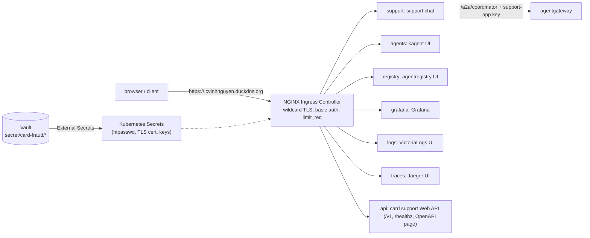
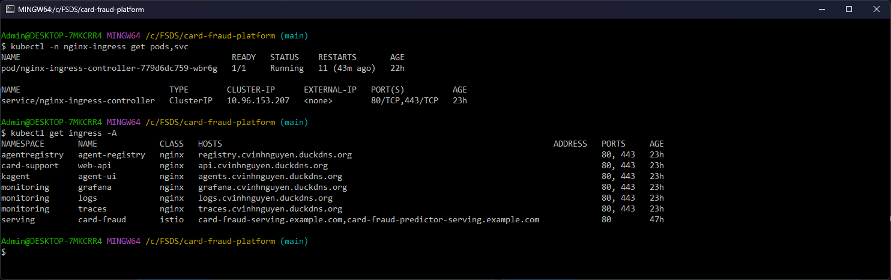
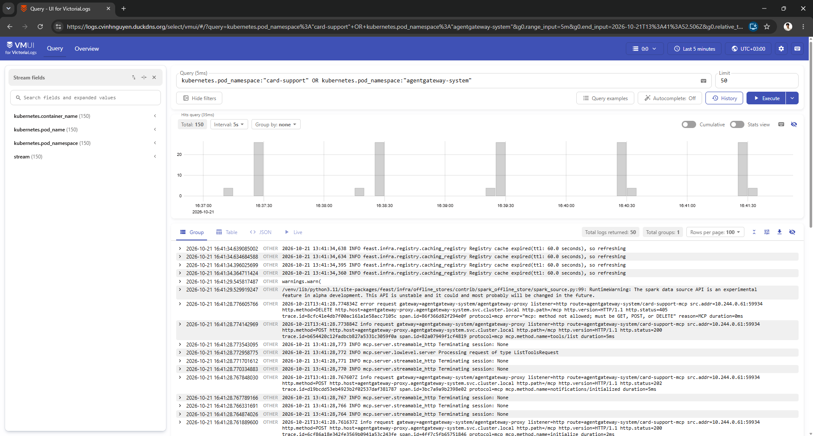
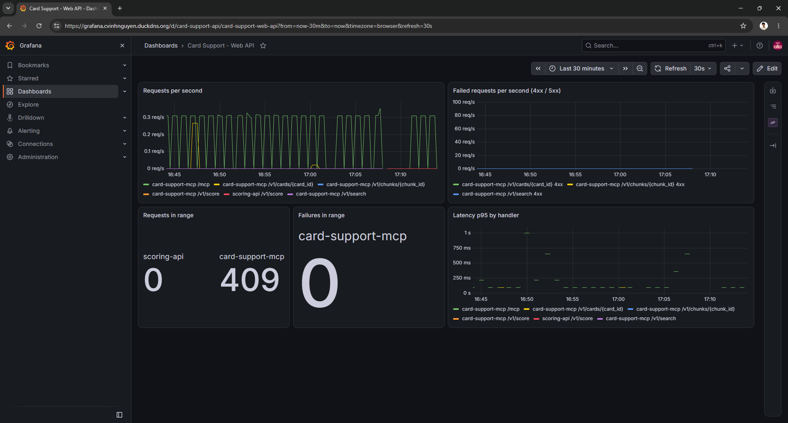
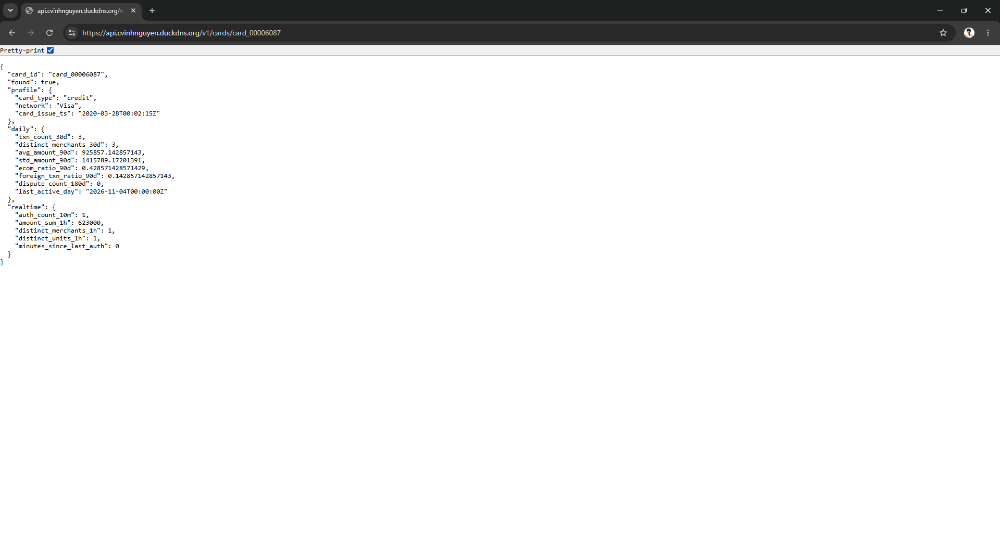
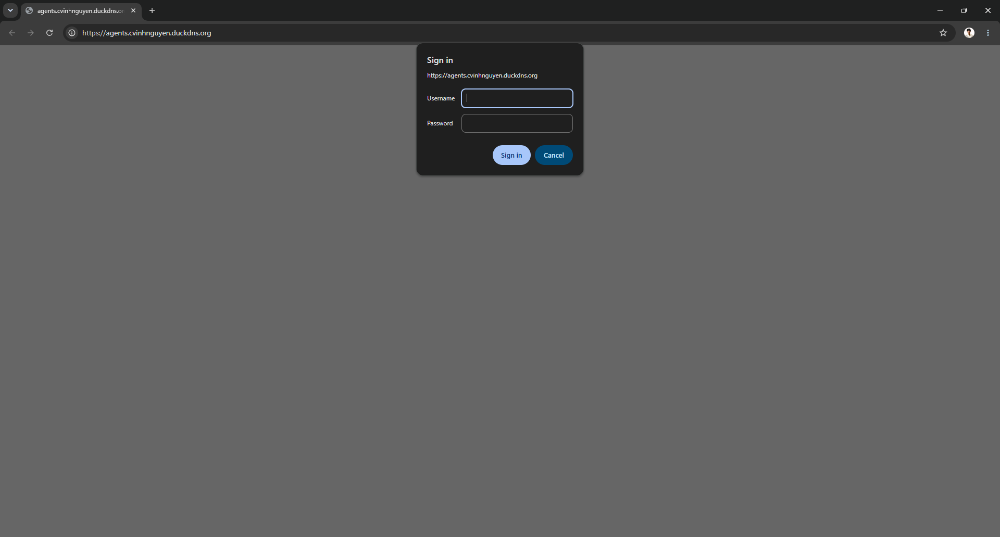
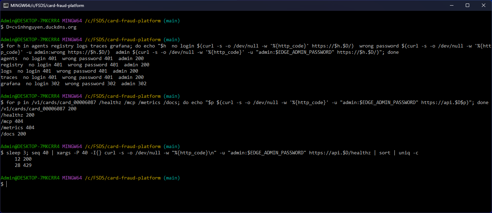
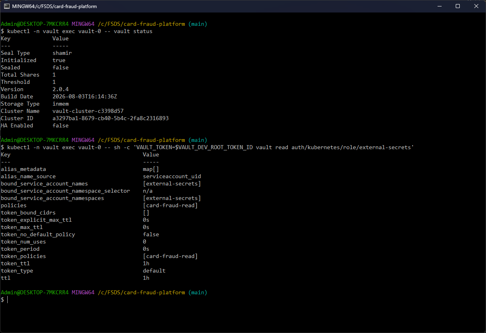
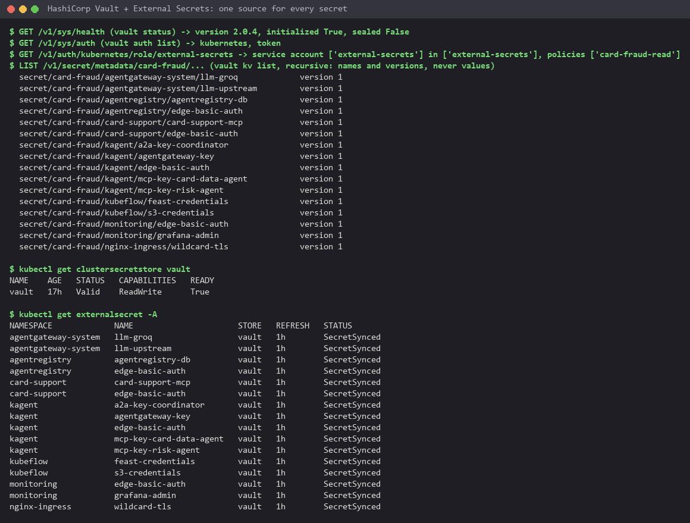

# Edge routing, HTTPS and secrets

The platform holds card data, so the way in has to be one door that is encrypted, asks who you are and cannot be
flooded, and no password may sit in the code. Nothing in the cluster is reached through a port-forward or a NodePort
by people: every UI and the public Web API sit
behind one NGINX Ingress Controller, on their own host name under a real domain, with HTTPS, a login and a rate limit.
Every secret the platform uses lives in HashiCorp Vault and reaches the cluster through the External Secrets
Operator (ESO), which copies each one into a Kubernetes Secret for the pods that need it.

| | |
|---|---|
| Code | [`infra/k8s/edge.sh`](https://github.com/cvinhnguyen/card-fraud-platform/blob/822721cab1ac597d118f100f1c49949f137f8a7d/infra/k8s/edge.sh), [`infra/k8s/edge/`](https://github.com/cvinhnguyen/card-fraud-platform/tree/822721cab1ac597d118f100f1c49949f137f8a7d/infra/k8s/edge), [`infra/k8s/tls.sh`](https://github.com/cvinhnguyen/card-fraud-platform/blob/822721cab1ac597d118f100f1c49949f137f8a7d/infra/k8s/tls.sh), [`infra/k8s/vault.sh`](https://github.com/cvinhnguyen/card-fraud-platform/blob/822721cab1ac597d118f100f1c49949f137f8a7d/infra/k8s/vault.sh), [`infra/k8s/secrets.sh`](https://github.com/cvinhnguyen/card-fraud-platform/blob/822721cab1ac597d118f100f1c49949f137f8a7d/infra/k8s/secrets.sh) |
| Runs on | kind namespaces `nginx-ingress` (the controller and the `edge` chart's release; each Ingress sits in the namespace of its service), `vault` (Vault, dev mode) and `external-secrets` (External Secrets Operator) |
| Reads | secret values from the gitignored `infra/.env`; the DuckDNS API for the DNS-01 challenge |
| Writes | Vault `secret/card-fraud/<namespace>/<name>`, one ExternalSecret and Kubernetes Secret per secret, the wildcard certificate in `nginx-ingress/wildcard-tls` |
| Related | [serving.md](../ml-platform/serving.md), [agents.md](../llm-platform/agents.md), [cicd.md](cicd.md) |

How a request from a browser or client reaches a service:



## Where it fits

The edge is the front door of Layer 3 (LLM and agent platform) in the kind cluster, the A1 arrow of the Layer 3
picture ([architecture.md](../architecture.md#system-diagram-layer-3)). A browser or a client reaches the UIs
(support chat, kagent, agentregistry, Grafana, VictoriaLogs, Jaeger) and the card support Web API only through NGINX, each on its
own host name under the domain. NGINX ends the HTTPS, asks for the login and limits the request rate, then passes the
request to the service. Vault and External Secrets supply what NGINX and the pods need: the htpasswd file, the
certificate and every API key or password ([agents.md](../llm-platform/agents.md), [cicd.md](cicd.md)).

## How it works

1. One Ingress per route, generated from a values file: host name, service, login or not, rate limit. The NGINX
   Ingress Controller listens on the kind node's ports 80 and 443, which map to `127.0.0.1` on the PC
   ([NGINX Ingress Controller](#nginx-ingress-controller)).
2. The domain `cvinhnguyen.duckdns.org` points at `127.0.0.1` (`tls.sh` sets it through the DuckDNS API). One
   Let's Encrypt wildcard certificate covers every host. The lego tool gets it with the DNS-01 challenge through the
   DuckDNS API, because the machine is not reachable from the internet ([Domain and HTTPS](#domain-and-https)).
3. Every host asks for a login (basic auth with the user `admin`; Grafana uses its own login) and allows 20 requests
   per second per client IP, the Web API and the support chat 5. Above that NGINX answers 429 ([Login and rate limit](#login-and-rate-limit)).
4. The Web API publishes only `/v1`, `/healthz` and the OpenAPI page. The MCP endpoint stays reachable only through
   agentgateway, and `/metrics` only by Prometheus inside the cluster.
5. Every secret is written once into Vault from the gitignored `infra/.env`. External Secrets copies each one into a
   Kubernetes Secret in the namespace that needs it and refreshes it hourly. No value is in git, on a command line or
   in a log ([Secrets](#secrets-hashicorp-vault--external-secrets)).

## Run it

In the kind cluster, after `infra/k8s/up.sh`; each script is idempotent and reads its secrets from `infra/.env`:

```bash
sh infra/k8s/vault.sh     # Vault + External Secrets, then secrets.sh (once after up.sh; again after a cluster restart)
sh infra/k8s/edge.sh      # NGINX Ingress Controller + one Ingress per route (after observability.sh)
sh infra/k8s/tls.sh       # Let's Encrypt wildcard certificate (DNS-01), then secrets.sh and edge.sh turn HTTPS on
sh infra/k8s/secrets.sh   # after a value in infra/.env changes or a namespace is added
```

## NGINX Ingress Controller

F5 NGINX Ingress Controller 5.6.3 (chart 2.7.3) runs on the kind node's ports 80 and 443, which
[`infra/k8s/kind.yaml` L12-L14](https://github.com/cvinhnguyen/card-fraud-platform/blob/822721cab1ac597d118f100f1c49949f137f8a7d/infra/k8s/kind.yaml#L12-L14)
maps to `127.0.0.1`.
[`infra/k8s/edge.sh`](https://github.com/cvinhnguyen/card-fraud-platform/blob/822721cab1ac597d118f100f1c49949f137f8a7d/infra/k8s/edge.sh)
installs it and then the small chart
[`infra/k8s/edge/`](https://github.com/cvinhnguyen/card-fraud-platform/tree/822721cab1ac597d118f100f1c49949f137f8a7d/infra/k8s/edge):
one Ingress per route, all generated from
[`infra/k8s/edge/values.yaml`](https://github.com/cvinhnguyen/card-fraud-platform/blob/822721cab1ac597d118f100f1c49949f137f8a7d/infra/k8s/edge/values.yaml)
by
[`infra/k8s/edge/templates/ingresses.yaml`](https://github.com/cvinhnguyen/card-fraud-platform/blob/822721cab1ac597d118f100f1c49949f137f8a7d/infra/k8s/edge/templates/ingresses.yaml).

| Host | Service | Rubric | Login | Rate limit per client IP |
|---|---|---|---|---|
| `grafana.<domain>` | Grafana (metrics) | C37 | Grafana's own login | 20 r/s, burst 60 |
| `logs.<domain>` | VictoriaLogs UI | C38 | basic auth | 20 r/s, burst 60 |
| `traces.<domain>` | Jaeger UI | C39 | basic auth | 20 r/s, burst 60 |
| `support.<domain>` | support chat, the page support users ask the coordinator on; it sends each question to agentgateway first ([agents.md](../llm-platform/agents.md#support-chat-gateway-first)) | | basic auth | 5 r/s, burst 20; no buffering and 300 s reads, since an answer can take minutes |
| `agents.<domain>` | kagent UI, the admin and test console of the agents | C40, C42 | basic auth | 20 r/s, burst 60; no buffering and 300 s reads, so streamed answers arrive as they are written |
| `registry.<domain>` | agentregistry UI | C41 | basic auth | 20 r/s, burst 60 |
| `api.<domain>` | card support Web API, only `/v1`, `/healthz` and the OpenAPI page (`/docs`, `/openapi.json`) | C43 | basic auth | 5 r/s, burst 10 |

The annotations in the template do the work: `nginx.org/basic-auth-secret` points at `edge-basic-auth` (an htpasswd
file for the user `admin`, from Vault), `nginx.org/limit-req-rate` and `limit-req-burst` set the per-IP limit and
`limit-req-reject-code: 429` the answer above it, `redirect-to-https` sends plain HTTP to HTTPS. The Web API route
lists its paths instead of `/` (`/v1` and `/healthz`, plus `/docs` and `/openapi.json` for the OpenAPI page): the MCP
endpoint is only reachable through agentgateway (with an agent's key) and `/metrics` only by Prometheus inside the
cluster.

[`infra/k8s/edge/templates/ingresses.yaml` L9-L29](https://github.com/cvinhnguyen/card-fraud-platform/blob/822721cab1ac597d118f100f1c49949f137f8a7d/infra/k8s/edge/templates/ingresses.yaml#L9-L29):

```yaml
  annotations:
    {{- if $r.auth }}
    nginx.org/basic-auth-secret: {{ $.Values.basicAuthSecret }}
    nginx.org/basic-auth-realm: "Card fraud platform"
    {{- end }}
    nginx.org/limit-req-rate: {{ $r.rate }}
    nginx.org/limit-req-burst: {{ $r.burst | quote }}
    nginx.org/limit-req-no-delay: "true"
    nginx.org/limit-req-reject-code: "429"
    {{- if $r.streaming }}
    nginx.org/proxy-buffering: "false"
    nginx.org/proxy-read-timeout: "300s"
    {{- end }}
    {{- if $.Values.tls }}
    nginx.org/redirect-to-https: "true"
    {{- end }}
spec:
  ingressClassName: nginx
  {{- if $.Values.tls }}
  tls:
    - hosts: [{{ printf "%s.%s" $r.host $.Values.domain }}]   # no secretName: the controller's wildcard TLS secret
```

The Web API route sends the public paths to the card-data MCP server (the Web API that pulls data by id; the other
two servers are reached only through agentgateway),
[`infra/k8s/edge/values.yaml` L54-L65](https://github.com/cvinhnguyen/card-fraud-platform/blob/822721cab1ac597d118f100f1c49949f137f8a7d/infra/k8s/edge/values.yaml#L54-L65):

```yaml
  - name: web-api             # Web API that pulls data by id: card data and policy chunks (MCP server card-data)
    namespace: card-support
    host: api
    service: {name: card-data-mcp, port: 8000}
    auth: true
    rate: 5r/s
    burst: 10
    paths:                     # REST only: /mcp is reachable only through agentgateway, /metrics only by Prometheus
      - {path: /v1, type: Prefix}
      - {path: /healthz, type: Exact}
      - {path: /docs, type: Exact}           # OpenAPI page (FastAPI) and the spec it loads
      - {path: /openapi.json, type: Exact}
```

The controller and the Ingresses in the cluster (the last line is KServe's own Istio ingress from
[serving.md](../ml-platform/serving.md), not part of the edge). The screenshot predates the `support-chat` Ingress, the
seventh route:



Every host opened in Chrome, logged in as `admin`, one screenshot per host (the support chat came later and has no screenshot
yet; its path is in [agents.md](../llm-platform/agents.md#support-chat-gateway-first)). First
`https://agents.cvinhnguyen.duckdns.org` (C40, C42), the kagent UI with the card support agents:


`https://registry.cvinhnguyen.duckdns.org` (C41), the agentregistry catalog:


`https://logs.cvinhnguyen.duckdns.org` (C38), the VictoriaLogs UI:



`https://traces.cvinhnguyen.duckdns.org` (C39), the Jaeger UI:


`https://grafana.cvinhnguyen.duckdns.org` (C37), Grafana:



`https://api.cvinhnguyen.duckdns.org` (C43), the Web API answering `/v1/cards/card_00006087`:



## Domain and HTTPS

The domain is `cvinhnguyen.duckdns.org` (DuckDNS, free), with its A record set to `127.0.0.1` because the platform
runs on this machine. One Let's Encrypt wildcard certificate, `*.cvinhnguyen.duckdns.org`, covers every host. The
machine is not reachable from the internet, so the HTTP-01 challenge cannot work;
[`infra/k8s/tls.sh`](https://github.com/cvinhnguyen/card-fraud-platform/blob/822721cab1ac597d118f100f1c49949f137f8a7d/infra/k8s/tls.sh)
runs lego v5.5.2 in a container with the DNS-01 challenge through the DuckDNS API, writes the certificate and key into
Vault, and External Secrets syncs them to `nginx-ingress/wildcard-tls`, NGINX's default wildcard TLS secret.
Certificates last 90 days: re-run `tls.sh` within the last 30 (this one expires on 2027-01-18).

[`infra/k8s/tls.sh` L22-L26](https://github.com/cvinhnguyen/card-fraud-platform/blob/822721cab1ac597d118f100f1c49949f137f8a7d/infra/k8s/tls.sh#L22-L26):

```sh
# the token reaches the container through the environment (-e NAME without a value), not the command line
DUCKDNS_TOKEN=$(val DUCKDNS_TOKEN) MSYS_NO_PATHCONV=1 docker run --rm -e DUCKDNS_TOKEN -v "$dir:/data" \
  "goacme/lego:$LEGO" run --accept-tos --dns duckdns -d "*.$DOMAIN" --key-type ec256 --path /data ${email:+--email "$email"}
sh infra/k8s/secrets.sh   # cert + key -> Vault -> nginx-ingress/wildcard-tls
sh infra/k8s/edge.sh      # wildcard TLS on, HTTPS hosts
```

What a client sees, from Git Bash: openssl reads the certificate the Web API presents and verifies it against the
CA bundle, and plain HTTP is redirected to HTTPS:


## Login and rate limit

Without a login, Chrome shows its own sign-in dialog for the realm NGINX sends:



The next screenshot checks three things from Git Bash. First, the status code of each host without a login, with a
wrong password and with the `admin` login (Grafana is not behind basic auth and redirects to its own login page).
Second, the Web API paths: the routes listed above answer, and the server's MCP endpoint and its metrics are not
published. Third, the rate limit: the Web API allows 5 requests per second per client IP with a burst of 10, and 40
requests sent at once get 12 answers and 28 `429`. The password comes from the environment; only its variable name
appears:



The same limit in the browser, right after such a burst:


The agents' chat UI over HTTPS is in [agents.md](../llm-platform/agents.md#chat-with-the-agents-kagent-ui).

## Secrets: HashiCorp Vault + External Secrets

[`infra/k8s/vault.sh`](https://github.com/cvinhnguyen/card-fraud-platform/blob/822721cab1ac597d118f100f1c49949f137f8a7d/infra/k8s/vault.sh)
installs Vault 2.0.4 (chart 0.34.1) and External Secrets Operator 2.11.0 and connects them:

- Vault runs the KV (key-value) v2 engine at `secret/`. Every secret of the cluster is at
  `secret/card-fraud/<namespace>/<name>`.
- External Secrets logs in to Vault with Kubernetes auth: the role `external-secrets` is bound to that operator's
  ServiceAccount and has the read-only policy `card-fraud-read` on `secret/card-fraud/*`
  ([`infra/k8s/vault.sh` L30-L34](https://github.com/cvinhnguyen/card-fraud-platform/blob/822721cab1ac597d118f100f1c49949f137f8a7d/infra/k8s/vault.sh#L30-L34)).
  External Secrets holds no Vault token. Vault itself runs in dev mode, so its root token is in its own Helm release
  and pod environment (see [Limits](#limits)).
- [`infra/k8s/secrets.sh`](https://github.com/cvinhnguyen/card-fraud-platform/blob/822721cab1ac597d118f100f1c49949f137f8a7d/infra/k8s/secrets.sh)
  writes the values from the gitignored `infra/.env` into Vault (JSON on stdin to the HTTP API, never on a command
  line or in a log) and one ExternalSecret per secret (ClusterSecretStore `vault`, refreshed hourly). Changing a value
  in Vault changes it in the cluster within the hour.
- Values never enter git: `infra/.env` and `infra/.secrets/` are gitignored and
  [`infra/make_env.py`](https://github.com/cvinhnguyen/card-fraud-platform/blob/822721cab1ac597d118f100f1c49949f137f8a7d/infra/make_env.py)
  generates random local values. The gateway keeps only SHA-256 hashes of its API keys.

One call per secret: the value goes to Vault, the ExternalSecret tells ESO where to read it
([`infra/k8s/secrets.sh` L35-L55](https://github.com/cvinhnguyen/card-fraud-platform/blob/822721cab1ac597d118f100f1c49949f137f8a7d/infra/k8s/secrets.sh#L35-L55)):

```sh
secret() {
  ns=$1 name=$2 type=$3; shift 3
  kubectl get ns "$ns" >/dev/null 2>&1 || return 0
  json=$(for kv in "$@"; do printf '"%s":"%s",' "${kv%%=*}" "${kv#*=}"; done)
  printf '{"data":{%s}}' "${json%,}" | curl -fsS -o /dev/null -K "$hdr" --data @- \
    "http://127.0.0.1:18200/v1/secret/data/card-fraud/$ns/$name" || { echo "vault write failed: $ns/$name" >&2; return 1; }
  kubectl apply -f - >/dev/null <<EOF
apiVersion: external-secrets.io/v1
kind: ExternalSecret
metadata:
  name: $name
  namespace: $ns
  annotations: {force-sync: "$sync"}   # sync now, not at the next refresh
spec:
  refreshInterval: 1h
  secretStoreRef: {kind: ClusterSecretStore, name: vault}
  target: {name: $name, creationPolicy: Owner, template: {type: $type}}
  dataFrom: [{extract: {key: card-fraud/$ns/$name, decodingStrategy: ${DECODE:-None}}}]
EOF
  echo "  vault -> $ns/$name"
}
```

The NGINX login is one of them; only the apr1 hash of `EDGE_ADMIN_PASSWORD` is stored
([`infra/k8s/secrets.sh` L73-L74](https://github.com/cvinhnguyen/card-fraud-platform/blob/822721cab1ac597d118f100f1c49949f137f8a7d/infra/k8s/secrets.sh#L73-L74)):

```sh
htpasswd="admin:$(printf '%s' "$(val EDGE_ADMIN_PASSWORD)" | openssl passwd -apr1 -stdin)"
for ns in kagent agentregistry monitoring card-support; do secret "$ns" edge-basic-auth nginx.org/htpasswd htpasswd="$htpasswd"; done
```

Below are Vault's status and the role External Secrets logs in with. The root token of dev mode stays inside the Vault
pod (`$VAULT_DEV_ROOT_TOKEN_ID` is expanded there, never typed or shown):



The next screenshot lists the secrets in Vault (names only, `vault kv list` never prints values) and every
ExternalSecret synced from them: 16 secrets in 7 namespaces, from the agents' gateway keys to the TLS certificate, all
`SecretSynced`. It predates the MCP split (2026-10-24) and the support chat. Since then `card-data-mcp` and
`policy-rag-mcp` have a Secret each in place of `card-support-mcp`'s, and the support chat's key
`a2a-key-support-app` was added, so `infra/k8s/secrets.sh` writes 18 (17 without the optional Groq key). The secrets
and their ExternalSecrets:



Jenkins is outside the cluster and keeps its own credentials, filled from Docker secrets by configuration as code
([cicd.md](cicd.md#jenkins-setup)); the cosign signing key is one of them.

## Limits

- Vault runs in dev mode: in memory and unsealed at start. After a restart it is empty until `vault.sh` runs again
  (the synced Kubernetes Secrets stay in place meanwhile). A real deployment would run it with Raft storage, several
  replicas and auto-unseal through a KMS (key management service).
- The domain points at `127.0.0.1`, so the HTTPS hosts work only on this machine; the certificate is a real public one.

Coursework rubric: A37 to A43, A54.
