# Infrastructure as code (Azure)

One infrastructure-as-code (IaC) run creates a small Azure environment, deploys the fraud model server to it twice,
checks that it answers, and destroys everything. Terraform creates the resources, Ansible configures the VM, and
kubectl deploys the image the local platform serves to AKS (Azure Kubernetes Service). As code, the setup can be
rebuilt the same way and reviewed. An Azure for Students subscription ($100 credit, no card) keeps it to
`polandcentral` and 2 vCPU for the VM + 2 for the AKS node ([Why not all of it on Azure](#why-not-all-of-it-on-azure)).

| | |
|---|---|
| Code | [`infra/terraform/`](https://github.com/cvinhnguyen/card-fraud-platform/tree/6457d47445ec1a910ebd2c01bc1edbff50f76d37/infra/terraform), [`infra/ansible/`](https://github.com/cvinhnguyen/card-fraud-platform/tree/6457d47445ec1a910ebd2c01bc1edbff50f76d37/infra/ansible), [`infra/k8s/aks/predictor.yaml`](https://github.com/cvinhnguyen/card-fraud-platform/blob/6457d47445ec1a910ebd2c01bc1edbff50f76d37/infra/k8s/aks/predictor.yaml) |
| Runs on | Azure, resource group `rg-cardfraud-dev` in `polandcentral` (each IaC run: created, checked, destroyed); Terraform, Ansible and kubectl run from the PC |
| Reads | `services/predictor/` (code + production model) for the VM; for AKS the predictor pipeline's image in GHCR (`ghcr.io/cvinhnguyen/fraud-predictor:v1-<commit>`), pushed to ACR as `fraud/predictor:1` (the runs below took it from the former local registry) |
| Writes | the Azure resources, `infra/ansible/inventory/hosts.ini`, `infra/.secrets/aks-kubeconfig`, the local Terraform state (the three files are gitignored) |
| Related | [serving.md](../ml-platform/serving.md), [architecture.md](../architecture.md) |

What one IaC run creates and deploys:

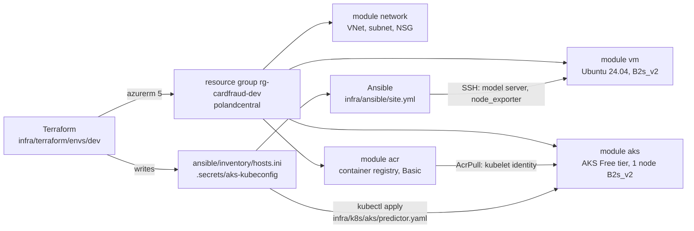

## Where it fits

- The deployment path to the cloud: the Azure box of the overview and the right side of the deployment picture
  ([architecture.md](../architecture.md#deployment)); the platform itself runs on the PC.
- Deploys the fraud model server of Layer 2 ([serving.md](../ml-platform/serving.md)) to a VM and to AKS.

## How it works

1. Terraform creates one resource group: a virtual network (VNet) with a network security group (NSG) that admits
   only the admin's IP, an Ubuntu VM, a one-node AKS cluster, a container registry (ACR), plus Ansible's inventory and
   the AKS kubeconfig ([Terraform](#terraform)).
2. Ansible configures the VM over SSH (firewall, Docker, the model server built from source, node_exporter); it fails
   unless the model answers a smoke prediction, and a second run changes nothing ([Ansible](#ansible)).
3. The image goes to the registry, and a plain Deployment on AKS pulls it with its kubelet identity, without a pull
   secret ([AKS](#aks-the-same-model-server-from-acr)).
4. `terraform destroy` removes it all, since the VM and the node are billed by the hour ([Destroy](#destroy)).
5. The subscription allows 6 vCPU, 3 public IPs and no GPU in the region, so only this runs in the cloud
   ([Why not all of it on Azure](#why-not-all-of-it-on-azure)).

## Run it

Create the resources with Terraform:

```bash
az login && export ARM_SUBSCRIPTION_ID=$(az account show --query id -o tsv)
cd infra/terraform/envs/dev
terraform init
terraform apply -var admin_cidr=$(curl -s https://api.ipify.org)/32
kubectl --kubeconfig ../../../.secrets/aks-kubeconfig get nodes
```

Fill `services/predictor/model/` (gitignored) from MLflow with
`python services/predictor/fetch_model.py --alias production` (`MLFLOW_TRACKING_URI` is `http://127.0.0.1:5000` for
the local platform), then run the playbook from the repo root:

```bash
# macOS / Linux
pip install ansible==14.5.0 && cd infra/ansible && ansible-playbook site.yml
# Windows: Ansible has no Windows control node, so it runs in a container (infra/ansible/Dockerfile)
docker build -t fraud/ansible:14.5.0 infra/ansible
docker run --rm -v "$PWD:/work:ro" -v "$HOME/.ssh/id_ed25519:/key:ro" fraud/ansible:14.5.0 ansible-playbook site.yml
```

Push the model image to ACR and deploy it on AKS:

```bash
az acr login -n crcardfrauddev
docker login ghcr.io -u <user>    # fraud-predictor is a private package; the token is read from the prompt
docker pull ghcr.io/cvinhnguyen/fraud-predictor:v1-<commit>   # the image the predictor pipeline pushed
docker tag ghcr.io/cvinhnguyen/fraud-predictor:v1-<commit> crcardfrauddev.azurecr.io/fraud/predictor:1
docker push crcardfrauddev.azurecr.io/fraud/predictor:1
sed -e "s#ACR#crcardfrauddev.azurecr.io#; s#MODEL_VERSION#1#" infra/k8s/aks/predictor.yaml |
  kubectl --kubeconfig infra/.secrets/aks-kubeconfig apply -f -
```

Destroy everything when done:

```bash
cd infra/terraform/envs/dev
terraform destroy -var admin_cidr=0.0.0.0/32     # the VM and the node are billed by the hour
```

## What runs where

| Where | What | Lifetime |
|---|---|---|
| The Windows PC (Ryzen 5 3600, 16 GB RAM, GTX 1070) | Layers 1-3: compose profiles in the Docker Desktop VM (8 GB + 4 GB swap), the kind cluster, the two llama.cpp model servers on the GPU | always |
| Azure, `rg-cardfraud-dev` in `polandcentral` | VNet, NSG, a VM running the fraud model server and node_exporter (Ansible), AKS running the same model server from ACR (kubectl) | one IaC run: created, checked, destroyed |
| SaaS | GitHub (Jenkins polls it; GHCR holds our images and their signatures), Langfuse Cloud EU (agent prompts, eval experiments), Groq (side B of the LLM A/B test), Let's Encrypt + DuckDNS (the HTTPS certificate) | always |

## Why not all of it on Azure

Every part is a container image, compose service or Helm chart, so most of it could move:

| On the PC | On Azure it would be |
|---|---|
| kind cluster: KFP, KServe, kagent, agentgateway, monitoring, Vault | AKS with the same charts and manifests; the NodePorts become a load balancer or the NGINX ingress |
| compose services: Kafka, Spark, Airflow, DataHub, Postgres, Redis, SeaweedFS | VMs configured by Ansible, or managed services: Event Hubs (Kafka API), Blob Storage, Azure Database for PostgreSQL, Azure Cache for Redis |
| llama.cpp on the GTX 1070 | a GPU VM, or an LLM API such as Groq (already side B of the A/B test) |

The subscription keeps it on the PC. Quotas come from `az vm list-usage` and `az network list-usages` during the run
on 2026-10-22 ([screenshot below](#run-on-2026-10-22)); prices are Linux pay-as-you-go in `polandcentral` (Azure Retail
Prices API).

- Only 5 EU regions, and only `polandcentral` lets AKS use the B-series the quota covers (in `germanywestcentral`
  AKS offers only v6/v7 sizes, quota 0).
- 6 vCPU per region, no increase: the run takes 4 (2 VM, 2 AKS node) and another VM in the subscription the last 2.
- 3 public IPs per region, taken by the VM, the AKS outbound load balancer and the other VM, so the model server on
  AKS gets no load balancer ([AKS](#aks-the-same-model-server-from-acr)).
- GPU sizes on sale (T4, A10, A100, H100 families) have a quota of 0, so the chat and embedding models cannot run
  there; a T4 VM (NC4as T4 v3) would cost $0.656 an hour.
- The PC has 16 GB of RAM; the Docker Desktop VM gets 8 GB plus 4 GB swap, so not every compose profile fits at once.
  A 16 GB VM (D4s v3, 4 vCPU) costs $0.23 an hour, about $168 a month, so the $100 credit lasts about 18 days; a 32 GB
  one (D8s v3, $0.46 an hour) does not fit the 6 vCPU quota.

A run of an hour or two costs under a dollar of credit: two B2s v2 at $0.096 an hour each, plus the registry, the
disks and the load balancer while they exist.

## Terraform

[`infra/terraform/`](https://github.com/cvinhnguyen/card-fraud-platform/tree/6457d47445ec1a910ebd2c01bc1edbff50f76d37/infra/terraform)
has one module per service and one folder per environment (the layout the rubric links to):

```text
infra/terraform/
  modules/network/   VNet, subnet, NSG: only the admin's IP reaches SSH (22), the model server (8080), node_exporter (9100)
  modules/vm/        static public IP, NIC, Ubuntu 24.04 VM, SSH key login only
  modules/aks/       AKS Free tier (no control plane fee), 1 system node, Azure CNI overlay, managed identity
  modules/acr/       container registry (Basic, no admin user): AKS pulls with its kubelet identity
  envs/dev/          the resource group + the 4 modules + AcrPull for AKS; writes Ansible's inventory and the AKS kubeconfig
```

- azurerm 5 registers no resource providers: `resource_providers_to_register` lists the four needed
  ([`infra/terraform/envs/dev/versions.tf`
  L16-L22](https://github.com/cvinhnguyen/card-fraud-platform/blob/6457d47445ec1a910ebd2c01bc1edbff50f76d37/infra/terraform/envs/dev/versions.tf#L16-L22)),
  and `node_provisioning_profile` is required on the AKS cluster ([`infra/terraform/modules/aks/main.tf`
  L36-L38](https://github.com/cvinhnguyen/card-fraud-platform/blob/6457d47445ec1a910ebd2c01bc1edbff50f76d37/infra/terraform/modules/aks/main.tf#L36-L38)).
- The subscription id comes from `ARM_SUBSCRIPTION_ID`. State, plan, inventory (VM IP) and kubeconfig are
  gitignored; the state is local, since one person runs this.
- `admin_cidr` is required and must be one address (`/32`), never a whole network; the AKS API server takes it as its
  only authorized IP range
  ([`infra/terraform/modules/aks/main.tf`](../../infra/terraform/modules/aks/main.tf), `api_server_access_profile`),
  a block added on 2026-11-13 ([Run on 2026-11-13](#run-on-2026-11-13)).

The environment wires the resource group and the modules
([`infra/terraform/envs/dev/main.tf`
L17-L62](https://github.com/cvinhnguyen/card-fraud-platform/blob/6457d47445ec1a910ebd2c01bc1edbff50f76d37/infra/terraform/envs/dev/main.tf#L17-L62)).
The check on `admin_cidr` ([`infra/terraform/envs/dev/variables.tf`
L13-L21](../../infra/terraform/envs/dev/variables.tf#L13-L21)):

```hcl
variable "admin_cidr" {
  description = "The admin's public IP as /32: the only source allowed to reach the VM and the AKS API server"
  type        = string

  validation {
    condition     = can(cidrhost(var.admin_cidr, 0)) && endswith(var.admin_cidr, "/32")
    error_message = "admin_cidr must be one address as /32 (the admin's public IP)."
  }
}
```

The NSG rules use it for SSH on port 22
([`infra/terraform/modules/network/main.tf`
L24-L34](https://github.com/cvinhnguyen/card-fraud-platform/blob/6457d47445ec1a910ebd2c01bc1edbff50f76d37/infra/terraform/modules/network/main.tf#L24-L34))
and the service ports ([`infra/terraform/modules/network/main.tf`
L36-L46](https://github.com/cvinhnguyen/card-fraud-platform/blob/6457d47445ec1a910ebd2c01bc1edbff50f76d37/infra/terraform/modules/network/main.tf#L36-L46)):

```hcl
  security_rule {
    name                       = "services-from-admin"
    priority                   = 110
    direction                  = "Inbound"
    access                     = "Allow"
    protocol                   = "Tcp"
    source_port_range          = "*"
    destination_port_ranges    = [for p in var.service_ports : tostring(p)]
    source_address_prefix      = var.admin_cidr
    destination_address_prefix = "*"
  }
```

### Run on 2026-10-22

`terraform apply` from an empty state: 13 resources, the AKS cluster in 3m23s (`grep` keeps the "Creation complete" lines, `sed` cuts the
`[id=/subscriptions/...]` suffix, and the plan is left out because it prints the admin IP):

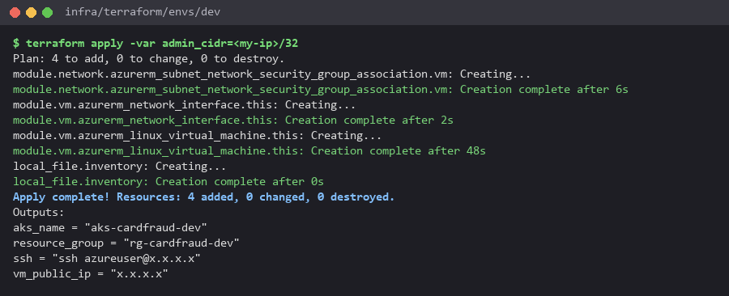

The resource group's 8 resources in the Azure Portal (tenant, subscription id and account blanked out):

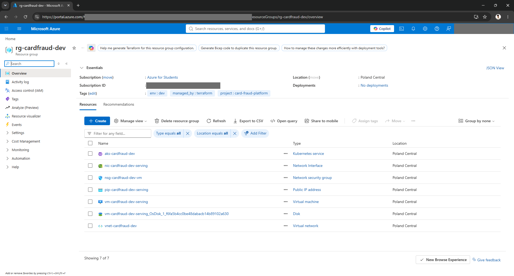

Its Resource visualizer:

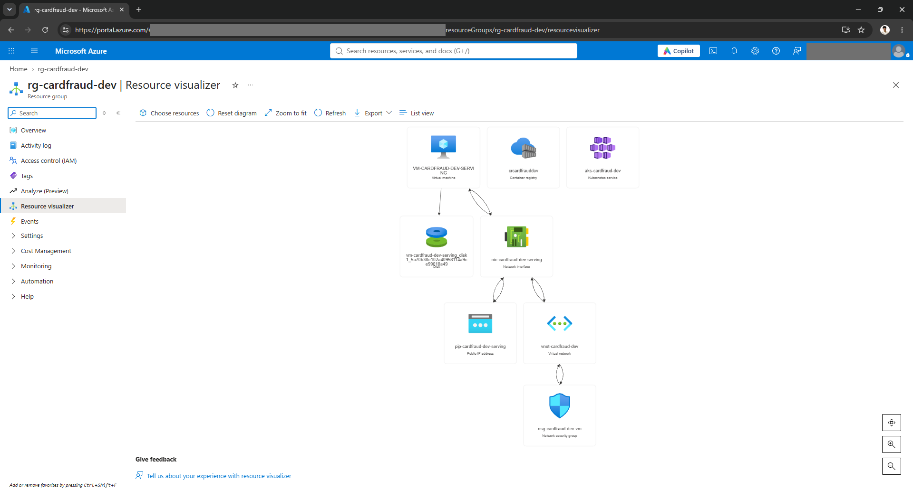

The VM: B2s v2, Ubuntu 24.04, Poland Central:

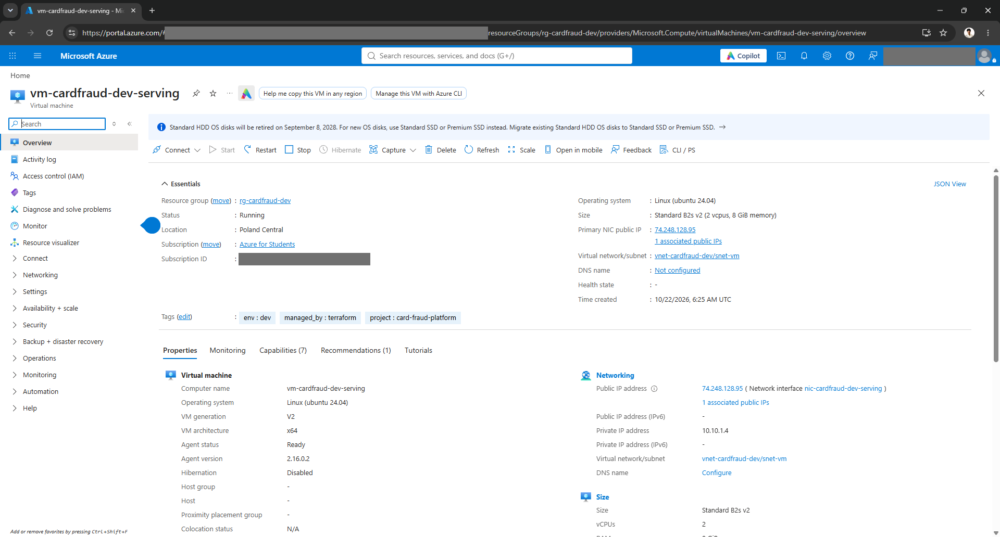

The AKS cluster: Kubernetes 1.36.4, Free tier, Azure CNI Overlay, 1 node pool, registry `crcardfrauddev`:

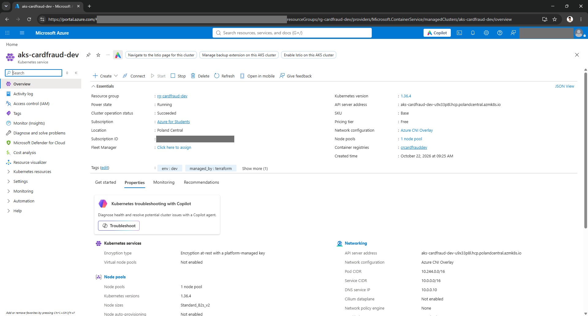

State and quotas during the run: its 4 vCPU (Bsv2 family) and the other VM's 2 (Basv2) fill the region's 6, the GPU
families are at 0 of 0, the public IPs at 3 of 3:

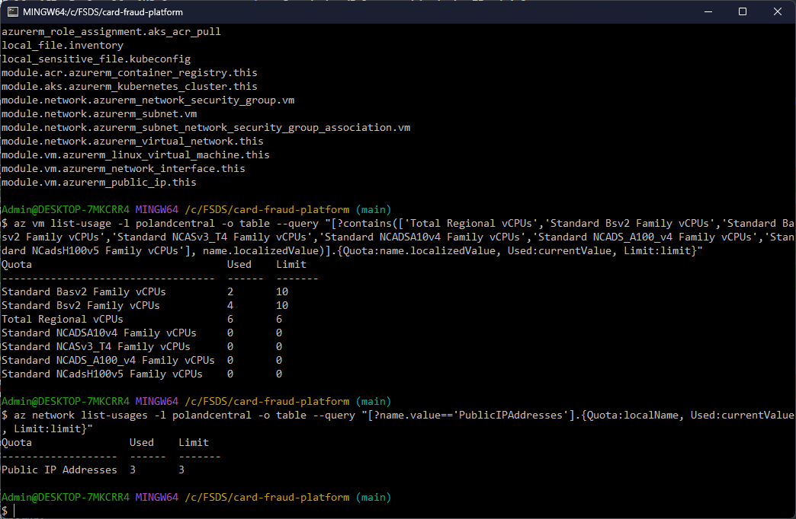

### Run on 2026-11-13

`terraform apply` with the `api_server_access_profile` block: 13 resources (AKS in 3m33s), `az aks show` listed the
admin address as the only authorized range, `kubectl get nodes` from it answered (1 node Ready), then all was destroyed.

## Ansible

[`infra/ansible/site.yml`](https://github.com/cvinhnguyen/card-fraud-platform/blob/6457d47445ec1a910ebd2c01bc1edbff50f76d37/infra/ansible/site.yml)
applies four roles to the `serving` group (the Terraform VM; [`infra/ansible/site.yml`
L10-L17](https://github.com/cvinhnguyen/card-fraud-platform/blob/6457d47445ec1a910ebd2c01bc1edbff50f76d37/infra/ansible/site.yml#L10-L17)):

| Role | What it does |
|---|---|
| `common` | base packages, `ufw`: deny inbound except 22 / 8080 / 9100 (a second firewall behind the NSG; Docker's published 8080 bypasses it, see [Gotchas](#gotchas)) |
| `docker` | Docker engine + compose plugin from the Ubuntu archive, started at boot |
| `predictor` | copies `services/predictor` (code + production model), builds the image on the VM (no registry credential), runs it with compose and checks it |
| `node_exporter` | host metrics for Prometheus on :9100 |

A code or model change rebuilds the image (handler on the copy); otherwise the role only checks the container. The
play fails unless the model answers
([`infra/ansible/roles/predictor/tasks/main.yml`
L25-L44](https://github.com/cvinhnguyen/card-fraud-platform/blob/6457d47445ec1a910ebd2c01bc1edbff50f76d37/infra/ansible/roles/predictor/tasks/main.yml#L25-L44)):

```yaml
- name: Model is loaded and ready
  ansible.builtin.uri:
    url: "http://localhost:{{ predictor_port }}/v1/models/{{ predictor_model_name }}"
  register: ready
  until: ready.status == 200 and ready.json.ready | default(false)
  retries: 30
  delay: 5

- name: Smoke prediction (an empty instance, every feature missing)
  ansible.builtin.uri:
    url: "http://localhost:{{ predictor_port }}/v1/models/{{ predictor_model_name }}:predict"
    method: POST
    body_format: json
    body: {instances: [{}]}
  register: prediction
  failed_when: prediction.json.predictions | length != 1

- name: Served model version
  ansible.builtin.debug:
    msg: "model {{ prediction.json.model_version }}, score {{ prediction.json.predictions[0] }}"
```

The first run on the new VM made 9 changes; the model answered with version 1 of the registry:

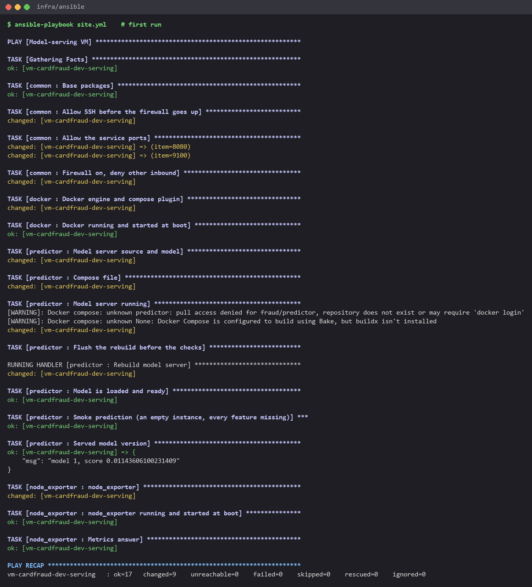

<details>
<summary>Full log of a first run (2026-10-21, the same tasks)</summary>

```text
$ ansible-playbook site.yml

PLAY [Model-serving VM] ********************************************************

TASK [Gathering Facts] *********************************************************
ok: [vm-cardfraud-dev-serving]

TASK [common : Base packages] **************************************************
ok: [vm-cardfraud-dev-serving]

TASK [common : Allow SSH before the firewall goes up] **************************
changed: [vm-cardfraud-dev-serving]

TASK [common : Allow the service ports] ****************************************
changed: [vm-cardfraud-dev-serving] => (item=8080)
changed: [vm-cardfraud-dev-serving] => (item=9100)

TASK [common : Firewall on, deny other inbound] ********************************
changed: [vm-cardfraud-dev-serving]

TASK [docker : Docker engine and compose plugin] *******************************
changed: [vm-cardfraud-dev-serving]

TASK [docker : Docker running and started at boot] *****************************
ok: [vm-cardfraud-dev-serving]

TASK [predictor : Model server source and model] *******************************
changed: [vm-cardfraud-dev-serving]

TASK [predictor : Compose file] ************************************************
changed: [vm-cardfraud-dev-serving]

TASK [predictor : Model server running] ****************************************
[WARNING]: Docker compose: unknown predictor: pull access denied for fraud/predictor, repository does not exist or may require 'docker login'
[WARNING]: Docker compose: unknown None: Docker Compose is configured to build using Bake, but buildx isn't installed
changed: [vm-cardfraud-dev-serving]

TASK [predictor : Flush the rebuild before the checks] *************************

RUNNING HANDLER [predictor : Rebuild model server] *****************************
changed: [vm-cardfraud-dev-serving]

TASK [predictor : Model is loaded and ready] ***********************************
ok: [vm-cardfraud-dev-serving]

TASK [predictor : Smoke prediction (an empty instance, every feature missing)] ***
ok: [vm-cardfraud-dev-serving]

TASK [predictor : Served model version] ****************************************
ok: [vm-cardfraud-dev-serving] => {
    "msg": "model 1, score 0.01143606100231409"
}

TASK [node_exporter : node_exporter] *******************************************
changed: [vm-cardfraud-dev-serving]

TASK [node_exporter : node_exporter running and started at boot] ***************
ok: [vm-cardfraud-dev-serving]

TASK [node_exporter : Metrics answer] ******************************************
ok: [vm-cardfraud-dev-serving]

PLAY RECAP *********************************************************************
vm-cardfraud-dev-serving   : ok=17   changed=9    unreachable=0    failed=0    skipped=0    rescued=0    ignored=0
```

</details>

The `pull access denied` warning is expected: the image is built on the VM, never pulled. A second run makes 0
changes (`ok=16 changed=0`):

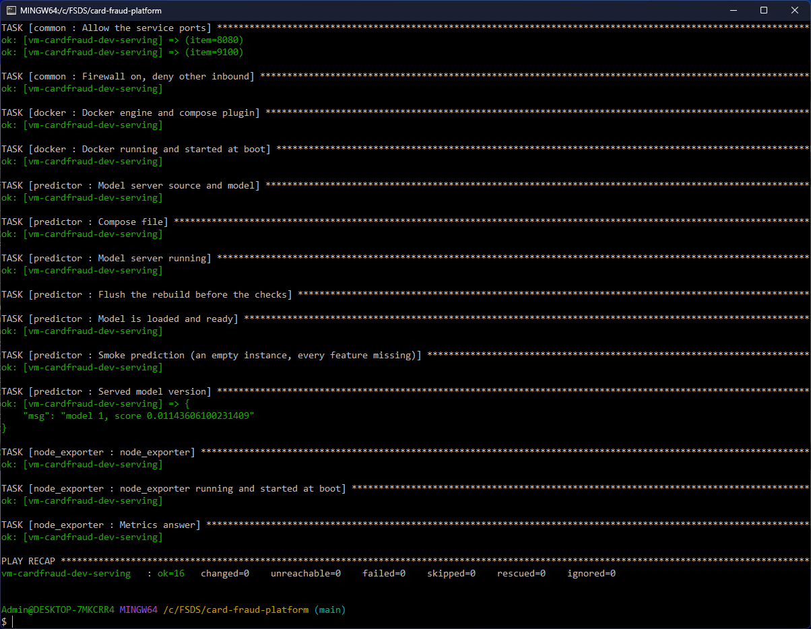

From the PC through the NSG (2026-10-21 run), curl reaches the model server on 8080 and node_exporter on 9100:

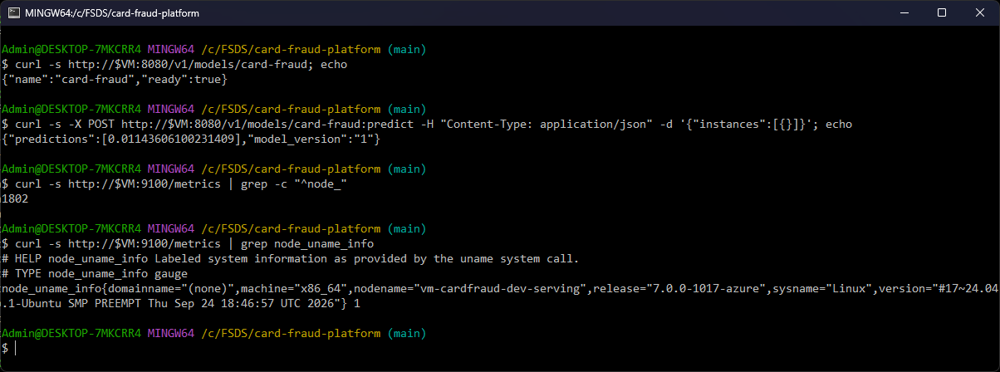

## AKS: the same model server, from ACR

AKS runs the image the local platform serves, `fraud/predictor:1` (the model inside, as on kind), from the
Terraform registry. Terraform grants the kubelet identity `AcrPull` on it, so the cluster holds no pull secret
([`infra/terraform/envs/dev/main.tf`
L65-L70](https://github.com/cvinhnguyen/card-fraud-platform/blob/6457d47445ec1a910ebd2c01bc1edbff50f76d37/infra/terraform/envs/dev/main.tf#L65-L70)):

```hcl
resource "azurerm_role_assignment" "aks_acr_pull" {
  scope                            = module.acr.id
  role_definition_name             = "AcrPull"
  principal_id                     = module.aks.kubelet_object_id
  skip_service_principal_aad_check = true
}
```

[`infra/k8s/aks/predictor.yaml`](https://github.com/cvinhnguyen/card-fraud-platform/blob/6457d47445ec1a910ebd2c01bc1edbff50f76d37/infra/k8s/aks/predictor.yaml)
is a plain Deployment, since one B2s v2 node has no room for KServe and cert-manager: 2 replicas,
`maxUnavailable: 0`, a readiness probe on the model, non-root ([Run it](#run-it)).

A `LoadBalancer` Service gets no public IP here: Azure answers `PublicIPCountLimitReached`, "Cannot create more than
3 public IP addresses for this subscription in this region", so the Service is a `ClusterIP`, checked through
`kubectl port-forward`:

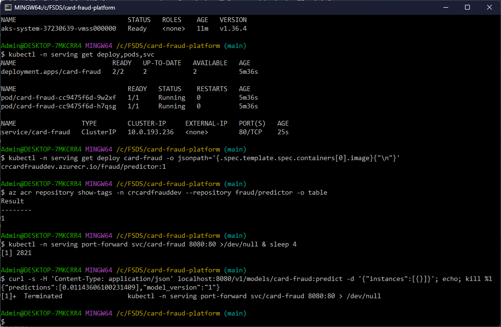

The deployment `card-fraud` in the Portal:

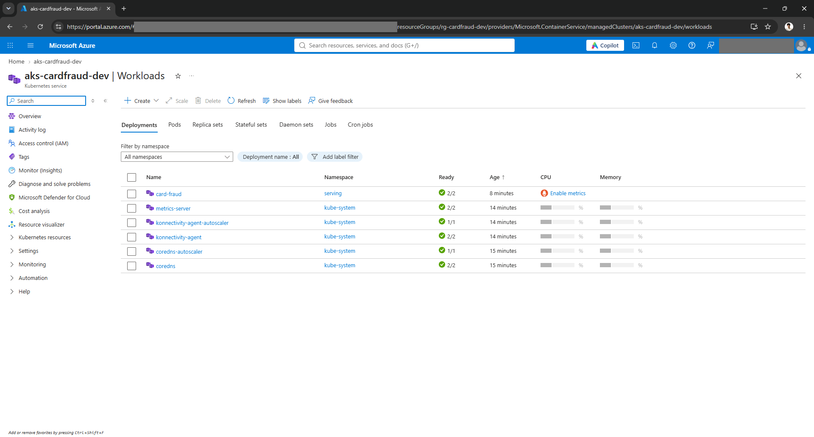

The repository `fraud/predictor`:

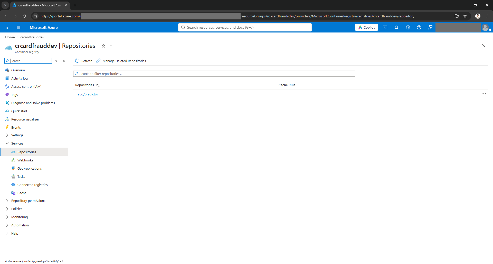

## Destroy

`terraform destroy` ([Run it](#run-it)) removed the 13 resources and the resource group; only the summary lines are shown, since the plan prints the ids and the
admin IP:

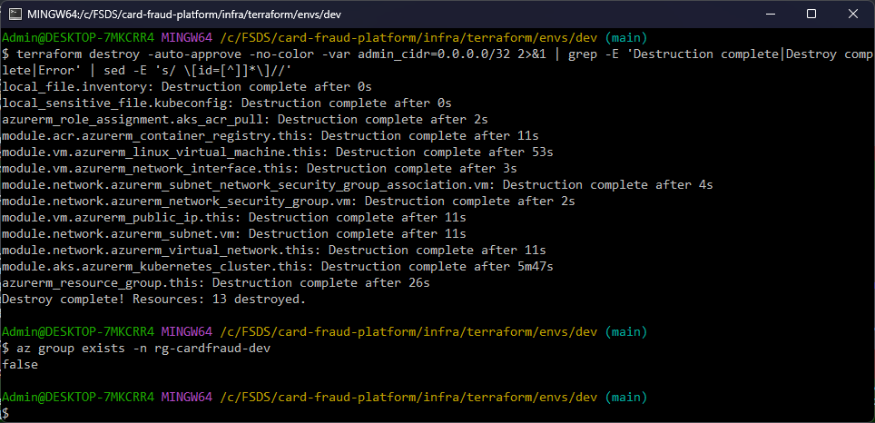

## Gotchas

- Port 8080 on the VM stays open despite `ufw`: Docker publishes ports through its own iptables chains first. The
  NSG is the firewall that holds for 8080.
- `ssh` in the Ansible container refuses the key: bind-mounted files from Windows are world-readable. The container
  copies `/key` to `~/.ssh` with mode 600 first
  ([`infra/ansible/Dockerfile`
  L8](https://github.com/cvinhnguyen/card-fraud-platform/blob/6457d47445ec1a910ebd2c01bc1edbff50f76d37/infra/ansible/Dockerfile#L8)).
- `[Errno 12] Cannot allocate memory` reading `model.json`: the Ansible container runs on the PC, and once failed this
  way on a loaded Docker Desktop VM. The rerun passed.
- The first attempts (2026-10-21) failed: `Standard_B2s_v2` not allowed for AKS and out of VM capacity in
  `germanywestcentral`, then two transient `404` right after the VNet and subnet were created in `polandcentral`.
