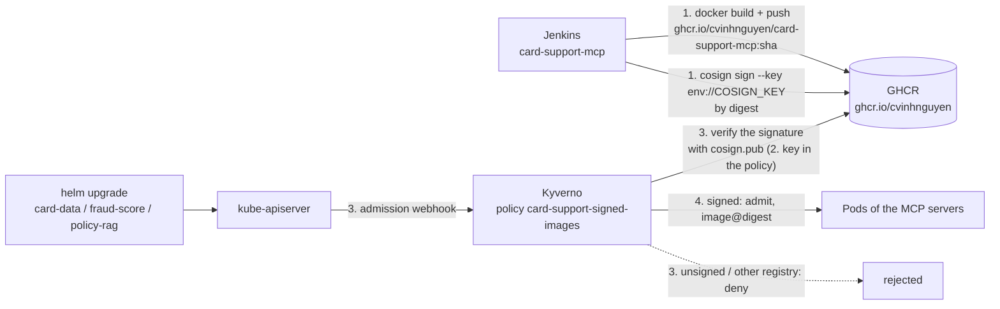
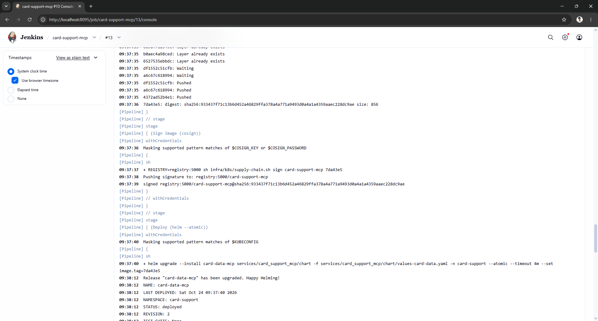
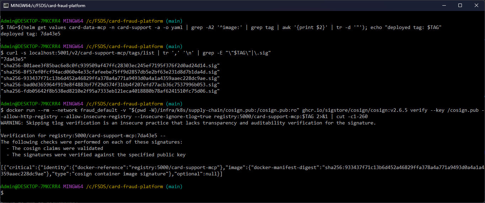
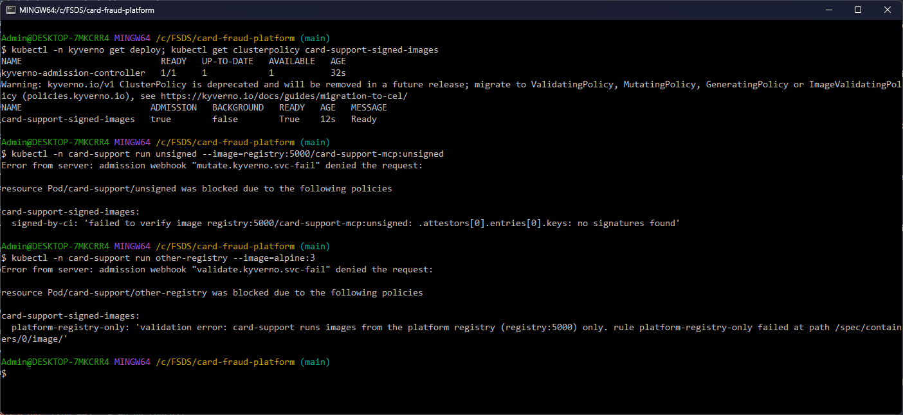
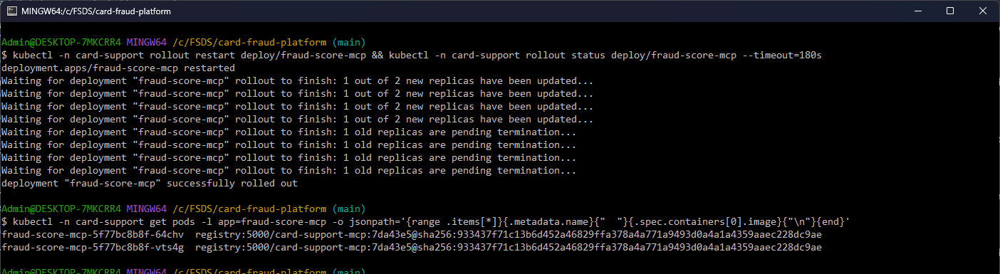

# Novel idea: only signed images run (cosign + Kyverno admission)

The rest of the platform checks who calls what (gateway API keys, NetworkPolicies, Vault); this checks what runs.
The MCP (Model Context Protocol) servers' pipeline, like the model server's, signs every image with a key only CI
holds ([cosign](https://github.com/sigstore/cosign)). A [Kyverno](https://kyverno.io) admission policy refuses a Pod
in `card-support` unless its image comes from GHCR (`ghcr.io/cvinhnguyen`) with a valid signature, and pins it to the
verified digest. Not covered in the EDAI course: software supply-chain security (image signing and signature
verification at admission).

| | |
|---|---|
| Code | [`infra/k8s/supply-chain.sh`](https://github.com/cvinhnguyen/card-fraud-platform/blob/54d21eddbf6e602ae13fed46a1a9e0ef265d23cd/infra/k8s/supply-chain.sh), [`infra/k8s/supply-chain/`](https://github.com/cvinhnguyen/card-fraud-platform/tree/54d21eddbf6e602ae13fed46a1a9e0ef265d23cd/infra/k8s/supply-chain), [`services/card_support_mcp/Jenkinsfile`](https://github.com/cvinhnguyen/card-fraud-platform/blob/54d21eddbf6e602ae13fed46a1a9e0ef265d23cd/services/card_support_mcp/Jenkinsfile) (stage "Sign image (cosign)") |
| Runs on | signing: Jenkins (compose profile `cicd`) with cosign v2.6.5 in its image; admission: Kyverno 1.19.1 in kind namespace `kyverno`, policy on namespace `card-support` |
| Reads | images in GHCR (`ghcr.io/cvinhnguyen`, public packages) |
| Writes | one signature artifact (`sha256-<digest>.sig`) per signed image, in the same registry |
| Related | [cicd.md](cicd.md), [agents.md](../llm-platform/agents.md) |

From the CI build to the admitted Pod:



## Where it fits

- Signing: the Jenkins pipeline of the MCP tool servers ([cicd.md](cicd.md#mcp-servers)), arrow C3 of the Layer 3
  picture; deploy is C4 ([architecture.md](../architecture.md#numbered-arrows-layer-3)).
- Checking: Kyverno in the kind namespace `card-support`, where those servers run
  ([agents.md](../llm-platform/agents.md#the-three-mcp-servers)); the agents' kagent images are outside the policy.
- On this machine Kyverno is installed only for the demo and then removed ([Limits](#limits)).

## How it works

1. The pipeline pushes the image to GHCR and signs its digest; the signature sits next to the image
   ([Pieces](#pieces)).
2. The public key, in the repo, is written into a Kyverno policy on `card-support`.
3. A new Pod there must use the platform registry and a signature that verifies; any other image is refused
   ([Admission](#admission)).
4. Kyverno replaces the tag with the verified digest, so the Pod runs exactly the checked bytes even if the tag moves.
5. CI signs before it deploys; the policy is the second line, for anything that bypasses the pipeline.

## Run it

In the kind cluster (after `infra/k8s/up.sh`). The key pair comes from `cosign generate-key-pair`, run once
([Gotchas](#gotchas)); signing by hand needs the private key in `infra/.secrets/cosign.key` (or `COSIGN_KEY`):

```bash
sh infra/k8s/supply-chain.sh                              # install / update: Kyverno and the policy
GHCR_USER=<user> GHCR_TOKEN=<token> sh infra/k8s/supply-chain.sh sign card-support-mcp <tag>   # CI does this in "Sign image (cosign)"
docker run --rm -v "$PWD/infra/k8s/supply-chain:/k:ro" ghcr.io/sigstore/cosign/cosign:v2.6.5 verify \
  --key /k/cosign.pub --insecure-ignore-tlog=true ghcr.io/cvinhnguyen/card-support-mcp:<tag>   # check a signature
helm uninstall kyverno -n kyverno                         # remove after the demo, then delete the *kyverno* webhook configurations
```

`<tag>` is the short commit SHA CI pushed (`git rev-parse --short=7 HEAD`).

## Problem

The MCP servers in `card-support` serve card data, and two (card-data, policy-rag) hold the online stores' passwords ([`infra/k8s/secrets.sh`
L65-L69](https://github.com/cvinhnguyen/card-fraud-platform/blob/54d21eddbf6e602ae13fed46a1a9e0ef265d23cd/infra/k8s/secrets.sh#L65-L69)).
Before this change the cluster ran whatever image a Deployment named, next to the customers' card data.

- The registry of that time (compose service `registry:3` on `127.0.0.1:5001`) asked for no login.
- GHCR needs a `write:packages` token to push, but a leaked token or a re-pushed tag would still run unchecked.
- A tag proves nothing: build #16 pushed commit `7da43e5` again under the same tag with a new digest
  ([Proof](#proof)), so a tested tag can point at other bytes when the next Pod starts.

## Pieces

| Piece | Where | Role |
|---|---|---|
| private key | `infra/.secrets/cosign.key` (gitignored), encrypted with `COSIGN_PASSWORD` from `infra/.env` | signs in CI |
| public key | [`infra/k8s/supply-chain/cosign.pub`](https://github.com/cvinhnguyen/card-fraud-platform/blob/54d21eddbf6e602ae13fed46a1a9e0ef265d23cd/infra/k8s/supply-chain/cosign.pub) | written into the policy |
| signing script | [`infra/k8s/supply-chain.sh`](https://github.com/cvinhnguyen/card-fraud-platform/blob/54d21eddbf6e602ae13fed46a1a9e0ef265d23cd/infra/k8s/supply-chain.sh) `sign <repo> <tag>` | signs one image by digest |
| policy | [`infra/k8s/supply-chain/signed-images.yaml`](https://github.com/cvinhnguyen/card-fraud-platform/blob/54d21eddbf6e602ae13fed46a1a9e0ef265d23cd/infra/k8s/supply-chain/signed-images.yaml) on Kyverno | admits or refuses Pods in `card-support` |

`COSIGN_PASSWORD` comes from
[`infra/make_env.py`
L45](https://github.com/cvinhnguyen/card-fraud-platform/blob/54d21eddbf6e602ae13fed46a1a9e0ef265d23cd/infra/make_env.py#L45).
Jenkins gets key and password as the credentials `cosign-key` and `cosign-password`, from Docker secrets
([`infra/docker-compose.yaml`
L846-L847](https://github.com/cvinhnguyen/card-fraud-platform/blob/54d21eddbf6e602ae13fed46a1a9e0ef265d23cd/infra/docker-compose.yaml#L846-L847)),
through [`infra/jenkins/casc.yaml`
L28-L29](https://github.com/cvinhnguyen/card-fraud-platform/blob/54d21eddbf6e602ae13fed46a1a9e0ef265d23cd/infra/jenkins/casc.yaml#L28-L29).

### Signing

[`infra/k8s/supply-chain.sh`
L15-L31](https://github.com/cvinhnguyen/card-fraud-platform/blob/54d21eddbf6e602ae13fed46a1a9e0ef265d23cd/infra/k8s/supply-chain.sh#L15-L31)
looks up the tag's digest in GHCR (`docker buildx imagetools inspect`) and signs
`ghcr.io/cvinhnguyen/<repo>@<digest>` with cosign v2.6.5; the key reaches cosign only through its environment
(`--key env://COSIGN_KEY`). In Jenkins, cosign is in the Jenkins image and pushes with the pipeline's
`docker login ghcr.io`; by hand it runs in a container with `GHCR_USER` and `GHCR_TOKEN` from the environment. The
signature is a separate artifact in the same package; nothing goes to the public Rekor transparency log.

### Admission

Kyverno 1.19.1 (chart 3.9.1, only the admission controller:
[`infra/k8s/supply-chain/kyverno-values.yaml`](https://github.com/cvinhnguyen/card-fraud-platform/blob/54d21eddbf6e602ae13fed46a1a9e0ef265d23cd/infra/k8s/supply-chain/kyverno-values.yaml))
enforces two rules:

| Rule | What it requires |
|---|---|
| `platform-registry-only` | the images of `card-support` Pods come from `ghcr.io/cvinhnguyen` |
| `signed-by-ci` | `verifyImages`: required, signature by `cosign.pub`, `mutateDigest` + `verifyDigest` |

[`infra/k8s/supply-chain/signed-images.yaml`
L14-L31](https://github.com/cvinhnguyen/card-fraud-platform/blob/54d21eddbf6e602ae13fed46a1a9e0ef265d23cd/infra/k8s/supply-chain/signed-images.yaml#L14-L31):

```yaml
- name: platform-registry-only
  match: {any: [{resources: {kinds: [Pod, Pod/ephemeralcontainers], namespaces: [card-support]}}]}
  validate:
    failureAction: Enforce
    message: "card-support runs images from the platform registry (ghcr.io/cvinhnguyen) only"
    pattern:
      spec:
        =(containers): [{image: "ghcr.io/cvinhnguyen/*"}]
        =(initContainers): [{image: "ghcr.io/cvinhnguyen/*"}]
        =(ephemeralContainers): [{image: "ghcr.io/cvinhnguyen/*"}]
- name: signed-by-ci   # verifyImages checks containers, initContainers and ephemeralContainers
  match: {any: [{resources: {kinds: [Pod, Pod/ephemeralcontainers], namespaces: [card-support]}}]}
  verifyImages:
    - imageReferences: ["ghcr.io/cvinhnguyen/*"]
      failureAction: Enforce
      mutateDigest: true
      verifyDigest: true
      required: true
```

GHCR serves HTTPS and the packages are public, so the kind node and Kyverno need no login or registry mirror.

## The run of 2026-10-24, step by step

This run used the compose registry of that time (`registry:5000`, pushed to as `localhost:5001`), which the
screenshots show; since 2026-11-21 the steps run against `ghcr.io/cvinhnguyen` ([Proof](#proof)).

### 1. CI signs the image it built

In
[`services/card_support_mcp/Jenkinsfile`](https://github.com/cvinhnguyen/card-fraud-platform/blob/54d21eddbf6e602ae13fed46a1a9e0ef265d23cd/services/card_support_mcp/Jenkinsfile)
the stage "Sign image (cosign)" sits between "Build + push image" and "Deploy"
([`services/card_support_mcp/Jenkinsfile`
L58-L68](https://github.com/cvinhnguyen/card-fraud-platform/blob/54d21eddbf6e602ae13fed46a1a9e0ef265d23cd/services/card_support_mcp/Jenkinsfile#L58-L68)):

```groovy
stage('Sign image (cosign)') {
  // card-support admits only images signed with this key (Kyverno, infra/k8s/supply-chain): the signature is
  // pushed next to the image in GHCR, by digest, with the docker login above; the key only lives in cosign's
  // environment
  steps {
    withCredentials([string(credentialsId: 'cosign-key', variable: 'COSIGN_KEY'),
                     string(credentialsId: 'cosign-password', variable: 'COSIGN_PASSWORD')]) {
      sh 'sh infra/k8s/supply-chain.sh sign card-support-mcp $TAG'
    }
  }
}
```

The run of 2026-10-24 called it as `REGISTRY=registry:5000 sh infra/k8s/supply-chain.sh sign card-support-mcp $TAG`;
without `REGISTRY` the signature goes to GHCR.

Build #13 pushed `card-support-mcp:7da43e5` (`sha256:933437f7...`), signed that digest (the `cosign-key` credential
masked in the log), and only then deployed the three servers with `helm --atomic`:



### 2. The signature sits next to the image and verifies with the public key

The deployed tag, the signature artifacts (one `sha256-<digest>.sig` per signed image, `933437f7...` among them),
and `cosign verify` with the repo's public key, in the cosign container on the compose network:



### 3 and 4. Kyverno refuses what is not signed by CI and pins what is

`sh infra/k8s/supply-chain.sh` installs Kyverno and the policy
([`infra/k8s/supply-chain.sh`
L33-L36](https://github.com/cvinhnguyen/card-fraud-platform/blob/54d21eddbf6e602ae13fed46a1a9e0ef265d23cd/infra/k8s/supply-chain.sh#L33-L36)).
In `card-support`, `signed-by-ci` then refuses a pushed but unsigned image ("no signatures found"), and
`platform-registry-only` refuses `alpine:3` from another registry before any signature check:



A rollout of fraud-score is admitted, and the pods run `registry:5000/card-support-mcp:7da43e5@sha256:933437f7...`,
the digest CI signed in step 1:



## Proof

- CI signs before it deploys: besides #13, build #9 (2026-10-21) stopped at "Sign image (cosign)" with an empty key
  credential ([Gotchas](#gotchas)) and never deployed ([cicd.md](cicd.md#mcp-servers)).
- The signature verifies outside the cluster (step 2); unsigned and foreign images do not start, signed ones start
  pinned (steps 3 and 4). That holds for every container list: a signed main container with an `alpine:3` init
  container is refused at `/spec/initContainers/0/image`, and ephemeral containers (`kubectl debug`) are matched
  through the `Pod/ephemeralcontainers` subresource.
- One signature covers the three MCP servers, three releases of one image
  ([agents.md](../llm-platform/agents.md#the-three-mcp-servers)).
- Build #16 rebuilt commit `7da43e5` under the same tag with a new digest (`sha256:0b9c88d6...`) and signed it. A Pod
  admitted before keeps the digest Kyverno pinned (`933437f7...`); only a new admission pins the new one.
- On GHCR (2026-11-21), `card-support-mcp` #21 signed `card-support-mcp:c935dd1`, and Kyverno admitted the pods pinned
  to its digest ([cicd.md](cicd.md#ci-test-run-of-2026-11-21)).

## Gotchas

- The `cosign-key` credential comes out empty (`invalid pem block` in the first CI run): `cosign generate-key-pair`
  in its container writes the key as its own user with mode 600, unreadable for Jenkins. Write the key file as the
  host user (it stays encrypted with `COSIGN_PASSWORD`).
- Kyverno refuses a `helm rollback` to a revision with an unsigned image: `card-support-mcp` #20 hit this on
  2026-11-21 with an old image of the former local registry. Since `c935dd1` the rollback still tries the other
  servers ([cicd.md](cicd.md#ci-test-run-of-2026-11-21)).

## Limits

- With Kyverno, kube-apiserver grew from about 1.2 to 2.0 GB (Kyverno watches many resource kinds), and the 8 GB
  Docker VM ran out of memory with the rest of the platform up. `sh infra/k8s/supply-chain.sh` installs it in under a
  minute once the images are cached; `helm uninstall kyverno -n kyverno` plus deleting the `*kyverno*` webhook
  configurations removes it (they fail closed, so a leftover one blocks every Pod). CI signs either way, so
  enforcement needs no other change. On a real cluster it stays on.
- With no Rekor upload, `cosign verify` needs `--insecure-ignore-tlog=true` (cosign warns, as in step 2).
- The code packages are public; a bank would keep them private, as `fraud-predictor` (the model) already is.
- `kyverno.io/v1 ClusterPolicy` is deprecated in Kyverno 1.19 for `ImageValidatingPolicy` (CEL, the Common Expression
  Language); it still enforces, and the migration rewrites this one file.
- The agents run kagent's published images, not ours to sign; Kyverno could verify them against the kagent project's
  keys the same way.
