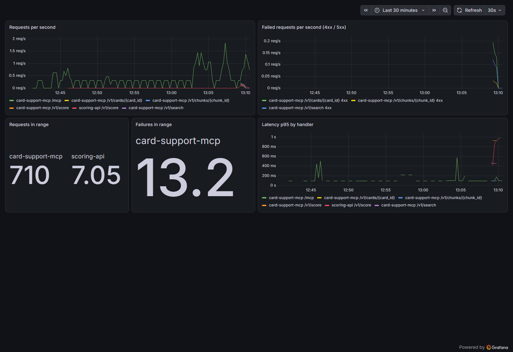
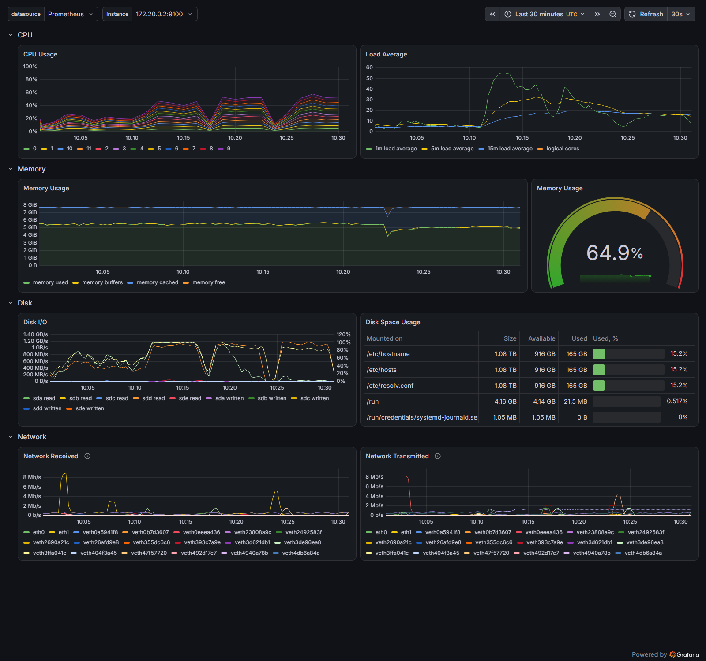
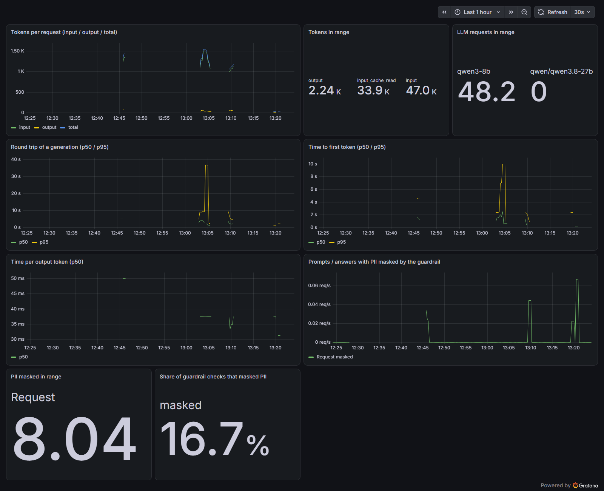
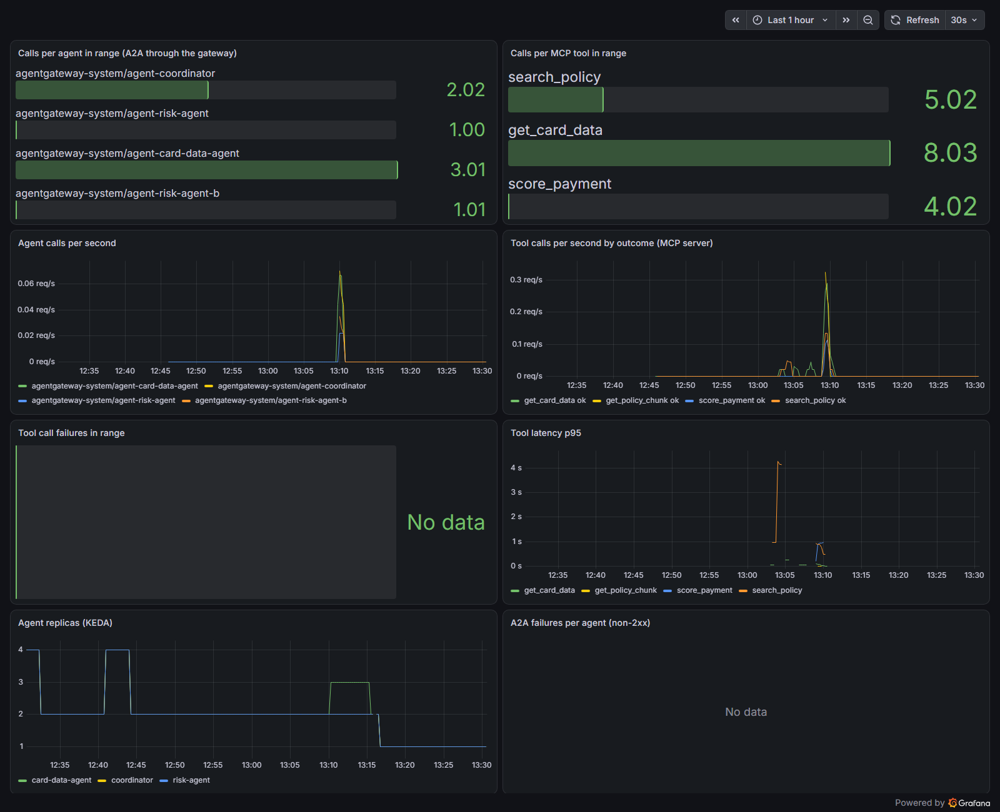
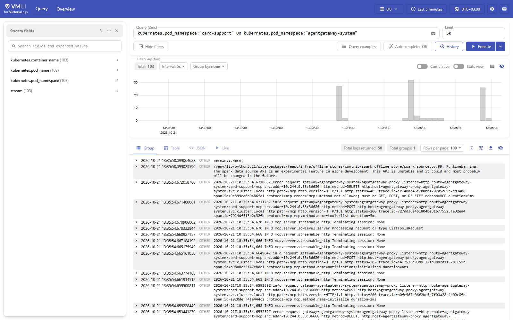
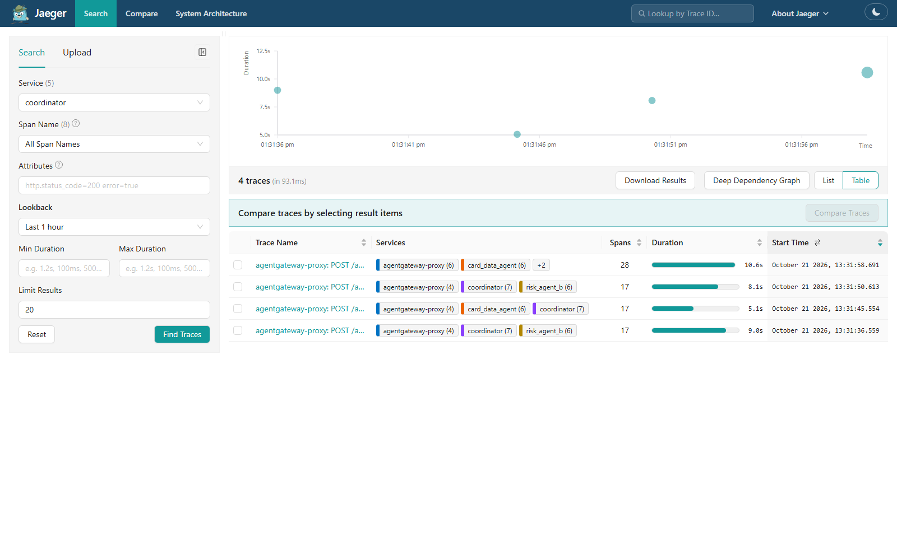
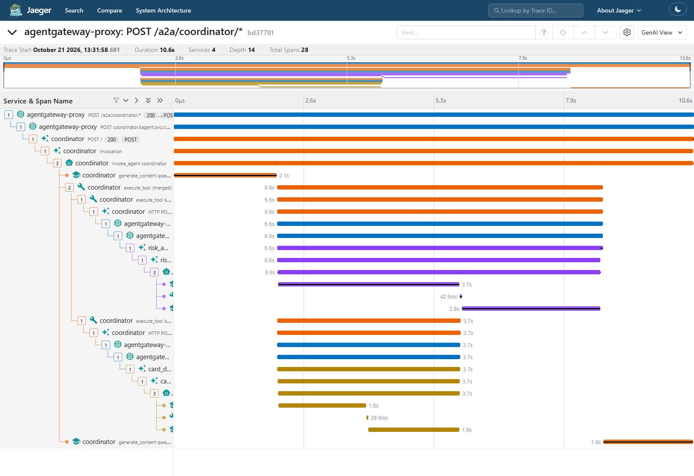

# Observability: metrics, logs and traces

When an agent answers slowly or a tool server fails, the team has to see which service, call and log line. One stack
watches the Layer 3 platform and the Layer 2 Scoring API: Prometheus and Grafana for metrics (something is wrong),
VictoriaLogs for logs (what happened), Jaeger for traces (one conversation through every service).
[`infra/k8s/observability.sh`](https://github.com/cvinhnguyen/card-fraud-platform/blob/6457d47445ec1a910ebd2c01bc1edbff50f76d37/infra/k8s/observability.sh)
installs it into `monitoring`; NGINX publishes the UIs ([edge_security.md](edge_security.md)).

| | |
|---|---|
| Code | [`infra/k8s/observability.sh`](https://github.com/cvinhnguyen/card-fraud-platform/blob/6457d47445ec1a910ebd2c01bc1edbff50f76d37/infra/k8s/observability.sh), [`infra/k8s/observability-values.yaml`](https://github.com/cvinhnguyen/card-fraud-platform/blob/6457d47445ec1a910ebd2c01bc1edbff50f76d37/infra/k8s/observability-values.yaml), [`infra/k8s/monitors.yaml`](https://github.com/cvinhnguyen/card-fraud-platform/blob/6457d47445ec1a910ebd2c01bc1edbff50f76d37/infra/k8s/monitors.yaml), [`infra/k8s/tracing.yaml`](https://github.com/cvinhnguyen/card-fraud-platform/blob/6457d47445ec1a910ebd2c01bc1edbff50f76d37/infra/k8s/tracing.yaml), [`infra/k8s/dashboards/`](https://github.com/cvinhnguyen/card-fraud-platform/tree/6457d47445ec1a910ebd2c01bc1edbff50f76d37/infra/k8s/dashboards) |
| Runs on | kind namespace `monitoring`; UIs behind NGINX at `https://grafana|logs|traces.<domain>` |
| Reads | `/metrics` of the three MCP (Model Context Protocol) servers, agentgateway's proxy and the Scoring API; every pod's stdout; spans from agentgateway and the kagent agents (OTLP, the OpenTelemetry protocol) |
| Related | [edge_security.md](edge_security.md), [ab_testing.md](../llm-platform/ab_testing.md), [agents.md](../llm-platform/agents.md), [llm_platform.md](../llm-platform/llm_platform.md) |

## Where it fits

- The O flow of the Layer 3 picture ([architecture.md](../architecture.md#system-diagram-layer-3)).
- Fed by agentgateway, the three MCP tool servers, the agents and the Scoring API.
- Read by people in Grafana, the VictoriaLogs UI and the Jaeger UI, and by KEDA, which scales the agents on the gateway
  metrics ([agents.md](../llm-platform/agents.md)).

## How it works

1. Prometheus scrapes every service's `/metrics` plus node-exporter and kube-state-metrics; Grafana's dashboards are
   JSON files in ConfigMaps, so a fresh cluster gets them too ([Signals and tools](#signals-and-tools)).
2. The gateway sees every LLM, MCP and A2A (agent-to-agent) call, so LLM and agent telemetry needs no agent code; the
   tool servers count their own tool calls ([LLM telemetry](#llm-telemetry), [Agent telemetry](#agent-telemetry)).
3. Vector ships every pod's stdout to VictoriaLogs; the gateway's request lines carry a `trace.id` ([Logs](#logs)).
4. The gateway and the agents send spans to Jaeger, joined by the W3C `traceparent` header, so one support question
   is one trace across the gateway, the coordinator and its agents ([Traces](#traces)).

## Run it

Run the script after `llm-platform.sh` (idempotent, pinned versions); until `infra/k8s/edge.sh` has run, use a
port-forward:

```bash
sh infra/k8s/observability.sh
kubectl -n monitoring port-forward svc/monitoring-grafana 3000:80              # Grafana: user admin, GRAFANA_ADMIN_PASSWORD
kubectl -n monitoring port-forward svc/victoria-logs-victoria-logs-single-server 9428:9428   # VictoriaLogs: /select/vmui
kubectl -n monitoring port-forward svc/jaeger 16686:16686                      # Jaeger
```

## Signals and tools

| Signal | Tool | Where it comes from |
|---|---|---|
| Metrics | Prometheus + Grafana (kube-prometheus-stack 91.9.0) | node-exporter and kube-state-metrics (compute), the `/metrics` of the three MCP servers (one ServiceMonitor per release, [`services/card_support_mcp/chart/templates/servicemonitor.yaml`](https://github.com/cvinhnguyen/card-fraud-platform/blob/6457d47445ec1a910ebd2c01bc1edbff50f76d37/services/card_support_mcp/chart/templates/servicemonitor.yaml)), agentgateway's proxy (PodMonitor in [`infra/k8s/monitors.yaml`](https://github.com/cvinhnguyen/card-fraud-platform/blob/6457d47445ec1a910ebd2c01bc1edbff50f76d37/infra/k8s/monitors.yaml)), the Layer 2 Scoring API (ScrapeConfig; both in [`infra/k8s/monitors.yaml` L5-L26](https://github.com/cvinhnguyen/card-fraud-platform/blob/6457d47445ec1a910ebd2c01bc1edbff50f76d37/infra/k8s/monitors.yaml#L5-L26)) |
| Logs | VictoriaLogs v1.53 + its Vector agent | every pod's stdout, shipped by the Vector DaemonSet, kept 3 days ([`infra/k8s/observability.sh` L26-L30](https://github.com/cvinhnguyen/card-fraud-platform/blob/6457d47445ec1a910ebd2c01bc1edbff50f76d37/infra/k8s/observability.sh#L26-L30)) |
| Traces | Jaeger 2.21 (OTLP) | agentgateway's tracing policy ([`infra/k8s/tracing.yaml`](https://github.com/cvinhnguyen/card-fraud-platform/blob/6457d47445ec1a910ebd2c01bc1edbff50f76d37/infra/k8s/tracing.yaml)) for every LLM, MCP and A2A request, plus the spans the kagent agents export themselves ([`infra/k8s/llm-platform.sh` L50](https://github.com/cvinhnguyen/card-fraud-platform/blob/6457d47445ec1a910ebd2c01bc1edbff50f76d37/infra/k8s/llm-platform.sh#L50)); joined by the W3C `traceparent` header |

The four dashboards are the `*.json` files in
[`infra/k8s/dashboards/`](https://github.com/cvinhnguyen/card-fraud-platform/tree/6457d47445ec1a910ebd2c01bc1edbff50f76d37/infra/k8s/dashboards),
in ConfigMaps labelled `grafana_dashboard=1` for Grafana's sidecar
([`infra/k8s/observability.sh`
L20-L25](https://github.com/cvinhnguyen/card-fraud-platform/blob/6457d47445ec1a910ebd2c01bc1edbff50f76d37/infra/k8s/observability.sh#L20-L25)).
The fourth, A/B tests, is in [ab_testing.md](../llm-platform/ab_testing.md).

## Web API metrics

Dashboard "Card Support - Web API"
([`infra/k8s/dashboards/card-support-api.json`](https://github.com/cvinhnguyen/card-fraud-platform/blob/6457d47445ec1a910ebd2c01bc1edbff50f76d37/infra/k8s/dashboards/card-support-api.json))
shows requests and failures (4xx and 5xx) per second and in the range, and p95 latency per handler, from
`http_requests_total` and `http_request_duration_seconds` of the three MCP servers (prometheus-fastapi-instrumentator, [`services/card_support_mcp/app/main.py`
L137](https://github.com/cvinhnguyen/card-fraud-platform/blob/6457d47445ec1a910ebd2c01bc1edbff50f76d37/services/card_support_mcp/app/main.py#L137);
jobs `card-data-mcp`, `fraud-score-mcp`, `policy-rag-mcp`) and from the Scoring API.

The screenshot predates the split into three servers (one job, `card-support-mcp`; the job filter matches the new
three). It was not retaken: with Grafana on top of the platform, the 8 GB Docker VM ran out of memory and killed pods
on failed liveness probes (2026-10-24). The MCP requests are agents' calls on `/mcp` and REST calls through NGINX. In the
last half hour shown: 710 requests to the MCP server, 7 to the Scoring API, and 13 failures, the 404s and 422s a test
script sent on purpose (unknown ids, a too short question):



## Compute metrics

kube-prometheus-stack's "Node Exporter / Nodes" shows CPU, load, memory, disk I/O, disk space and network of the
kind node, the whole 8 GB Docker VM on a 16 GB machine ([README](../../README.md#deployment)); "Kubernetes / Compute
Resources / Namespace (Pods)" splits CPU and memory per pod. The spike around 10:12 is the VM running out of page
cache with Prometheus, Grafana and the agents together:



## LLM telemetry

Dashboard "Card Support - LLM telemetry"
([`infra/k8s/dashboards/llm-telemetry.json`](https://github.com/cvinhnguyen/card-fraud-platform/blob/6457d47445ec1a910ebd2c01bc1edbff50f76d37/infra/k8s/dashboards/llm-telemetry.json)).
Every number comes from agentgateway:

| Rubric metric | Metric | Panel |
|---|---|---|
| tokens per request: input, output, total | `agentgateway_gen_ai_client_token_usage` (sum / count, by token type) | Tokens per request; Tokens in range (input, output and input read from llama.cpp's prompt cache) |
| total round trip of a generation | `agentgateway_gen_ai_server_request_duration` | p50 / p95 |
| time to first token | `agentgateway_gen_ai_server_time_to_first_token` | p50 / p95 |
| (extra) time per output token | `agentgateway_gen_ai_server_time_per_output_token` | p50 |
| how often the PII (personal data) guardrail caught a prompt | `agentgateway_guardrail_checks_total{action="Mask"}`, by phase (request / response) | masked per second, masked in range, share of checks that masked |

In the hour shown: 48 LLM requests to Qwen3-8B and none to the A/B side B, 47.0k input tokens (33.9k from
llama.cpp's prompt cache), 2.24k output tokens, and 8 requests masked (16.7% of the guardrail checks). Totals over a
range come from Prometheus `increase()`, which extrapolates, hence the decimals:



## Agent telemetry

Dashboard "Card Support - Agent telemetry"
([`infra/k8s/dashboards/agent-telemetry.json`](https://github.com/cvinhnguyen/card-fraud-platform/blob/6457d47445ec1a910ebd2c01bc1edbff50f76d37/infra/k8s/dashboards/agent-telemetry.json)):

| Rubric metric | Metric |
|---|---|
| calls per agent | `agentgateway_requests_total` on the agents' A2A backends (every agent call passes the gateway) |
| calls per MCP tool | `agentgateway_mcp_requests_total` by tool name, at the gateway |
| failures per tool call | `card_support_tool_calls_total{outcome="error"}`, counted per tool by the MCP server that serves it, plus non-2xx A2A responses per agent |
| (extra) | tool calls per second by outcome, tool latency p95 (`card_support_tool_seconds`), agent replicas set by KEDA |

Each MCP server counts and times every tool call in one wrapper (the same code in all three). The metrics
([`services/card_support_mcp/app/main.py`
L71-L74](https://github.com/cvinhnguyen/card-fraud-platform/blob/6457d47445ec1a910ebd2c01bc1edbff50f76d37/services/card_support_mcp/app/main.py#L71-L74)):

```python
calls = Counter("card_support_tool_calls_total", "Tool calls by tool and outcome", ["tool", "outcome"],
                registry=registry)
latency = Histogram("card_support_tool_seconds", "Tool latency", ["tool"], registry=registry,
                    buckets=(0.01, 0.025, 0.05, 0.1, 0.25, 0.5, 1, 2.5, 5))
```

The wrapper `run`
([`services/card_support_mcp/app/main.py`
L80-L93](https://github.com/cvinhnguyen/card-fraud-platform/blob/6457d47445ec1a910ebd2c01bc1edbff50f76d37/services/card_support_mcp/app/main.py#L80-L93)):

```python
async def run(tool: str, call):
    """Run one tool call, counting it by outcome and timing it (agent telemetry)."""
    start = time.perf_counter()
    try:
        result = await call
    except Exception as e:
        calls.labels(tool, "error").inc()
        log.exception("tool %s failed", tool)
        # what the agent reads: some errors (httpx.ReadTimeout) have an empty message
        raise RuntimeError(f"{tool} unavailable: {type(e).__name__}") from e
    finally:
        latency.labels(tool).observe(time.perf_counter() - start)
    calls.labels(tool, "ok").inc()
    return result
```

In the hour shown the gateway counted about 2 calls to the coordinator, 3 to card-data-agent, 1 to risk-agent and 1
to its B variant, risk-agent-b. The tools ran 8 `get_card_data`, 5 `search_policy` and 4 `score_payment` calls, none
failed ("No data" in the failure panels), and KEDA kept the agents between 2 and 4 replicas. The drop to 1 at 13:16 is a
manual pause of KEDA (`autoscaling.keda.sh/paused-replicas`) to free memory:



## Logs

VictoriaLogs keeps every pod's lines with their Kubernetes labels for 3 days, queried with LogsQL in its UI
(`/select/vmui`). The gateway's request lines carry route, MCP method, status and a `trace.id`, the key into Jaeger.
The query (2026-10-21, before the split into three servers):



## Traces

The gateway's spans come from one policy on the whole Gateway
([`infra/k8s/tracing.yaml`
L43-L56](https://github.com/cvinhnguyen/card-fraud-platform/blob/6457d47445ec1a910ebd2c01bc1edbff50f76d37/infra/k8s/tracing.yaml#L43-L56)):

```yaml
# Gateway-wide (all routes): sample every request, a demo-sized load
apiVersion: agentgateway.dev/v1alpha1
kind: AgentgatewayPolicy
metadata:
  name: tracing
  namespace: agentgateway-system
spec:
  targetRefs: [{group: gateway.networking.k8s.io, kind: Gateway, name: agentgateway-proxy}]
  frontend:
    tracing:
      url: http://jaeger.monitoring.svc.cluster.local:4318
      protocol: HTTP
      path: /v1/traces
      randomSampling: "true"
```

Jaeger's search: 4 coordinator traces in the last hour, 17 to 28 spans, 5.1 s to 10.6 s:



The first is one conversation of 10.6 s and 28 spans over 4 services: the coordinator's first LLM call (2.1 s) asks both agents, the risk agent (6.6 s) and
the card data agent (3.7 s) run in parallel through the gateway with their own LLM and MCP calls, and the
coordinator's last LLM call (1.8 s) writes the answer:



## Gotchas

- No new log lines after VictoriaLogs restarts: the Vector agent backs off and sends nothing until it is restarted
  itself (`kubectl -n monitoring rollout restart ds/victoria-logs-vector`).
- `/api/services` answers 404 on Jaeger: Jaeger 2's API is `/api/v3/...`. It keeps traces in memory (20,000 at most,
  [`infra/k8s/tracing.yaml`
  L20](https://github.com/cvinhnguyen/card-fraud-platform/blob/6457d47445ec1a910ebd2c01bc1edbff50f76d37/infra/k8s/tracing.yaml#L20)),
  so a restart empties it.
- Grafana restarts on failed liveness probes: at 384Mi its search API timed out. It needs 640Mi here
  ([`infra/k8s/observability-values.yaml`
  L15-L17](https://github.com/cvinhnguyen/card-fraud-platform/blob/6457d47445ec1a910ebd2c01bc1edbff50f76d37/infra/k8s/observability-values.yaml#L15-L17)).

Coursework rubric: A46 to A51.
