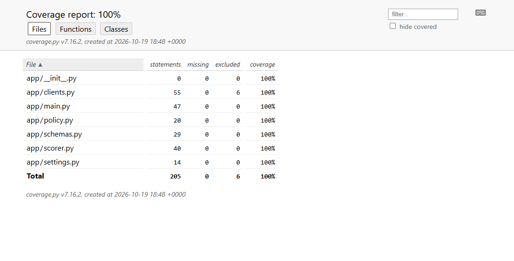
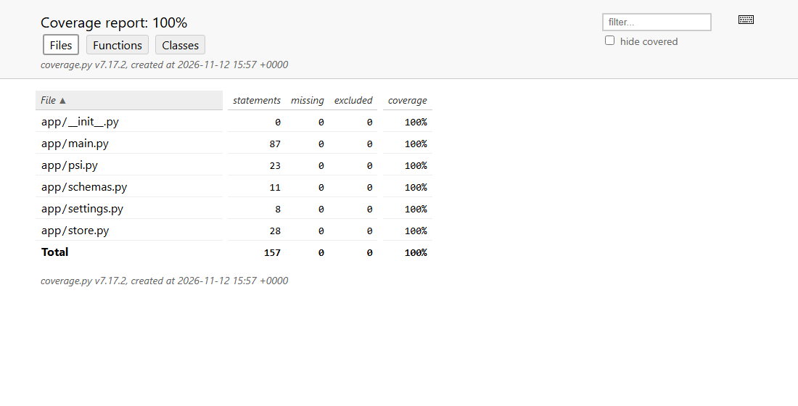
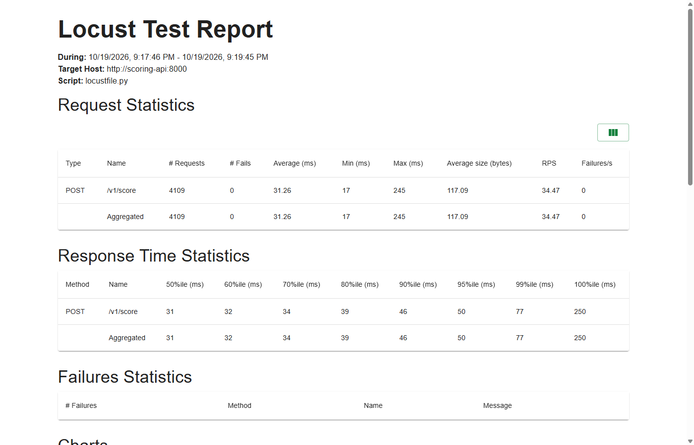
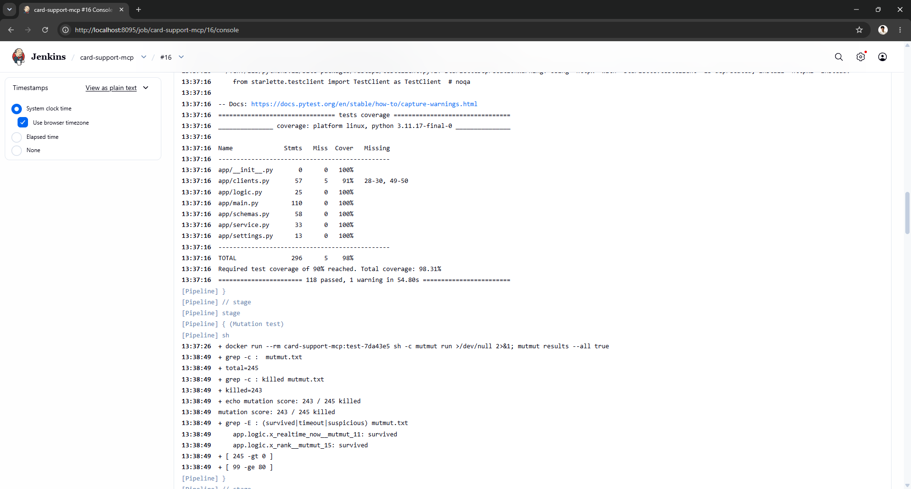
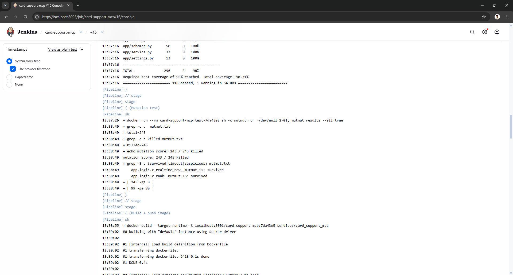
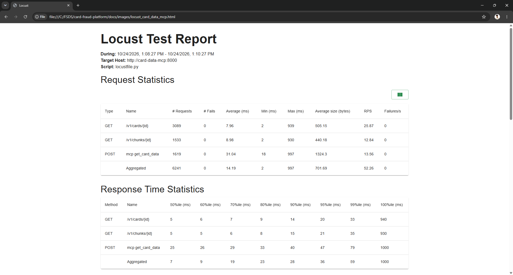

# Tests

A bug in the Scoring API declines good customers or lets fraud through; a bug in an MCP (Model Context Protocol)
server feeds the agents wrong data. These tests guard Layer 2's two APIs (Scoring API, Drift API) and Layer 3's three
MCP servers ([below](#layer-3-the-card-support-mcp-servers)) with fakes, equivalence partitioning and boundary values,
property-based tests, mutation testing and a locust load test.

| | |
|---|---|
| Code | [`services/scoring_api/tests/`](https://github.com/cvinhnguyen/card-fraud-platform/tree/54d21eddbf6e602ae13fed46a1a9e0ef265d23cd/services/scoring_api/tests), [`services/drift_api/tests/`](https://github.com/cvinhnguyen/card-fraud-platform/tree/54d21eddbf6e602ae13fed46a1a9e0ef265d23cd/services/drift_api/tests), [`services/card_support_mcp/tests/`](https://github.com/cvinhnguyen/card-fraud-platform/tree/54d21eddbf6e602ae13fed46a1a9e0ef265d23cd/services/card_support_mcp/tests) |
| Runs on | the `test` stage of each service's image; Jenkins jobs `fraud-scoring-api`, `fraud-drift-api` and `card-support-mcp`; load tests: a locust container on the compose network (Scoring API), a locust pod in kind namespace `card-support` (card-data) |
| Related | [serving.md](../ml-platform/serving.md), [drift.md](../ml-platform/drift.md), [agents.md](../llm-platform/agents.md), [cicd.md](cicd.md) |

## Where it fits

- Layer 2 (ML platform): the Scoring API decides on every payment, the Drift API watches its inputs
  ([serving.md](../ml-platform/serving.md), [drift.md](../ml-platform/drift.md)).
- Layer 3 (LLM and agent platform): the three MCP tool servers give the agents card data, fraud scores and policy
  chunks ([agents.md](../llm-platform/agents.md)).
- Jenkins runs the tests, the coverage gate and the mutation test on every change of all three code bases, before
  the image build ([cicd.md](cicd.md#pipelines)); for the tool servers that is arrow C3
  ([architecture.md](../architecture.md#numbered-arrows-layer-3)).

## How it works

Each code base tests in the `test` stage of its own Docker image, against the image's exact dependency pins, behind
a coverage gate of 90%:

| Test | Question it answers |
|---|---|
| example tests with fakes | right result for a known case, without a real Redis, KServe or Kafka? |
| equivalence partitioning and boundary values | inputs that should behave alike treated alike, and the edges (a score exactly on a threshold, an amount of 0) right? |
| property-based tests (hypothesis) | a rule holds for thousands of generated inputs? |
| mutation testing (mutmut) | would the tests notice subtly wrong code? mutmut changes the code and counts the changes no test catches |
| load test (locust) | how many requests per second before latency or errors climb? |

## Run it

From the repo root:

```bash
# Layer 2: pytest + coverage gate (pytest.ini) in the image's test stage
docker build --target test -t fraud/scoring-api:test services/scoring_api
docker run --rm fraud/scoring-api:test
docker build --target test -t fraud/drift-api:test services/drift_api
docker run --rm fraud/drift-api:test
# Layer 2: mutation test (shown for the Drift API)
docker run --rm -w /app fraud/drift-api:test sh -c "mutmut run --max-children 2 && mutmut results"
# Layer 3: the card support MCP servers
docker build --target test -t card-support-mcp:test services/card_support_mcp
docker run --rm card-support-mcp:test                      # pytest + coverage gate (pytest.ini)
docker run --rm card-support-mcp:test sh -c "mutmut run >/dev/null 2>&1; mutmut results --all true"
```

## Layer 2: the Scoring API and the Drift API

The `test` stage
([`services/scoring_api/Dockerfile`
L7-L14](https://github.com/cvinhnguyen/card-fraud-platform/blob/54d21eddbf6e602ae13fed46a1a9e0ef265d23cd/services/scoring_api/Dockerfile#L7-L14))
adds the dev requirements and runs `pytest`; the gate is `--cov-fail-under=90` in `pytest.ini` ([`services/scoring_api/pytest.ini`
L4](https://github.com/cvinhnguyen/card-fraud-platform/blob/54d21eddbf6e602ae13fed46a1a9e0ef265d23cd/services/scoring_api/pytest.ini#L4),
the same line in the Drift API).

| Service | Tests | Coverage | Measured |
|---|---:|---:|---|
| Scoring API | 97 | 100% | 2026-11-13 |
| Scoring API | 115 | 100% | Jenkins `fraud-scoring-api` #2, 2026-11-21 |
| Drift API | 57 | 100% | 2026-11-13; again in Jenkins `fraud-drift-api` #1, 2026-11-21 |

The Drift API's endpoint moved from `/v1/events` (batches from a Kafka forwarder) to `POST /v1/inference-events` for
KServe's CloudEvents ([drift.md](../ml-platform/drift.md)); its 57 tests include one that no PSI (population
stability index) gauge is exported for too few events.

The Scoring API's coverage report, 100% of 205 statements, from before the prediction-log fix of 2026-11-13 (after it:
97 passed, 100% of 209 statements):



The Drift API's, 100% of 157 statements, 56 tests (2026-11-12, a day before the 57-test run, already on
`/v1/inference-events`):



### Fakes over mocks

The scorer gets fake feature / model / log objects
([`services/scoring_api/tests/conftest.py`
L17-L75](https://github.com/cvinhnguyen/card-fraud-platform/blob/54d21eddbf6e602ae13fed46a1a9e0ef265d23cd/services/scoring_api/tests/conftest.py#L17-L75))
with the real clients' small interfaces, which can be told to fail or hang. The real clients are tested against
recorded HTTP (respx) and a patched Kafka producer
([`services/scoring_api/tests/test_clients.py`](https://github.com/cvinhnguyen/card-fraud-platform/blob/54d21eddbf6e602ae13fed46a1a9e0ef265d23cd/services/scoring_api/tests/test_clients.py)).
No test needs Redis, KServe or Kafka; the price is a bug only a real client triggers ([Gotchas](#gotchas)).

### Equivalence partitioning and boundary values

With `pytest.mark.parametrize` in
[`services/scoring_api/tests/test_policy.py`](https://github.com/cvinhnguyen/card-fraud-platform/blob/54d21eddbf6e602ae13fed46a1a9e0ef265d23cd/services/scoring_api/tests/test_policy.py),
[`services/scoring_api/tests/test_schemas.py`](https://github.com/cvinhnguyen/card-fraud-platform/blob/54d21eddbf6e602ae13fed46a1a9e0ef265d23cd/services/scoring_api/tests/test_schemas.py)
and the Drift API's
[`services/drift_api/tests/test_api.py`](https://github.com/cvinhnguyen/card-fraud-platform/blob/54d21eddbf6e602ae13fed46a1a9e0ef265d23cd/services/drift_api/tests/test_api.py)
and
[`services/drift_api/tests/test_psi.py`](https://github.com/cvinhnguyen/card-fraud-platform/blob/54d21eddbf6e602ae13fed46a1a9e0ef265d23cd/services/drift_api/tests/test_psi.py):

| Input | Partitions / boundaries tested |
|---|---|
| score vs thresholds | 0 and 1, inside each partition, just below / at / just above `t_low` and `t_high` |
| threshold config | `t_low > t_high`, < 0, > 1 rejected; `(0,0)`, `(0,1)`, `(1,1)`, equal thresholds accepted |
| amount (fallback) | 1, inside, just below / at / above 2,000,000 VND, the largest valid amount |
| request schema | amount -1 / 0 / 1 / 10 bn / 10 bn + 1, currency `VND` / `USD` / lower case / 2 or 4 letters, channel valid / unknown / empty, id lengths 0 / 1 / 64 / 65, device absent / 64 / 65 |
| inference event | `ce-type` request / response / unknown (400) / missing (422); a GET call's event with no `instances` or `predictions` (accepted, not counted); malformed bodies: not JSON, positional instance of the wrong length, non-numeric value, an instance that is neither dict nor list, `instances` not a list, body not an object, a prediction that is not a number (400) |
| PSI level | 0.1 and 0.25 exactly and either side |

### Property-based tests (hypothesis)

Rules for *any* input, with hypothesis generating the cases
([`services/scoring_api/tests/test_properties.py`
L30-L54](https://github.com/cvinhnguyen/card-fraud-platform/blob/54d21eddbf6e602ae13fed46a1a9e0ef265d23cd/services/scoring_api/tests/test_properties.py#L30-L54)
for the Scoring API, [`services/drift_api/tests/test_api.py`
L144-L152](https://github.com/cvinhnguyen/card-fraud-platform/blob/54d21eddbf6e602ae13fed46a1a9e0ef265d23cd/services/drift_api/tests/test_api.py#L144-L152)
for the drift report):

- idempotency: the same request scores the same twice, and the drift report over the same data is the same;
- monotonicity: a higher score never gives a milder decision, for any pair of thresholds;
- totality: every request gets a decision, whichever dependency fails.

### Mutation testing (mutmut 3.8)

Mutation covers only the code changed in the phase that added Layer 2 (the rubric's rule), set in each `setup.cfg`
([`services/scoring_api/setup.cfg`](https://github.com/cvinhnguyen/card-fraud-platform/blob/54d21eddbf6e602ae13fed46a1a9e0ef265d23cd/services/scoring_api/setup.cfg),
[`services/drift_api/setup.cfg`](https://github.com/cvinhnguyen/card-fraud-platform/blob/54d21eddbf6e602ae13fed46a1a9e0ef265d23cd/services/drift_api/setup.cfg)):
`policy.py` and `scorer.py` of the Scoring API, `psi.py` and `store.py` of the Drift API. mutmut flips operators and
constants (`>=` to `>`, `0.25` to `1.25`, ...) and reruns the tests; a survivor is a line no test really checks.
Jenkins fails the build below 80% killed.

| Service | First run (2026-10-20) | Survivors | After the fixes (2026-10-20) | Rerun on 2026-11-13 |
|---|---|---|---|---|
| Drift API | 104 / 116 killed | 12 | 106 / 106 | 99 / 99 |
| Scoring API | 88 / 108 killed | 20 | 106 / 106 | 106 / 106 |

The rerun used [Run it](#run-it) on the current code; the Drift API has fewer mutants because its `store.py`
changed on 2026-11-12 for the Knative event feed. Jenkins build #2 of `fraud-scoring-api` (2026-11-21) killed 165 of
179 mutants.

What the survivors of the first run were:

- Real gaps, now tested. PSI had no exact-value test, so `|` to `&` over the bins, `+=` to `=` and the defaults for
  a bin missing on one side survived (now three exact cases, one the docs example 0.416). Also untested: a fallback
  event *followed by* a counted one (`continue` to `break`), the TTL (time to live) on a key other than the bucket,
  bucket names (`// 61`), the feature store request, stage latency labels and values, the fallback log line, and the
  prediction log's timestamps (python mode writes `2026-10-16 09:30:00`, not ISO).
- Dead code, deleted: `b.decode() if isinstance(b, bytes) else b` (redis-py without `decode_responses` always
  returns bytes).
- Equivalent mutants, marked `# pragma: no mutate`: `pipeline(transaction=False)` to `True` / `None` (same counts)
  and the response half of the prediction log record (JSON-native in either dump mode). `int(clock // 60)` to
  `int(clock / 60)` was equivalent too, so the code reads `int(clock) // 60`, whose mutant gives a float bucket name
  that the bucket-name test catches.

### Load test (locust)

[`services/scoring_api/locustfile.py`](https://github.com/cvinhnguyen/card-fraud-platform/blob/54d21eddbf6e602ae13fed46a1a9e0ef265d23cd/services/scoring_api/locustfile.py)
plays the authorization switch with real card ids so Redis lookups hit (report: `docs/images/locust_report.html`).
Run 2026-10-19: locust 2.31.8 on the compose network, 5,000 real card ids from the live period, fallbacks counted
from `fraud_decisions_total{fallback="true"}` before and after. `<repo>` is the repo's absolute path, `<cards.txt>` a
file of card ids, one per line:

```bash
docker run --rm --network fraud_default -e CARDS_FILE=/w/cards.txt -v <repo>/services/scoring_api/locustfile.py:/w/locustfile.py \
    -v <cards.txt>:/w/cards.txt -v <repo>/docs/images:/out locustio/locust:2.31.8 -f /w/locustfile.py \
    --host http://scoring-api:8000 --headless -u 3 -r 3 -t 2m --html /out/locust_report.html
```

| Run | Users | Requests | Throughput | p50 / p95 / p99 | HTTP failures | Fallback decisions |
|---|---:|---:|---:|---:|---:|---:|
| SLA ([report](https://github.com/cvinhnguyen/card-fraud-platform/blob/54d21eddbf6e602ae13fed46a1a9e0ef265d23cd/docs/images/locust_report.html)) | 3 | 4,109 | 34.5 req/s | 31 / 50 / 77 ms | 0 | 9 (0.2%) |
| Overload ([report](https://github.com/cvinhnguyen/card-fraud-platform/blob/54d21eddbf6e602ae13fed46a1a9e0ef265d23cd/docs/images/locust_overload.html)) | 20 | 3,463 | 58.0 req/s | 290 / 410 / 490 ms | 0 | 641 (18%) |

- The SLA (service-level agreement) run stays within one worker's capacity (~45 req/s,
  [serving.md](../ml-platform/serving.md)) and meets the design's p99 < 100 ms.
- Overloaded, it never errors: requests past their 200 ms budget get the fallback rule. More load needs replicas
  (KEDA on requests per second, course Module 2), not a bigger budget.
- Right after the overload, 100 serial requests: 21 ms median, 0% fallback. Before the `asyncio.shield` fix
  ([serving.md](../ml-platform/serving.md#capacity-and-a-bug-the-first-load-found)) a burst left the API at 100%
  fallback until a restart.

The SLA run's report: 4,109 requests, 0 failures, 34.5 req/s, p50 31 ms, p99 77 ms:



## Layer 3: the card support MCP servers

[`services/card_support_mcp/`](https://github.com/cvinhnguyen/card-fraud-platform/tree/54d21eddbf6e602ae13fed46a1a9e0ef265d23cd/services/card_support_mcp)
is one code base for the three MCP servers the agents call
([agents.md](../llm-platform/agents.md#the-three-mcp-servers)):

- card-data, the Web API that pulls a card's data from the online feature store by `card_id` and a policy chunk by
  `chunk_id`
- fraud-score, the fraud model's verdict on a payment
- policy-rag, the policy search

The tests build each server with fakes of its adapters; Jenkins job `card-support-mcp` runs them
([cicd.md](cicd.md#mcp-servers)).

| Service | Tests | Coverage |
|---|---:|---:|
| Card support MCP servers (one code base) | 119 (118 in the build below; the Feast read timeout test was added on 2026-11-13) | 98.32% |

Build #21 (2026-11-21) confirms both numbers. Stage "Unit tests + coverage gate"
([`services/card_support_mcp/Jenkinsfile`
L31-L37](https://github.com/cvinhnguyen/card-fraud-platform/blob/54d21eddbf6e602ae13fed46a1a9e0ef265d23cd/services/card_support_mcp/Jenkinsfile#L31-L37))
of build #16 (2026-10-24, commit `7da43e5`): 118 passed, total coverage 98.31% against the 90% gate:



Uncovered are the constructors that open the real Feast repos, lines 28-30 and 49-50 of `clients.py`
([`services/card_support_mcp/app/clients.py`
L29-L31](https://github.com/cvinhnguyen/card-fraud-platform/blob/54d21eddbf6e602ae13fed46a1a9e0ef265d23cd/services/card_support_mcp/app/clients.py#L29-L31),
[`services/card_support_mcp/app/clients.py`
L29-L30](https://github.com/cvinhnguyen/card-fraud-platform/blob/54d21eddbf6e602ae13fed46a1a9e0ef265d23cd/services/card_support_mcp/app/clients.py#L29-L30)).
They need the registry database and the online stores, so the pipeline's smoke test covers them.

### Fixtures and mocks

[`services/card_support_mcp/tests/conftest.py`](https://github.com/cvinhnguyen/card-fraud-platform/blob/54d21eddbf6e602ae13fed46a1a9e0ef265d23cd/services/card_support_mcp/tests/conftest.py)
fakes the four adapters (feature store, knowledge base, embedder, Scoring API), each with the `ready()` its
server's `/readyz` calls and able to fail. The `service` fixture wires them at a fixed clock; `make_client` builds one
server's real FastAPI app (REST and MCP) with its own Prometheus registry, so tests never share counters.
[`services/card_support_mcp/tests/test_api.py`](https://github.com/cvinhnguyen/card-fraud-platform/blob/54d21eddbf6e602ae13fed46a1a9e0ef265d23cd/services/card_support_mcp/tests/test_api.py)
checks:

- each server lists only its own tools over MCP and has no REST route of the others (404);
- status codes: 200, 404 for an unknown id, 422 for a malformed one, 503 when a dependency fails;
- `/healthz` checks no dependency, and `/readyz` fails only for that server's own (a broken Feast store does not make
  fraud-score unready);
- tool-call metrics, MCP calls, and bad arguments or a failing dependency as MCP tool errors;
- `build_service` builds only the adapters a server's tools use (fraud-score builds no Feast reader).

The real adapters are tested in
[`services/card_support_mcp/tests/test_clients.py`](https://github.com/cvinhnguyen/card-fraud-platform/blob/54d21eddbf6e602ae13fed46a1a9e0ef265d23cd/services/card_support_mcp/tests/test_clients.py)
against respx mocks (the embedder sends the query instruction and the API key, a 500 raises, the Scoring API's
health is its `/healthz`) and a stand-in Feast store.

### Equivalence partitioning and boundary values

`pytest.mark.parametrize` tables in
[`services/card_support_mcp/tests/test_logic.py`](https://github.com/cvinhnguyen/card-fraud-platform/blob/54d21eddbf6e602ae13fed46a1a9e0ef265d23cd/services/card_support_mcp/tests/test_logic.py)
(the tool rules) and
[`services/card_support_mcp/tests/test_schemas.py`](https://github.com/cvinhnguyen/card-fraud-platform/blob/54d21eddbf6e602ae13fed46a1a9e0ef265d23cd/services/card_support_mcp/tests/test_schemas.py)
(what pydantic lets through):

| Input | Partitions / boundaries tested |
|---|---|
| age of the last real-time count | no timestamp; 0, 90 s; 600 / 601 s (10-minute window); 3600 / 3601 s (1-hour window); -120 s (replayed data ahead of the clock counts as age 0) |
| `rank` k | 0 and -1 rejected; 1, 2, 3 and 4 with 3 candidates (above the candidate count it returns all of them) |
| cosine | same direction, orthogonal, opposite, zero vector, different lengths; equal scores ordered by id |
| `amount_vnd` | -1 and 0 rejected; 1 and 10,000,000,000 accepted; 10,000,000,001 rejected |
| currency, channel | `USD` accepted; `usd`, `US`, `USDT` rejected; `pos`, `atm` accepted, `wire` rejected |
| `card_id` | empty rejected, 64 characters accepted, 65 rejected, `card 1; drop` rejected |
| search question, k | length 2 rejected, 3 and 500 accepted, 501 rejected; k 0 rejected, 1 and 10 accepted, 11 rejected |
| `chunk_id` | `card_terms#4.2`, `faq#3`, `fee_schedule#10` accepted; no `#`, upper case, empty or three-level section, 41-character document name rejected |

### Property-based tests (hypothesis + crosshair)

[`services/card_support_mcp/tests/test_properties.py`](https://github.com/cvinhnguyen/card-fraud-platform/blob/54d21eddbf6e602ae13fed46a1a9e0ef265d23cd/services/card_support_mcp/tests/test_properties.py)
states rules for any input:

- idempotency: the same candidates rank the same twice, so an agent that asks again gets the same chunks;
- ranking ignores the order candidates arrive in (Feast's order is not trusted);
- the ranking is best first, never longer than k, with scores within [-1, 1];
- a real-time count is the stored value or 0, for any age up to a day either side of now.

A younger timestamp is never less fresh than an older one: that rule runs on hypothesis's crosshair backend
(`@settings(backend="crosshair")`, package `hypothesis-crosshair`,
[`services/card_support_mcp/tests/test_properties.py`
L52-L54](https://github.com/cvinhnguyen/card-fraud-platform/blob/54d21eddbf6e602ae13fed46a1a9e0ef265d23cd/services/card_support_mcp/tests/test_properties.py#L52-L54)).
Crosshair executes `realtime_now` symbolically and solves for its branches, so the window edges at 600 and 3,600
seconds are hit on purpose.

### Mutation testing (mutmut 3.8)

The Jenkins stage "Mutation test"
([`services/card_support_mcp/Jenkinsfile`
L38-L48](https://github.com/cvinhnguyen/card-fraud-platform/blob/54d21eddbf6e602ae13fed46a1a9e0ef265d23cd/services/card_support_mcp/Jenkinsfile#L38-L48))
fails the build below 80% killed. Like every stage here, it runs only when a commit changed the service
(`changeset 'services/card_support_mcp/**'`) or on a manual start
([`services/card_support_mcp/Jenkinsfile`
L20-L23](https://github.com/cvinhnguyen/card-fraud-platform/blob/54d21eddbf6e602ae13fed46a1a9e0ef265d23cd/services/card_support_mcp/Jenkinsfile#L20-L23)).
[`services/card_support_mcp/setup.cfg`](https://github.com/cvinhnguyen/card-fraud-platform/blob/54d21eddbf6e602ae13fed46a1a9e0ef265d23cd/services/card_support_mcp/setup.cfg)
limits mutation to the tool rules, `app/logic.py` and `app/service.py`; the wiring and declarations (`main.py`,
`clients.py`, `schemas.py`, `settings.py`) are under `do_not_mutate`.

243 of 245 mutants are killed (99.2%), in build #16 and again in #21 (2026-11-21). The two survivors, in
`realtime_now` and `rank`, are equivalent (read by hand): neither changes what the tools return. Build #16:



### Load test (locust)

The rubric's load test targets the Web API that pulls data, the card-data server.
[`services/card_support_mcp/locustfile.py`](https://github.com/cvinhnguyen/card-fraud-platform/blob/54d21eddbf6e602ae13fed46a1a9e0ef265d23cd/services/card_support_mcp/locustfile.py)
plays an agent working a chat: card lookups and chunk reads over REST, plus the same lookup over MCP
(`tools/call get_card_data`) to show the MCP layer's cost. Run 2026-10-24 from a locust pod in `card-support` (so the
network policy lets it in) against `http://card-data-mcp:8000`: 10 users for 2 minutes, 5,000 card ids from the live
period so every lookup hits Redis. Report:
[`locust_card_data_mcp.html`](https://github.com/cvinhnguyen/card-fraud-platform/blob/54d21eddbf6e602ae13fed46a1a9e0ef265d23cd/docs/images/locust_card_data_mcp.html).

| Request | Requests | Median | p95 | p99 |
|---|---:|---:|---:|---:|
| `GET /v1/cards/{id}` | 3,089 | 5 ms | 20 ms | 33 ms |
| `GET /v1/chunks/{id}` | 1,533 | 5 ms | 21 ms | 35 ms |
| MCP `get_card_data` | 1,619 | 25 ms | 47 ms | 79 ms |
| All | 6,241 | 7 ms | 36 ms | 59 ms |

That is 52.3 requests per second (52.26 in the report) with 0 failures; the JSON-RPC layer adds about 20 ms to a
lookup (25 ms median over MCP, 5 ms over REST):



The agents were load-tested with one customer chat per A2A (agent-to-agent) `message/send` to the coordinator
through the gateway
([`agents/locustfile.py`](https://github.com/cvinhnguyen/card-fraud-platform/blob/54d21eddbf6e602ae13fed46a1a9e0ef265d23cd/agents/locustfile.py)):

| Run | Users | Duration | Conversations | Failures | Report |
|---|---:|---|---:|---:|---|
| A2A load | 6 | 4 min 51 s | 37 (34 s median, 85 s p95) | 0 | [`locust_agents_a2a.html`](https://github.com/cvinhnguyen/card-fraud-platform/blob/54d21eddbf6e602ae13fed46a1a9e0ef265d23cd/docs/images/locust_agents_a2a.html) |
| KEDA scaling | 6 | 3 min 41 s | 31 | 0 | [`locust_agents_scaling.html`](https://github.com/cvinhnguyen/card-fraud-platform/blob/54d21eddbf6e602ae13fed46a1a9e0ef265d23cd/docs/images/locust_agents_scaling.html) |

A conversation takes tens of seconds: the coordinator waits for the sub-agents, each making its own LLM calls, all
on one GPU.

## Gotchas

- `/metrics` of the Scoring API answered 200 with no body on the first live run: `import feast` (only the real
  `FeatureClient` does it) sets `PROMETHEUS_MULTIPROC_DIR`, and `Instrumentator.expose()` then served an empty
  multiprocess directory. The endpoint now renders the app's registry itself
  ([`services/scoring_api/app/main.py`
  L52-L56](https://github.com/cvinhnguyen/card-fraud-platform/blob/54d21eddbf6e602ae13fed46a1a9e0ef265d23cd/services/scoring_api/app/main.py#L52-L56)),
  and `test_metrics_survive_feast_multiprocess_env` ([`services/scoring_api/tests/test_api.py`
  L53-L57](https://github.com/cvinhnguyen/card-fraud-platform/blob/54d21eddbf6e602ae13fed46a1a9e0ef265d23cd/services/scoring_api/tests/test_api.py#L53-L57))
  sets that variable to pin the behaviour.
- The coverage gate of `pytest.ini` fails the mutmut run, which tests a copy of the code with every function behind
  a trampoline. `setup.cfg` empties `addopts` for it (with the 3.x key names; the 2.x `paths_to_mutate` is
  deprecated), here in
  [`services/scoring_api/setup.cfg`
  L12-L15](https://github.com/cvinhnguyen/card-fraud-platform/blob/54d21eddbf6e602ae13fed46a1a9e0ef265d23cd/services/scoring_api/setup.cfg#L12-L15):

  ```ini
  # the coverage gate belongs to the normal run: mutmut runs a trampolined copy of the code
  pytest_add_cli_args =
      -o
      addopts=
  ```
