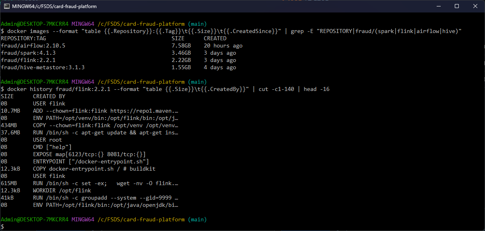

# Docker image optimization

Layer 1 builds four images from `infra/*/Dockerfile`. They carried more than they needed, and every `spark-submit`
downloaded its jars first, which cost time and failed whenever the network did. Multi-stage builds cut Flink by 23%
and Airflow by 17% of layer size (29% before it gained the lakehouse jars), and a new Spark image bakes those jars in.
Functional runs checked that the slim images still run the pipelines.

| | |
|---|---|
| Code | [`infra/flink/Dockerfile`](https://github.com/cvinhnguyen/card-fraud-platform/blob/54d21eddbf6e602ae13fed46a1a9e0ef265d23cd/infra/flink/Dockerfile), [`infra/airflow/Dockerfile`](https://github.com/cvinhnguyen/card-fraud-platform/blob/54d21eddbf6e602ae13fed46a1a9e0ef265d23cd/infra/airflow/Dockerfile), [`infra/spark/Dockerfile`](https://github.com/cvinhnguyen/card-fraud-platform/blob/54d21eddbf6e602ae13fed46a1a9e0ef265d23cd/infra/spark/Dockerfile), [`infra/hive/Dockerfile`](https://github.com/cvinhnguyen/card-fraud-platform/blob/54d21eddbf6e602ae13fed46a1a9e0ef265d23cd/infra/hive/Dockerfile) |
| Runs on | built by compose: `fraud/spark` and `fraud/hive-metastore` in profile `batch`, `fraud/flink` in `stream`, `fraud/airflow` in `orch` |
| Related | [flink_jobs.md](../data-platform/flink_jobs.md), [airflow.md](../data-platform/airflow.md), [spark_jobs.md](../data-platform/spark_jobs.md) |

## Sizes

"Before" is what the first Flink and Airflow Dockerfiles built; "after" is the multi-stage Dockerfile in the repo.
Docker Desktop's containerd store reports a `docker images` size that is neither content nor download size, so the
table also gives the sum of the layer sizes in `docker history`, which compares between images.

| Image | Layers before | Layers after | Change | `docker images` before -> after |
|---|---:|---:|---:|---|
| `fraud/flink:2.2.1` | 1.80 GB | 1.38 GB | -23% | 2.95 -> 2.22 GB |
| `fraud/airflow:2.10.5` | 5.39 GB | 4.50 GB | -17% (-29% before the jars below were added) | 7.66 -> 6.50 GB (5.19 GB without them) |
| `fraud/spark:4.1.3` (new; was `apache/spark` + jars downloaded per run) | 1.35 GB | 2.06 GB | +0.71 GB of jars, once | 2.15 -> 3.46 GB |

The new Airflow image copies Spark from `fraud/spark`, so it carries about 0.65 GB of lakehouse jars the old one
downloaded at run time. Without them it is about 3.85 GB of layers (4.50 minus the jars), hence the -29%.

The screenshot of 2026-10-21 matches the table for Flink and Spark. Airflow shows 7.58 GB because layers came later:
a Layer 2 Feast venv (Feast, MLflow, XGBoost, scikit-learn, kfp, deltalake,
[`infra/airflow/Dockerfile` L23-L27](https://github.com/cvinhnguyen/card-fraud-platform/blob/54d21eddbf6e602ae13fed46a1a9e0ef265d23cd/infra/airflow/Dockerfile#L23-L27))
and the Layer 3 Docker provider for the RAG DAG ([`infra/airflow/Dockerfile` L56-L58](https://github.com/cvinhnguyen/card-fraud-platform/blob/54d21eddbf6e602ae13fed46a1a9e0ef265d23cd/infra/airflow/Dockerfile#L56-L58)).
The Flink `docker history` shows what the build adds to the base image: the venv from the build stage (434 MB), the
apt layer and the Kafka connector jar.



## Where it fits

- Layer 1 (data platform, [architecture.md](../architecture.md#layer-1-the-data-platform-top-band)) compose profiles
  run them: Spark for batch ([spark_jobs.md](../data-platform/spark_jobs.md)), Flink for streaming
  ([flink_jobs.md](../data-platform/flink_jobs.md)), Airflow ([airflow.md](../data-platform/airflow.md)), Hive Metastore.
- Every other Layer 1 container runs an official image as it is; Layer 2 is out of scope ([Limits](#limits)).
- A smaller image pulls and starts faster and takes less of the Docker VM's disk.

## How it works

1. Measure each image as the sum of its layers in `docker history` ([Sizes](#sizes)).
2. Rebuild Flink and Airflow as multi-stage builds and bake the jars into a new Spark image
   ([What made the images big](#what-made-the-images-big)).
3. Run the pipelines on the slim images: a Flink replay check, DP2 (bronze to silver and gold) and DP3 (gold to
   features) ([Checks after the rebuild](#checks-after-the-rebuild)).

## Run it

Build the images, then read their sizes as in the [Sizes](#sizes) screenshot:

```bash
docker compose -f infra/docker-compose.yaml --profile batch build                   # fraud/spark, fraud/hive-metastore (fraud/airflow builds FROM fraud/spark)
docker compose -f infra/docker-compose.yaml --profile stream --profile orch build   # fraud/flink, fraud/airflow
docker images --format "table {{.Repository}}:{{.Tag}}\t{{.Size}}\t{{.CreatedSince}}" | grep -E "REPOSITORY|fraud/(spark|flink|airflow|hive)"
docker history fraud/flink:2.2.1 --format "table {{.Size}}\t{{.CreatedBy}}" | cut -c1-140 | head -16
```

## The four images

| Image | Built from | Why it exists |
|---|---|---|
| `fraud/spark:4.1.3` | `apache/spark:4.1.3-scala2.13-java17-python3-ubuntu` | Spark with the lakehouse jars baked in (Delta, S3A, Postgres JDBC, OpenLineage); added for the 100 GB run ([scale_100g.md](scale_100g.md)) |
| `fraud/flink:2.2.1` | `flink:2.2.1-scala_2.12-java17` | PyFlink 2.2.1 + Kafka connector for the `stream` profile |
| `fraud/airflow:2.10.5` | `apache/airflow:2.10.5-python3.10` | Spark client (Java runtime (JRE) + Spark 4.1.3), Great Expectations (GE), dbt, DataHub plugin and CLI |
| `fraud/hive-metastore:3.1.3` | `apache/hive:3.1.3` | Postgres driver 42.7.14 (the bundled 9.4 driver predates SCRAM auth, the Postgres 16 default) + S3A jars ([`infra/hive/Dockerfile` L5-L9](https://github.com/cvinhnguyen/card-fraud-platform/blob/54d21eddbf6e602ae13fed46a1a9e0ef265d23cd/infra/hive/Dockerfile#L5-L9)); 3 small layers, nothing to trim |

## What made the images big

The biggest layers in `docker history` show what to cut in
[Flink](#flink-multi-stage-build-duplicate-jars-linked),
[Airflow](#airflow-venvs-built-in-a-stage-only-what-a-spark-client-needs) and
[Spark](#spark-jars-baked-into-a-new-image).

### Flink: multi-stage build, duplicate jars linked

Before, one `RUN` installed `python3 python3-pip python3-venv` with apt and `apache-flink==2.2.1` with pip into the
system Python: an 893 MB layer.

| Part | Size | Needed at run time? |
|---|---:|---|
| `pyflink/lib`: the Flink 2.2.1 jars | 267 MB | no: the same jars are already in `/opt/flink/lib` of the base image |
| `pyflink/opt`, `fn_execution`, Python modules | ~70 MB | yes |
| pyarrow, pandas, numpy, apache-beam, grpc, ... | ~420 MB | yes (PyFlink's Python runtime) |
| `__pycache__` / `tests` directories | 87 MB / 60 MB | no |
| pip, setuptools, `python3-pip` / `python3-venv` packages | ~40 MB | no: only to install |

The old instruction predates the git history (the first commit of `infra/flink/Dockerfile` is already multi-stage):

```text
# before: one layer with apt pip + venv, pip into the system Python, every jar twice
RUN apt-get update && apt-get install -y --no-install-recommends python3 python3-pip python3-venv \
    && rm -rf /var/lib/apt/lists/* && ln -sf /usr/bin/python3 /usr/bin/python \
    && pip3 install --no-cache-dir --break-system-packages apache-flink==2.2.1
```

Now the `build` stage of [`infra/flink/Dockerfile`](https://github.com/cvinhnguyen/card-fraud-platform/blob/54d21eddbf6e602ae13fed46a1a9e0ef265d23cd/infra/flink/Dockerfile)
uses `python3-venv` to install PyFlink into `/opt/venv`, replaces `pyflink/lib` with a symlink to `/opt/flink/lib`,
and deletes `__pycache__` / `tests` and pip. The final stage installs only the `python3` runtime (37.6 MB layer) and
copies the venv (434 MB layer, was 893 MB). `PATH` points `python`, the default `python.executable` of the Python
workers, at the venv ([`infra/flink/Dockerfile` L4-L20](https://github.com/cvinhnguyen/card-fraud-platform/blob/54d21eddbf6e602ae13fed46a1a9e0ef265d23cd/infra/flink/Dockerfile#L4-L20)):

```dockerfile
FROM flink:2.2.1-scala_2.12-java17 AS build
USER root
RUN apt-get update && apt-get install -y --no-install-recommends python3-venv
RUN python3 -m venv /opt/venv && /opt/venv/bin/pip install --no-cache-dir apache-flink==2.2.1
# pyflink/lib is a copy of the Flink 2.2.1 jars already in /opt/flink/lib (267 MB): link instead of copy.
# Bytecode caches and test suites are not needed at run time.
RUN cd /opt/venv/lib/python3.12/site-packages \
    && rm -rf pyflink/lib && ln -s /opt/flink/lib pyflink/lib \
    && find /opt/venv -depth \( -name __pycache__ -o -name tests \) -type d -exec rm -rf {} + \
    && /opt/venv/bin/pip uninstall -y -q pip

FROM flink:2.2.1-scala_2.12-java17
USER root
RUN apt-get update && apt-get install -y --no-install-recommends python3 && rm -rf /var/lib/apt/lists/*
COPY --from=build --chown=flink:flink /opt/venv /opt/venv
# `python` (the default python.executable of the Python workers) resolves to the venv
ENV PATH=/opt/venv/bin:$PATH
```

### Airflow: venvs built in a stage, only what a Spark client needs

Before, `fraud/airflow` added these layers to the 2.14 GB Airflow image:

| Layer | Size | Problem |
|---|---:|---|
| JRE + `/opt/spark` copied from the Spark image | 282 + 518 MB | Spark's `examples/`, `R/`, `data/`, `tests/` not needed by a client |
| `apache-airflow-providers-apache-spark` | 367 MB | it declares `pyspark` (342 MB) as a dependency; `SparkSubmitOperator` only calls the `spark-submit` binary |
| DataHub CLI venv | 1.71 GB | the `delta-lake` extra pulled `deltalake` (135 MB) and a second `pyspark` (343 MB); delta-lake ingestion is not used (lakehouse tables come from OpenLineage) |
| GE venv | 622 MB | pip, caches and test suites included |
| DataHub plugin | 57 MB | separate `pip install` layer |

Now [`infra/airflow/Dockerfile`](https://github.com/cvinhnguyen/card-fraud-platform/blob/54d21eddbf6e602ae13fed46a1a9e0ef265d23cd/infra/airflow/Dockerfile)
builds the venvs in a `venvs` stage and copies only what a Spark client needs:

| Layer | Before | After | How |
|---|---:|---:|---|
| JRE + Spark | 282 + 518 MB | 282 + 484 MB | copy `bin/`, `jars/`, `python/lib` only (no `examples/`, `R/`, `data/`, `tests/`) |
| Spark provider | 367 MB | (in a 34 MB layer) | `--no-deps`: its `pyspark` dependency (342 MB) is never imported by `SparkSubmitOperator`; the provider shares one pip layer with the DataHub listener and `delta-spark` (35.2 MB in `docker history` on 2026-11-13, since the Docker provider joined it) ([`infra/airflow/Dockerfile` L53-L60](https://github.com/cvinhnguyen/card-fraud-platform/blob/54d21eddbf6e602ae13fed46a1a9e0ef265d23cd/infra/airflow/Dockerfile#L53-L60)) |
| DataHub CLI venv | 1.71 GB | (in the 1.29 GB below) | no `delta-lake` extra (it brought `deltalake` 135 MB and a second `pyspark` 343 MB) ([`infra/airflow/Dockerfile` L19-L22](https://github.com/cvinhnguyen/card-fraud-platform/blob/54d21eddbf6e602ae13fed46a1a9e0ef265d23cd/infra/airflow/Dockerfile#L19-L22)) |
| GE + dbt + DataHub venvs | 2.46 GB together | 1.29 GB | built in the `venvs` stage, copied without `__pycache__`, `tests` and pip |

The final stage ([`infra/airflow/Dockerfile` L36-L50](https://github.com/cvinhnguyen/card-fraud-platform/blob/54d21eddbf6e602ae13fed46a1a9e0ef265d23cd/infra/airflow/Dockerfile#L36-L50)):

```dockerfile
FROM apache/airflow:2.10.5-python3.10
USER root
COPY --from=spark /opt/java/openjdk /opt/java/openjdk
# A Spark client needs bin/, jars/ and the Python libs; examples, R, data, tests and sbin stay in the Spark image.
COPY --from=spark /opt/spark/bin /opt/spark/bin
COPY --from=spark /opt/spark/jars /opt/spark/jars
COPY --from=spark /opt/spark/python/lib /opt/spark/python/lib
COPY --from=spark /opt/spark/RELEASE /opt/spark/RELEASE
ENV JAVA_HOME=/opt/java/openjdk \
    SPARK_HOME=/opt/spark \
    PATH=/opt/spark/bin:/opt/java/openjdk/bin:$PATH
# dbt-artifacts is a named volume: created here so it is owned by group 0 and writable by uid 185 (spark)
RUN mkdir -p /opt/spark/conf /opt/airflow/dbt-artifacts && chown airflow:0 /opt/airflow/dbt-artifacts \
    && chmod g+rwx /opt/airflow/dbt-artifacts
COPY --from=venvs --chown=airflow:0 /opt/venvs /opt/venvs
```

### Spark: jars baked into a new image

Before, Spark containers ran the stock `apache/spark` image with `spark.jars.packages` in `spark-defaults.conf`.
Each `spark-submit` resolved Delta, hadoop-aws (with the 600 MB AWS SDK bundle), the Postgres driver and OpenLineage
through Ivy, and the worker copied them into each application's work directory: 94 GB after a day of Airflow runs,
which filled the disk ([airflow.md](../data-platform/airflow.md#gotchas)).

Now a build stage of [`infra/spark/Dockerfile` L6-L21](https://github.com/cvinhnguyen/card-fraud-platform/blob/54d21eddbf6e602ae13fed46a1a9e0ef265d23cd/infra/spark/Dockerfile#L6-L21)
resolves the packages once and copies into `/opt/spark/jars` only the 13 jars Spark does not ship, plus the
`delta-spark` Python module. Copying the whole Ivy directory would add an older jackson that breaks Spark. The image
is 0.71 GB of layers (1.3 GB in `docker images`) bigger than `apache/spark`, paid once instead of 600 MB per
application. As a result:

- Nothing downloads at run time; `spark.jars.packages` / `spark.jars.ivy` are gone from `spark-defaults.conf`.
- The Thrift Server lost its 13-jar `extraClassPath` workaround, one of whose paths Git Bash path conversion had
  mangled since the Thrift Server was first set up.
- The worker cleans up finished applications' directories (`SPARK_WORKER_OPTS`,
  [`infra/docker-compose.yaml` L251-L254](https://github.com/cvinhnguyen/card-fraud-platform/blob/54d21eddbf6e602ae13fed46a1a9e0ef265d23cd/infra/docker-compose.yaml#L251-L254)).

## Checks after the rebuild

Both slim images pass a functional run. Import checks alone were not enough: the first slim Airflow image passed them
and still broke dbt ([Gotchas](#gotchas)).

- A PyFlink job in the new Flink image (Python UDF through the venv and the linked `pyflink/lib`) returned `[2, 4, 6]`.
- The Airflow image imports GE 0.18.19, dbt-core 1.11.16 + dbt-spark 1.11.0, the DataHub CLI 1.5.0.17, the Spark
  provider and the DataHub listener; `spark-submit --version` reports 4.1.3.

| Check | Image | Result |
|---|---|---|
| `pipelines/flink/check_windows.py --replay-from "2026-06-01 00:00" --limit 20000` | `fraud/flink:2.2.1` | baseline 96.08%, lateness 98.47%, dedup 100.00% card windows exact: same as before the change ([flink_jobs.md](../data-platform/flink_jobs.md); baseline sent 484 late events to the side output instead of 483, watermark timing) |
| `dp2_bronze_to_gold` (DP2 as one DAG, before it was split into `dp2_bronze_to_silver` and `dp2_silver_to_gold`) + `dp3_gold_to_features` for 2026-10-15 (Spark jobs, GE, dbt build with its 22 tests) | `fraud/airflow:2.10.5` | both runs `success` |

## Layer order and cache

Each Dockerfile puts what changes least first: base image and system packages, then large dependency installs, then
small files. The Airflow venv stage caches apart from the final stage, so a new plugin version or Spark image
rebuilds only the last layers (the switch to `fraud/spark` reused the cached venvs).

## glibc vs musl

All images stay on glibc bases (Debian for Airflow, Ubuntu for Spark and Flink), so the JRE and Spark copied from the
Ubuntu-based Spark image run unchanged in Airflow. An Alpine (musl) base would need a musl JRE and would break the
manylinux wheels of pyarrow, numpy and grpc.

## Gotchas

- DP2 failed on the first slim Airflow image in the functional run of 2026-10-18 with
  `'get_where_subquery' is undefined` and `No materialization 'test'`: all 22 dbt tests failed to compile. The
  `find ... -name tests` cleanup had deleted `dbt/include/global_project/macros/materializations/tests`, which holds
  the `test` materialization and `get_where_subquery`. numpy 2 imports `numpy._core.tests._natype` at run time, the
  same trap. The cleanup now skips the `dbt` and `numpy` packages (a few hundred KB, [`infra/airflow/Dockerfile` L28-L34](https://github.com/cvinhnguyen/card-fraud-platform/blob/54d21eddbf6e602ae13fed46a1a9e0ef265d23cd/infra/airflow/Dockerfile#L28-L34)).

## Limits

- The Layer 2 images (`infra/ml`, `infra/mlflow`, `ml/Dockerfile`, `services/*/Dockerfile`) came later and are not
  part of this comparison.
