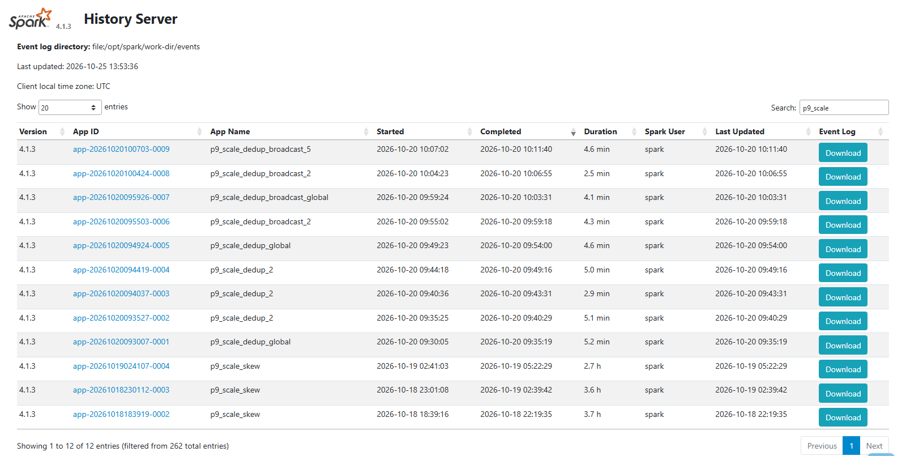
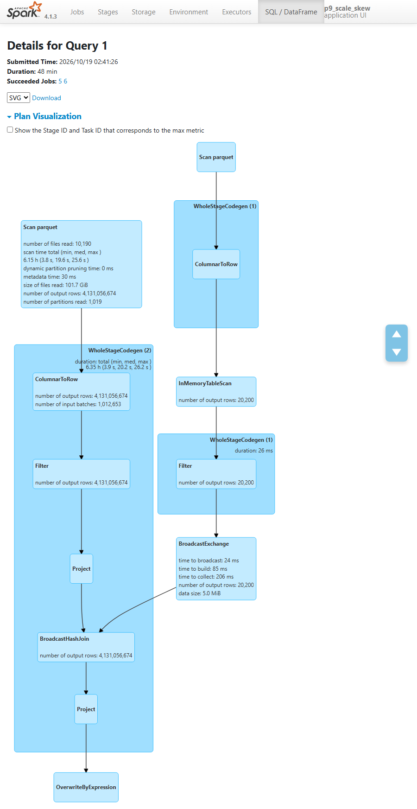
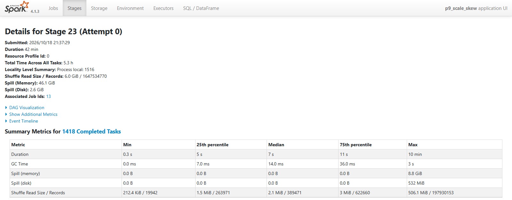
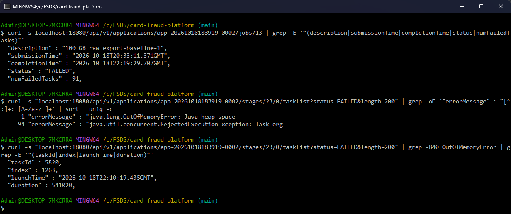
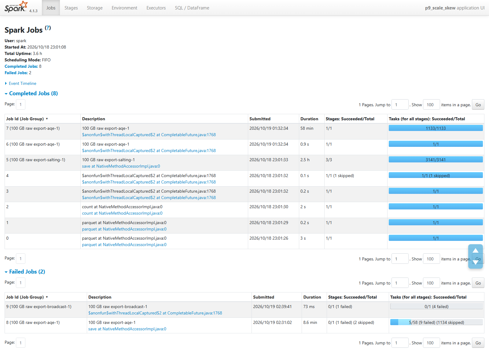
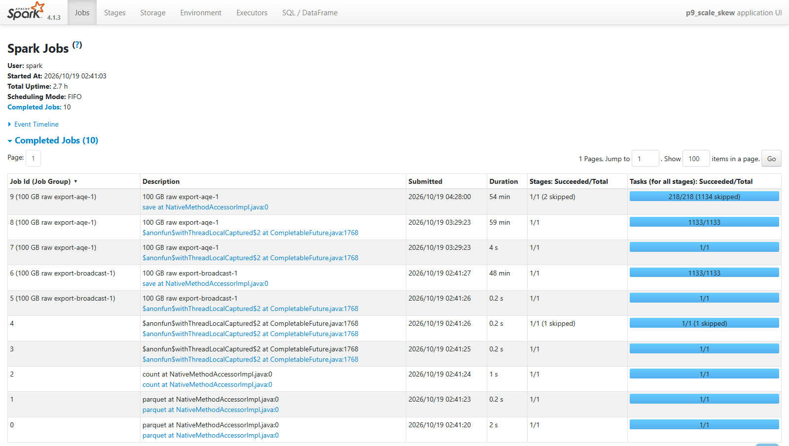
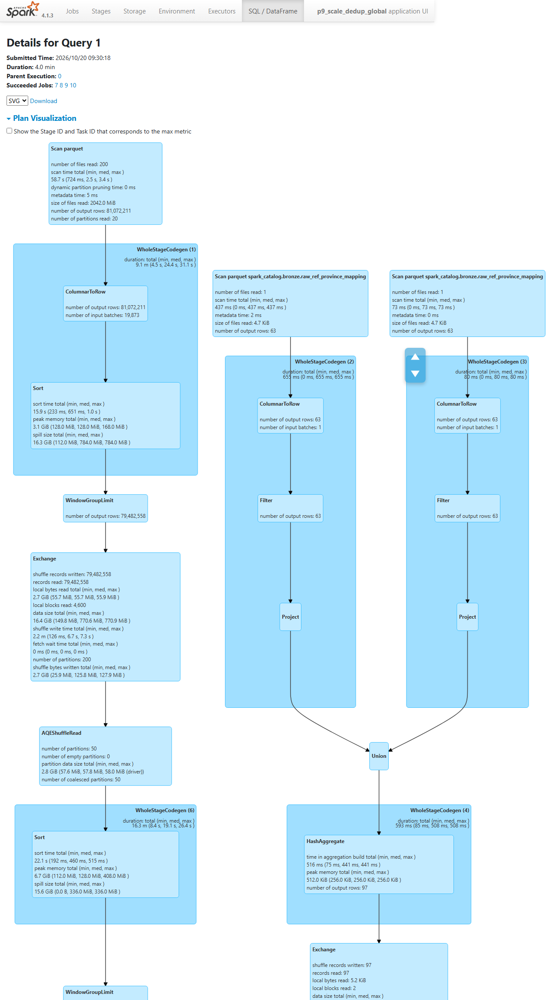

# The 100 GB run

A skewed join or a dedup that takes seconds on the 1 GB dataset can fail or crawl at bank scale, so the course asks
for at least 100 GB of offline source data. At 100 GB the sort-merge merchant join runs out of memory while broadcast
finishes in 48 min (AQE 113 min, salting 151 min). Batched dedup with a broadcast of the duplicated ids takes about
2.4 hours (extrapolated from 20 dates) against ~4 days first estimated. The 100 GB dataset is a separate run of the
same generator code; everything else runs on the ~1 GB dataset.

| | |
|---|---|
| Code | [`generator/generate_scale.py`](https://github.com/cvinhnguyen/card-fraud-platform/blob/54d21eddbf6e602ae13fed46a1a9e0ef265d23cd/generator/generate_scale.py), [`pipelines/spark/scale_100g.py`](https://github.com/cvinhnguyen/card-fraud-platform/blob/54d21eddbf6e602ae13fed46a1a9e0ef265d23cd/pipelines/spark/scale_100g.py), [`pipelines/spark/scale_dedup.py`](https://github.com/cvinhnguyen/card-fraud-platform/blob/54d21eddbf6e602ae13fed46a1a9e0ef265d23cd/pipelines/spark/scale_dedup.py) |
| Runs on | generator: host process (compose profile `core` up); benchmarks: compose profile `batch` (inside `spark-master`) |
| Reads | `s3://core-banking-export/scale_100g/transactions/` + `merchants.parquet` |
| Writes | the generator writes the 100 GB export to `s3://core-banking-export/scale_100g/`; the dedup writes `s3a://lakehouse/scale_100g/stg_transactions`; the skew benchmark writes nothing |
| Related | [spark_optimization.md](spark_optimization.md), [spark_jobs.md](../data-platform/spark_jobs.md), [data_characteristics.md](../data-platform/data_characteristics.md) |

## Where it fits

- A second output of the Layer 1 (data platform) generator ([data_characteristics.md](../data-platform/data_characteristics.md),
  [architecture.md](../architecture.md#layer-1-the-data-platform-top-band)), under its own prefix in the export bucket.
- Two benchmarks read it: the merchant join skew of [spark_optimization.md](spark_optimization.md#merchant-join-skew)
  and the silver dedup of DP2 (bronze to silver and gold, [spark_jobs.md](../data-platform/spark_jobs.md)).
- The results back broadcast joins in DP2 and a dedup that works per export date.

## How it works

1. `generate_scale.py` writes 4.05 billion transactions plus 2% duplicates straight to S3, in parallel by day and
   chunk ([The 100 GB dataset](#the-100-gb-dataset)).
2. The skew benchmark joins `merchant_id` and `amount_vnd` of the raw export with the merchants four ways (sort-merge
   baseline, salting, AQE (adaptive query execution), broadcast), once each ([Skew join benchmark](#skew-join-benchmark)).
3. The dedup compares the `build_silver.py` window with a variant that sorts only the 2% duplicated ids, globally and
   in batches, on a 20-date slice ([Dedup at scale](#dedup-at-scale)).

## Run it

From the repo root:

```bash
# 100 GB dataset (host, core profile up)
python generator/generate_scale.py --transactions 4050000000 --customers 2000000 --merchants 20000 --workers 5

# Skew join benchmark (batch profile up, nothing else running on the worker)
docker compose -f infra/docker-compose.yaml exec spark-master /opt/spark/bin/spark-submit \
    --conf spark.sql.shuffle.partitions=2000 --conf spark.io.compression.codec=zstd \
    --conf spark.cleaner.periodicGC.interval=5min /opt/jobs/scale_100g.py

# Dedup at scale: the 20-date slice, then one variant (--method window|broadcast, --batch-days 0 = global)
python generator/generate_scale.py --transactions 4050000000 --every 51 --workers 3
docker compose -f infra/docker-compose.yaml exec spark-master /opt/spark/bin/spark-submit \
    --conf spark.io.compression.codec=zstd --conf spark.sql.adaptive.advisoryPartitionSizeInBytes=16m \
    /opt/jobs/scale_dedup.py --method broadcast --batch-days 2
```

## The 100 GB dataset

[`generator/generate_scale.py` L77-L92](https://github.com/cvinhnguyen/card-fraud-platform/blob/54d21eddbf6e602ae13fed46a1a9e0ef265d23cd/generator/generate_scale.py#L77-L92)
calls the `gen_day` of
[`generator/generate.py`](https://github.com/cvinhnguyen/card-fraud-platform/blob/54d21eddbf6e602ae13fed46a1a9e0ef265d23cd/generator/generate.py)
once per day and chunk. The 20,200 merchants are `--merchants 20000` plus the 200 foreign merchants of the generator
config.

| | 1 GB dataset | 100 GB dataset |
|---|---|---|
| Generator | `generator/generate.py` (one process, day by day) | `generator/generate_scale.py` (parallel, by day and chunk) |
| Where | Postgres `core_banking` + `s3://core-banking-export/transactions/` | `s3://core-banking-export/scale_100g/transactions/` + `merchants.parquet` |
| Transactions | 8.0M (+2% duplicates) | 4.05B (+2% duplicates) |
| Customers / cards / merchants | 100k / 130k / 5.2k | 2M / 2.6M / 20.2k |
| Silver | `silver.stg_transactions` | the skew benchmark reads the raw export; the dedup was measured on a 20-date slice (below) |

The same functions give the same problems as the 1 GB data: merchant skew (top 10 merchants = 70% of rows), city skew
(HCMC 60%), cross-border payments, old province names after 2025-07-01, 2% export duplicates, and the auth columns
from 2024-07-01 (schema evolution).

The export was deleted to free the disk. The Spark History Server (profile `batch`, port 18080) keeps the event logs
that the task sizes, spills and times come from. Filtered on `p9_scale`: three skew runs of 2026-10-18 and 2026-10-19 (3.7 h, 3.6 h, 2.7 h) and nine dedup runs of
2026-10-20:



The broadcast run scanned 10,190 Parquet files, 101.7 GiB, 4,131,056,674 rows, 1,019 `export_date`
partitions, then a `BroadcastHashJoin` with the 20,200 merchants and no shuffle of the big side:



## Skew join benchmark

[`pipelines/spark/scale_100g.py`](https://github.com/cvinhnguyen/card-fraud-platform/blob/54d21eddbf6e602ae13fed46a1a9e0ef265d23cd/pipelines/spark/scale_100g.py)
runs the benchmark of [spark_optimization.md](spark_optimization.md#merchant-join-skew) on the 100 GB export.

### Why the raw export and two columns

Building silver first (a `transaction_id` window over every row and column) was too slow: a probe on 10 export dates
(~1% of the data) took about an hour, because the Docker disk was on a USB HDD and one 2 GB executor for 8 cores
spilled full rows. All of it would take about 4 days, with shuffle files + output (180-220 GB) near the free disk
(201 GB).

The benchmark reads only `merchant_id` + `amount_vnd` of the raw export (column pruning: 2 of the 13 column chunks
per row group); the 2% duplicates do not change which merchant is hot. Shuffle files are zstd-compressed and cleaned
every 5 minutes, and a watcher stops the job below 25 GB of free disk.

The job reuses the 1 GB code
([`pipelines/spark/skew_join.py`](https://github.com/cvinhnguyen/card-fraud-platform/blob/54d21eddbf6e602ae13fed46a1a9e0ef265d23cd/pipelines/spark/skew_join.py))
with Spark's AQE defaults ([`pipelines/spark/scale_100g.py` L30-L39](https://github.com/cvinhnguyen/card-fraud-platform/blob/54d21eddbf6e602ae13fed46a1a9e0ef265d23cd/pipelines/spark/scale_100g.py#L30-L39)):

```python
    spark = SparkSession.builder.appName("p9_scale_skew").getOrCreate()
    txn = spark.read.parquet(f"{SRC}/transactions").select("merchant_id", "amount_vnd")
    merchants = spark.read.parquet(f"{SRC}/merchants.parquet").select("merchant_id", "merchant_name", "mcc").cache()
    merchants.count()
    if not args.no_stats:
        skew_join.TOP = [r.merchant_id for r in txn.groupBy("merchant_id").count().orderBy(F.desc("count"))
                         .limit(skew_join.TOP_N).collect()]
    # Spark's own AQE defaults at this size (skew threshold 256 MB, target partition 64 MB)
    skew_join.RUNS, skew_join.WARMUP, skew_join.SKEW_THRESHOLD, skew_join.ADVISORY = 1, False, "256m", "64m"
    skew_join.bench(spark, txn, merchants, "100 GB raw export", args.methods, stats=not args.no_stats)
```

### Results

Setup: 4,131,056,674 rows (4.05B + 2% duplicates), biggest merchant 23.9% of all rows (~990M rows), top 10 merchants
70.0%; one executor, 8 cores, 2 GB heap; 2,000 shuffle partitions; one run per method (a run is a full pass).

| Method | Wall time | Slowest task | Median task | Biggest shuffle read | Note |
|---|---:|---:|---:|---:|---|
| baseline (sort-merge, AQE off) | did not finish | | | | `OutOfMemoryError: Java heap space` after 106 min, in the reduce task that holds the hot merchant |
| salting (32 buckets) | 9,060 s (151 min) | 377 s | 16 s | 181 MB | hot keys spread over 32 tasks |
| AQE (Spark defaults: skew 256 MB, target 64 MB) | 6,784 s (113 min) | 477 s | 94 s | 81 MB | 2,000 shuffle partitions coalesced to 218 tasks, the hot ones split |
| broadcast | 2,866 s (48 min) | 26 s | 20 s | 0 (no shuffle) | merchants (20k rows) copied to the executor; the scan is the whole cost |

- Baseline: with ~24% of 4.1B rows behind one key, one task sorts ~990M rows alone while 1,999 others finish in
  seconds.
- Broadcast wins whenever the small side fits in memory: the 4.1B rows never shuffle, every task does the same work
  (slowest 26 s vs median 20 s), and the time is the scan.
- AQE needs no code change: it split the hot partitions and merged the small ones. The slowest task is still 5x
  the median, but nothing runs out of memory.
- Salting costs the most: a salt column on every row, the merchant table copied 32 times, and code that knows
  which keys are hot.

The 1 GB benchmark ([spark_optimization.md](spark_optimization.md): baseline 51 s, salting 46 s, AQE 38 s, broadcast
24 s) has the same order, with the baseline only 2x slower than broadcast.

### Evidence from the History Server

The baseline's reduce stage (stage 23, run of 2026-10-18): the median task read 2.1 MiB (389,471 records) in 7 s, the
largest finished task 506.1 MiB (197,930,153 records) in 10 min:



The REST API: job 13 (`baseline-1`) ran from 20:33:11 to 22:19:29 and failed. Task 1263 died after 541 s with
`java.lang.OutOfMemoryError: Java heap space`; the 94 other failed tasks were rejected while the executor shut down:



Second run, 2026-10-18 from 23:01: salting finished in 2.5 h (job 5). The two failed jobs are the first AQE attempt
and the broadcast after it ([Gotchas](#gotchas)):



Third run, 2026-10-19 from 02:41: broadcast in 48 min (job 6), AQE in 59 + 54 min (jobs 8 and 9), the last with 218
tasks where 2,000 shuffle partitions were planned:



## Dedup at scale

[`pipelines/spark/scale_dedup.py`](https://github.com/cvinhnguyen/card-fraud-platform/blob/54d21eddbf6e602ae13fed46a1a9e0ef265d23cd/pipelines/spark/scale_dedup.py)
runs the silver dedup (latest `created_ts` per `transaction_id`, as in
[`pipelines/spark/build_silver.py` L58-L59](https://github.com/cvinhnguyen/card-fraud-platform/blob/54d21eddbf6e602ae13fed46a1a9e0ef265d23cd/pipelines/spark/build_silver.py#L58-L59))
on a slice of the 100 GB dataset.

### The 20-date slice

The full 100 GB plus its silver copy (~190 GB) does not fit the free disk since the Docker disk moved to the C: SSD.
The slice is every 51st day at full volume: 20 export dates over 2024-2026, with both schemas (before and after
2024-07-01) and the trend. Generating it (`--every 51`, 3 workers) wrote 81,072,211 rows, 2.0 GiB, in 8 min.
With the same seed the files equal the full run's: each day and chunk has its own random stream
([`generator/generate_scale.py` L81](https://github.com/cvinhnguyen/card-fraud-platform/blob/54d21eddbf6e602ae13fed46a1a9e0ef265d23cd/generator/generate_scale.py#L81)),
and `--every` only drops days ([`generator/generate_scale.py` L109](https://github.com/cvinhnguyen/card-fraud-platform/blob/54d21eddbf6e602ae13fed46a1a9e0ef265d23cd/generator/generate_scale.py#L109)).

### What is compared

| Choice | Options | How it works |
|---|---|---|
| Scope | global, batched | Global runs all dates in one job, like a one-shot backfill. Batched runs a few export dates per job, appended to the same Delta table ([`pipelines/spark/scale_dedup.py` L81-L85](https://github.com/cvinhnguyen/card-fraud-platform/blob/54d21eddbf6e602ae13fed46a1a9e0ef265d23cd/pipelines/spark/scale_dedup.py#L81-L85)). |
| Method | window, broadcast | Window is `row_number()` over `transaction_id` (the `build_silver.py` code), which shuffles and sorts every row with every column. Broadcast runs the window on the 2% duplicated ids only (code below). |

Batching is correct because a duplicate comes from re-running one nightly export, so both copies share an
`export_date`. DP2 (bronze to silver and gold) relies on this every night when it dedups only the new export dates.

The two methods
([`pipelines/spark/scale_dedup.py` L38-L47](https://github.com/cvinhnguyen/card-fraud-platform/blob/54d21eddbf6e602ae13fed46a1a9e0ef265d23cd/pipelines/spark/scale_dedup.py#L38-L47)):

```python
def latest(raw, method: str):
    """One row per transaction_id, the one with the latest created_ts."""
    if method == "window":
        w = Window.partitionBy("transaction_id").orderBy(F.col("created_ts").desc())
        return raw.withColumn("_rn", F.row_number().over(w)).where("_rn = 1").drop("_rn")
    # broadcast: only 2% of the ids are duplicated. Find them from the id column alone (column pruning), pass the
    # other rows through a broadcast anti join (no shuffle, no sort) and run the window on the duplicated rows only.
    dup = F.broadcast(raw.groupBy("transaction_id").count().where("count > 1").select("transaction_id"))
    return (raw.join(dup, "transaction_id", "left_anti")
            .unionByName(latest(raw.join(dup, "transaction_id", "left_semi"), "window")))
```

### Results

Every run wrote the same 79,482,558 of 81,072,211 rows (1,589,653 duplicates removed), same checksum
([`pipelines/spark/scale_dedup.py` L88-L93](https://github.com/cvinhnguyen/card-fraud-platform/blob/54d21eddbf6e602ae13fed46a1a9e0ef265d23cd/pipelines/spark/scale_dedup.py#L88-L93)).
One 2 GB executor, 8 cores, Docker disk on the SSD; one run each. Bold marks the best value in each column.

| Method | Scope | AQE partition target | Time (20 dates) | Per date | Spill (memory / disk) |
|---|---|---:|---:|---:|---:|
| window | global | 64 MB (default) | 249 s | 12.5 s | 34.3 / 5.6 GB |
| window | batched, 2 dates | 64 MB (default) | 237 s | 11.9 s | 18.8 / 3.1 GB |
| window | global | 16 MB | 216 s | 10.8 s | 17.6 / 2.8 GB |
| window | batched, 2 dates | 16 MB | 233 s | 11.7 s | 9.4 / 1.5 GB |
| broadcast | global | 16 MB | **180 s** | **9.0 s** | 16.5 / 0.3 GB |
| broadcast | batched, 2 dates | 16 MB | 201 s | 10.0 s | **0.4 / 0.0 GB** |
| broadcast | batched, 5 dates | 16 MB | 200 s | 10.0 s | 16.1 / 0.3 GB |

- The disk mattered most: the probe (window, global, 10 dates) took about an hour on the USB HDD, the window job on
  the SSD 4.2 min for 20 dates (global) and 2.3 min for 10 (batched).
- A 16 MB AQE target halves the spill and makes the global window job 13% faster. The default 64 MB of compressed
  data unpacks to more than one task's share of a 2 GB executor for 8 cores, so every sort spills.
- Broadcast is 28% faster than the default window job; its only shuffle finds the duplicated ids.
- On 2 GB global beats batched slightly (each batch pays its own Spark jobs, file listing and Delta commit), but it
  cannot scale: at 100 GB it shuffles the whole dataset, and ~81M duplicated ids (2% of 4.1B) are too many to
  broadcast to a 2 GB executor.
- Batched broadcast barely spills, broadcasts one batch's ids, and grows linearly: 116 s for 10 dates and 201 s for
  20, about 31 s fixed plus 8.5 s per date. Five dates per batch were no faster and spilled again.

For the whole 100 GB (1,019 export dates) that is about 31 s + 1,019 x 8.5 s, roughly 2.4 hours on this machine,
against the ~4 days estimated from the HDD probe.

The first row in the History Server (run of 2026-10-20 09:30, query 1, 4.0 min): the scan reads 200 files, 2,042 MiB,
81,072,211 rows; both sorts spill, 16.3 GiB before the shuffle and 15.6 GiB after (31.9 GiB, the table's 34.3 GB);
79,482,558 rows come out of the window:



## Gotchas

- The first AQE run of the skew benchmark also ran out of memory, after 67 min (job 7 ran 58 min, then job 8 failed
  after 8.6 min). `skew_join.configure` set the target partition size equal to the skew threshold
  ([`pipelines/spark/skew_join.py` L46](https://github.com/cvinhnguyen/card-fraud-platform/blob/54d21eddbf6e602ae13fed46a1a9e0ef265d23cd/pipelines/spark/skew_join.py#L46)),
  right at 1 GB where both are 8 MB, but at 100 GB each task aimed at 256 MB instead of Spark's default 64 MB. The
  results table uses Spark's defaults. That attempt's broadcast failed only because the OOM had broken the executor.

## Limits

- Each skew method ran once (48 to 151 min per run), so only large differences mean something; these are large.
- The 2.4 hours for a dedup of the whole 100 GB is an extrapolation from 20 dates, not a measured 100 GB run.
