# Spark optimization

Three problems in the bank's batch data would make the daily pipelines slow or wrong
([data_characteristics.md](../data-platform/data_characteristics.md)): join skew (70% of the payments go to 10 big
merchants, so one Spark task does most of the work), schema evolution (payments from 2024-07-01 carry two new
columns), and duplicates (an export re-run sends 2% of the rows twice, counted twice in every total). The fixes run in
DP1 (data pipeline: ingest to bronze) and DP2 (bronze to silver and gold)
([In the Airflow pipeline](#in-the-airflow-pipeline), [airflow.md](../data-platform/airflow.md)).

| | |
|---|---|
| Code | [`pipelines/spark/`](https://github.com/cvinhnguyen/card-fraud-platform/tree/54d21eddbf6e602ae13fed46a1a9e0ef265d23cd/pipelines/spark), [`pipelines/airflow/dags/`](https://github.com/cvinhnguyen/card-fraud-platform/tree/54d21eddbf6e602ae13fed46a1a9e0ef265d23cd/pipelines/airflow/dags) |
| Runs on | compose profile `batch` (jobs run inside the `spark-master` container); in the pipeline, Airflow DAGs `dp1_source_to_bronze`, `dp2_bronze_to_silver` and `dp2_silver_to_gold` |
| Reads | the export bucket `s3a://core-banking-export/transactions/`, `bronze.raw_transactions`, `bronze.raw_merchants`, `silver.stg_transactions` |
| Writes | `bronze.raw_transactions` (on a lakeFS run branch), `silver.stg_transactions`; the skew benchmark writes to the `noop` sink |
| Related | [spark_jobs.md](../data-platform/spark_jobs.md), [airflow.md](../data-platform/airflow.md), [scale_100g.md](scale_100g.md), [novel_lakefs_wap.md](../data-platform/novel_lakefs_wap.md) |

## Results at a glance

| Problem | Before (baseline) | Fix | After |
|---|---|---|---|
| Merchant join skew | sort-merge join 51.2 s; the hot-key task runs 17.4 s, the median task 0.15 s | broadcast join with the small table | 23.9 s; slowest task 1.5 s ([Merchant join skew](#merchant-join-skew)) |
| Schema evolution | a plain read drops the two new columns with no error, and the Delta append fails | `mergeSchema` on the read and on the append | 14 columns, older rows NULL ([Schema evolution](#schema-evolution)) |
| Duplicates | bronze has 8,330,664 rows for 8,167,316 ids; settled spend 2.00% too high | latest `created_ts` per `transaction_id`, MERGE into silver | one row per id ([Duplicates](#duplicates)) |

## Where it fits

- Layer 1 (data platform, [architecture.md](../architecture.md#layer-1-the-data-platform-top-band)) pipelines run the
  fixes: schema evolution in DP1's export load, duplicates and broadcast joins in DP2.
- The benchmarks run by hand on the same compose Spark cluster; [scale_100g.md](scale_100g.md) repeats two at 100 GB.
- [data_characteristics.md](../data-platform/data_characteristics.md) measures how much of each problem the data has.

## How it works

Each problem has a job and an Airflow task; every Spark task comes from one helper and runs one application at a time
([In the Airflow pipeline](#in-the-airflow-pipeline)).

| Problem | Job | Airflow task | Section |
|---|---|---|---|
| Merchant join skew: top 10 merchants have 70% of the rows | [`pipelines/spark/skew_join.py`](https://github.com/cvinhnguyen/card-fraud-platform/blob/54d21eddbf6e602ae13fed46a1a9e0ef265d23cd/pipelines/spark/skew_join.py) (benchmark of 4 join methods, run by hand); the pipeline applies the winner, broadcast, to its own joins | `dp2_bronze_to_silver.build_silver`, `dp2_silver_to_gold.build_labels` | [Merchant join skew](#merchant-join-skew) |
| Schema evolution: `auth_method`, `three_ds_version` appear in the payments from 2024-07-01 (export files from 2024-07-02) | [`pipelines/spark/ingest_bronze.py`](https://github.com/cvinhnguyen/card-fraud-platform/blob/54d21eddbf6e602ae13fed46a1a9e0ef265d23cd/pipelines/spark/ingest_bronze.py) (DP1) | `dp1_source_to_bronze.ingest_exports` | [Schema evolution](#schema-evolution) |
| Duplicates: 2% of the exported rows, from export re-runs | [`pipelines/spark/build_silver.py`](https://github.com/cvinhnguyen/card-fraud-platform/blob/54d21eddbf6e602ae13fed46a1a9e0ef265d23cd/pipelines/spark/build_silver.py) (DP2) | `dp2_bronze_to_silver.build_silver` | [Duplicates](#duplicates) |

## Run it

From the repo root, with the `batch` profile up (stop `spark-thrift` first if the `dbt` profile is up too):

```bash
# Merchant join skew: 4 methods on the data unioned 4 times, then the skew level sweep
docker compose -f infra/docker-compose.yaml stop spark-thrift      # it holds worker cores
docker compose -f infra/docker-compose.yaml exec spark-master /opt/spark/bin/spark-submit /opt/jobs/skew_join.py --replicate 4
docker compose -f infra/docker-compose.yaml exec spark-master /opt/spark/bin/spark-submit /opt/jobs/skew_join.py --replicate 4 --top-shares 0.3,0.6,0.8

# Schema evolution: the read without and with mergeSchema, then the append steps on a scratch path
docker compose -f infra/docker-compose.yaml exec spark-master /opt/spark/bin/spark-submit /opt/jobs/schema_evolution_read.py
docker compose -f infra/docker-compose.yaml exec spark-master /opt/spark/bin/spark-submit /opt/jobs/ingest_bronze.py --part exports --txn-root s3a://lakehouse/tmp/schema_demo --until 2024-07-01
docker compose -f infra/docker-compose.yaml exec spark-master /opt/spark/bin/spark-submit /opt/jobs/ingest_bronze.py --part exports --txn-root s3a://lakehouse/tmp/schema_demo --until 2024-07-02 --no-merge-schema
docker compose -f infra/docker-compose.yaml exec spark-master /opt/spark/bin/spark-submit /opt/jobs/ingest_bronze.py --part exports --txn-root s3a://lakehouse/tmp/schema_demo --until 2024-07-02

# Duplicates: dedup + MERGE into silver
docker compose -f infra/docker-compose.yaml exec spark-master /opt/spark/bin/spark-submit /opt/jobs/build_silver.py
```

## Merchant join skew

[`pipelines/spark/skew_join.py`](https://github.com/cvinhnguyen/card-fraud-platform/blob/54d21eddbf6e602ae13fed46a1a9e0ef265d23cd/pipelines/spark/skew_join.py)
joins `stg_transactions JOIN merchants ON merchant_id` on full rows four ways: sort-merge baseline, salting, AQE
(adaptive query execution) and broadcast, writing to the `noop` sink. The biggest merchant (an e-wallet top-up) has
23.9% of the rows, the top 10 have 70%.

Setup: 1 worker, 8 cores, 2 GB executor; the data unioned 4 times (32M rows, 2 GB of shuffle) so tasks are long
enough to measure ([`pipelines/spark/skew_join.py` L133-L136](https://github.com/cvinhnguyen/card-fraud-platform/blob/54d21eddbf6e602ae13fed46a1a9e0ef265d23cd/pipelines/spark/skew_join.py#L133-L136)).
Median of 3 runs after a warm-up ([`pipelines/spark/skew_join.py` L104-L118](https://github.com/cvinhnguyen/card-fraud-platform/blob/54d21eddbf6e602ae13fed46a1a9e0ef265d23cd/pipelines/spark/skew_join.py#L104-L118));
task numbers from the slowest stage of the last run (Spark REST API, [`pipelines/spark/skew_join.py` L63-L79](https://github.com/cvinhnguyen/card-fraud-platform/blob/54d21eddbf6e602ae13fed46a1a9e0ef265d23cd/pipelines/spark/skew_join.py#L63-L79)).

| Method | What changes | Median (s) | Runs (s) | Slowest task | Median task |
|---|---|---:|---|---:|---:|
| baseline | sort-merge join, AQE off, broadcast off | 51.2 | 53.5, 51.2, 48.9 | 17.4 s | 0.15 s |
| salting | merchant_id + random salt 0..31, merchants copied 32 times | 45.5 | 45.8, 45.5, 44.8 | 2.2 s | 1.80 s |
| AQE skew join | `spark.sql.adaptive.enabled`, skew threshold 8 MB | 38.0 | 35.8, 38.0, 38.6 | 2.1 s | 1.68 s |
| broadcast | merchants (5.2k rows) sent to every executor | 23.9 | 24.1, 23.2, 23.9 | 1.5 s | 1.35 s |

Salting, AQE and broadcast remove the skew: their slowest stage is the scan. Broadcast's 23.9 s is roughly the cost of
reading the data, so the join itself costs about 27 s in the baseline, 22 s with salting, 14 s with AQE and almost
nothing with broadcast.

The methods differ only in these session settings and the join call
([`pipelines/spark/skew_join.py` L38-L60](https://github.com/cvinhnguyen/card-fraud-platform/blob/54d21eddbf6e602ae13fed46a1a9e0ef265d23cd/pipelines/spark/skew_join.py#L38-L60)):

```python
def configure(spark: SparkSession, method: str) -> None:
    """Session settings per method; everything else is identical across runs."""
    conf = {
        "spark.sql.adaptive.enabled": method == "aqe",
        "spark.sql.autoBroadcastJoinThreshold": -1,            # no automatic broadcast: it would hide the skew
        "spark.sql.adaptive.autoBroadcastJoinThreshold": -1,
        "spark.sql.adaptive.skewJoin.enabled": True,
        "spark.sql.adaptive.skewJoin.skewedPartitionThresholdInBytes": SKEW_THRESHOLD,
        "spark.sql.adaptive.advisoryPartitionSizeInBytes": ADVISORY or SKEW_THRESHOLD,
    }
    for k, v in conf.items():
        spark.conf.set(k, str(v).lower() if isinstance(v, bool) else str(v))


def join(txn: DataFrame, merchants: DataFrame, method: str) -> DataFrame:
    """transactions JOIN merchants on merchant_id with one of the four methods."""
    if method == "salting":
        txn = txn.withColumn("salt", (F.rand(7) * SALTS).cast("int"))
        merchants = merchants.crossJoin(txn.sparkSession.range(SALTS).withColumnRenamed("id", "salt"))
        return txn.join(merchants, ["merchant_id", "salt"]).drop("salt")
    if method == "broadcast":
        return txn.join(F.broadcast(merchants), "merchant_id")
    return txn.join(merchants, "merchant_id")
```

### Baseline: one task reads the hot key

Of 200 shuffle partitions, the one with the biggest merchant reads 451 MB (7.7M rows) and runs 17.4 s against a
0.15 s median, while the other 7 cores sit idle. The screenshots predate the 200 foreign merchants (same pattern:
453 MB read, 16 s, 2.4 GB spilled, median task 3.5 MB).

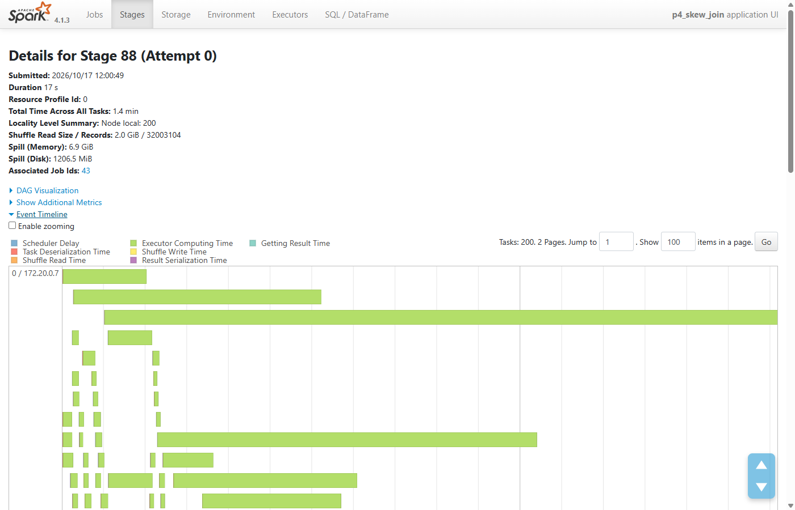

The task metrics: slowest task 16 s, 452.8 MiB and 7.7M records read, 2.4 GiB spilled; median 0.1 s, 3.5 MiB:

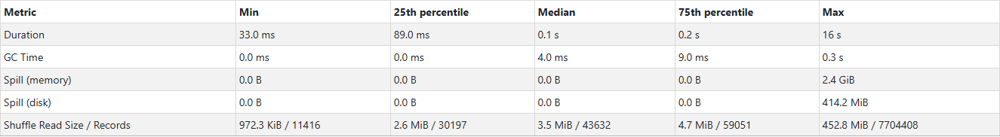

### AQE: the hot partition is split at run time

AQE splits the oversized shuffle partitions (325 tasks instead of 200 in the screenshot run). In the join stage the
largest task reads 17 MB, the slowest runs 0.5 s and nothing spills; the table's 2.1 s comes from the scan, the
slowest stage with AQE.

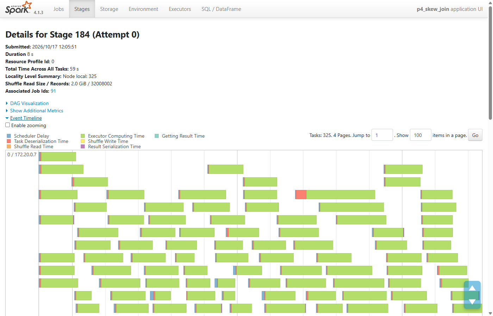

The task metrics: slowest 0.5 s and 17.3 MiB read, median 0.2 s and 6.7 MiB:

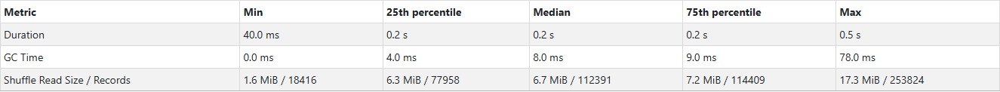

### Which fix, in which order

1. Broadcast when one side is small. `merchants` (5.2k rows) is far below Spark's 10 MB auto-broadcast threshold, so
   by default this join is broadcast and never skews; the benchmark turns automatic broadcast off to show the problem.
2. AQE for large-to-large joins, configuration only. Its defaults (skewed above 256 MB and 5 times the median) target
   big data; at 1 GB the threshold had to drop to 8 MB
   ([`pipelines/spark/skew_join.py` L31](https://github.com/cvinhnguyen/card-fraud-platform/blob/54d21eddbf6e602ae13fed46a1a9e0ef265d23cd/pipelines/spark/skew_join.py#L31)).
   At the 100 GB target the hot partition is several GB and the defaults apply.
3. Salting only where AQE cannot help: skew inside an aggregation or a window (AQE splits join partitions only), join
   types AQE does not split (full outer), or split pieces still too big. It costs code, an extra shuffle column
   (2.5 GB instead of 2.0 GB here) and a copy of the other side per salt bucket.

### Why skew needs scale to show

A skewed task costs wall time only when the hot partition exceeds the fair share (total / cores) and the task outlasts
Spark's fixed overhead. A first run with 4 cores and 8M cached rows (3 columns) gave baseline 3.4 s, salting 3.7 s, AQE
2.7 s, broadcast 0.8 s: the hot key (24%) was about one core's fair share (25%), and the slowest task took 0.8 s. With
8 cores and 32M full rows the fair share is 12.5%, so the 24% key takes twice as long as everything else.

### Skew level sweep

`--top-shares 0.3,0.6,0.8` re-assigns `merchant_id` in memory so the top 10 merchants get 30%, 60% or 80% of the rows,
spread evenly over the 10, so the biggest merchant is smaller than in the generated data
([`pipelines/spark/skew_join.py` L82-L89](https://github.com/cvinhnguyen/card-fraud-platform/blob/54d21eddbf6e602ae13fed46a1a9e0ef265d23cd/pipelines/spark/skew_join.py#L82-L89)).
The re-assignment runs in every run and changes the plan (broadcast about 4.5 s faster than on the generated data), so
compare methods within a row. Median of 3 runs, seconds; 8 cores, 32M rows.

| Top-10 share | Biggest merchant | Baseline | Salting | AQE | Broadcast | Baseline slowest task |
|---|---:|---:|---:|---:|---:|---:|
| 30% | 8.1% | 44.4 | 44.4 | 38.7 | 19.3 | 9.2 s |
| 60% | 16.1% | 45.9 | 41.7 | 37.7 | 19.9 | 15.8 s |
| 80% | 21.5% | 48.6 | 42.4 | 38.1 | 18.7 | 19.4 s |
| 70% (as generated, no re-assignment) | 23.9% | 51.2 | 45.5 | 38.0 | 23.9 | 17.4 s |

- At 30% the biggest key (8.1%) is below one core's fair share (12.5%). Salting gains nothing (44.4 s both): it pays
  back its saving for the extra column and the 32 copies of `merchants`. AQE is still 5.7 s faster, because the
  baseline's slowest task still reads 175 MB (9.2 s).
- From 60% the hot key exceeds the fair share: the baseline grows by 1.5 to 2.7 s per row, AQE stays between 37.7 and
  38.7 s, and salting moves by 0.7 s from 60% to 80%.
- Broadcast does not depend on skew: the transactions are never shuffled.

## Schema evolution

Core banking added the two columns to its payments from 2024-07-01 (an authentication regulation). A day's export is
dated the next day, so export files up to 2024-07-01 have 12 columns and later ones 14:

| Export files | Columns |
|---|---|
| up to 2024-07-01 | `transaction_id`, `card_id`, `merchant_id`, `terminal_id`, `txn_ts`, `txn_city`, `amount_vnd`, `currency`, `channel`, `status`, `created_ts`, `export_date` |
| after 2024-07-01 | the same 12 + `auth_method`, `three_ds_version` |

### Baseline: the columns vanish on read, or the append fails

[`pipelines/spark/schema_evolution_read.py` L18-L23](https://github.com/cvinhnguyen/card-fraud-platform/blob/54d21eddbf6e602ae13fed46a1a9e0ef265d23cd/pipelines/spark/schema_evolution_read.py#L18-L23)
reads every export file at once, without and with `mergeSchema`, in 28 s (all files in the bucket on 2026-10-25,
more than at the first load below):

| Read | Columns | Rows | Rows with `auth_method` |
|---|---:|---:|---:|
| without `mergeSchema` (before) | 12 (auth columns missing) | 8,445,032 | 0 |
| with `mergeSchema` (after) | 14 | 8,445,032 | 6,989,616 |

Without `mergeSchema` Spark takes the schema of one file (the oldest), so the two columns vanish for all rows, with no
error:

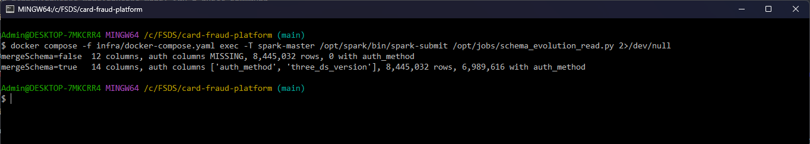

On write, Delta enforces the table schema. Three appends to `bronze.raw_transactions` with `ingest_bronze.py` at the
first load, before the table moved into lakeFS (today the exports part also needs `--txn-root`, see
[spark_jobs.md](../data-platform/spark_jobs.md#incremental-load)):

| Step | Command | Result |
|---|---|---|
| 1 | `--until 2024-07-01` | +182 export dates, 1,455,416 rows, table without the auth columns (82 s) |
| 2 | `--until 2024-07-02 --no-merge-schema` | fails: `[DELTA_METADATA_MISMATCH] A schema mismatch detected when writing to the Delta table`, nothing written |
| 3 | no flags (`mergeSchema` on read and write) | +837 export dates, 8,159,516 rows in total (132 s; 510 s on a run where the machine was short of RAM) |

Step 2's failure is the safe default: a source that changes its schema cannot silently corrupt the table. For the
screenshot, steps 1 and 2 ran again on a scratch path (`--txn-root s3a://lakehouse/tmp/schema_demo`), since the real
table on lakeFS main takes merges only. The error prints both schemas: no auth columns in the table, `auth_method` and
`three_ds_version` in the 2024-07-02 file.

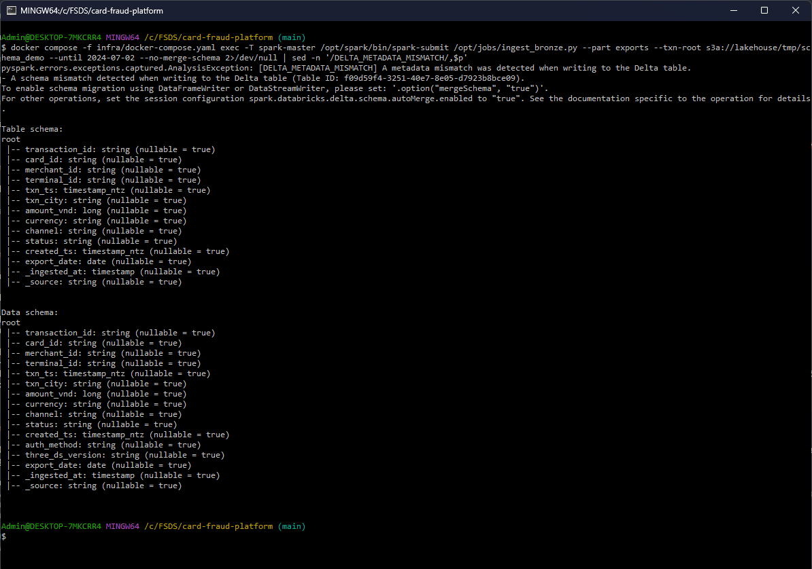

### Fix: `mergeSchema` on the read and on the Delta append

DP1 reads only the new export folders, with `mergeSchema` on both sides
([`pipelines/spark/ingest_bronze.py` L92-L97](https://github.com/cvinhnguyen/card-fraud-platform/blob/54d21eddbf6e602ae13fed46a1a9e0ef265d23cd/pipelines/spark/ingest_bronze.py#L92-L97)):

```python
    df = (spark.read.options(basePath=EXPORTS, mergeSchema=str(merge_schema).lower())
          .parquet(*[f"{EXPORTS}/export_date={d}" for d in new])
          .withColumn("_ingested_at", F.current_timestamp())
          .withColumn("_source", F.col("_metadata.file_path")))
    save(df.repartition("export_date"), "raw_transactions", "append",
         partition_by="export_date", root=root, mergeSchema=str(merge_schema).lower())
```

The table gains the two columns once; older rows keep NULL. Step 3 on the scratch path, up to 2024-07-02: the append
goes through, rows of 2024-06-29 to 2024-07-01 read NULL and every row of 2024-07-02 has `auth_method`:

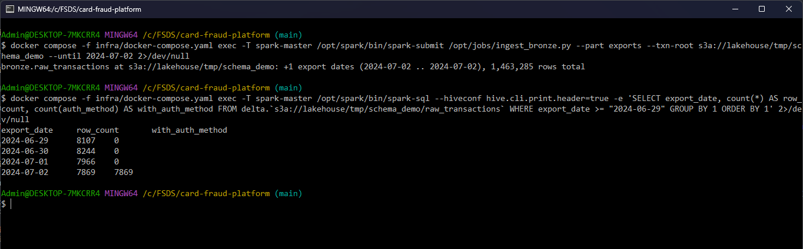

In the real table (lakeFS main, export dates up to 2026-11-06), Trino shows the same split:

| Export date | Rows | With `auth_method` |
|---|---:|---:|
| up to 2024-07-01 | 1,455,416 | 0 |
| after 2024-07-01 | 6,875,248 | 6,875,248 |

DP2 maps the NULLs to `unknown_pre_regulation` (1,426,881 rows in silver after dedup), so a NULL never reads as "no
authentication" ([`pipelines/spark/build_silver.py` L60](https://github.com/cvinhnguyen/card-fraud-platform/blob/54d21eddbf6e602ae13fed46a1a9e0ef265d23cd/pipelines/spark/build_silver.py#L60)):

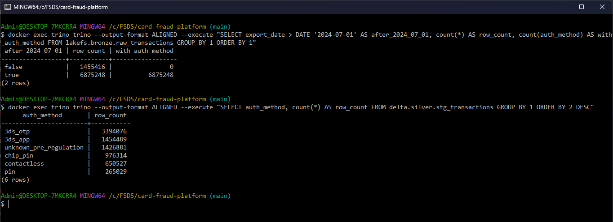

In Airflow this is the DP1 task `ingest_exports`, checked by `validate_dp1` on the run's branch before
`merge_to_main` ([In the Airflow pipeline](#in-the-airflow-pipeline)).

## Duplicates

The core banking export job sometimes re-runs after a timeout, so 2% of the exported rows are a second copy: same
`transaction_id`, later `created_ts`. Bronze keeps them as the source sent them.

### Baseline: the settled spend is overcounted

Both tables up to export date 2026-11-06, counted with `spark-sql`:

| Measure | Bronze (before) | Silver (after) |
|---|---:|---:|
| Rows | 8,330,664 | 8,167,316 |
| Distinct `transaction_id` | 8,167,316 | 8,167,316 |
| Settled spend (VND) | 3,697,581,455,000 | 3,624,992,633,000 |

In the export of 2026-11-06, three ids come twice, the second copy 31 minutes to 2 h 45 min after the first:

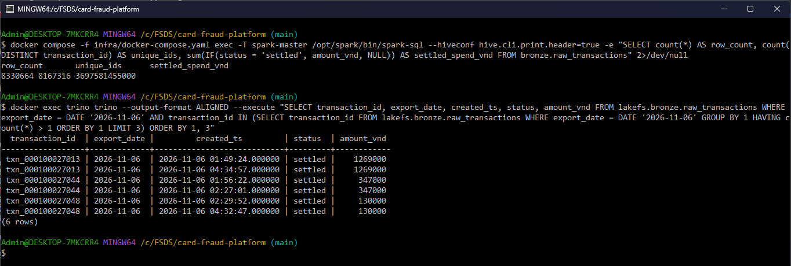

### Fix: keep the latest `created_ts`, MERGE on `transaction_id`

[`pipelines/spark/build_silver.py` L58-L59](https://github.com/cvinhnguyen/card-fraud-platform/blob/54d21eddbf6e602ae13fed46a1a9e0ef265d23cd/pipelines/spark/build_silver.py#L58-L59)
keeps the row with the latest `created_ts` per `transaction_id` (`row_number()` over a window partitioned by
`transaction_id`), then MERGEs the new export dates into `silver.stg_transactions`. An id already in silver is
replaced only by a later `created_ts`, so neither a re-run nor a duplicate in a later export can double count
([`pipelines/spark/build_silver.py` L83-L91](https://github.com/cvinhnguyen/card-fraud-platform/blob/54d21eddbf6e602ae13fed46a1a9e0ef265d23cd/pipelines/spark/build_silver.py#L83-L91)):

```python
    if not exists:
        save(clean.repartition("txn_date"), "stg_transactions", "txn_date")
    else:   # a later export may repeat an id: keep the row with the newest created_ts
        first_day = clean.agg(F.min("txn_date")).first()[0]
        (DeltaTable.forName(spark, table).alias("t")
         .merge(clean.alias("s"), f"t.txn_date >= '{first_day}' AND t.transaction_id = s.transaction_id")
         .whenMatchedUpdateAll(condition="s.created_ts > t.created_ts")
         .whenNotMatchedInsertAll()
         .execute())
```

Deleting the last 6 export dates from silver (47,226 rows) and re-running merged exactly 47,226 rows back (7,999,526
total, 64 s); full report in [spark_jobs.md](../data-platform/spark_jobs.md#before--after-full-build-146-s). After,
the same three ids appear once each, with their latest `created_ts`:

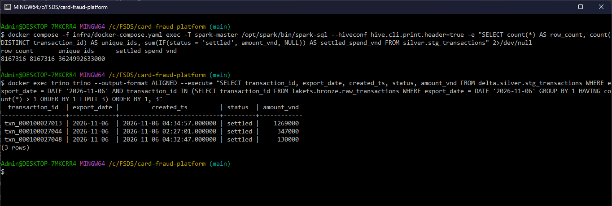

In Airflow this is the DP2 task `build_silver`, checked by `validate_dp2_silver`
([In the Airflow pipeline](#in-the-airflow-pipeline)).

## In the Airflow pipeline

Every Spark job of the pipeline is a task made by `spark_job()` in
[`pipelines/airflow/dags/common.py`](https://github.com/cvinhnguyen/card-fraud-platform/blob/54d21eddbf6e602ae13fed46a1a9e0ef265d23cd/pipelines/airflow/dags/common.py):
a `SparkSubmitOperator` to the standalone master in the pool `spark` (1 slot, so applications queue in Airflow
instead of fighting for the 3 GB worker), with the same Spark settings for every job (`SPARK_CONF`,
[`pipelines/airflow/dags/common.py` L92-L99](https://github.com/cvinhnguyen/card-fraud-platform/blob/54d21eddbf6e602ae13fed46a1a9e0ef265d23cd/pipelines/airflow/dags/common.py#L92-L99);
helper [`pipelines/airflow/dags/common.py` L104-L111](https://github.com/cvinhnguyen/card-fraud-platform/blob/54d21eddbf6e602ae13fed46a1a9e0ef265d23cd/pipelines/airflow/dags/common.py#L104-L111)):

```python
def spark_job(task_id: str, script: str, args: list[str] | None = None, env: dict | None = None,
              conf: dict | None = None, **kwargs) -> SparkSubmitOperator:
    """spark-submit pipelines/spark/<script> to the standalone master. Pool `spark` (1 slot) runs one application at a time:
    the 3 GB worker holds one 1.5 GB executor with room left for the Thrift Server of the dbt profile."""
    return SparkSubmitOperator(task_id=task_id, conn_id="spark_lakehouse",
                               application="{{ var.value.spark_jobs_dir }}/" + script, application_args=args or [],
                               env_vars={**S3_ENV, **(env or {})}, conf={**SPARK_CONF, **(conf or {})}, pool="spark",
                               **kwargs)
```

Each zone is validated (Great Expectations) before the next DAG reads it:

| Fix | DAG and task | What the task runs | Checked by |
|---|---|---|---|
| Schema evolution | `dp1_source_to_bronze.ingest_exports`, after the S3 sensor `wait_for_export` and `create_branch` | `ingest_bronze.py --part exports --until <ds+1> --txn-root s3a://bronze/dp1_<ds>`: reads only the new export folders, `mergeSchema` on read and append, on the run's lakeFS branch | `validate_dp1`, on the branch before `merge_to_main` |
| Duplicates | `dp2_bronze_to_silver.build_silver` | `build_silver.py`: `row_number()` per `transaction_id` (latest `created_ts`), MERGE into `silver.stg_transactions` | `validate_dp2_silver`: for the new export date, row count = distinct ids of the bronze slice, `transaction_id` unique ([`pipelines/spark/validate.py` L87-L89](https://github.com/cvinhnguyen/card-fraud-platform/blob/54d21eddbf6e602ae13fed46a1a9e0ef265d23cd/pipelines/spark/validate.py#L87-L89)) |
| Skew (join with a small table) | `build_silver` and `build_labels` | broadcast joins: the 34-unit mapping ([`pipelines/spark/build_silver.py` L30](https://github.com/cvinhnguyen/card-fraud-platform/blob/54d21eddbf6e602ae13fed46a1a9e0ef265d23cd/pipelines/spark/build_silver.py#L30)) and the card owner table ([`pipelines/spark/build_labels.py` L61](https://github.com/cvinhnguyen/card-fraud-platform/blob/54d21eddbf6e602ae13fed46a1a9e0ef265d23cd/pipelines/spark/build_labels.py#L61)); AQE stays on (Spark's default, not overridden in `spark-defaults.conf`) | `validate_dp2_gold` |

### DP1

The sensor and the run's lakeFS branch gate the export append; the Postgres snapshot and the landing load run in
parallel. The append is committed on the branch, `validate_dp1` checks it there, and only a passing run is merged
into `main`. Then `publish_bronze` emits the dataset event `lakehouse://bronze`, which schedules DP2
([`pipelines/airflow/dags/dp1_source_to_bronze.py`](https://github.com/cvinhnguyen/card-fraud-platform/blob/54d21eddbf6e602ae13fed46a1a9e0ef265d23cd/pipelines/airflow/dags/dp1_source_to_bronze.py)):

```python
    wait = S3KeySensor(task_id="wait_for_export", aws_conn_id="lakehouse_s3", bucket_name="{{ var.value.export_bucket }}",
                       bucket_key="transactions/export_date={{ macros.ds_add(ds, 1) }}/*.parquet", wildcard_match=True,
                       mode="reschedule", poke_interval=300, timeout=6 * 3600)
    branch = create_branch(BRANCH)
    snapshot = spark_job("snapshot_core_banking", "ingest_bronze.py", ["--part", "core_banking"], env=CORE_DB_ENV)
    exports = spark_job("ingest_exports", "ingest_bronze.py",
                        ["--part", "exports", "--until", "{{ macros.ds_add(ds, 1) }}", "--txn-root", TXN_ROOT],
                        inlets=[EXPORT], outlets=[LAKEFS_TXN])
    landing = spark_job("ingest_stream_landing", "ingest_bronze.py", ["--part", "landing"])

    [wait, branch] >> exports
    checks = validate("dp1", ["--txn-root", TXN_ROOT])   # reads the export on the run's branch
    merge = merge_to_main.override(inlets=[LAKEFS_TXN], outlets=[TABLE])(BRANCH)
    [snapshot, exports >> commit_branch(BRANCH), landing] >> checks >> merge >> publish(BRONZE)
```

The lakeFS tasks are in [novel_lakefs_wap.md](../data-platform/novel_lakefs_wap.md). The run of 2026-11-08 shows
`ingest_exports` gated by `wait_for_export` and `create_branch`, the three Spark tasks before `validate_dp1`, and
`merge_to_main` before `publish_bronze`, which emits `lakehouse://bronze/`:


### DP2

DP2 is two DAGs. `dp2_bronze_to_silver` runs `build_silver`, `validate_dp2_silver` and `publish_silver`
([`pipelines/airflow/dags/dp2_bronze_to_silver.py`](https://github.com/cvinhnguyen/card-fraud-platform/blob/54d21eddbf6e602ae13fed46a1a9e0ef265d23cd/pipelines/airflow/dags/dp2_bronze_to_silver.py#L27-L30)):

```python
with DAG("dp2_bronze_to_silver", schedule=[BRONZE], start_date=datetime(2026, 10, 1), catchup=False, max_active_runs=1,
         default_args=DEFAULT_ARGS, doc_md=__doc__, tags=["dp2", "silver", RELEASE_TAG]) as dag:
    silver = spark_job("build_silver", "build_silver.py", inlets=SILVER_IN, outlets=SILVER_OUT)
    silver >> validate("dp2_silver") >> publish(SILVER)
```

`dp2_silver_to_gold` runs on the silver event and builds gold with dbt and the labels in parallel
([`pipelines/airflow/dags/dp2_silver_to_gold.py`](https://github.com/cvinhnguyen/card-fraud-platform/blob/54d21eddbf6e602ae13fed46a1a9e0ef265d23cd/pipelines/airflow/dags/dp2_silver_to_gold.py#L38-L48)):

```python
with DAG("dp2_silver_to_gold", schedule=[SILVER], start_date=datetime(2026, 10, 1), catchup=False, max_active_runs=1,
         default_args=DEFAULT_ARGS, doc_md=__doc__, tags=["dp2", "gold", "dbt", RELEASE_TAG]) as dag:
    # pool `spark`: a dbt run is a Spark application like the others
    dbt_build = BashOperator(task_id="dbt_build", bash_command=f"{DBT} build {DBT_ARGS}", env=DBT_ENV, append_env=True,
                             pool="spark")
    dbt_docs = BashOperator(task_id="dbt_docs", bash_command=f"{DBT} docs generate {DBT_ARGS}", env=DBT_ENV,
                            append_env=True, pool="spark")
    labels = spark_job("build_labels", "build_labels.py", ["--as-of", DAY])

    dbt_build >> dbt_docs
    [dbt_build, labels] >> validate("dp2_gold") >> publish(GOLD)
```

The run of 2026-11-12 starts on `lakehouse://silver/`, runs `dbt_build` (then `dbt_docs`) and `build_labels` in
parallel, then `validate_dp2_gold` and `publish_gold` ([airflow.md](../data-platform/airflow.md)):

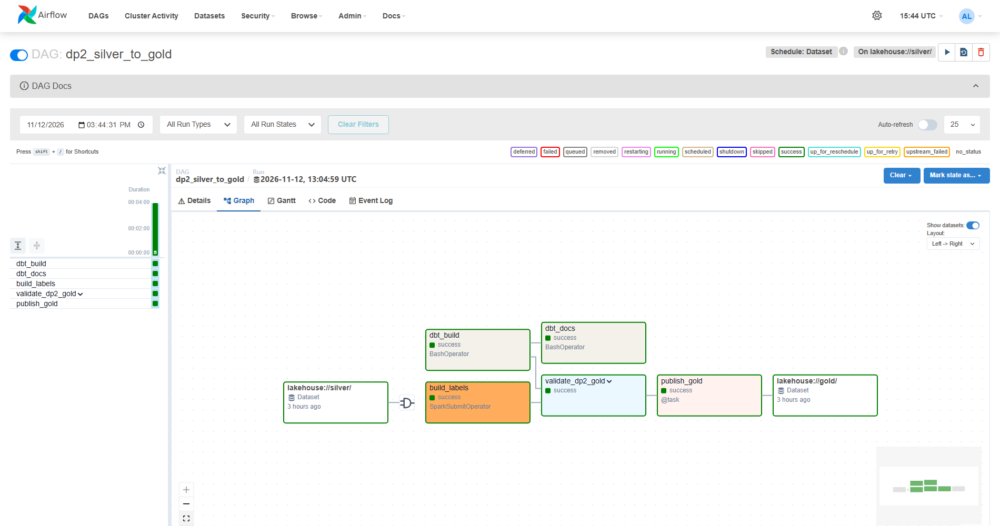

[airflow.md](../data-platform/airflow.md) shows a failed check stopping the pipeline (a duplicate planted in silver)
and the backfill of 4 days through the three DAGs of that time.

## Limits

- The pipeline's `build_silver.py` still uses the plain window, which shuffles and sorts every row; at 100 GB a probe
  estimated about 4 days (Docker disk then on a USB HDD). The variant that scales, measured on a 20-date slice, runs
  in batches of export dates (both copies of a row share an `export_date`) and windows only the 2% duplicated ids,
  found from the id column and broadcast ([scale_100g.md](scale_100g.md#dedup-at-scale)).
