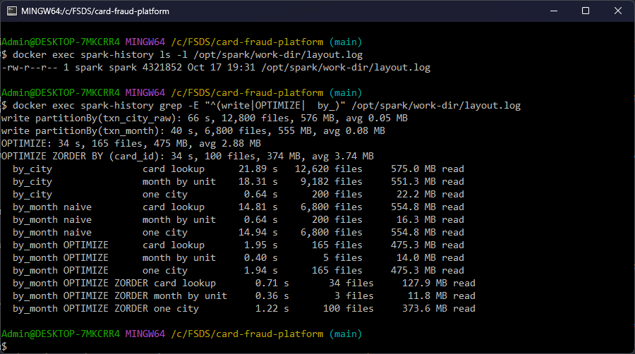
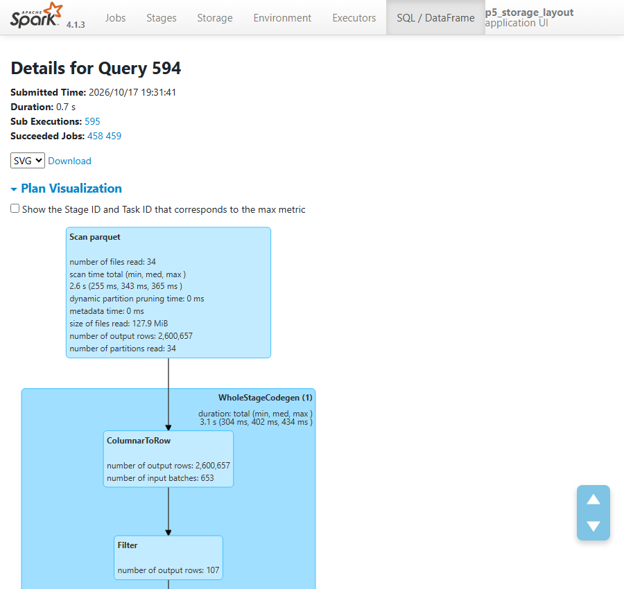
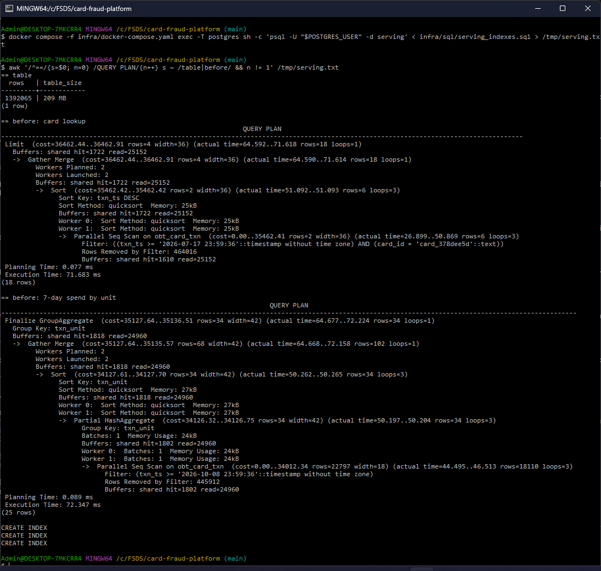
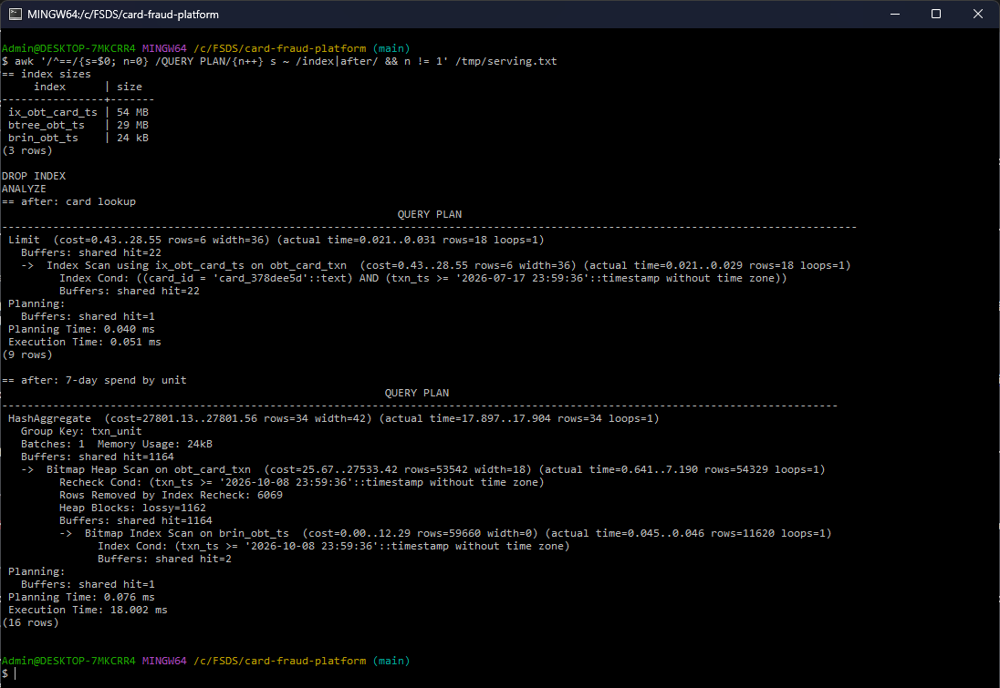

# Storage optimization

Layout on disk decides read speed: an analyst opening one card's last 90 days wants the answer at once, and a
monthly report should not open thousands of tiny files. Spark and Trino scan the lakehouse (Delta tables on
SeaweedFS); the serving database (Postgres) answers small queries from people. The lakehouse is tuned by file layout
(how rows are split into files and sorted inside them), Postgres by indexes, each measured before and after.

| | |
|---|---|
| Code | [`pipelines/spark/storage_layout.py`](https://github.com/cvinhnguyen/card-fraud-platform/blob/54d21eddbf6e602ae13fed46a1a9e0ef265d23cd/pipelines/spark/storage_layout.py), [`pipelines/spark/load_serving.py`](https://github.com/cvinhnguyen/card-fraud-platform/blob/54d21eddbf6e602ae13fed46a1a9e0ef265d23cd/pipelines/spark/load_serving.py), [`infra/sql/serving_indexes.sql`](https://github.com/cvinhnguyen/card-fraud-platform/blob/54d21eddbf6e602ae13fed46a1a9e0ef265d23cd/infra/sql/serving_indexes.sql) |
| Runs on | Spark jobs: compose profile `batch` (inside `spark-master`); Postgres: compose service `postgres` (profile `core`), database `serving` |
| Reads | `gold.fact_transaction`, `gold.dim_merchant` |
| Writes | the benchmark tables under `s3a://lakehouse/lab/` (not registered in the metastore); Postgres `serving.mart.obt_card_txn` |
| Related | [spark_optimization.md](spark_optimization.md), [spark_jobs.md](../data-platform/spark_jobs.md), [scale_100g.md](scale_100g.md) |

## Results at a glance

| Store | Slow before | Fix | After |
|---|---|---|---|
| [Lakehouse](#lakehouse-layout) | card lookup on the month-partitioned table: 14.8 s, 6,800 small files | `OPTIMIZE ZORDER BY (card_id)`: small files packed, rows sorted by card | 0.71 s, 34 files |
| [Postgres](#serving-database-postgres) | one card's payments: Parallel Seq Scan, 78.5 ms | B-tree `(card_id, txn_ts DESC)` | Index Scan, 0.053 ms |
| Postgres | 7-day spend per unit: Parallel Seq Scan, 68.6 ms | BRIN (block range) index `(txn_ts)` | Bitmap Heap Scan, 17.0 ms |

## Where it fits

- Both stores are Layer 1 (data platform, [architecture.md](../architecture.md#layer-1-the-data-platform-top-band)).
- DP2 (bronze to silver and gold) writes the gold tables; Trino, DP3 (gold to features) and training read them
  ([schema_design.md](../data-platform/schema_design.md)).
- A Spark job copies the last 180 days of `fact_transaction` to the serving database for dashboards and analysts.
- The benchmark tables under `s3a://lakehouse/lab/` are not in the metastore and touch nothing the pipelines read.

## Run it

From the repo root. The lakehouse layout benchmark (stop `spark-thrift` first, it holds worker cores):

```bash
docker compose -f infra/docker-compose.yaml stop spark-thrift
docker compose -f infra/docker-compose.yaml exec spark-master /opt/spark/bin/spark-submit /opt/jobs/storage_layout.py
```

The serving database: create it, load the table, then run the indexes script with its `EXPLAIN` before and after:

```bash
docker compose -f infra/docker-compose.yaml exec -T postgres sh -c 'psql -U "$POSTGRES_USER" -d core_banking -c "CREATE DATABASE serving"'
docker compose -f infra/docker-compose.yaml exec -T postgres sh -c 'psql -U "$POSTGRES_USER" -d serving -c "CREATE SCHEMA mart"'
docker compose -f infra/docker-compose.yaml exec spark-master /opt/spark/bin/spark-submit /opt/jobs/load_serving.py
docker compose -f infra/docker-compose.yaml exec -T postgres sh -c 'psql -U "$POSTGRES_USER" -d serving' < infra/sql/serving_indexes.sql
```

## Lakehouse layout

[`pipelines/spark/storage_layout.py`](https://github.com/cvinhnguyen/card-fraud-platform/blob/54d21eddbf6e602ae13fed46a1a9e0ef265d23cd/pipelines/spark/storage_layout.py)
writes `gold.fact_transaction` (7.9M rows) to `s3a://lakehouse/lab/` after a 200-way shuffle, as a job writes after a
join or aggregation. Each query is the median of 3 runs after a warm-up; files and bytes read come from the scan node
of the Spark SQL metrics (REST API, [`pipelines/spark/storage_layout.py` L34-L46](https://github.com/cvinhnguyen/card-fraud-platform/blob/54d21eddbf6e602ae13fed46a1a9e0ef265d23cd/pipelines/spark/storage_layout.py#L34-L46)).

### Writes: small files before, packed files after

| Layout | Files | Avg file | Write |
|---|---:|---:|---:|
| `partitionBy(txn_city_raw)` | 12,800 | 0.05 MB | 66 s |
| `partitionBy(txn_month)`, naive (version 0) | 6,800 | 0.08 MB | 40 s |
| + `OPTIMIZE` (version 1) | 165 | 2.88 MB | 34 s |
| + `OPTIMIZE ZORDER BY (card_id)` (version 2) | 100 | 3.74 MB | 34 s |

Each shuffle task holds rows of every partition value and writes one file per value: 200 tasks × 64 raw
city names = 12,800 files, 200 × 34 months = 6,800, most a few dozen KB. The writes and the two `OPTIMIZE` runs
([`pipelines/spark/storage_layout.py` L79-L90](https://github.com/cvinhnguyen/card-fraud-platform/blob/54d21eddbf6e602ae13fed46a1a9e0ef265d23cd/pipelines/spark/storage_layout.py#L79-L90)):

```python
    by_city, by_month = f"{LAB}/fact_by_city", f"{LAB}/fact_by_month"
    for path, col in ((by_city, "txn_city_raw"), (by_month, "txn_month")):
        t0 = time.perf_counter()
        fact.repartition(SHUFFLE).write.format("delta").mode("overwrite").option("overwriteSchema", "true") \
            .partitionBy(col).save(path)
        print(f"write partitionBy({col}): {time.perf_counter() - t0:.0f} s, {detail(spark, path)}")
    for extra in ("", " ZORDER BY (card_id)"):
        t0 = time.perf_counter()
        spark.sql(f"OPTIMIZE delta.`{by_month}`{extra}").collect()
        print(f"OPTIMIZE{extra}: {time.perf_counter() - t0:.0f} s, {detail(spark, by_month)}")
    last = spark.sql(f"DESCRIBE HISTORY delta.`{by_month}`").agg(F.max("version")).first()[0]
    versions = {"naive": last - 2, "OPTIMIZE": last - 1, "OPTIMIZE ZORDER": last}
```

### Queries on each layout

The queries ([`pipelines/spark/storage_layout.py` L72-L77](https://github.com/cvinhnguyen/card-fraud-platform/blob/54d21eddbf6e602ae13fed46a1a9e0ef265d23cd/pipelines/spark/storage_layout.py#L72-L77)):
all payments of the busiest card (fraud investigation), spend per unit in 2026-06 (reporting), spend in raw city "Da
Nang". Bold marks the fastest layout per query.

| Layout | Card lookup | Month by unit | One city |
|---|---|---|---|
| by city | 21.9 s, 12,620 files, 575 MB | 18.3 s, 9,182 files, 551 MB | **0.64 s, 200 files, 22 MB** |
| by month, naive | 14.8 s, 6,800 files, 555 MB | 0.64 s, 200 files, 16 MB | 14.9 s, 6,800 files, 555 MB |
| by month, `OPTIMIZE` | 1.95 s, 165 files, 475 MB | 0.40 s, 5 files, 14 MB | 1.94 s, 165 files, 475 MB |
| by month, `OPTIMIZE ZORDER BY (card_id)` | **0.71 s, 34 files, 128 MB** | **0.36 s, 3 files, 12 MB** | 1.22 s, 100 files, 374 MB |

- Files cost more than bytes. The naive month layout reads about as much as after `OPTIMIZE` (555 MB against 475 MB)
  but takes 7.6× longer, because opening 6,800 S3 objects dominates. `OPTIMIZE` (bin-packing) leaves 165 files and
  the scans drop from ~15 s to ~2 s.
- Partition on a low-cardinality, evenly sized column that queries filter on. City wins its own query (200 files
  read) and loses the rest, and the city with 60% of the rows makes partitions very uneven. Reports and nightly loads
  filter on month, whose partitions are about equal.
- Z-order suits a high-cardinality column you cannot partition by, like `card_id` (130k values). After
  `ZORDER BY (card_id)` each file holds a narrow `card_id` range, so the min/max statistics in the Delta log skip 66
  of the 100 files; one file per month remains (34) because the card appears in every month. Sorting also improves
  compression (475 MB to 374 MB), which helps the other queries a little.
- `OPTIMIZE` aims at 1 GB files, one per month at 1 GB of data: a first run with the default gave 34 files, card
  lookup 0.60 s, and Z-order skipped nothing (34 files read either way). The job sets
  `spark.databricks.delta.optimize.maxFileSize` to 4 MB so a month has several files, as at 100 GB (about 3 GB per
  month) ([`pipelines/spark/storage_layout.py` L68-L70](https://github.com/cvinhnguyen/card-fraud-platform/blob/54d21eddbf6e602ae13fed46a1a9e0ef265d23cd/pipelines/spark/storage_layout.py#L68-L70)).

So the gold tables are partitioned by month (`fact_transaction` by `txn_month`,
[`pipelines/dbt/models/gold/fact_transaction.sql` L4-L9](https://github.com/cvinhnguyen/card-fraud-platform/blob/54d21eddbf6e602ae13fed46a1a9e0ef265d23cd/pipelines/dbt/models/gold/fact_transaction.sql#L4-L9);
`label_transaction` by `event_month`, [`pipelines/spark/build_labels.py` L69](https://github.com/cvinhnguyen/card-fraud-platform/blob/54d21eddbf6e602ae13fed46a1a9e0ef265d23cd/pipelines/spark/build_labels.py#L69)).

### Evidence from the run of 2026-10-17

Both tables come from the job's output, `layout.log` in the Spark work volume (12,800, 6,800, 165 and 100 files,
then the 12 query lines):



In the Spark History Server (app `p5_storage_layout`), the card lookup on the naive month layout (query 543, 15 s)
reads 6,800 files, 554.8 MiB and all 7,879,773 rows of the 34 months to keep 107:


After `ZORDER BY (card_id)` (query 594, 0.7 s) it reads 34 files, 127.9 MiB and 2,600,657 rows for the same 107:



## Serving database (Postgres)

[`pipelines/spark/load_serving.py`](https://github.com/cvinhnguyen/card-fraud-platform/blob/54d21eddbf6e602ae13fed46a1a9e0ef265d23cd/pipelines/spark/load_serving.py)
copies the last 180 days of `fact_transaction` with the merchant name into one flat table `mart.obt_card_txn`
(1,392,065 rows, 209 MB), read without joins, in `txn_ts` order like a daily append ([`pipelines/spark/load_serving.py` L24-L28](https://github.com/cvinhnguyen/card-fraud-platform/blob/54d21eddbf6e602ae13fed46a1a9e0ef265d23cd/pipelines/spark/load_serving.py#L24-L28)).
[`infra/sql/serving_indexes.sql`](https://github.com/cvinhnguyen/card-fraud-platform/blob/54d21eddbf6e602ae13fed46a1a9e0ef265d23cd/infra/sql/serving_indexes.sql)
measures both query patterns before and after the indexes.

| Query pattern | Index | Before | After |
|---|---|---|---|
| One card's payments in the last 90 days, newest first, `LIMIT 50` | B-tree `(card_id, txn_ts DESC)`, 54 MB | Parallel Seq Scan, 26,874 buffers, 78.5 ms | Index Scan, 22 buffers, 0.053 ms |
| Spend per unit over the last 7 days | BRIN `(txn_ts)`, 24 kB | Parallel Seq Scan, 26,778 buffers, 68.6 ms | Bitmap Heap Scan on 1,162 blocks, 17.0 ms |

Numbers are the warm-cache second run of each `EXPLAIN (ANALYZE, BUFFERS)`
([`infra/sql/serving_indexes.sql` L17-L26](https://github.com/cvinhnguyen/card-fraud-platform/blob/54d21eddbf6e602ae13fed46a1a9e0ef265d23cd/infra/sql/serving_indexes.sql#L17-L26)
for "before"). The script creates the two indexes plus a plain B-tree on `txn_ts`, only to compare sizes
([`infra/sql/serving_indexes.sql` L28-L34](https://github.com/cvinhnguyen/card-fraud-platform/blob/54d21eddbf6e602ae13fed46a1a9e0ef265d23cd/infra/sql/serving_indexes.sql#L28-L34)):

```sql
CREATE INDEX ix_obt_card_ts ON mart.obt_card_txn (card_id, txn_ts DESC);
CREATE INDEX brin_obt_ts ON mart.obt_card_txn USING brin (txn_ts);
CREATE INDEX btree_obt_ts ON mart.obt_card_txn (txn_ts);   -- only to compare sizes, dropped below
\echo '== index sizes'
SELECT relname AS index, pg_size_pretty(pg_relation_size(oid)) AS size FROM pg_class
WHERE relname IN ('ix_obt_card_ts', 'brin_obt_ts', 'btree_obt_ts') ORDER BY pg_relation_size(oid) DESC;
DROP INDEX mart.btree_obt_ts;
```

- The composite B-tree matches the whole predicate and the sort (equality on `card_id`, then `txn_ts` descending), so
  Postgres reads 18 rows and stops, with no sort.
- BRIN stores only the min/max `txn_ts` per block range. Because the table is loaded in time order, a 7-day range
  covers few block ranges; in random insert order BRIN would match every range. It is 24 kB where a B-tree on
  `txn_ts` is 29 MB, and the 6,069 rows removed by recheck are the price of the coarse ranges.

Trino has no indexes on Delta; partition pruning and the min/max statistics that Z-order sharpens play that role.

### Re-run of 2026-10-25

Same plans and buffer counts, timings a few ms apart; `awk` prints the second (warm cache) plan of each query from
the output file. Before the indexes: Parallel Seq Scan, 1,722 + 25,152 = 26,874 buffers and
71.7 ms for the card, 26,778 buffers and 72.3 ms for the 7-day spend:



After: index sizes 54 MB, 29 MB and 24 kB; Index Scan on `ix_obt_card_ts`, 22 buffers, 0.051 ms; Bitmap Heap Scan
through `brin_obt_ts` on 1,162 lossy blocks, 6,069 rows removed by recheck, 18.0 ms:



## Limits

- The serving table shares the Postgres instance with `core_banking` to save RAM on a laptop; a real setup gives it its
  own server.
