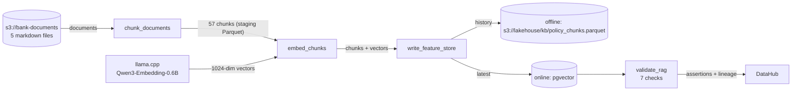
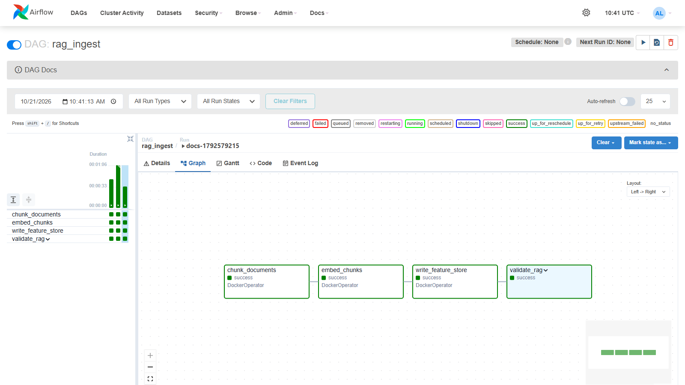
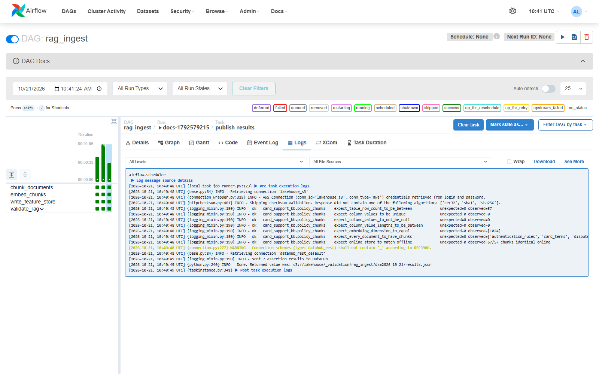
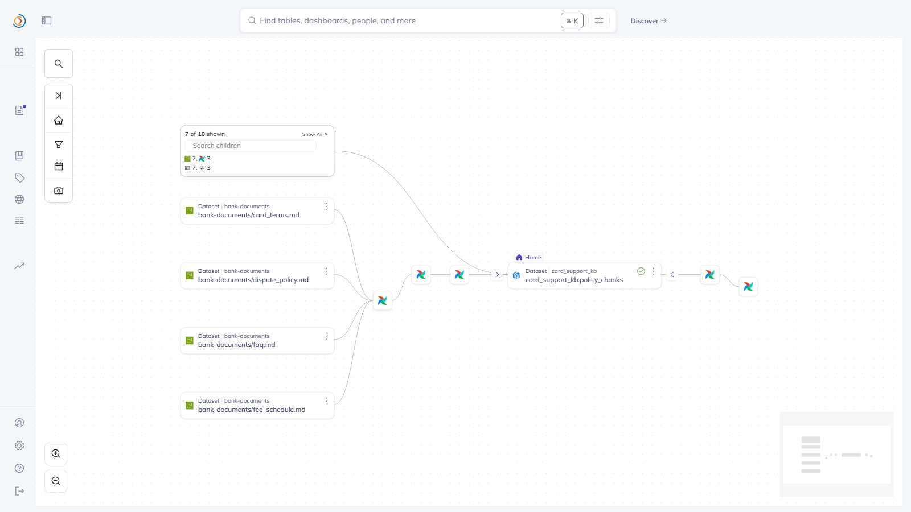
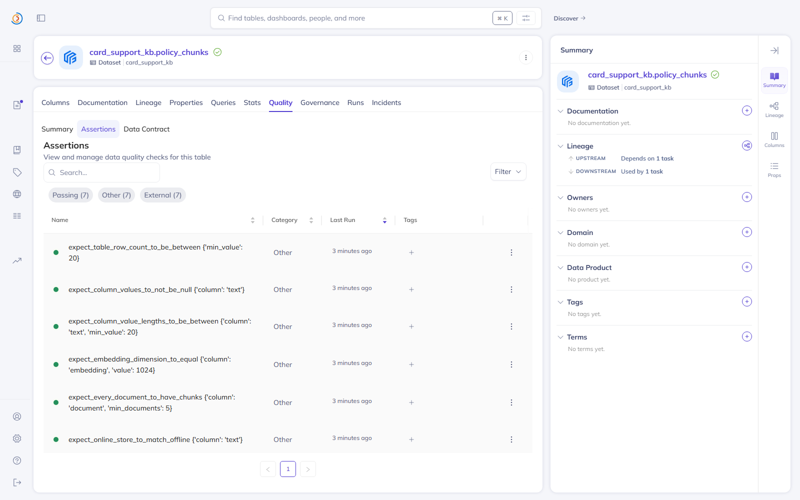

# RAG data pipeline

The risk agent answers policy questions from the bank's own card documents: terms and conditions, the fee schedule,
the dispute policy, the authentication rules and the FAQ. The Airflow DAG `rag_ingest` turns those documents into
chunks, embeds every chunk and stores chunks and vectors in a Feast feature view, which two MCP servers read:
policy-rag's `search_policy` (RAG) and card-data's `get_policy_chunk` (a chunk by id). This page covers rubric A9 (C9, C10); the CI/CD pipeline that
releases it is in [cicd.md](cicd.md#rag-data-pipeline).



## Steps

The DAG ([`pipelines/airflow/dags/rag_ingest.py`](../pipelines/airflow/dags/rag_ingest.py)) has no schedule: it runs
when the documents or the code change, started by CI. Each task runs one step of
[`ml/jobs/rag_ingest.py`](../ml/jobs/rag_ingest.py) as a container of the ml image
([`pipelines/airflow/dags/rag_ingest.py` L55-L73](https://github.com/cvinhnguyen/card-fraud-platform/blob/35d4295a1e5a409fa242bc6aa9eff9b06038c111/pipelines/airflow/dags/rag_ingest.py#L55-L73)),
and the steps hand each other S3 paths, never data.

| Task | What it does |
|---|---|
| `chunk_documents` | reads `s3://bank-documents/*.md` (uploaded by `generator/load_source.py --part documents` from [`generator/knowledge/`](../generator/knowledge)); one chunk per numbered clause (`card_terms#4.2`), one per section without clauses (the fee tables), one per FAQ question; the document title and section heading stay in the chunk text, so a chunk makes sense on its own |
| `embed_chunks` | sends every chunk to the embedding server (OpenAI-compatible `/v1/embeddings`, Qwen3-Embedding-0.6B on the host, connection `llm_embeddings`), 1024-dimension vectors ([`ml/jobs/rag_ingest.py` L79-L89](https://github.com/cvinhnguyen/card-fraud-platform/blob/35d4295a1e5a409fa242bc6aa9eff9b06038c111/ml/jobs/rag_ingest.py#L79-L89)) |
| `write_feature_store` | Feast project `card_support_kb` ([`ml/feature_repo_kb/`](../ml/feature_repo_kb)): appends the chunks to the offline history (the Parquet FileSource) and writes them to the online store, Postgres with pgvector (`vector-db`) ([`ml/jobs/rag_ingest.py` L108-L123](https://github.com/cvinhnguyen/card-fraud-platform/blob/35d4295a1e5a409fa242bc6aa9eff9b06038c111/ml/jobs/rag_ingest.py#L108-L123)) |
| `validate_rag.run_checks` | 7 checks on what was written, in the same report format as the Layer 1 validate stages |
| `validate_rag.publish_results` | logs the checks, sends them to DataHub as assertions on the feature view, and fails the run if one failed |

How `chunk_documents` cuts one document
([`ml/jobs/rag_ingest.py` L46-L63](https://github.com/cvinhnguyen/card-fraud-platform/blob/35d4295a1e5a409fa242bc6aa9eff9b06038c111/ml/jobs/rag_ingest.py#L46-L63)):

```python
def split_document(doc: str, text: str) -> list[dict]:
    """Chunks of one Markdown document: numbered clauses, else whole `##` sections (FAQ: one per question)."""
    title = text.splitlines()[0].lstrip("# ").strip()
    version = re.search(r"Version (\d{4}-\d{2}-\d{2})", text).group(1)
    chunks = []
    for i, block in enumerate(re.split(r"^## ", text, flags=re.M)[1:], start=1):
        heading, *body = block.strip().splitlines()
        lines = [line.strip() for line in body if line.strip()]
        clauses = [m for m in map(CLAUSE.match, lines) if m]
        numbered = SECTION.match(heading)
        if clauses:
            parts = [(m.group(1), m.group(2)) for m in clauses]
        else:   # a fee table or an FAQ answer: the whole section is one chunk
            parts = [(numbered.group(1) if numbered else str(i), "\n".join(lines))]
        for number, content in parts:
            chunks.append({"chunk_id": f"{doc}#{number}", "document": doc, "section": number,
                           "text": f"{title} > {heading}\n{content}", "version": version})
    return chunks
```

The feature view `policy_chunks` (entity `chunk_id`) holds `document`, `section`, `text` and `embedding` (1024 floats,
cosine distance, vector index on;
[`ml/feature_repo_kb/kb_features.py` L26-L41](https://github.com/cvinhnguyen/card-fraud-platform/blob/35d4295a1e5a409fa242bc6aa9eff9b06038c111/ml/feature_repo_kb/kb_features.py#L26-L41)).
The policy-rag MCP server embeds a question with Qwen3-Embedding's query instruction, asks the
online store for the nearest candidates, reads them by id and ranks them by its own cosine similarity
([`services/card_support_mcp/app/service.py` L68-L75](../services/card_support_mcp/app/service.py#L68-L75)).



Run `docs-1792579215` on 2026-10-21, started through the Airflow REST API: `chunk_documents` 3.1 s, `embed_chunks`
4.9 s, `write_feature_store` 7.1 s, `validate_rag.run_checks` 6.1 s, `validate_rag.publish_results` 1.1 s. The CI
release of the same DAG (rag-pipeline #2) is in [cicd.md](cicd.md#rag-data-pipeline).

## Data governance

The pipeline follows the same rules as the Layer 1 pipelines ([airflow.md](airflow.md), [datahub.md](datahub.md)).

| Rule | How |
|---|---|
| Quality gate | 7 checks after every write: at least 20 chunks (57), unique `chunk_id`, no empty text, text length at least 20, embedding dimension 1024, every document has chunks, online store identical to the offline history (57/57). One failure fails the run, so a broken knowledge base is visible in Airflow before an agent cites it |
| Validation history | every report is kept at `s3://lakehouse/_validation/rag_ingest/ds=<date>/results.json` and sent to DataHub as assertion results on `card_support_kb.policy_chunks` |
| Lineage | each task declares inlets and outlets; the DataHub Airflow plugin turns them into lineage: 5 documents -> `chunk_documents` -> staging chunks -> `embed_chunks` -> `write_feature_store` -> offline history and the feature view -> the validate task |
| Secrets | the DAG holds none: store passwords and the embedding key come from Airflow connections (`feast_registry`, `feast_kb_online`, `llm_embeddings`, `lakehouse_s3`), which Airflow masks in logs and rendered templates ([`pipelines/airflow/dags/rag_ingest.py` L30-L36](https://github.com/cvinhnguyen/card-fraud-platform/blob/35d4295a1e5a409fa242bc6aa9eff9b06038c111/pipelines/airflow/dags/rag_ingest.py#L30-L36)) |
| Code provenance | the image a task runs is the Airflow Variable `rag_image`, set only by the CI release; the DAG refuses anything that is not a `fraud/ml-train:<tag>` image ([`pipelines/airflow/dags/rag_ingest.py` L40-L45](https://github.com/cvinhnguyen/card-fraud-platform/blob/35d4295a1e5a409fa242bc6aa9eff9b06038c111/pipelines/airflow/dags/rag_ingest.py#L40-L45)), and Airflow starts containers through `docker-proxy`, which allows the container API and denies exec, build and volumes (Airflow has no Docker socket) |

The 7 checks of `validate_rag.run_checks`, the last one reading every chunk back from the online store
([`ml/jobs/rag_ingest.py` L141-L158](https://github.com/cvinhnguyen/card-fraud-platform/blob/35d4295a1e5a409fa242bc6aa9eff9b06038c111/ml/jobs/rag_ingest.py#L141-L158)):

```python
    online = FeatureStore(repo_path=os.environ["FEAST_KB_REPO"]).get_online_features(
        features=["policy_chunks:text"], entity_rows=[{"chunk_id": c} for c in df.chunk_id]).to_dict()
    mismatched = sum(o != t for o, t in zip(online["text"], df.text))
    results = [
        check("expect_table_row_count_to_be_between", n >= 20, n, n, min_value=20),
        check("expect_column_values_to_be_unique", df.chunk_id.is_unique, int(df.chunk_id.duplicated().sum()), n,
              int(df.chunk_id.duplicated().sum()), column="chunk_id"),
        check("expect_column_values_to_not_be_null", df.text.notna().all(), int(df.text.isna().sum()), n,
              int(df.text.isna().sum()), column="text"),
        check("expect_column_value_lengths_to_be_between", short == 0, int(short), n, int(short), column="text",
              min_value=20),
        check("expect_embedding_dimension_to_equal", (dims == EMBEDDING_DIM).all(), sorted(dims.unique().tolist()), n,
              int((dims != EMBEDDING_DIM).sum()), column="embedding", value=EMBEDDING_DIM),
        check("expect_every_document_to_have_chunks", len(docs) >= 5, docs, n, max(0, 5 - len(docs)), column="document",
              min_documents=5),
        check("expect_online_store_to_match_offline", mismatched == 0, f"{n - mismatched}/{n} chunks identical online",
              n, mismatched, column="text"),
    ]
```







## Run it

```bash
# Airflow (orch) + DataHub (gov) + the stores; Kafka for DataHub
docker compose -f infra/docker-compose.yaml --profile core --profile ml --profile orch --profile gov up -d
.venv/Scripts/python generator/load_source.py --part documents      # the 5 documents -> s3://bank-documents
docker exec airflow-scheduler airflow dags trigger rag_ingest       # or the CI pipeline, which also sets rag_image
```

Without DataHub (`DATAHUB_ENABLED=false`, as in the CI run) the checks still gate the run; only the publication to
DataHub is skipped. On this machine the kind cluster is stopped while Airflow and DataHub run (8 GB Docker VM).

## Gotchas

- Feast 0.66's `retrieve_online_documents_v2(...).to_df()` can put the wrong text and vector next to a `chunk_id`
  (the id column keeps the database's rank order, the feature columns another order). The policy-rag server uses it only for
  candidate ids, reads the features by id and ranks them itself.
- The embedding model is the one the policy-rag server uses for questions; changing it means re-running the pipeline, or the
  question vectors and the stored vectors stop matching.
