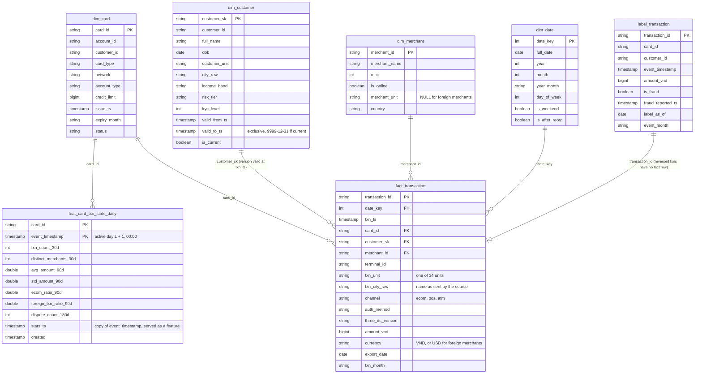

# Schema design

All tables are Delta tables in the SeaweedFS bucket `lakehouse`, registered in the Hive Metastore, so Spark, dbt
(through the Spark Thrift Server) and Trino (`delta.<zone>.<table>`) see the same tables.

## Zones

| Zone | Location | Written by | What it holds |
|---|---|---|---|
| bronze | `s3a://lakehouse/bronze/` | `pipelines/spark/ingest_bronze.py` (DP1) | Faithful copies of the sources: duplicates, old province names and missing columns are kept |
| silver | `s3a://lakehouse/silver/` | `pipelines/spark/build_silver.py` (DP2) | Cleaned rows: deduplicated, locations mapped to the 34 units, `auth_method` filled |
| gold | `s3a://lakehouse/gold/` | dbt models, `pipelines/spark/build_labels.py`, `pipelines/spark/build_features.py` (DP3) | Star schema for analysis, the label table and the feature table for Layer 2 |

Bronze and silver are written by PySpark because the dedup, skew and merge demos need DataFrame-level control. Gold
star schema models are SQL in dbt so they are tested (`dbt build`) and documented in one place.

## Naming

| Prefix | Zone | Meaning | Example |
|---|---|---|---|
| `raw_` | bronze | copy of one source table or export | `raw_transactions` |
| `stg_` | silver | cleaned, same grain as the source | `stg_transactions` |
| `dim_` | gold | dimension (who, what, where, when) | `dim_customer` |
| `fact_` | gold | measurable events at a fixed grain | `fact_transaction` |
| `label_` | gold | ML labels that change after they are written | `label_transaction` |
| `feat_` | gold | ML features with `event_timestamp` + `created` (Feast offline source) | `feat_card_txn_stats_daily` |

Columns: `snake_case`; timestamps end in `_ts` (`txn_ts`, `valid_from_ts`); surrogate keys in `_sk`, natural keys in
`_id`; booleans start with `is_`; amounts carry the unit (`amount_vnd`). Pipeline metadata columns start with `_`
(`_ingested_at`, `_source`, `_processed_at`). Timestamps are `timestamp_ntz` in Vietnam local time, as in the source.

## Tables and grain

| Table | Grain (one row is) | Key | Partitioned by | Load |
|---|---|---|---|---|
| `bronze.raw_transactions` | one exported row (duplicates included) | none | `export_date` | append new export dates |
| `bronze.raw_<table>` (6 core banking tables) | one source row | source PK | | full snapshot overwrite |
| `silver.stg_transactions` | one transaction (latest `created_ts`) | `transaction_id` | `txn_date` | `MERGE` new export dates |
| `silver.stg_customers` | one customer version (`customer_id`, `updated_ts`) | both | | overwrite |
| `gold.dim_customer` | one customer version with a change in a tracked attribute (SCD2) | `customer_sk` | | dbt table |
| `gold.dim_card` | one card | `card_id` | | dbt table |
| `gold.dim_merchant` | one merchant | `merchant_id` | | dbt table |
| `gold.dim_date` | one calendar day | `date_key` (`yyyyMMdd`) | | dbt table |
| `gold.fact_transaction` | one **settled** transaction | `transaction_id` | `txn_month` | dbt incremental `MERGE` |
| `gold.label_transaction` | one transaction (settled or reversed) as labelled on `label_as_of` | `transaction_id` | `event_month` | `MERGE` per `--as-of` run |
| `gold.feat_card_txn_stats_daily` | one card after one day with activity (a settled transaction or a reported dispute) | `card_id`, `event_timestamp` | | overwrite |

## Gold ER diagram

## Design notes

- In the SCD2 `dim_customer`, `valid_from_ts` is inclusive, `valid_to_ts` exclusive, and the open version ends at
  9999-12-31, so a point-in-time join is always `valid_from_ts <= ts < valid_to_ts`. Versions are compared on
  `customer_unit`, so relabelling an old province name on 2025-07-01 is not a new version (16,635 avoided).
- `fact_transaction.customer_sk` is resolved once, at build time, against the customer version valid at `txn_ts`.
  Queries join on `customer_sk` without a date condition.
- Every location keeps two columns: the 34-unit value used for grouping (`txn_unit`, `customer_unit`,
  `merchant_unit`) and the raw string from the source (`txn_city_raw`, `city_raw`) for lineage and audits.
- A fraud label can flip up to 60 days after the payment, so labels live in their own table, apart from the fact,
  updated with `MERGE`; each run is a Delta version tagged `label_as_of=<date>` (see [spark_jobs.md](spark_jobs.md)).
- A feature row describes an active day L and carries `event_timestamp` = L + 1 day, the night it is written, so a
  point-in-time join in Feast sees the card's last active day before the payment, never the payment being scored.
  `created` is the processing time.
- Facts are partitioned by month (`txn_month`, `event_month`), so a `MERGE` of recent data rewrites only the last few
  partitions. Silver is partitioned by day (`txn_date`) to match the nightly export.
