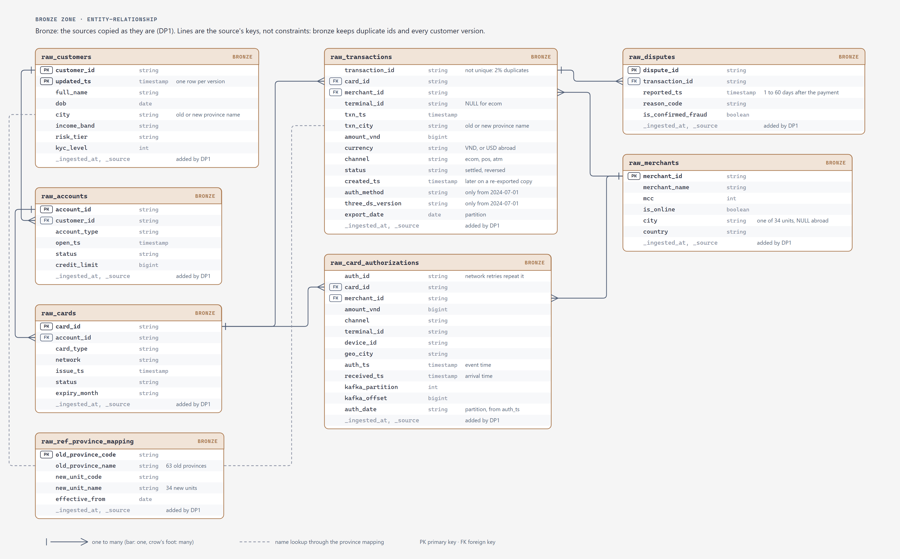
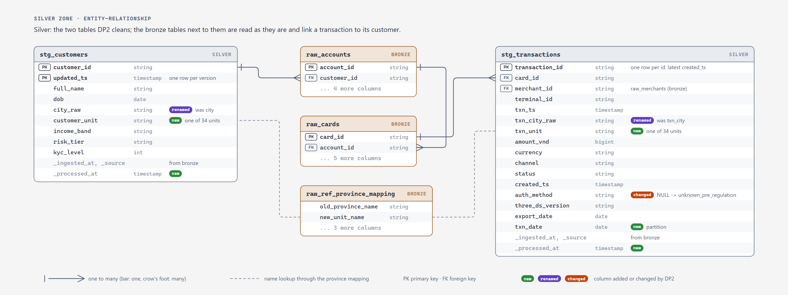
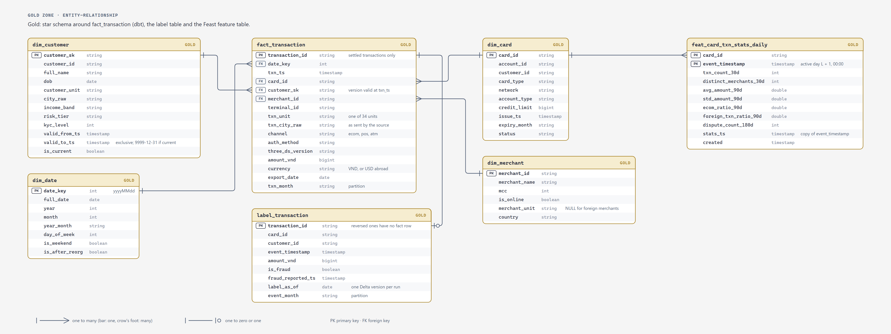

# Schema design

The Layer 1 lakehouse keeps every table as a Delta table registered in the Hive Metastore, so Spark, dbt (through
the Spark Thrift Server) and Trino see the same tables. The tables live in the SeaweedFS bucket `lakehouse` (Trino:
`delta.<zone>.<table>`), except `bronze.raw_transactions`, which is in the lakeFS repository `bronze` on branch `main`
(`s3a://bronze/main/raw_transactions`, Trino: `lakefs.bronze.raw_transactions`). DP1's `save()` writes a bronze
table and registers it once
([`pipelines/spark/ingest_bronze.py` L43-L54](https://github.com/cvinhnguyen/card-fraud-platform/blob/a593ac7ac74f781dc50824b14e97f2620198be46/pipelines/spark/ingest_bronze.py#L43-L54)).
This page names the zones, the tables, their grain and keys, and the design choices behind them.

| | |
|---|---|
| Code | [`pipelines/spark/`](https://github.com/cvinhnguyen/card-fraud-platform/tree/a593ac7ac74f781dc50824b14e97f2620198be46/pipelines/spark), [`pipelines/dbt/models/gold/`](https://github.com/cvinhnguyen/card-fraud-platform/tree/a593ac7ac74f781dc50824b14e97f2620198be46/pipelines/dbt/models/gold), [`docs/diagrams/er.py`](https://github.com/cvinhnguyen/card-fraud-platform/blob/a593ac7ac74f781dc50824b14e97f2620198be46/docs/diagrams/er.py) |
| Runs on | compose profile `batch` (Spark, Hive Metastore, lakeFS, Trino) and `dbt` (Spark Thrift Server) |
| Writes | Delta tables under `s3a://lakehouse/bronze/`, `silver/` and `gold/`; `bronze.raw_transactions` in the lakeFS repository `bronze` |
| Related | [spark_jobs.md](spark_jobs.md), [dbt_gold.md](dbt_gold.md), [novel_lakefs_wap.md](novel_lakefs_wap.md), [feature_store.md](feature_store.md) |

## Zones

| Zone | Location | Written by | What it holds |
|---|---|---|---|
| bronze | `s3a://lakehouse/bronze/`; `raw_transactions` in the lakeFS repository `bronze` (`s3a://bronze/main/raw_transactions`, [novel_lakefs_wap.md](novel_lakefs_wap.md)) | [`pipelines/spark/ingest_bronze.py`](https://github.com/cvinhnguyen/card-fraud-platform/blob/a593ac7ac74f781dc50824b14e97f2620198be46/pipelines/spark/ingest_bronze.py) (DP1) | Faithful copies of the sources: duplicates, old province names and missing columns are kept |
| silver | `s3a://lakehouse/silver/` | [`pipelines/spark/build_silver.py`](https://github.com/cvinhnguyen/card-fraud-platform/blob/a593ac7ac74f781dc50824b14e97f2620198be46/pipelines/spark/build_silver.py) (DP2) | Cleaned rows: deduplicated, locations mapped to the 34 units, `auth_method` filled |
| gold | `s3a://lakehouse/gold/` | dbt models, [`pipelines/spark/build_labels.py`](https://github.com/cvinhnguyen/card-fraud-platform/blob/a593ac7ac74f781dc50824b14e97f2620198be46/pipelines/spark/build_labels.py), [`pipelines/spark/build_features.py`](https://github.com/cvinhnguyen/card-fraud-platform/blob/a593ac7ac74f781dc50824b14e97f2620198be46/pipelines/spark/build_features.py) (DP3) | Star schema for analysis, the label table and the feature table for Layer 2 |

Bronze and silver are written by PySpark: `mergeSchema` on the bronze appends, the dedup window and the MERGE into
silver need DataFrame-level control. The skew benchmark,
[`pipelines/spark/skew_join.py`](https://github.com/cvinhnguyen/card-fraud-platform/blob/a593ac7ac74f781dc50824b14e97f2620198be46/pipelines/spark/skew_join.py),
is a separate job. The gold star schema models are SQL in dbt, so they are tested (`dbt build`) and documented in one
place. The dbt project writes every gold model as a Delta table under `s3a://lakehouse/gold`
([`pipelines/dbt/dbt_project.yml` L11-L16](https://github.com/cvinhnguyen/card-fraud-platform/blob/a593ac7ac74f781dc50824b14e97f2620198be46/pipelines/dbt/dbt_project.yml#L11-L16)).

## Naming

| Prefix | Zone | Meaning | Example |
|---|---|---|---|
| `raw_` | bronze | copy of one source table or export | `raw_transactions` |
| `stg_` | silver | cleaned, same grain as the source | `stg_transactions` |
| `dim_` | gold | dimension (who, what, where, when) | `dim_customer` |
| `fact_` | gold | measurable events at a fixed grain | `fact_transaction` |
| `label_` | gold | ML labels that change after they are written | `label_transaction` |
| `feat_` | gold | ML features with `event_timestamp` + `created` (Feast offline source) | `feat_card_txn_stats_daily` |

Columns are `snake_case`. Timestamps end in `_ts` (`txn_ts`, `valid_from_ts`), surrogate keys in `_sk`, natural keys
in `_id`; booleans start with `is_`, and amounts carry the unit (`amount_vnd`). Pipeline metadata columns start with
`_` (`_ingested_at`, `_source`, `_processed_at`). Timestamps are `timestamp_ntz` in Vietnam local time, as in the
source.

## Tables and grain

| Table | Grain (one row is) | Key | Partitioned by | Load |
|---|---|---|---|---|
| `bronze.raw_transactions` | one exported row (duplicates included) | none | `export_date` | append new export dates (on a lakeFS branch, merged into `main` after the checks) |
| `bronze.raw_<table>` (6 core banking tables) | one source row | source PK | | full snapshot overwrite |
| `silver.stg_transactions` | one transaction (latest `created_ts`) | `transaction_id` | `txn_date` | `MERGE` new export dates |
| `silver.stg_customers` | one customer version (`customer_id`, `updated_ts`) | both | | overwrite |
| `gold.dim_customer` | one customer version with a change in a tracked attribute (SCD2) | `customer_sk` | | dbt table |
| `gold.dim_card` | one card | `card_id` | | dbt table |
| `gold.dim_merchant` | one merchant | `merchant_id` | | dbt table |
| `gold.dim_date` | one calendar day | `date_key` (`yyyyMMdd`) | | dbt table |
| `gold.fact_transaction` | one **settled** transaction | `transaction_id` | `txn_month` | dbt incremental `MERGE` |
| `gold.label_transaction` | one transaction (settled or reversed) as labelled on `label_as_of` | `transaction_id` | `event_month` | `MERGE` per `--as-of` run |
| `gold.feat_card_txn_stats_daily` | one card after one day with activity (a settled transaction or a reported dispute) | `card_id`, `event_timestamp` | | overwrite |

## Zone flow

Which job reads each table and what it writes (`pipelines/spark/*.py` and the dbt `source()` / `ref()` calls):

| Table | Read by | Writes |
|---|---|---|
| `bronze.raw_transactions` | `build_silver.py` (DP2) | `silver.stg_transactions` |
| `bronze.raw_customers` | `build_silver.py` (DP2) | `silver.stg_customers` |
| `bronze.raw_ref_province_mapping` | `build_silver.py` (DP2), as a lookup | the 34-unit columns of both silver tables |
| `bronze.raw_cards`, `bronze.raw_accounts` | dbt, `build_labels.py` | `gold.dim_card`, `gold.label_transaction` |
| `bronze.raw_merchants` | dbt | `gold.dim_merchant` (its city is already one of the 34 units) |
| `bronze.raw_disputes` | `build_labels.py`, `build_features.py` (DP3) | `gold.label_transaction`, `gold.feat_card_txn_stats_daily` |
| `bronze.raw_card_authorizations` | none | the raw stream, kept for replay and audit; the realtime features come from the Flink jobs through the push jobs ([feature_store.md](feature_store.md)) |
| `silver.stg_transactions` | dbt, `build_labels.py` | `gold.dim_date`, `gold.fact_transaction`, `gold.label_transaction` |
| `silver.stg_customers` | dbt | `gold.dim_customer` (SCD2) |
| `gold.fact_transaction` | `build_features.py` (DP3) | `gold.feat_card_txn_stats_daily` |

The three ER diagrams below are drawn by `python docs/diagrams/er.py` from the column lists in
[`docs/diagrams/er.py`](https://github.com/cvinhnguyen/card-fraud-platform/blob/a593ac7ac74f781dc50824b14e97f2620198be46/docs/diagrams/er.py).
A line ends in a bar on the "one" side and a crow's foot on the "many" side; a dashed line is a name lookup.

## Bronze ER diagram

Bronze tables are copies of the sources, so the lines are the source's keys, not constraints: bronze keeps what the
source sent, including the 2% duplicate `transaction_id`s in `raw_transactions` and every version of a customer in
`raw_customers`. Every bronze table also has `_ingested_at` and `_source` (the Postgres table or the file path). The
diagram has `raw_transactions` and `raw_card_authorizations` in the middle and the core banking tables around them:



## Silver ER diagram

DP2 cleans two tables; the other bronze tables are already clean and gold reads them as they are. `raw_cards` and
`raw_accounts` are drawn because they link a transaction to its customer, and `raw_ref_province_mapping` because DP2
looks the 34 units up in it. The diagram shows `stg_transactions` and `stg_customers`, with badges on the columns DP2
adds or changes:



The before / after numbers of each fix (rows, distinct ids, settled spend, NULL `auth_method`) are in
[spark_jobs.md](spark_jobs.md#before--after-full-build-146-s) and
[spark_optimization.md](spark_optimization.md#duplicates).

## Gold ER diagram

Gold is the star schema around `fact_transaction` (dbt), plus the label table and the Feast feature table. The
diagram shows `fact_transaction` with `dim_customer` (SCD2), `dim_date`, `dim_card` and `dim_merchant`, and beside it
`label_transaction` (one row per transaction, zero or one fact row) and `feat_card_txn_stats_daily`:



The platform's tools record the same relations. dbt's docs site draws `fact_transaction` from its
sources and the dimensions it joins ([dbt_gold.md](dbt_gold.md)):


DataHub shows the feature table built from `gold.fact_transaction` and `bronze.raw_disputes`
([datahub.md](datahub.md)):


## Design notes

- In the SCD2 `dim_customer`, `valid_from_ts` is inclusive, `valid_to_ts` exclusive, and the open version ends at
  9999-12-31, so a point-in-time join is always `valid_from_ts <= ts < valid_to_ts`. Versions are compared on
  `customer_unit`, so relabelling an old province name on 2025-07-01 is not a new version (16,635 avoided).
- `fact_transaction.customer_sk` is resolved once, at build time, against the customer version valid at `txn_ts`.
  Queries join on `customer_sk` without a date condition.
- Every location keeps two columns: the 34-unit value used for grouping (`txn_unit`, `customer_unit`,
  `merchant_unit`) and the raw string from the source (`txn_city_raw`, `city_raw`) for lineage and audits
  ([`pipelines/spark/build_silver.py` L28-L31](https://github.com/cvinhnguyen/card-fraud-platform/blob/a593ac7ac74f781dc50824b14e97f2620198be46/pipelines/spark/build_silver.py#L28-L31)).
- A fraud label can flip up to 60 days after the payment, so labels live in their own table, apart from the fact,
  updated with `MERGE`; each run is a Delta version tagged `label_as_of=<date>` (see [spark_jobs.md](spark_jobs.md),
  [`pipelines/spark/build_labels.py` L51-L53](https://github.com/cvinhnguyen/card-fraud-platform/blob/a593ac7ac74f781dc50824b14e97f2620198be46/pipelines/spark/build_labels.py#L51-L53)).
- A feature row describes an active day L and carries `event_timestamp` = L + 1 day, the night it is written, so a
  point-in-time join in Feast sees the card's last active day before the payment, never the payment being scored.
  `created` is the processing time
  ([`pipelines/spark/build_features.py` L69-L71](https://github.com/cvinhnguyen/card-fraud-platform/blob/a593ac7ac74f781dc50824b14e97f2620198be46/pipelines/spark/build_features.py#L69-L71)).
- Facts are partitioned by month (`txn_month`, `event_month`), so a `MERGE` of recent data rewrites only the last few
  partitions. Silver is partitioned by day (`txn_date`) to match the nightly export
  ([`pipelines/spark/build_silver.py` L83-L84](https://github.com/cvinhnguyen/card-fraud-platform/blob/a593ac7ac74f781dc50824b14e97f2620198be46/pipelines/spark/build_silver.py#L83-L84)).

The SCD2 versions of the first note: a new version starts only when the hash of the tracked attributes changes
([`pipelines/dbt/models/gold/dim_customer.sql` L4-L22](https://github.com/cvinhnguyen/card-fraud-platform/blob/a593ac7ac74f781dc50824b14e97f2620198be46/pipelines/dbt/models/gold/dim_customer.sql#L4-L22)):

```sql
with src as (
    select
        *,
        md5(to_json(named_struct(
            'full_name', full_name, 'dob', dob, 'unit', customer_unit,
            'income_band', income_band, 'risk_tier', risk_tier, 'kyc_level', kyc_level
        ))) as attr_hash
    from {{ source('silver', 'stg_customers') }}
),

flagged as (
    select *, lag(attr_hash) over (partition by customer_id order by updated_ts) as prev_hash
    from src
),

versions as (
    select * from flagged
    where prev_hash is null or prev_hash != attr_hash
)
```

Their validity range
([`pipelines/dbt/models/gold/dim_customer.sql` L34-L38](https://github.com/cvinhnguyen/card-fraud-platform/blob/a593ac7ac74f781dc50824b14e97f2620198be46/pipelines/dbt/models/gold/dim_customer.sql#L34-L38)):

```sql
    updated_ts as valid_from_ts,
    coalesce(lead(updated_ts) over (partition by customer_id order by updated_ts),
             timestamp_ntz '9999-12-31 00:00:00') as valid_to_ts,   -- exclusive end; open-ended = 9999-12-31
    lead(updated_ts) over (partition by customer_id order by updated_ts) is null as is_current
from versions
```

The fact's merge key and month partitions
([`pipelines/dbt/models/gold/fact_transaction.sql` L4-L9](https://github.com/cvinhnguyen/card-fraud-platform/blob/a593ac7ac74f781dc50824b14e97f2620198be46/pipelines/dbt/models/gold/fact_transaction.sql#L4-L9)):

```sql
{{ config(
    materialized='incremental',
    incremental_strategy='merge',
    unique_key='transaction_id',
    partition_by=['txn_month'],
) }}
```

The point-in-time join that sets `customer_sk`
([`pipelines/dbt/models/gold/fact_transaction.sql` L36-L39](https://github.com/cvinhnguyen/card-fraud-platform/blob/a593ac7ac74f781dc50824b14e97f2620198be46/pipelines/dbt/models/gold/fact_transaction.sql#L36-L39)):

```sql
from txn t
join {{ ref('dim_card') }} c on c.card_id = t.card_id
left join {{ ref('dim_customer') }} d
    on d.customer_id = c.customer_id and t.txn_ts >= d.valid_from_ts and t.txn_ts < d.valid_to_ts
```
