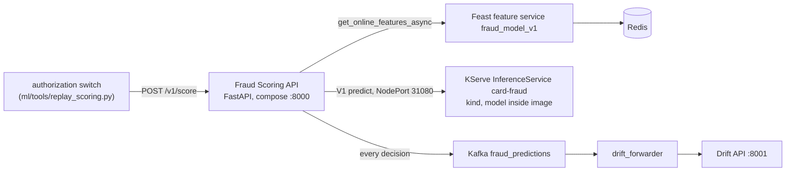
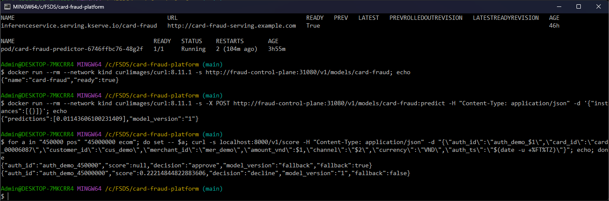

# Serving



## Model server (KServe)

[`infra/k8s/kserve-card-fraud.yaml`](../infra/k8s/kserve-card-fraud.yaml): one InferenceService in namespace `serving`, KServe 0.21 in Standard mode (formerly
called RawDeployment): a plain Deployment + Service, no Knative, so it fits the 8 GB machine. In 0.21 the Helm chart is
`oci://ghcr.io/kserve/charts/kserve-resources`; the old `kserve` chart name no longer resolves. The predictor is a
custom KServe `Model` (`services/predictor/predictor.py`) with the booster inside the image:

```bash
python services/predictor/fetch_model.py --alias production      # MLflow alias -> services/predictor/model/
docker build -t localhost:5001/fraud/predictor:<version> services/predictor && docker push localhost:5001/fraud/predictor:<version>
kubectl apply -f infra/k8s/kserve-card-fraud.yaml                    # image tag = the registry version
```

One image = one model version: the running version is the image tag, a rollback is the previous tag, and a pod
never starts without its model (no download at start-up that can fail). Instances are sent as dicts and reordered by
the booster's own feature names, so a caller never depends on column order; a missing feature is NaN, as in
training. The response carries `model_version`.

## Fraud Scoring API (`services/scoring_api`)

| Endpoint | Purpose |
|---|---|
| `POST /v1/score` | one authorization in (pydantic `ScoreRequest`: ids, amount, channel, currency, auth method, device, time), `{score, decision, model_version, fallback}` out |
| `GET /healthz` | liveness: the process answers; never checks dependencies (a Redis outage must not restart the API) |
| `GET /readyz` | readiness: Feast online read and the model endpoint both answer |
| `GET /metrics` | Prometheus format: request rate / latency / status, decisions, fallbacks by cause, score histogram, latency per stage |

Async end to end: Feast `get_online_features_async`, `httpx.AsyncClient` (one pooled client) to KServe,
`aiokafka` for the prediction log: one worker serves many requests while each waits on Redis or the model.

The decision is `ThresholdPolicy`: `score >= t_high` decline, `>= t_low` step-up (OTP), else approve. The thresholds
come from configuration (`T_LOW`, `T_HIGH`), not from the model, so risk can tune them without a release; the model
version carries the recommended values from validation (`t_low` at 1% FPR, `t_high` at 0.1% FPR).

Fallback, never an error: each stage has a time budget (`asyncio.wait_for`, 50 ms by default, 200 ms in compose
where KServe is reached through the kind NodePort). A timeout or failure of
the feature store or the model gives `FallbackPolicy`: approve below 2,000,000 VND, step-up from it, never decline
without evidence. The response says `fallback: true` and the counter `fraud_fallbacks_total{cause}` records why
(`features_timeout`, `model_error`, ...). A payment is never blocked by an outage of the fraud system.

Prediction log: every request + response + the feature vector goes to Kafka `fraud_predictions`, keyed by card,
without waiting for the broker ack. If Kafka is down the API keeps scoring and only stops logging.

## Design

The scorer depends on three small interfaces (`FeatureSource`, `ModelSource`, `PredictionLog`) wired in
`build_scorer`; tests pass fakes, the app passes the real clients. The two policies are interchangeable strategies
behind one `decide` call. `create_app` is an app factory so tests build an app with fake collaborators and their own
metrics registry.

## Run (2026-10-19, model v1)

```bash
MLFLOW_TRACKING_URI=http://mlflow:5000 python services/predictor/fetch_model.py --alias production   # v1 -> model/
docker build -t localhost:5001/fraud/predictor:1 services/predictor && docker push localhost:5001/fraud/predictor:1
sed 's/MODEL_VERSION/1/' infra/k8s/kserve-card-fraud.yaml | kubectl apply -f -
kubectl wait --for=condition=Ready isvc/card-fraud -n serving        # Ready after 25 s, 1 predictor pod
```

`GET /v1/models/card-fraud` -> `{"name":"card-fraud","ready":true}`. The image is 968 MB (the `kserve` package and
its dependencies); the model inside is 243 KB.

The InferenceService
([`infra/k8s/kserve-card-fraud.yaml` L4-L22](https://github.com/cvinhnguyen/card-fraud-platform/blob/35d4295a1e5a409fa242bc6aa9eff9b06038c111/infra/k8s/kserve-card-fraud.yaml#L4-L22)):

```yaml
apiVersion: serving.kserve.io/v1beta1
kind: InferenceService
metadata:
  name: card-fraud
  namespace: serving
  annotations:
    serving.kserve.io/deploymentMode: Standard
spec:
  predictor:
    minReplicas: 1
    maxReplicas: 3
    containers:
      - name: kserve-container
        image: localhost:5001/fraud/predictor:MODEL_VERSION
        args: ["--model_name", "card-fraud", "--http_port", "8080"]
        ports: [{containerPort: 8080, protocol: TCP}]
        resources:
          requests: {cpu: 100m, memory: 256Mi}
          limits: {cpu: "1", memory: 512Mi}
```



Checked again on 2026-10-21 from Git Bash: the InferenceService is Ready with one predictor pod, and a direct V1
`predict` call through the NodePort answers with `model_version` 1. Then two payments on the same card through the
Scoring API. The first one fell back: the machine was loaded, the feature lookup ran past its time budget, and
`FallbackPolicy` approved the 450,000 VND payment by rule (`model_version: fallback`). The second one was scored by
KServe: 45,000,000 VND online is declined (0.2221, `fallback: false`).

Thresholds in compose are model v1's validated ones (`T_LOW=0.0018`, `T_HIGH=0.058`, MLflow tags of the version):
the scores are calibrated to the real 0.3% fraud rate, so a 0.5 cut-off would decline almost nothing.

Three payments of the first live day (2026-10-16), through `POST /v1/score`:

| label | channel | amount (VND) | score | decision | latency |
|---|---|---:|---:|---|---:|
| fraud | ecom | 129,000 | 0.9989 | decline | 101 ms (first call) |
| legitimate | ecom | 514,000 | 0.0003 | approve | 22 ms |
| legitimate | pos | 42,000 | 0.0021 | step_up | 21 ms |

Fallback demo: `docker pause redis`, same three requests -> all `approve`, `score: null`, `fallback: true`,
~220 ms each (the 200 ms feature budget), log `fallback (features_timeout)`; `docker unpause redis` and scoring
resumes. `/readyz` reports both dependencies; `/metrics` counts `fraud_decisions_total{decision, fallback}`.

### Capacity, and a bug the first load found

The first replay at 100 requests/s fell back on 96% of the payments. Two separate problems:

| Concurrency | Throughput | p50 / p95 | Fallback |
|---:|---:|---:|---:|
| 1 | 36 req/s | 25 / 41 ms | 0% |
| 2 | 45 req/s | 42 / 58 ms | 0% |
| 4 | 46 req/s | 82 / 121 ms | 0% |
| 8 | 47 req/s | 165 / 206 ms | 0% |
| 32 | 41 req/s | 757 / 950 ms | 94% |

1. One worker scores ~45 requests/s, at about 22 ms of CPU per request, most of it Feast computing the on-demand
   features in pandas inside the event loop. Above that rate requests queue past their 200 ms budget and the
   fallback answers (as designed: the payment still gets a decision). More throughput means more replicas, not a
   bigger budget; the replay scores at 30/s.
2. After a burst the API never recovered. Once the load was gone, every request still fell back
   (`model_timeout` / `PoolTimeout`) until a restart, while a fresh client in the same container reached KServe in
   4 ms. `asyncio.wait_for` cancelled the httpx calls mid-request and the shared connection pool stayed exhausted.
   `ModelClient.predict` now runs the call under `asyncio.shield`: the budget still answers the switch on time, and
   the abandoned call ends under httpx's own timeouts and returns its connection. Measured: 1,000 requests at
   concurrency 32, then serial requests are back at 25 ms with no fallback (before the fix: 100% fallback).
   `test_model_budget_does_not_cancel_the_http_call` fails on the old code.
