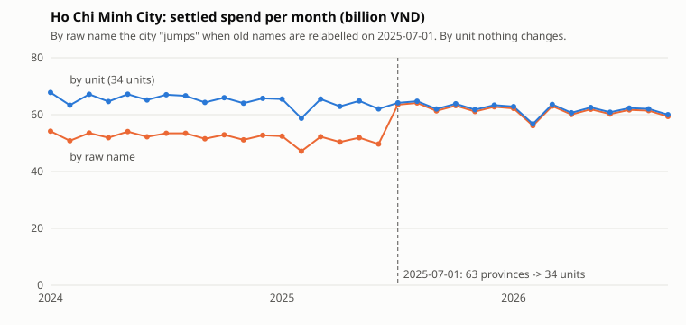

# Spark jobs

The batch jobs of the lakehouse run on Spark and write Delta tables through the Hive Metastore. DP1 copies the core
banking sources into bronze, DP2 cleans them into silver, dbt-spark builds the gold star schema, a labels job keeps
the fraud labels as they were known on each date, and DP3 computes the daily card features for the Feast offline
store. The stack is Spark 4.1.3 standalone (1 master, 1 worker with 8 cores / 3 GB), Delta Lake 4.4.1, Hive Metastore
3.1.3 and Trino 484.

| | |
|---|---|
| Code | [`pipelines/spark/`](https://github.com/cvinhnguyen/card-fraud-platform/tree/612ffdc2aa8a38f9098d6190f54bd46c2ea70315/pipelines/spark), [`pipelines/dbt/`](https://github.com/cvinhnguyen/card-fraud-platform/tree/612ffdc2aa8a38f9098d6190f54bd46c2ea70315/pipelines/dbt) |
| Runs on | compose profile `batch` (jobs run inside the `spark-master` container); dbt through the Spark Thrift Server, compose profile `dbt`, port 10000 |
| Reads | Postgres `core_banking` (6 tables, JDBC), the export bucket `s3a://core-banking-export/transactions/`, Flink's landing files in `s3a://lakehouse/landing/card_authorizations/` |
| Writes | Delta tables `bronze.*`, `silver.*` and `gold.*` under `s3a://lakehouse/`; `bronze.raw_transactions` in the lakeFS repository `bronze` |
| Related | [dbt_gold.md](dbt_gold.md), [spark_optimization.md](spark_optimization.md), [novel_lakefs_wap.md](novel_lakefs_wap.md), [airflow.md](airflow.md) |

## Run it

From the repo root, with the `batch` profile up:

```bash
# DP1, first load (before infra/init_lakefs.py moves bronze.raw_transactions into lakeFS)
docker compose -f infra/docker-compose.yaml exec spark-master /opt/spark/bin/spark-submit /opt/jobs/ingest_bronze.py --txn-root s3a://lakehouse/bronze
# DP1 after that, as the Airflow tasks run it: the exports go on a lakeFS run branch (DP1 creates, validates and merges it)
docker compose -f infra/docker-compose.yaml exec spark-master /opt/spark/bin/spark-submit /opt/jobs/ingest_bronze.py --part core_banking
docker compose -f infra/docker-compose.yaml exec spark-master /opt/spark/bin/spark-submit /opt/jobs/ingest_bronze.py --part exports --txn-root s3a://bronze/dp1_20261015
docker compose -f infra/docker-compose.yaml exec spark-master /opt/spark/bin/spark-submit /opt/jobs/ingest_bronze.py --part landing

# DP2: bronze to silver
docker compose -f infra/docker-compose.yaml exec spark-master /opt/spark/bin/spark-submit /opt/jobs/build_silver.py

# Gold with dbt-spark
docker compose -f infra/docker-compose.yaml --profile dbt up -d spark-thrift
.venv/Scripts/dbt build --project-dir pipelines/dbt --profiles-dir pipelines/dbt     # models + tests

# Labels with label delay
docker compose -f infra/docker-compose.yaml exec spark-master /opt/spark/bin/spark-submit /opt/jobs/build_labels.py --as-of 2026-06-30
docker compose -f infra/docker-compose.yaml exec spark-master /opt/spark/bin/spark-submit /opt/jobs/build_labels.py            # up to the last txn date
docker compose -f infra/docker-compose.yaml exec spark-master /opt/spark/bin/spark-submit /opt/jobs/build_labels.py --report   # time travel

# DP3: features
docker compose -f infra/docker-compose.yaml exec spark-master /opt/spark/bin/spark-submit /opt/jobs/build_features.py
```

## DP1: source to bronze

[`pipelines/spark/ingest_bronze.py`](https://github.com/cvinhnguyen/card-fraud-platform/blob/612ffdc2aa8a38f9098d6190f54bd46c2ea70315/pipelines/spark/ingest_bronze.py)
loads three sources:

| Source | Bronze table | Load |
|---|---|---|
| Postgres `core_banking.<table>` (6 tables, JDBC) | `bronze.raw_<table>` | full snapshot, overwrite; Delta time travel keeps earlier snapshots |
| `s3a://core-banking-export/transactions/export_date=*/` | `bronze.raw_transactions`, partitioned by `export_date`, in the lakeFS repository `bronze` (branch `main`) | append only the export dates after the newest one already loaded, on a lakeFS branch that is merged into `main` once validated |
| `s3a://lakehouse/landing/card_authorizations/` (Flink's raw landing files) | `bronze.raw_card_authorizations`, partitioned by `auth_date` | file stream with `availableNow`: append the files not loaded yet (a checkpoint remembers them) |

Bronze is a faithful copy: duplicates, old province names and missing columns stay as they are. Each row gets
`_ingested_at` and `_source` (the JDBC table or the source file path). Timestamps are read without a time zone
(`preferTimestampNTZ`), as they are in the source
([`pipelines/spark/ingest_bronze.py` L57-L69](https://github.com/cvinhnguyen/card-fraud-platform/blob/612ffdc2aa8a38f9098d6190f54bd46c2ea70315/pipelines/spark/ingest_bronze.py#L57-L69)).
`save` registers each table once in the Hive Metastore (`CREATE TABLE ... USING DELTA LOCATION`); the schema lives in
the Delta log, so Trino reads the tables as `delta.bronze.*`. A write to a lakeFS run branch is not registered: the
metastore entry of `bronze.raw_transactions` points at `s3a://bronze/main/raw_transactions`, so silver and Trino read
`main` only
([`pipelines/spark/ingest_bronze.py` L43-L54](https://github.com/cvinhnguyen/card-fraud-platform/blob/612ffdc2aa8a38f9098d6190f54bd46c2ea70315/pipelines/spark/ingest_bronze.py#L43-L54)):

```python
def save(df, table: str, mode: str, partition_by: str | None = None, root: str = BRONZE, **options) -> None:
    """Write a Delta table at <root>/<table> and register it as bronze.<table> in the Hive Metastore once
    (not for a lakeFS run branch: the metastore points at main).

    The schema lives in the Delta log, so later writes never alter the metastore entry
    (Hive Metastore 3.1 cannot parse timestamp_ntz and would log a warning on every schema change).
    """
    path = f"{root}/{table}"
    w = df.write.format("delta").mode(mode).options(**options)
    (w.partitionBy(partition_by) if partition_by else w).save(path)
    if root in (BRONZE, TXN_MAIN):
        df.sparkSession.sql(f"CREATE TABLE IF NOT EXISTS bronze.{table} USING DELTA LOCATION '{path}'")
```

Result (2026-10-17, 1 GB data):

| Table | Rows |
|---|---:|
| raw_transactions (1,019 export dates) | 8,159,516 |
| raw_customers | 193,207 |
| raw_cards | 130,120 |
| raw_accounts | 100,000 |
| raw_disputes | 31,364 |
| raw_merchants | 5,200 |
| raw_ref_province_mapping | 63 |

`SELECT count(*) FROM delta.bronze.raw_transactions` on Trino returned 8,159,516, the number of rows the generator wrote.
Since the table moved into lakeFS ([novel_lakefs_wap.md](novel_lakefs_wap.md)) Trino reads it as
`lakefs.bronze.raw_transactions`.

### Incremental load

The exports part reads the newest `export_date` already in `<root>/raw_transactions` and lists the export bucket, then
reads only the newer folders. A run branch is created from `main`, so on a branch this is the newest export already
published. With no table there yet (the first load) it reads them all. A second run with no new files prints
`nothing new after 2026-10-16` and appends nothing. `--until YYYY-MM-DD` stops at a given export date. The append,
with `mergeSchema` on the read and on the write
([`pipelines/spark/ingest_bronze.py` L79-L99](https://github.com/cvinhnguyen/card-fraud-platform/blob/612ffdc2aa8a38f9098d6190f54bd46c2ea70315/pipelines/spark/ingest_bronze.py#L79-L99)):

```python
def ingest_exports(spark: SparkSession, until: str | None, merge_schema: bool, root: str = TXN_MAIN) -> None:
    """Append the export dates after the newest one already in bronze (and up to `until`) to <root>/raw_transactions:
    lakeFS main, or the run's branch in DP1."""
    table, path = "bronze.raw_transactions", f"{root}/raw_transactions"
    try:
        done = str(spark.read.format("delta").load(path).agg(F.max("export_date")).first()[0])
    except AnalysisException:   # first load: no table there yet
        done = ""
    new = [d for d in export_dates(spark) if d > done and (until is None or d <= until)]
    if not new:
        print(f"{table}: nothing new after {done}")
        return
    # Read only the new folders: files up to 2024-07-01 have no auth_method / three_ds_version columns.
    df = (spark.read.options(basePath=EXPORTS, mergeSchema=str(merge_schema).lower())
          .parquet(*[f"{EXPORTS}/export_date={d}" for d in new])
          .withColumn("_ingested_at", F.current_timestamp())
          .withColumn("_source", F.col("_metadata.file_path")))
    save(df.repartition("export_date"), "raw_transactions", "append",
         partition_by="export_date", root=root, mergeSchema=str(merge_schema).lower())
    total = spark.read.format("delta").load(path).count()
    print(f"{table} at {root}: +{len(new)} export dates ({new[0]} .. {new[-1]}), {total:,} rows total")
```

`--txn-root` says where the append goes. lakeFS `main` takes merges only, so the job stops with an error when the
exports part runs without `--txn-root` or with `s3a://bronze/main`
([`pipelines/spark/ingest_bronze.py` L127-L129](https://github.com/cvinhnguyen/card-fraud-platform/blob/612ffdc2aa8a38f9098d6190f54bd46c2ea70315/pipelines/spark/ingest_bronze.py#L127-L129)).
`s3a://lakehouse/bronze` is only for the first load, before `infra/init_lakefs.py` imports the table into lakeFS. The
Airflow DAG appends on the branch `dp1_<ds>`, commits it, validates it and merges it into `main`
([`pipelines/airflow/dags/dp1_source_to_bronze.py` L35-L60](https://github.com/cvinhnguyen/card-fraud-platform/blob/612ffdc2aa8a38f9098d6190f54bd46c2ea70315/pipelines/airflow/dags/dp1_source_to_bronze.py#L35-L60));
the runs are in [novel_lakefs_wap.md](novel_lakefs_wap.md).

### Schema evolution

Export files up to 2024-07-01 have no `auth_method` / `three_ds_version` columns; later files have both, so the
append above sets `mergeSchema` on the read and on the write. The baseline (columns lost on read, append refused
with `DELTA_METADATA_MISMATCH`), the fix and the numbers are in
[spark_optimization.md](spark_optimization.md#schema-evolution).

## DP2: bronze to silver

[`pipelines/spark/build_silver.py`](https://github.com/cvinhnguyen/card-fraud-platform/blob/612ffdc2aa8a38f9098d6190f54bd46c2ea70315/pipelines/spark/build_silver.py)
builds two silver tables:

| Silver table | From | Fixes |
|---|---|---|
| `silver.stg_transactions`, partitioned by `txn_date` | `bronze.raw_transactions` | dedup, `txn_unit` (34 units) + `txn_city_raw`, `auth_method` NULL → `unknown_pre_regulation` |
| `silver.stg_customers` | `bronze.raw_customers` | `customer_unit` (34 units) + `city_raw`; input of the SCD2 `dim_customer` |

The job stops if a city name is missing from `ref_province_mapping` (no silent NULL unit)
([`pipelines/spark/build_silver.py` L28-L35](https://github.com/cvinhnguyen/card-fraud-platform/blob/612ffdc2aa8a38f9098d6190f54bd46c2ea70315/pipelines/spark/build_silver.py#L28-L35)).

### Incremental load

Only bronze export dates newer than the newest `export_date` in silver are read
([`pipelines/spark/build_silver.py` L53-L56](https://github.com/cvinhnguyen/card-fraud-platform/blob/612ffdc2aa8a38f9098d6190f54bd46c2ea70315/pipelines/spark/build_silver.py#L53-L56)).
The batch is deduplicated, then `MERGE`d on `transaction_id`
([`pipelines/spark/build_silver.py` L83-L91](https://github.com/cvinhnguyen/card-fraud-platform/blob/612ffdc2aa8a38f9098d6190f54bd46c2ea70315/pipelines/spark/build_silver.py#L83-L91)):
an id already in silver is replaced only by a row with a later `created_ts`, so a re-run, or a duplicate that lands in
a later export, cannot double count. Test: deleting the last 6 export dates from silver (47,226 rows) and re-running
the job merged exactly 47,226 rows back (7,999,526 total, 64 s).

### Before / after (full build, 146 s)

| Measure | Bronze (before) | Silver (after) |
|---|---:|---:|
| Rows | 8,159,516 | 7,999,526 |
| Distinct `transaction_id` | 7,999,526 | 7,999,526 |
| Settled spend (VND) | 3,625,268,094,000 | 3,554,102,498,000 |
| NULL `auth_method` | 1,455,416 | 0 (1,426,881 rows `unknown_pre_regulation`) |

Without dedup the settled spend is overcounted by 2.00%. 878,795 rows (10.99%) carry a location name that maps to a
different unit (old province names before 2025-07-01, plus stale names after it).

Ho Chi Minh City around the reorganization (settled spend, billion VND; share of rows):

| Month | By raw name | By `txn_unit` | Binh Duong (raw) | Share raw | Share unit |
|---|---:|---:|---:|---:|---:|
| 2025-05 | 51.9 | 64.9 | 8.5 | 47.8% | 59.9% |
| 2025-06 | 49.7 | 62.0 | 8.0 | 48.0% | 60.0% |
| 2025-07 | 63.5 | 64.1 | 0.4 | 59.5% | 60.1% |
| 2025-08 | 64.1 | 64.7 | 0.4 | 59.3% | 59.9% |

By raw name, HCMC "grows" 28% in July 2025 and Binh Duong almost disappears. By `txn_unit` the series is flat,
because only the labels changed. The chart draws both series for every month; the February dips are the short month:



Redraw it with `python docs/diagrams/hcmc_spend.py` (reads silver through Trino).

## Gold with dbt-spark

The dbt project in
[`pipelines/dbt/`](https://github.com/cvinhnguyen/card-fraud-platform/tree/612ffdc2aa8a38f9098d6190f54bd46c2ea70315/pipelines/dbt)
([dbt_gold.md](dbt_gold.md)) runs SQL models through the Spark Thrift Server (compose profile `dbt`, port 10000), so
the gold tables are Delta tables in `s3a://lakehouse/gold/`, registered in the same Hive Metastore and readable from
Trino.

### SCD2 `gold.dim_customer`

The source already holds one row per customer version (`customer_id` + `updated_ts`), from 2024 onwards. A dbt
snapshot only records the state it sees at each run, so it would lose that history. `dim_customer` is therefore a
model over `silver.stg_customers`: `lag()` compares a hash of the tracked attributes (unit, income band, risk tier, KYC
level, name, date of birth) with the previous row, keeps only rows where something changed, and `lead()` gives
`valid_to_ts` (exclusive; open-ended = 9999-12-31) and `is_current`
([`pipelines/dbt/models/gold/dim_customer.sql` L4-L38](https://github.com/cvinhnguyen/card-fraud-platform/blob/612ffdc2aa8a38f9098d6190f54bd46c2ea70315/pipelines/dbt/models/gold/dim_customer.sql#L4-L38)).

The city is compared after normalization (`customer_unit`), so the relabel of old province names on 2025-07-01 is not a
new version:

| Count | Rows |
|---|---:|
| Source rows (`stg_customers`) | 193,207 |
| SCD2 versions comparing the raw city name | 160,802 |
| SCD2 versions comparing `customer_unit` (= `dim_customer`) | 144,167 |
| Spurious versions avoided | 16,635 |
| Current versions (one per customer) | 100,000 |

Tests (`dbt build`, 8/8 pass): unique / not-null keys, exactly one current version per customer, versions of a
customer follow each other without gaps or overlaps.

### Point-in-time join

An online payment's `txn_city` is the card holder's home unit at payment time. For the 15,393 customers who moved,
joining their 977,652 settled ecom payments to `dim_customer`:

| Join | Home unit matches `txn_unit` |
|---|---:|
| Point in time: `valid_from_ts <= txn_ts < valid_to_ts` | 100.0% |
| Current version only (`is_current`) | 76.7% |

Joining on the current version puts every payment made before a move in the wrong unit.

### Star schema

| Model | Grain | Rows | Built from |
|---|---|---:|---|
| `fact_transaction` (incremental `MERGE`, partitioned by `txn_month`) | one settled transaction | 7,879,773 (315,913 in USD) | `stg_transactions` |
| `dim_customer` (SCD2) | one customer version | 144,167 | `stg_customers` |
| `dim_card` | one card, with its account and owner | 130,120 | `raw_cards` + `raw_accounts` |
| `dim_merchant` | one merchant (`merchant_unit` NULL for the 200 foreign ones) | 5,200 | `raw_merchants` |
| `dim_date` | one day, 2024-01-01 to 2026-10-15 | 1,019 | generated |

Reversed transactions (119,753) are left out: no money moved. Fraud labels are not in the fact because they change
after it is written; they live in `gold.label_transaction` (below). `fact_transaction.customer_sk` is resolved with the
point-in-time join when the row is built, so a query joins `dim_customer` on `customer_sk` without a date range
([`pipelines/dbt/models/gold/fact_transaction.sql` L36-L39](https://github.com/cvinhnguyen/card-fraud-platform/blob/612ffdc2aa8a38f9098d6190f54bd46c2ea70315/pipelines/dbt/models/gold/fact_transaction.sql#L36-L39)):

```sql
from txn t
join {{ ref('dim_card') }} c on c.card_id = t.card_id
left join {{ ref('dim_customer') }} d
    on d.customer_id = c.customer_id and t.txn_ts >= d.valid_from_ts and t.txn_ts < d.valid_to_ts
```

The two small reference tables need no cleaning, so `dim_card` and `dim_merchant` read bronze directly.

Tests (`dbt build`, 27/27 pass): unique / not-null keys, every fact key found in its dimension (`relationships`), and
`fact_transaction` has the same row count and settled spend as silver (7,879,773 rows, 3,554,102,498,000 VND).

Incremental load: a full refresh of the fact takes 60 s. Deleting the last 5 export dates (38,752 rows) and running
`dbt run --select fact_transaction` again `MERGE`d exactly 38,752 rows back in 25 s, with no file rewritten.

## Labels with label delay

[`pipelines/spark/build_labels.py`](https://github.com/cvinhnguyen/card-fraud-platform/blob/612ffdc2aa8a38f9098d6190f54bd46c2ea70315/pipelines/spark/build_labels.py)
writes `gold.label_transaction`, one row per transaction, partitioned by `event_month`: `transaction_id`, `card_id`,
`customer_id`, `event_timestamp`, `amount_vnd`, `is_fraud`, `fraud_reported_ts`, `label_as_of`.

A fraud dispute arrives 1 to 60 days after the payment, so a label can change after it was written and the table cannot
be append only. Each run takes `--as-of D` and sees only the transactions and disputes up to D, then `MERGE`s:
new transactions are inserted with the disputes known so far, and older transactions whose dispute arrived since the
last run are flipped to `is_fraud = true`. Because disputes are at most 60 days late, the `MERGE` only scans the last
3 months of partitions. Each run is one Delta version and its commit carries `label_as_of=D` (the `userMetadata`
column of `DESCRIBE HISTORY`), so `VERSION AS OF` returns the labels exactly as they were known on D.
The tag and the `MERGE`
([`pipelines/spark/build_labels.py` L51-L67](https://github.com/cvinhnguyen/card-fraud-platform/blob/612ffdc2aa8a38f9098d6190f54bd46c2ea70315/pipelines/spark/build_labels.py#L51-L67)):

```python
    spark.conf.set("spark.databricks.delta.commitInfo.userMetadata", f"label_as_of={as_of}")
    if not exists:
        src.repartition("event_month").write.format("delta").partitionBy("event_month").save(PATH)
        spark.sql(f"CREATE TABLE IF NOT EXISTS {TABLE} USING DELTA LOCATION '{PATH}'")
    else:
        # Older rows only need the label columns; disputes are at most 60 days late, so only the last 3 months change.
        flips = (fraud.where(F.col("fraud_reported_ts") >= F.lit(start))
                 .join(new_txn.select("transaction_id"), "transaction_id", "left_anti")
                 .withColumn("is_fraud", F.lit(True)).withColumn("label_as_of", F.lit(as_of)))
        oldest = (start - dt.timedelta(days=MATURITY_DAYS + 31)).strftime("%Y-%m")
        (DeltaTable.forName(spark, TABLE).alias("t")
         .merge(src.unionByName(flips, allowMissingColumns=True).alias("s"),
                f"t.event_month >= '{oldest}' AND t.transaction_id = s.transaction_id")
         .whenMatchedUpdate(condition="t.is_fraud <> s.is_fraud",
                            set={c: f"s.{c}" for c in ("is_fraud", "fraud_reported_ts", "label_as_of")})
         .whenNotMatchedInsertAll(condition="s.event_timestamp IS NOT NULL")
         .execute())
```

Replay, one run per month end (about 60 s each):

| Version | `label_as_of` | New rows | Labels flipped | Files removed / added |
|---:|---|---:|---:|---|
| 0 | 2026-06-30 | 7,159,417 | | 0 / 30 |
| 1 | 2026-07-31 | 243,823 | 409 | 2 / 3 |
| 2 | 2026-08-31 | 242,706 | 381 | 2 / 3 |
| 3 | 2026-09-30 | 235,497 | 356 | 2 / 3 |
| 4 | 2026-10-15 | 118,083 | 287 | 2 / 3 |

The final table has 7,999,526 rows (= `stg_transactions`) and 23,594 frauds (= confirmed fraud disputes).

The fraud rate of June 2026 transactions, read from each version, versus the rate of mature rows only
(`event_timestamp < label_as_of - 60 days`):

| Version (`label_as_of`) | June 2026 fraud rate | Mature rows | Mature fraud rate |
|---|---:|---:|---:|
| 0 (2026-06-30) | 0.141% | 6,680,600 | 0.2999% |
| 1 (2026-07-31) | 0.302% | 6,924,346 | 0.2995% |
| 2 (2026-08-31) | 0.311% | 7,167,311 | 0.3000% |
| 3 (2026-09-30) | 0.311% | 7,403,240 | 0.3000% |
| 4 (2026-10-15) | 0.311% | 7,520,544 | 0.2999% |

On the day June ends, more than half of June's frauds are still unknown; after 60 days the rate stops moving. The
mature rate is the same in every version, so a training set built from mature rows does not depend on when it was
built. Layer 2 reads `VERSION AS OF` the version its model was trained on and filters to mature rows.

## DP3: features

[`pipelines/spark/build_features.py`](https://github.com/cvinhnguyen/card-fraud-platform/blob/612ffdc2aa8a38f9098d6190f54bd46c2ea70315/pipelines/spark/build_features.py)
writes `gold.feat_card_txn_stats_daily`, the offline source of the Feast feature view `card_txn_stats_daily`
(Layer 2). One row per card and day L on which the card was active (a settled transaction or a reported dispute):
7,792,146 rows, 129,749 cards, for the days up to 2026-11-03.

| Feature | Window (days up to L) | Mean |
|---|---|---:|
| `txn_count_30d` | 30 | 2.97 |
| `distinct_merchants_30d` | 30 | 2.67 |
| `avg_amount_90d`, `std_amount_90d` (VND) | 90 | 452,293 / 453,999 |
| `ecom_ratio_90d` | 90 | 0.719 |
| `foreign_txn_ratio_90d` (`currency != VND`) | 90 | 0.040 |
| `dispute_count_180d` (disputes by `reported_ts`, any reason) | 180 | 0.047 |

Each window ends at L, L included, and `event_timestamp` is L + 1 day 00:00: the nightly run after day L writes the
row, and from then on it is the card's latest value. A point-in-time join for a payment on day D therefore sees the
row of the card's last active day before D, the same row the online store holds when that payment is scored.
Payments earlier on the same day are left to the stream features (Flink, 1 hour windows). Disputes are counted on
the day they were reported, not the day of the disputed payment: a dispute reported after L was unknown on L + 1.
`stats_ts` repeats `event_timestamp` as a feature column, because Feast does not serve the event timestamp itself and
Layer 2 derives `days_since_last_active` from it. `created` is the processing time (Feast uses it to break ties).

Layer 2 changed this layout. The first one had a row on each payment day D with windows ending at D-1: the values
were the same, but the row a training example joined to existed only because of the payment being scored, and the
online store never holds such a row. Training and serving would have read different rows.

Windows are `rangeBetween(-(N-1), 0)` over the day number, on one row per card and day, so one sort per card serves
all windows
([`pipelines/spark/build_features.py` L48-L54](https://github.com/cvinhnguyen/card-fraud-platform/blob/612ffdc2aa8a38f9098d6190f54bd46c2ea70315/pipelines/spark/build_features.py#L48-L54)).
The job ends with a leakage check: 500 random rows are recomputed from `fact_transaction` and
`raw_disputes` with plain date filters, and all 500 match
([`pipelines/spark/build_features.py` L78-L94](https://github.com/cvinhnguyen/card-fraud-platform/blob/612ffdc2aa8a38f9098d6190f54bd46c2ea70315/pipelines/spark/build_features.py#L78-L94)).

## Gotchas

- Hive Metastore is 3.1.3 because Spark 4.1's built-in Hive 2.3 client cannot call a 4.x metastore
  (`Invalid method name: 'get_table'`).
- Trino's default per-node memory (~500 MB with a 2 GB container) is too small for an exact
  `count(DISTINCT transaction_id)` over 8M rows; `approx_distinct` works.
- `dim_date` and the incremental filter failed on the Thrift Server with
  `ClassCastException: java.time.LocalDate cannot be cast to java.sql.Date`. Delta answers `min/max` of a date column
  from file statistics as `java.sql.Date`, while the Thrift Server uses the Java 8 time API. The Thrift Server now runs
  with `spark.databricks.delta.optimizeMetadataQuery.enabled=false`
  ([`infra/docker-compose.yaml` L259-L262](https://github.com/cvinhnguyen/card-fraud-platform/blob/612ffdc2aa8a38f9098d6190f54bd46c2ea70315/infra/docker-compose.yaml#L259-L262)).
