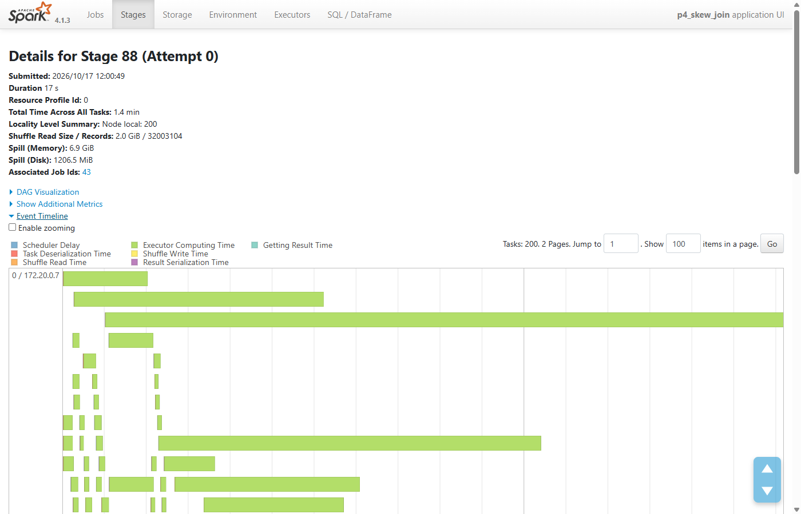
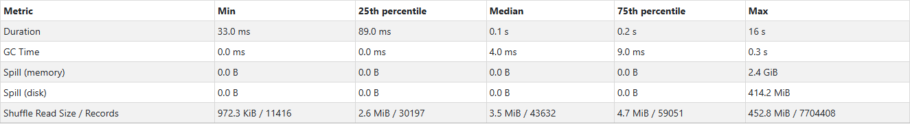
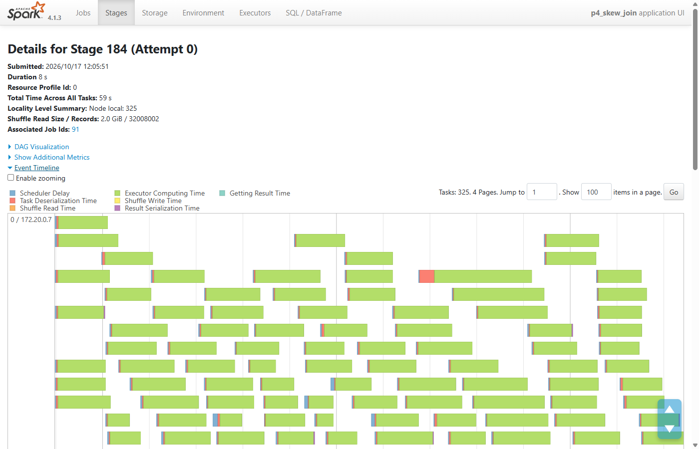
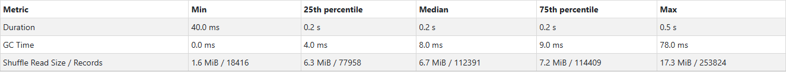
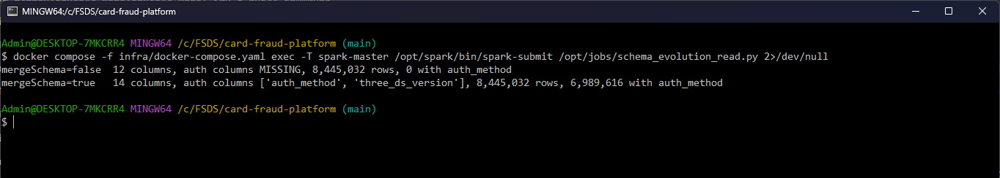
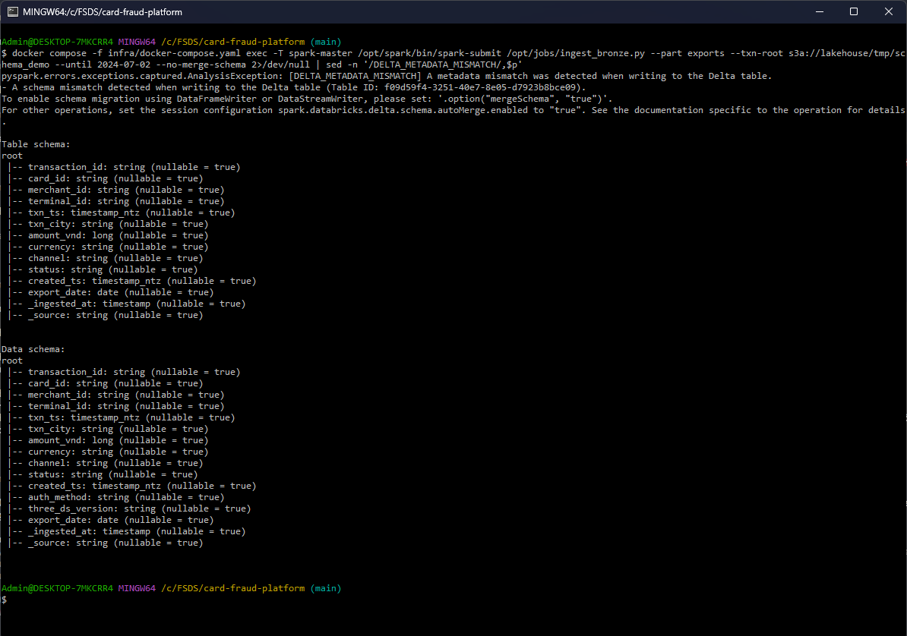
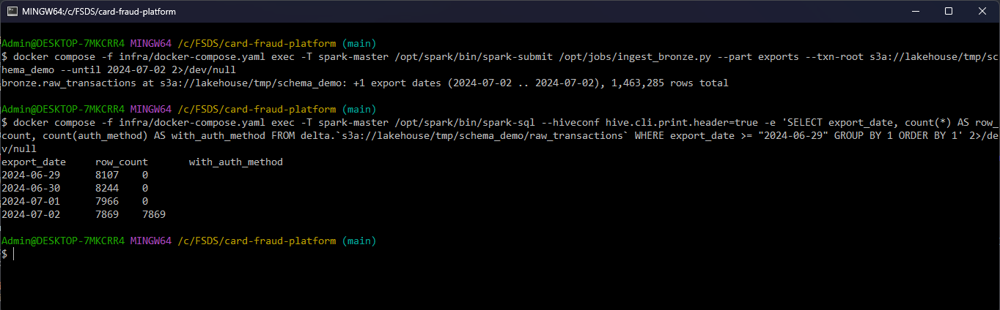
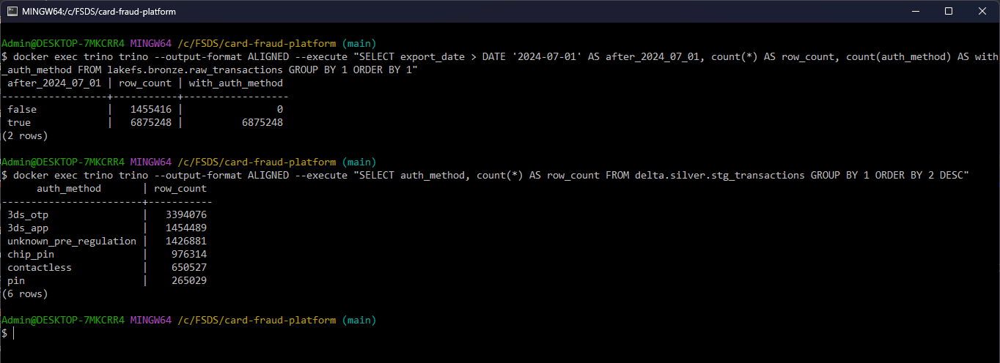
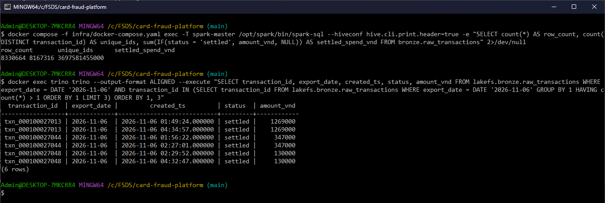
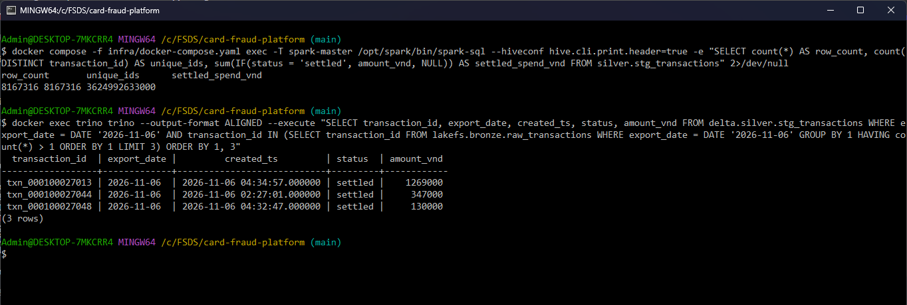

# Spark optimization

The Spark jobs handle three offline data problems from the generator ([data_characteristics.md](data_characteristics.md)).
Each section starts from the baseline (what goes wrong without the fix), then shows the fix, the numbers and where it
runs in Airflow (summary in [In the Airflow pipeline](#in-the-airflow-pipeline), details in [airflow.md](airflow.md)).

| Problem | Job | Airflow task | Section |
|---|---|---|---|
| Merchant join skew: top 10 merchants have 70% of the rows | `pipelines/spark/skew_join.py` (benchmark of 4 join methods, run by hand); the pipeline applies the winner, broadcast, to its own joins | `dp2_bronze_to_gold.build_silver`, `dp2_bronze_to_gold.build_labels` | [Merchant join skew](#merchant-join-skew-pipelinessparkskew_joinpy) |
| Schema evolution: `auth_method`, `three_ds_version` appear in the exports on 2024-07-01 | `pipelines/spark/ingest_bronze.py` (DP1) | `dp1_source_to_bronze.ingest_exports` | [Schema evolution](#schema-evolution) |
| Duplicates: 2% of the exported rows, from export re-runs | `pipelines/spark/build_silver.py` (DP2) | `dp2_bronze_to_gold.build_silver` | [Duplicates](#duplicates) |

## In the Airflow pipeline

Every Spark job of the pipeline is an Airflow task made by one helper, `spark_job()`: a `SparkSubmitOperator` to the
standalone master, in the pool `spark` (1 slot, so Spark applications queue in Airflow instead of fighting for the
3 GB worker), with the same Spark settings for every job
([`pipelines/airflow/dags/common.py` L39-L54](https://github.com/cvinhnguyen/card-fraud-platform/blob/873a173ee9078e8faef9568ac42d8b0aa7fab589/pipelines/airflow/dags/common.py#L39-L54)):

```python
def spark_job(task_id: str, script: str, args: list[str] | None = None, env: dict | None = None,
              conf: dict | None = None, **kwargs) -> SparkSubmitOperator:
    return SparkSubmitOperator(task_id=task_id, conn_id="spark_lakehouse",
                               application="{{ var.value.spark_jobs_dir }}/" + script, application_args=args or [],
                               env_vars={**S3_ENV, **(env or {})}, conf={**SPARK_CONF, **(conf or {})}, pool="spark",
                               **kwargs)
```

The fixes of this document run inside these tasks, and each zone is validated (Great Expectations) before the next
DAG reads it:

| Fix | DAG and task | What the task runs | Checked by |
|---|---|---|---|
| Schema evolution | `dp1_source_to_bronze.ingest_exports`, after the S3 sensor `wait_for_export` | `ingest_bronze.py --part exports --until <ds+1>`: reads only the new export folders, `mergeSchema` on read and append | `validate_dp1` |
| Duplicates | `dp2_bronze_to_gold.build_silver` | `build_silver.py`: `row_number()` per `transaction_id` (latest `created_ts`), MERGE into `silver.stg_transactions` | `validate_dp2_silver`: row count = distinct ids of the bronze slice, `transaction_id` unique |
| Skew (join with a small table) | `build_silver` and `build_labels` | broadcast joins: the 34-unit mapping ([`build_silver.py` L30](https://github.com/cvinhnguyen/card-fraud-platform/blob/873a173ee9078e8faef9568ac42d8b0aa7fab589/pipelines/spark/build_silver.py#L30)) and the card owner table ([`build_labels.py` L46](https://github.com/cvinhnguyen/card-fraud-platform/blob/873a173ee9078e8faef9568ac42d8b0aa7fab589/pipelines/spark/build_labels.py#L46)); AQE stays on (Spark's default, not overridden in `spark-defaults.conf`) | `validate_dp2_gold` |

DP1 wires them like this: the sensor gates only the export append, the Postgres snapshot and the landing load run in
parallel, and DP2 starts only after `validate_dp1` passed
([`pipelines/airflow/dags/dp1_source_to_bronze.py` L26-L39](https://github.com/cvinhnguyen/card-fraud-platform/blob/873a173ee9078e8faef9568ac42d8b0aa7fab589/pipelines/airflow/dags/dp1_source_to_bronze.py#L26-L39)):

```python
    wait = S3KeySensor(task_id="wait_for_export", aws_conn_id="lakehouse_s3", bucket_name="{{ var.value.export_bucket }}",
                       bucket_key="transactions/export_date={{ macros.ds_add(ds, 1) }}/*.parquet", wildcard_match=True,
                       mode="reschedule", poke_interval=300, timeout=6 * 3600)
    snapshot = spark_job("snapshot_core_banking", "ingest_bronze.py", ["--part", "core_banking"], env=CORE_DB_ENV)
    exports = spark_job("ingest_exports", "ingest_bronze.py",
                        ["--part", "exports", "--until", "{{ macros.ds_add(ds, 1) }}"])
    landing = spark_job("ingest_stream_landing", "ingest_bronze.py", ["--part", "landing"])
    trigger = TriggerDagRunOperator(task_id="trigger_dp2", trigger_dag_id="dp2_bronze_to_gold",
                                    logical_date="{{ logical_date }}", reset_dag_run=True)

    wait >> exports
    [snapshot, exports, landing] >> validate("dp1") >> trigger
```


DP2 runs the dedup first, validates silver, then builds gold with dbt and the labels in parallel
([`pipelines/airflow/dags/dp2_bronze_to_gold.py` L38-L53](https://github.com/cvinhnguyen/card-fraud-platform/blob/873a173ee9078e8faef9568ac42d8b0aa7fab589/pipelines/airflow/dags/dp2_bronze_to_gold.py#L38-L53)):

```python
    silver = spark_job("build_silver", "build_silver.py")
    labels = spark_job("build_labels", "build_labels.py", ["--as-of", "{{ ds }}"])
    silver >> validate("dp2_silver") >> [dbt_build, labels]
    [dbt_build, labels] >> gold_checks >> trigger
```


What a failed check does to the pipeline (a duplicate planted in silver stops dbt, the labels, DP3 and the next day),
and the backfill of 4 days through all three DAGs, are in [airflow.md](airflow.md).

## Merchant join skew (`pipelines/spark/skew_join.py`)

```bash
docker compose -f infra/docker-compose.yaml stop spark-thrift      # it holds worker cores
docker compose -f infra/docker-compose.yaml exec spark-master /opt/spark/bin/spark-submit /opt/jobs/skew_join.py --replicate 4
```

`stg_transactions JOIN merchants ON merchant_id`, full transaction rows, result written to the `noop` sink. The biggest
merchant (an e-wallet top-up) has 23.9% of the rows and the top 10 have 70%. Setup: 1 worker, 8 cores, 2 GB executor;
the data is unioned 4 times (32M rows, 2 GB of shuffle) so tasks are long enough to measure
([`pipelines/spark/skew_join.py` L133-L136](https://github.com/cvinhnguyen/card-fraud-platform/blob/35d4295a1e5a409fa242bc6aa9eff9b06038c111/pipelines/spark/skew_join.py#L133-L136)).
Each method runs once to warm up, then 3 times; the table shows the median
([`pipelines/spark/skew_join.py` L104-L118](https://github.com/cvinhnguyen/card-fraud-platform/blob/35d4295a1e5a409fa242bc6aa9eff9b06038c111/pipelines/spark/skew_join.py#L104-L118)).
Task numbers come from the slowest stage of the last run (Spark REST API,
[`pipelines/spark/skew_join.py` L63-L79](https://github.com/cvinhnguyen/card-fraud-platform/blob/35d4295a1e5a409fa242bc6aa9eff9b06038c111/pipelines/spark/skew_join.py#L63-L79)).

| Method | What changes | Median (s) | Runs (s) | Slowest task | Median task |
|---|---|---:|---|---:|---:|
| baseline | sort-merge join, AQE off, broadcast off | 51.2 | 53.5, 51.2, 48.9 | 17.4 s | 0.15 s |
| salting | merchant_id + random salt 0..31, merchants copied 32 times | 45.5 | 45.8, 45.5, 44.8 | 2.2 s | 1.80 s |
| AQE skew join | `spark.sql.adaptive.enabled`, skew threshold 8 MB | 38.0 | 35.8, 38.0, 38.6 | 2.1 s | 1.68 s |
| broadcast | merchants (5.2k rows) sent to every executor | 23.9 | 24.1, 23.2, 23.9 | 1.5 s | 1.35 s |

With salting, AQE and broadcast the skew is gone: their slowest stage is the scan of the transactions.
Broadcast's 23.9 s is roughly the cost of reading the data, so the join itself costs about 27 s in the baseline,
22 s with salting, 14 s with AQE and almost nothing with broadcast.

The four methods differ only in these session settings and in the join call
([`pipelines/spark/skew_join.py` L38-L60](https://github.com/cvinhnguyen/card-fraud-platform/blob/35d4295a1e5a409fa242bc6aa9eff9b06038c111/pipelines/spark/skew_join.py#L38-L60)):

```python
def configure(spark: SparkSession, method: str) -> None:
    """Session settings per method; everything else is identical across runs."""
    conf = {
        "spark.sql.adaptive.enabled": method == "aqe",
        "spark.sql.autoBroadcastJoinThreshold": -1,            # no automatic broadcast: it would hide the skew
        "spark.sql.adaptive.autoBroadcastJoinThreshold": -1,
        "spark.sql.adaptive.skewJoin.enabled": True,
        "spark.sql.adaptive.skewJoin.skewedPartitionThresholdInBytes": SKEW_THRESHOLD,
        "spark.sql.adaptive.advisoryPartitionSizeInBytes": ADVISORY or SKEW_THRESHOLD,
    }
    for k, v in conf.items():
        spark.conf.set(k, str(v).lower() if isinstance(v, bool) else str(v))


def join(txn: DataFrame, merchants: DataFrame, method: str) -> DataFrame:
    """transactions JOIN merchants on merchant_id with one of the four methods."""
    if method == "salting":
        txn = txn.withColumn("salt", (F.rand(7) * SALTS).cast("int"))
        merchants = merchants.crossJoin(txn.sparkSession.range(SALTS).withColumnRenamed("id", "salt"))
        return txn.join(merchants, ["merchant_id", "salt"]).drop("salt")
    if method == "broadcast":
        return txn.join(F.broadcast(merchants), "merchant_id")
    return txn.join(merchants, "merchant_id")
```

### Baseline: one task reads the hot key

200 shuffle partitions; the task that gets the biggest merchant reads 451 MB (7.7M rows) and runs 17.4 s, while the
median task runs 0.15 s. The other 7 cores sit idle while it runs. The screenshots are from the run before the 200
foreign merchants were added (same pattern: 453 MB read, 16 s, 2.4 GB spilled, median task 3.5 MB).





### AQE: the hot partition is split at run time

AQE sees the oversized shuffle partitions and splits them (325 tasks instead of 200 in the screenshot run). The largest
task reads 17 MB, the slowest join task runs 0.5 s, nothing spills.





### Which fix, in which order

1. Broadcast when one side is small. `merchants` is 5.2k rows, far below Spark's 10 MB auto-broadcast threshold, so
   with default settings this join is broadcast and never skews. The benchmark turns automatic broadcast off on purpose
   to show the problem.
2. AQE for large-to-large joins: configuration only, no code change. Its defaults (a partition is skewed above
   256 MB and 5 times the median) target big data; at 1 GB the threshold had to be lowered to 8 MB
   ([`pipelines/spark/skew_join.py` L31](https://github.com/cvinhnguyen/card-fraud-platform/blob/35d4295a1e5a409fa242bc6aa9eff9b06038c111/pipelines/spark/skew_join.py#L31)). At the 100 GB target
   the hot partition is several GB and the defaults apply.
3. Salting only when AQE cannot help: skew inside an aggregation or a window (AQE splits join partitions only),
   join types AQE does not split (full outer), or a key so hot that the split pieces are still too big. It costs code,
   an extra column in the shuffle (2.5 GB instead of 2.0 GB here) and a copy of the other side per salt bucket.

### Why skew needs scale to show

A skewed task only costs wall time when the hot partition is bigger than the fair share (total / cores) and the task is
long enough to outweigh Spark's fixed overhead. A first run with 4 cores and 8M cached rows (3 columns) gave baseline
3.4 s, salting 3.7 s, AQE 2.7 s, broadcast 0.8 s: the hot key (24%) was about one core's fair share (25%), and the
slowest task took 0.8 s. With 8 cores and 32M full rows the fair share is 12.5%, so the 24% key takes twice as long as
everything else.

### Skew level sweep

`--top-shares 0.3,0.6,0.8` re-assigns `merchant_id` in memory so the top 10 merchants get 30%, 60% or 80% of the rows
([`pipelines/spark/skew_join.py` L82-L89](https://github.com/cvinhnguyen/card-fraud-platform/blob/35d4295a1e5a409fa242bc6aa9eff9b06038c111/pipelines/spark/skew_join.py#L82-L89);
rows moved into the top group are spread evenly over the 10, so the biggest merchant is smaller than in the generated
data). The re-assignment is recomputed in every run and changes the plan (broadcast is about 4.5 s faster than on the
generated data), so compare methods within a row, not across rows. Median of 3 runs, seconds; 8 cores, 32M rows.

| Top-10 share | Biggest merchant | Baseline | Salting | AQE | Broadcast | Baseline slowest task |
|---|---:|---:|---:|---:|---:|---:|
| 30% | 8.1% | 44.4 | 44.4 | 38.7 | 19.3 | 9.2 s |
| 60% | 16.1% | 45.9 | 41.7 | 37.7 | 19.9 | 15.8 s |
| 80% | 21.5% | 48.6 | 42.4 | 38.1 | 18.7 | 19.4 s |
| 70% (as generated, no re-assignment) | 23.9% | 51.2 | 45.5 | 38.0 | 23.9 | 17.4 s |

- At 30% the biggest key (8.1%) is below one core's fair share (12.5%). Salting gains nothing over the baseline
  (44.4 s both): what it saves on the hot task it pays back for the extra column and the 32 copies of `merchants`.
  AQE is still 5.7 s faster, because the baseline's slowest task still reads 175 MB (9.2 s) and AQE splits it.
- From 60% the hot key exceeds the fair share: the baseline grows by 1.5 to 4 s per step while salting and AQE stay
  within a second of each other.
- Broadcast does not depend on skew at all, because the transactions are never shuffled.

## Schema evolution

Core banking added two columns to the nightly export on 2024-07-01 (an authentication regulation). Every export file
up to that day has 12 columns, every later file has 14:

| Export files | Columns |
|---|---|
| up to 2024-07-01 | `transaction_id`, `card_id`, `merchant_id`, `terminal_id`, `txn_ts`, `txn_city`, `amount_vnd`, `currency`, `channel`, `status`, `created_ts`, `export_date` |
| after 2024-07-01 | the same 12 + `auth_method`, `three_ds_version` |

### Baseline: the columns vanish on read, or the append fails

`pipelines/spark/schema_evolution_read.py` reads every export file at once, without and with `mergeSchema`
([`pipelines/spark/schema_evolution_read.py` L18-L23](https://github.com/cvinhnguyen/card-fraud-platform/blob/35d4295a1e5a409fa242bc6aa9eff9b06038c111/pipelines/spark/schema_evolution_read.py#L18-L23)),
in 28 s (every export file in the bucket on 2026-10-25, more than at the first load below):

| Read | Columns | Rows | Rows with `auth_method` |
|---|---:|---:|---:|
| without `mergeSchema` (before) | 12 (auth columns missing) | 8,445,032 | 0 |
| with `mergeSchema` (after) | 14 | 8,445,032 | 6,989,616 |

Without `mergeSchema` Spark takes the schema of one file (the oldest), so the two columns vanish for all rows, with no
error.



On the write side Delta enforces the table schema. Appending to `bronze.raw_transactions` in three steps with
`ingest_bronze.py`:

| Step | Command | Result |
|---|---|---|
| 1 | `--until 2024-07-01` | +182 export dates, 1,455,416 rows, table without the auth columns (82 s) |
| 2 | `--until 2024-07-02 --no-merge-schema` | fails: `[DELTA_METADATA_MISMATCH] A schema mismatch detected when writing to the Delta table`, nothing written |
| 3 | no flags (`mergeSchema` on read and write) | +837 export dates, 8,159,516 rows (132 s; 510 s on a run where the machine was short of RAM) |

The failure in step 2 is the safe default: a source that changes its schema cannot silently corrupt the table.

For the screenshots, steps 1 and 2 ran again on a scratch path (`--txn-root s3a://lakehouse/tmp/schema_demo`; the real
table is on lakeFS main, which takes merges only). The error prints both schemas: the table loaded up to 2024-07-01
has no auth columns, the 2024-07-02 file has `auth_method` and `three_ds_version`. Nothing is written.



### Fix: `mergeSchema` on the read and on the Delta append

DP1 reads only the new export folders and sets `mergeSchema` on both sides
([`pipelines/spark/ingest_bronze.py` L68-L83](https://github.com/cvinhnguyen/card-fraud-platform/blob/35d4295a1e5a409fa242bc6aa9eff9b06038c111/pipelines/spark/ingest_bronze.py#L68-L83)):

```python
    df = (spark.read.options(basePath=EXPORTS, mergeSchema=str(merge_schema).lower())
          .parquet(*[f"{EXPORTS}/export_date={d}" for d in new])
          .withColumn("_ingested_at", F.current_timestamp())
          .withColumn("_source", F.col("_metadata.file_path")))
    save(df.repartition("export_date"), "raw_transactions", "append",
         partition_by="export_date", mergeSchema=str(merge_schema).lower())
```

The table gains the two columns once; older rows keep NULL. Step 3 on the scratch path, up to 2024-07-02 only: the
append goes through, and the rows of 2024-06-29 to 2024-07-01 read NULL while every row of 2024-07-02 has
`auth_method`:



In the real table (lakeFS main, export dates up to 2026-11-06), Trino shows the auth columns filled for every row
exported after the cutoff and NULL before it:

| Export date | Rows | With `auth_method` |
|---|---:|---:|
| up to 2024-07-01 | 1,455,416 | 0 |
| after 2024-07-01 | 6,875,248 | 6,875,248 |

DP2 (`build_silver.py`) then maps the NULLs to `unknown_pre_regulation` instead of guessing a method (1,426,881 rows
in silver after dedup), so a NULL never reads as "no authentication".



In Airflow the append is the DP1 task `ingest_exports` (`ingest_bronze.py --part exports --until <ds+1>`, with
`mergeSchema`), and `validate_dp1` checks the bronze table before DP2 runs ([airflow.md](airflow.md)).

## Duplicates

The core banking export job sometimes re-runs after a timeout, so 2% of the exported rows are a second copy of a
transaction: same `transaction_id`, later `created_ts`. Bronze keeps them, as the source sent them.

### Baseline: the settled spend is overcounted

Both tables up to export date 2026-11-06, counted with `spark-sql`:

| Measure | Bronze (before) | Silver (after) |
|---|---:|---:|
| Rows | 8,330,664 | 8,167,316 |
| Distinct `transaction_id` | 8,167,316 | 8,167,316 |
| Settled spend (VND) | 3,697,581,455,000 | 3,624,992,633,000 |

Read from bronze, the settled spend is 2.00% too high. In the export of 2026-11-06, three ids come twice, the second
copy 31 minutes to 2 h 45 min after the first:



### Fix: keep the latest `created_ts`, MERGE on `transaction_id`

`build_silver.py` keeps one row per `transaction_id`, the one with the latest `created_ts` (`row_number()` over a window
partitioned by `transaction_id`), and MERGEs the new export dates into `silver.stg_transactions`
([`pipelines/spark/build_silver.py` L83-L91](https://github.com/cvinhnguyen/card-fraud-platform/blob/35d4295a1e5a409fa242bc6aa9eff9b06038c111/pipelines/spark/build_silver.py#L83-L91)):
an id already in silver is replaced only by a row with a later `created_ts`, so a re-run, or a duplicate that lands in
a later export, cannot double count. Deleting the last 6 export dates from silver (47,226 rows) and re-running the job
merged exactly 47,226 rows back (7,999,526 total, 64 s). Full before/after report: [spark_jobs.md](spark_jobs.md#before--after-full-build-146-s).

After: silver has one row per id (8,167,316 rows, 8,167,316 ids), and the same three ids keep the copy with the latest
`created_ts`:



The window shuffles and sorts every row. At 100 GB a probe estimated about 4 days (Docker disk then on a USB HDD), so
the 100 GB run dedups in
batches of export dates (both copies of a row always share an `export_date`) and runs the window on the 2% duplicated
ids only, found from the id column and broadcast: [scale_100g.md](scale_100g.md#dedup-at-scale).

In Airflow the dedup is the DP2 task `build_silver`, followed by `validate_dp2_silver`: for the new export date, the
silver row count must equal the distinct ids of the bronze slice and `transaction_id` must be unique
([`pipelines/spark/validate.py` L71-L73](https://github.com/cvinhnguyen/card-fraud-platform/blob/873a173ee9078e8faef9568ac42d8b0aa7fab589/pipelines/spark/validate.py#L71-L73)).
