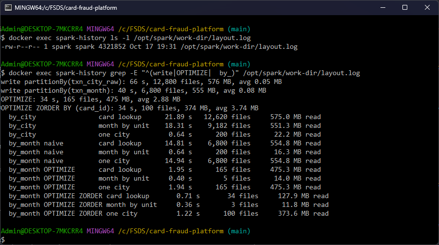
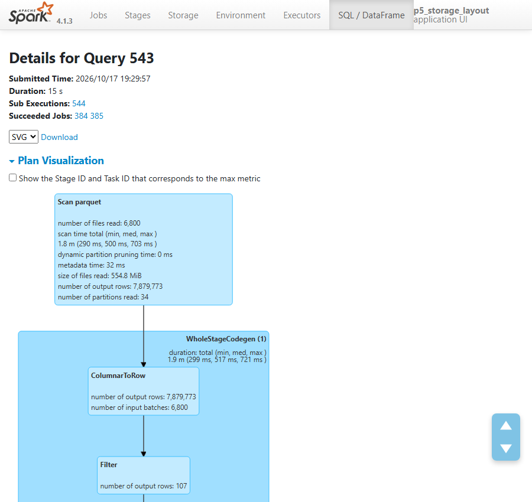
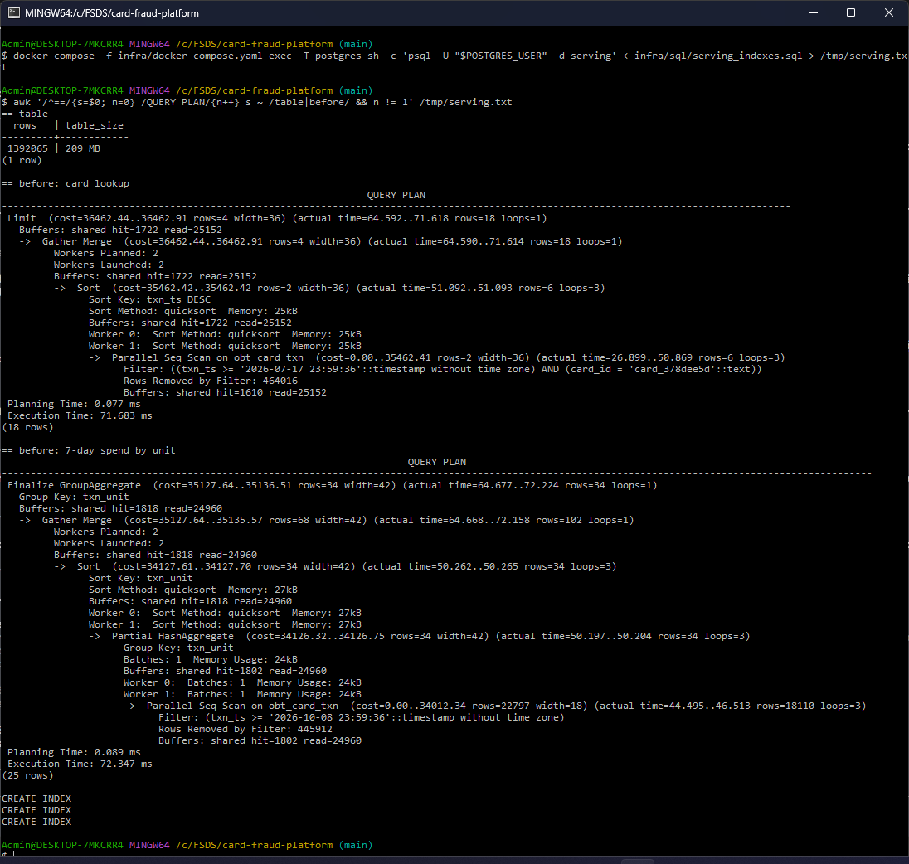
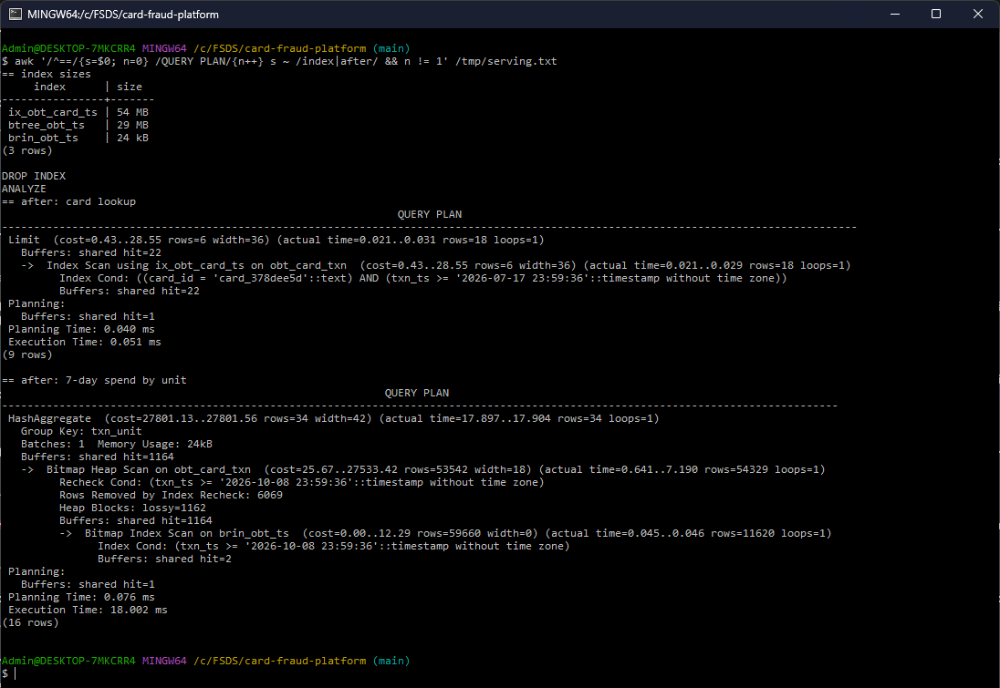

# Storage optimization

The platform has two stores with different readers: Spark and Trino scan the lakehouse (Delta on SeaweedFS), and the
serving database (Postgres) answers small queries from people. The lakehouse is tuned by file layout, Postgres by
indexes.

| | |
|---|---|
| Code | [`pipelines/spark/storage_layout.py`](https://github.com/cvinhnguyen/card-fraud-platform/blob/a593ac7ac74f781dc50824b14e97f2620198be46/pipelines/spark/storage_layout.py), [`pipelines/spark/load_serving.py`](https://github.com/cvinhnguyen/card-fraud-platform/blob/a593ac7ac74f781dc50824b14e97f2620198be46/pipelines/spark/load_serving.py), [`infra/sql/serving_indexes.sql`](https://github.com/cvinhnguyen/card-fraud-platform/blob/a593ac7ac74f781dc50824b14e97f2620198be46/infra/sql/serving_indexes.sql) |
| Runs on | Spark jobs: compose profile `batch` (inside `spark-master`); Postgres: compose service `postgres` (profile `core`), database `serving` |
| Reads | `gold.fact_transaction`, `gold.dim_merchant` |
| Writes | the benchmark tables under `s3a://lakehouse/lab/` (not registered in the metastore); Postgres `serving.mart.obt_card_txn` |
| Related | [spark_optimization.md](spark_optimization.md), [spark_jobs.md](spark_jobs.md), [scale_100g.md](scale_100g.md) |

## Run it

From the repo root. The lakehouse layout benchmark (stop `spark-thrift` first, it holds worker cores):

```bash
docker compose -f infra/docker-compose.yaml stop spark-thrift
docker compose -f infra/docker-compose.yaml exec spark-master /opt/spark/bin/spark-submit /opt/jobs/storage_layout.py
```

The serving database: create it, load the table, then run the indexes script with its `EXPLAIN` before and after:

```bash
docker compose -f infra/docker-compose.yaml exec -T postgres sh -c 'psql -U "$POSTGRES_USER" -d core_banking -c "CREATE DATABASE serving"'
docker compose -f infra/docker-compose.yaml exec -T postgres sh -c 'psql -U "$POSTGRES_USER" -d serving -c "CREATE SCHEMA mart"'
docker compose -f infra/docker-compose.yaml exec spark-master /opt/spark/bin/spark-submit /opt/jobs/load_serving.py
docker compose -f infra/docker-compose.yaml exec -T postgres sh -c 'psql -U "$POSTGRES_USER" -d serving' < infra/sql/serving_indexes.sql
```

## Lakehouse layout

[`pipelines/spark/storage_layout.py`](https://github.com/cvinhnguyen/card-fraud-platform/blob/a593ac7ac74f781dc50824b14e97f2620198be46/pipelines/spark/storage_layout.py)
writes `gold.fact_transaction` (7.9M rows) after a 200-way shuffle (what a job writes after a join or aggregation),
then runs three queries on each layout, each the median of 3 runs after a warm-up. Files and bytes read come from the
scan node of the Spark SQL metrics (REST API,
[`pipelines/spark/storage_layout.py` L34-L46](https://github.com/cvinhnguyen/card-fraud-platform/blob/a593ac7ac74f781dc50824b14e97f2620198be46/pipelines/spark/storage_layout.py#L34-L46)).
Tables go to `s3a://lakehouse/lab/`.

| Layout | Files | Avg file | Write |
|---|---:|---:|---:|
| `partitionBy(txn_city_raw)` | 12,800 | 0.05 MB | 66 s |
| `partitionBy(txn_month)`, naive (version 0) | 6,800 | 0.08 MB | 40 s |
| + `OPTIMIZE` (version 1) | 165 | 2.88 MB | 34 s |
| + `OPTIMIZE ZORDER BY (card_id)` (version 2) | 100 | 3.74 MB | 34 s |

Every task of the 200-way shuffle holds rows of every partition value, so it writes one file per value:
200 tasks × 64 raw city names = 12,800 files, 200 × 34 months = 6,800 files, most of them a few dozen KB.
The two writes, then the two `OPTIMIZE` runs that make versions 1 and 2
([`pipelines/spark/storage_layout.py` L79-L90](https://github.com/cvinhnguyen/card-fraud-platform/blob/a593ac7ac74f781dc50824b14e97f2620198be46/pipelines/spark/storage_layout.py#L79-L90)):

```python
    by_city, by_month = f"{LAB}/fact_by_city", f"{LAB}/fact_by_month"
    for path, col in ((by_city, "txn_city_raw"), (by_month, "txn_month")):
        t0 = time.perf_counter()
        fact.repartition(SHUFFLE).write.format("delta").mode("overwrite").option("overwriteSchema", "true") \
            .partitionBy(col).save(path)
        print(f"write partitionBy({col}): {time.perf_counter() - t0:.0f} s, {detail(spark, path)}")
    for extra in ("", " ZORDER BY (card_id)"):
        t0 = time.perf_counter()
        spark.sql(f"OPTIMIZE delta.`{by_month}`{extra}").collect()
        print(f"OPTIMIZE{extra}: {time.perf_counter() - t0:.0f} s, {detail(spark, by_month)}")
    last = spark.sql(f"DESCRIBE HISTORY delta.`{by_month}`").agg(F.max("version")).first()[0]
    versions = {"naive": last - 2, "OPTIMIZE": last - 1, "OPTIMIZE ZORDER": last}
```

Queries
([`pipelines/spark/storage_layout.py` L72-L77](https://github.com/cvinhnguyen/card-fraud-platform/blob/a593ac7ac74f781dc50824b14e97f2620198be46/pipelines/spark/storage_layout.py#L72-L77)):
all payments of the busiest card (fraud investigation); spend per unit in 2026-06 (reporting); spend in raw city
"Da Nang".

| Layout | Card lookup | Month by unit | One city |
|---|---|---|---|
| by city | 21.9 s, 12,620 files, 575 MB | 18.3 s, 9,182 files, 551 MB | **0.64 s, 200 files, 22 MB** |
| by month, naive | 14.8 s, 6,800 files, 555 MB | 0.64 s, 200 files, 16 MB | 14.9 s, 6,800 files, 555 MB |
| by month, `OPTIMIZE` | 1.95 s, 165 files, 475 MB | 0.40 s, 5 files, 14 MB | 1.94 s, 165 files, 475 MB |
| by month, `OPTIMIZE ZORDER BY (card_id)` | **0.71 s, 34 files, 128 MB** | **0.36 s, 3 files, 12 MB** | 1.22 s, 100 files, 374 MB |

Both tables come from the job's printed output of the run of 2026-10-17, saved as `layout.log` in the Spark work
volume: the four writes and `OPTIMIZE` runs (12,800, 6,800, 165 and 100 files), then the 12 query lines:



The same run in the Spark History Server, app `p5_storage_layout`. Before, the card lookup on the naive month layout
(query 543, 15 s) reads 6,800 files, 554.8 MiB and all 7,879,773 rows of the 34 months to keep 107:



After `ZORDER BY (card_id)`, the same lookup (query 594, 0.7 s) reads 34 files, 127.9 MiB and 2,600,657 rows for the
same 107:


- The number of files costs more than the bytes. The naive month layout reads about as much (555 MB, against 475 MB
  after `OPTIMIZE`) but takes 7.6× longer, because opening 6,800 objects on S3 dominates. `OPTIMIZE` (bin-packing)
  turns them into 165 files and the scans drop from ~15 s to ~2 s.
- Partition by what queries filter on, with low cardinality and even sizes. Partitioning by city wins the city
  query (only its 200 files are read) and loses everything else, and the city with 60% of the rows makes partitions
  very uneven. Month is what reports and the nightly loads filter on, and its partitions are about the same size.
- Z-order suits a high-cardinality column you cannot partition by. `card_id` has 130k values. After
  `ZORDER BY (card_id)` each file holds a narrow `card_id` range, so the min/max statistics in the Delta log skip
  66 of the 100 files: the card shows up in every month, so one file per month remains (34). Sorting also improves
  compression (475 MB to 374 MB), which helps the other queries a little.
- `OPTIMIZE` aims at 1 GB files. At 1 GB of data that is one file per month: a first run with the default gave 34
  files, card lookup 0.60 s, and Z-order skipped nothing (34 files read before and after). The job sets
  `spark.databricks.delta.optimize.maxFileSize` to 4 MB so a month has several files, as it would at 100 GB (about
  3 GB per month)
  ([`pipelines/spark/storage_layout.py` L68-L70](https://github.com/cvinhnguyen/card-fraud-platform/blob/a593ac7ac74f781dc50824b14e97f2620198be46/pipelines/spark/storage_layout.py#L68-L70)).

The gold tables are partitioned by month for the same reason (`fact_transaction` by `txn_month`,
[`pipelines/dbt/models/gold/fact_transaction.sql` L4-L9](https://github.com/cvinhnguyen/card-fraud-platform/blob/a593ac7ac74f781dc50824b14e97f2620198be46/pipelines/dbt/models/gold/fact_transaction.sql#L4-L9);
`label_transaction` by `event_month`,
[`pipelines/spark/build_labels.py` L53](https://github.com/cvinhnguyen/card-fraud-platform/blob/a593ac7ac74f781dc50824b14e97f2620198be46/pipelines/spark/build_labels.py#L53)).

## Serving database (Postgres)

[`pipelines/spark/load_serving.py`](https://github.com/cvinhnguyen/card-fraud-platform/blob/a593ac7ac74f781dc50824b14e97f2620198be46/pipelines/spark/load_serving.py)
fills the serving table, and
[`infra/sql/serving_indexes.sql`](https://github.com/cvinhnguyen/card-fraud-platform/blob/a593ac7ac74f781dc50824b14e97f2620198be46/infra/sql/serving_indexes.sql)
measures its two query patterns, creates the indexes and measures again.

The load copies the last 180 days of `fact_transaction`, joined with the merchant name, into one flat table
`mart.obt_card_txn` (1,392,065 rows, 209 MB), written in `txn_ts` order like a daily append
([`pipelines/spark/load_serving.py` L24-L28](https://github.com/cvinhnguyen/card-fraud-platform/blob/a593ac7ac74f781dc50824b14e97f2620198be46/pipelines/spark/load_serving.py#L24-L28)).
Dashboards and the analyst's screen read it without joins.

| Query pattern | Index | Before | After |
|---|---|---|---|
| One card's payments in the last 90 days, newest first, `LIMIT 50` | B-tree `(card_id, txn_ts DESC)`, 54 MB | Parallel Seq Scan, 26,874 buffers, **78.5 ms** | Index Scan, 22 buffers, **0.053 ms** |
| Spend per unit over the last 7 days | BRIN `(txn_ts)`, 24 kB | Parallel Seq Scan, 26,778 buffers, **68.6 ms** | Bitmap Heap Scan on 1,162 blocks, **17.0 ms** |

Warm cache, second run of each `EXPLAIN (ANALYZE, BUFFERS)`
([`infra/sql/serving_indexes.sql` L17-L26](https://github.com/cvinhnguyen/card-fraud-platform/blob/a593ac7ac74f781dc50824b14e97f2620198be46/infra/sql/serving_indexes.sql#L17-L26)
for the "before" runs). The script then creates the two indexes, plus a plain B-tree on `txn_ts` that exists only
to compare sizes
([`infra/sql/serving_indexes.sql` L28-L34](https://github.com/cvinhnguyen/card-fraud-platform/blob/a593ac7ac74f781dc50824b14e97f2620198be46/infra/sql/serving_indexes.sql#L28-L34)):

```sql
CREATE INDEX ix_obt_card_ts ON mart.obt_card_txn (card_id, txn_ts DESC);
CREATE INDEX brin_obt_ts ON mart.obt_card_txn USING brin (txn_ts);
CREATE INDEX btree_obt_ts ON mart.obt_card_txn (txn_ts);   -- only to compare sizes, dropped below
\echo '== index sizes'
SELECT relname AS index, pg_size_pretty(pg_relation_size(oid)) AS size FROM pg_class
WHERE relname IN ('ix_obt_card_ts', 'brin_obt_ts', 'btree_obt_ts') ORDER BY pg_relation_size(oid) DESC;
DROP INDEX mart.btree_obt_ts;
```

- The composite B-tree matches the whole predicate and the sort: equality on `card_id`, then `txn_ts` already in
  descending order, so Postgres reads 18 rows and stops, with no sort.
- BRIN stores only the min/max `txn_ts` of each block range. That works because the table is loaded in time order, so
  a 7-day range covers few block ranges. It is 24 kB where a B-tree on `txn_ts` is 29 MB. The 6,069 rows removed by
  recheck are the price of the coarse ranges. If rows were inserted in random order, BRIN would match every range.

A re-run of the script on 2026-10-25 gives the same plans and the same buffer counts, with timings a few ms apart.
The output went to a file, and `awk` prints the second (warm cache) plan of each query. Before the indexes: Parallel
Seq Scan, 1,722 + 25,152 = 26,874 buffers and 71.7 ms for the card, 26,778 buffers and 72.3 ms for the 7-day spend:



After: index sizes 54 MB, 29 MB and 24 kB; Index Scan on `ix_obt_card_ts` with 22 buffers and 0.051 ms; Bitmap Heap
Scan through `brin_obt_ts` on 1,162 lossy blocks, 6,069 rows removed by recheck, 18.0 ms:



Trino has no indexes on Delta. On the lakehouse side the same idea is partition pruning and the min/max statistics
that Z-order makes selective.

## Limits

- The serving table shares the Postgres instance with `core_banking` to save RAM on a laptop; a real setup gives it its
  own server.
