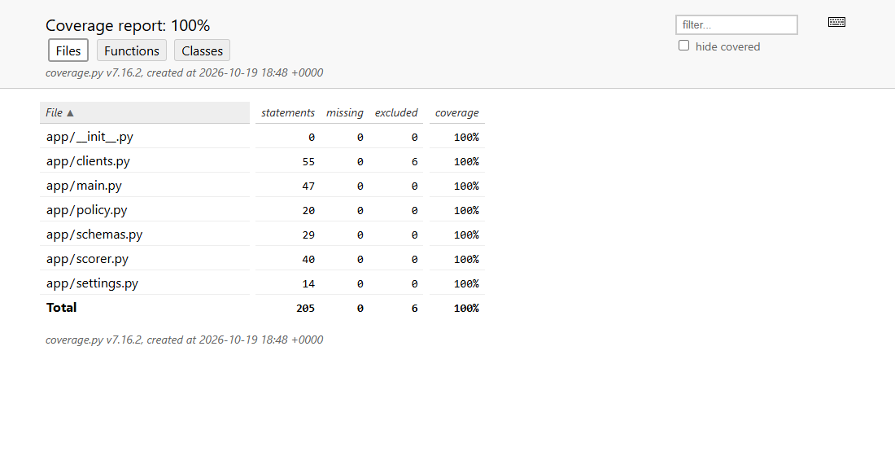
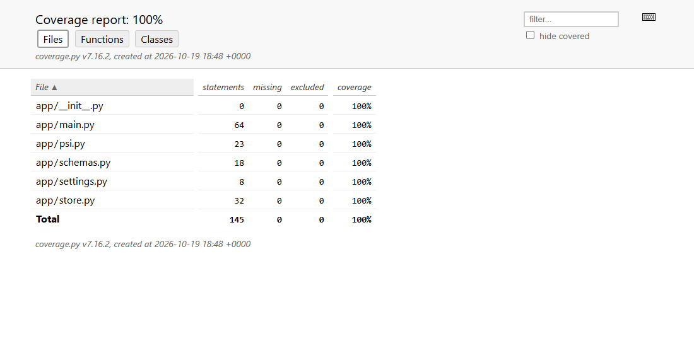
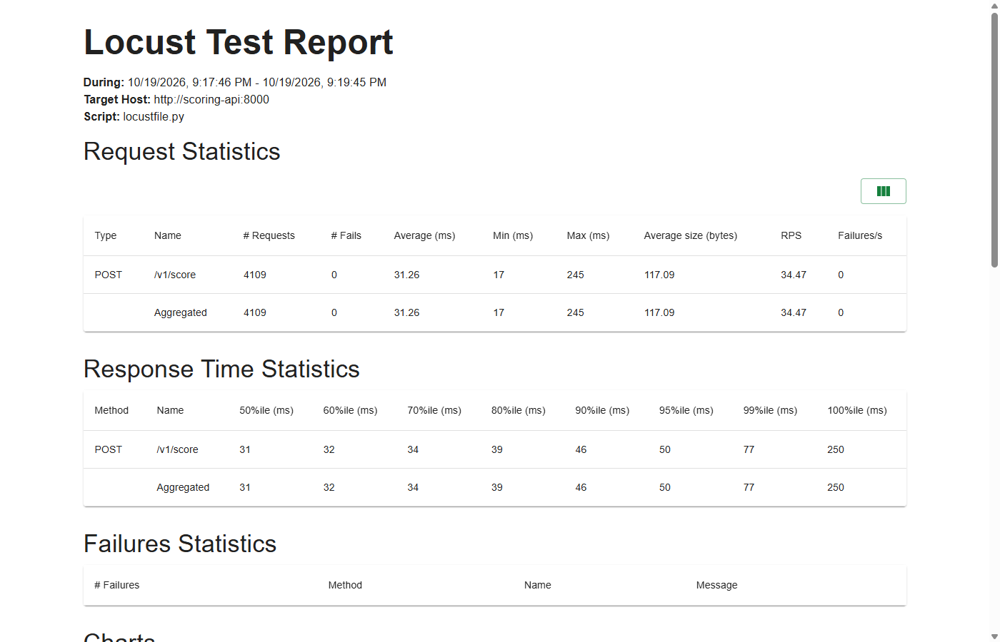
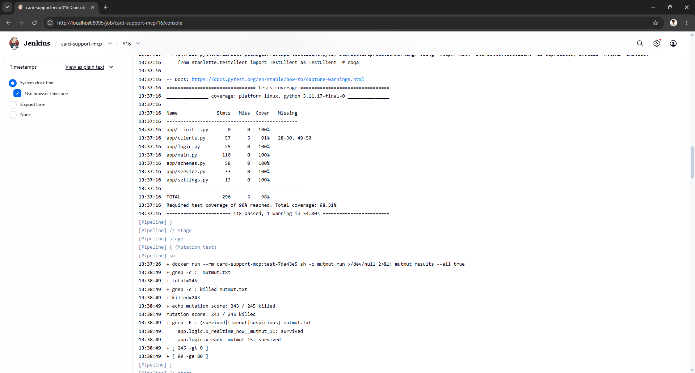
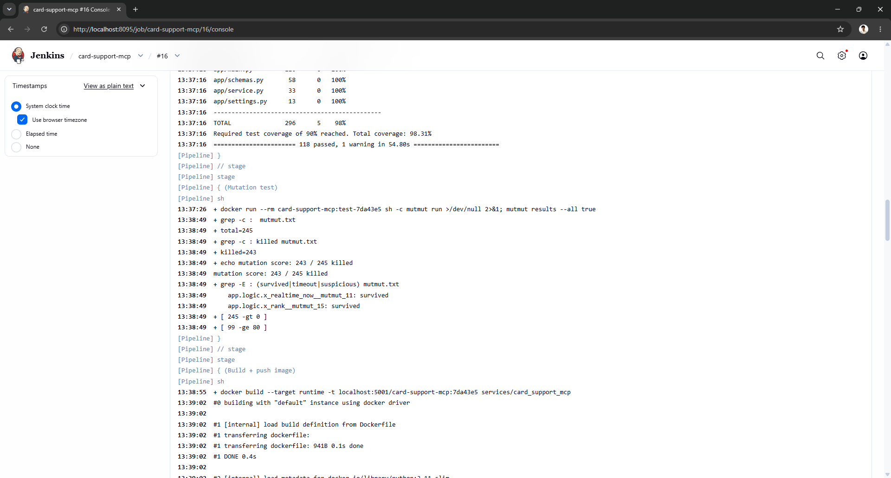
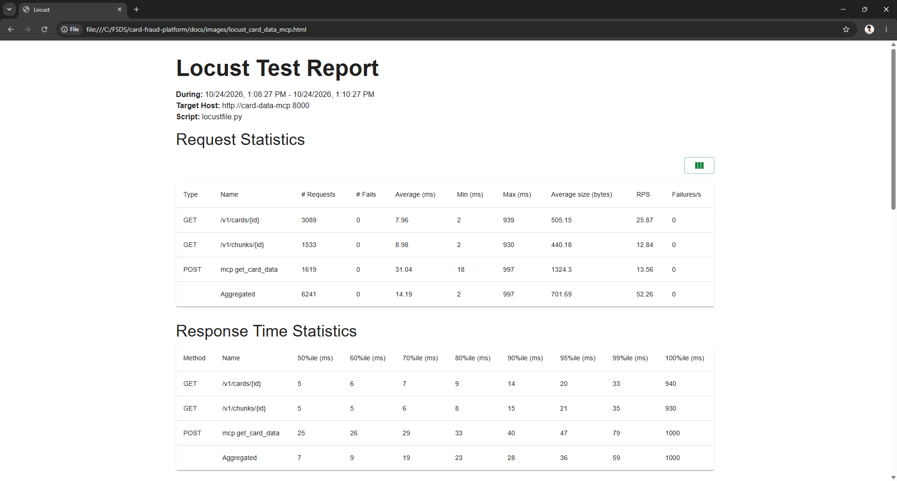

# Tests

The tests of the platform's services: Layer 2's two APIs (Scoring API, Drift API) first, then Layer 3's three MCP
servers ([below](#layer-3-the-card-support-mcp-servers)). Each code base runs its tests in the `test` stage of its
own Docker image, so the tests run against the exact dependency pins of the image, behind a coverage gate of 90%.
Besides example tests they use fakes, equivalence partitioning and boundary values, property-based tests, mutation
testing and a locust load test.

| | |
|---|---|
| Code | [`services/scoring_api/tests/`](https://github.com/cvinhnguyen/card-fraud-platform/tree/1416656ca28dbf52a0663508c5f0a81fb869faed/services/scoring_api/tests), [`services/drift_api/tests/`](https://github.com/cvinhnguyen/card-fraud-platform/tree/1416656ca28dbf52a0663508c5f0a81fb869faed/services/drift_api/tests), [`services/card_support_mcp/tests/`](https://github.com/cvinhnguyen/card-fraud-platform/tree/1416656ca28dbf52a0663508c5f0a81fb869faed/services/card_support_mcp/tests) |
| Runs on | the `test` stage of each service's image; Jenkins job `card-support-mcp` for the MCP servers; load tests: a locust container on the compose network (Scoring API), a locust pod in kind namespace `card-support` (card-data) |
| Related | [serving.md](serving.md), [drift.md](drift.md), [agents.md](agents.md), [cicd.md](cicd.md) |

## Run it

From the repo root; each code base runs its tests in the `test` stage of its own image:

```bash
# Layer 2: pytest + coverage gate (pytest.ini) in the image's test stage
docker build --target test -t fraud/scoring-api:test services/scoring_api
docker run --rm fraud/scoring-api:test
docker build --target test -t fraud/drift-api:test services/drift_api
docker run --rm fraud/drift-api:test
# Layer 2: mutation test (shown for the Drift API)
docker run --rm -w /app fraud/drift-api:test sh -c "mutmut run --max-children 2 && mutmut results"
# Layer 3: the card support MCP servers
docker build --target test -t card-support-mcp:test services/card_support_mcp
docker run --rm card-support-mcp:test                      # pytest + coverage gate (pytest.ini)
docker run --rm card-support-mcp:test sh -c "mutmut run >/dev/null 2>&1; mutmut results --all true"
```

## Layer 2: the Scoring API and the Drift API

Both Layer 2 services test in the `test` stage of their image
([`services/scoring_api/Dockerfile` L7-L14](https://github.com/cvinhnguyen/card-fraud-platform/blob/1416656ca28dbf52a0663508c5f0a81fb869faed/services/scoring_api/Dockerfile#L7-L14)):
the stage adds the dev requirements to the image's own dependencies, and its command is `pytest`, so the tests run
when the test image runs. Coverage gate:
`--cov-fail-under=90` in `pytest.ini`
([`services/scoring_api/pytest.ini` L4](https://github.com/cvinhnguyen/card-fraud-platform/blob/1416656ca28dbf52a0663508c5f0a81fb869faed/services/scoring_api/pytest.ini#L4),
the same line in the Drift API).

| Service | Tests | Coverage |
|---|---:|---:|
| Scoring API | 95 | 100% |
| Drift API | 52 | 100% |

The Scoring API's coverage report, 100% of 205 statements:



The Drift API's coverage report, 100% of 145 statements:



### Fakes over mocks

The scorer gets fake feature / model / log objects
([`services/scoring_api/tests/conftest.py` L17-L72](https://github.com/cvinhnguyen/card-fraud-platform/blob/1416656ca28dbf52a0663508c5f0a81fb869faed/services/scoring_api/tests/conftest.py#L17-L72))
that implement the same small interfaces as the real clients and can be told to fail or hang. The real clients are
tested against recorded HTTP (respx) and a patched Kafka producer
([`services/scoring_api/tests/test_clients.py`](https://github.com/cvinhnguyen/card-fraud-platform/blob/1416656ca28dbf52a0663508c5f0a81fb869faed/services/scoring_api/tests/test_clients.py)).
No test needs Redis, KServe or Kafka. The price of fakes is a bug that only a real client triggers: the first live
run found one ([Gotchas](#gotchas)).

### Equivalence partitioning and boundary values

With `pytest.mark.parametrize` in
[`services/scoring_api/tests/test_policy.py`](https://github.com/cvinhnguyen/card-fraud-platform/blob/1416656ca28dbf52a0663508c5f0a81fb869faed/services/scoring_api/tests/test_policy.py),
[`services/scoring_api/tests/test_schemas.py`](https://github.com/cvinhnguyen/card-fraud-platform/blob/1416656ca28dbf52a0663508c5f0a81fb869faed/services/scoring_api/tests/test_schemas.py)
and the Drift API's
[`services/drift_api/tests/test_api.py`](https://github.com/cvinhnguyen/card-fraud-platform/blob/1416656ca28dbf52a0663508c5f0a81fb869faed/services/drift_api/tests/test_api.py)
and [`services/drift_api/tests/test_psi.py`](https://github.com/cvinhnguyen/card-fraud-platform/blob/1416656ca28dbf52a0663508c5f0a81fb869faed/services/drift_api/tests/test_psi.py):

| Input | Partitions / boundaries tested |
|---|---|
| score vs thresholds | 0 and 1, inside each partition, just below / at / just above `t_low` and `t_high` |
| threshold config | `t_low > t_high`, < 0, > 1 rejected; `(0,0)`, `(0,1)`, `(1,1)`, equal thresholds accepted |
| amount (fallback) | 1, inside, just below / at / above 2,000,000 VND, the largest valid amount |
| request schema | amount -1 / 0 / 1 / 10 bn / 10 bn + 1, currency `VND` / `USD` / lower case / 2 or 4 letters, channel valid / unknown / empty, id lengths 0 / 1 / 64 / 65, device absent / 64 / 65 |
| drift batch | 0 / 1 / 1,000 / 1,001 events; score -0.01 / 0 / 1 / 1.01 |
| PSI level | 0.1 and 0.25 exactly and either side |

### Property-based tests (hypothesis)

Rules that must hold for *any* input, with hypothesis generating the cases
([`services/scoring_api/tests/test_properties.py` L30-L54](https://github.com/cvinhnguyen/card-fraud-platform/blob/1416656ca28dbf52a0663508c5f0a81fb869faed/services/scoring_api/tests/test_properties.py#L30-L54)
for the Scoring API,
[`services/drift_api/tests/test_api.py` L88-L96](https://github.com/cvinhnguyen/card-fraud-platform/blob/1416656ca28dbf52a0663508c5f0a81fb869faed/services/drift_api/tests/test_api.py#L88-L96)
for the drift report):

- idempotency: scoring the same request twice gives the same response; the drift report over the same data is the
  same twice;
- monotonicity: a higher score never gives a milder decision, for any pair of thresholds;
- totality: every request gets a decision, whichever dependency fails.

### Mutation testing (mutmut 3.8)

Mutation runs cover the code changed in this phase only (`setup.cfg`,
[`services/scoring_api/setup.cfg`](https://github.com/cvinhnguyen/card-fraud-platform/blob/1416656ca28dbf52a0663508c5f0a81fb869faed/services/scoring_api/setup.cfg)
and [`services/drift_api/setup.cfg`](https://github.com/cvinhnguyen/card-fraud-platform/blob/1416656ca28dbf52a0663508c5f0a81fb869faed/services/drift_api/setup.cfg)):
`policy.py`, `scorer.py` of the Scoring API, `psi.py`, `store.py` of the Drift API. mutmut flips operators and
constants (`>=` to `>`, `0.25` to `1.25`, ...) and reruns the tests; a mutant that survives is a line no test really
checks. The commands are in [Run it](#run-it).

| Service | First run | Survivors | After |
|---|---|---|---|
| Drift API | 104 / 116 killed | 13 | **106 / 106** |
| Scoring API | 88 / 108 killed | 20 | **106 / 106** |

What the survivors were:

- Real gaps, with tests added. PSI had no exact-value test: `|` to `&` over the bins, `+=` to `=`, and the defaults
  for a bin missing on one side all survived (now three exact cases, one of them the docs example 0.416). A
  fallback event *followed by* a counted one (`continue` to `break`), TTL set on a key other than the bucket, bucket
  names (`// 61`), the request passed to the feature store, stage latency labels and values, the fallback log line,
  and the prediction log's timestamps (python mode writes `2026-10-16 09:30:00`, which is not ISO).
- Dead code, deleted: `b.decode() if isinstance(b, bytes) else b`. redis-py without `decode_responses` always
  returns bytes, so the other branch could never run.
- Equivalent mutants, marked `# pragma: no mutate`: `pipeline(transaction=False)` to `True` / `None` (MULTI or not,
  the same counts) and the response half of the prediction log record (every field is JSON-native in either dump
  mode). `int(clock // 60)` to `int(clock / 60)` was equivalent too; `int(clock) // 60` makes that mutant produce a
  float bucket name, which the bucket-name test catches.

### Load test (locust)

[`services/scoring_api/locustfile.py`](https://github.com/cvinhnguyen/card-fraud-platform/blob/1416656ca28dbf52a0663508c5f0a81fb869faed/services/scoring_api/locustfile.py)
plays the authorization switch with real card ids so Redis lookups hit; the report is in
`docs/images/locust_report.html`.

Run 2026-10-19 (locust 2.31.8 in a container on the compose network, 5,000 real card ids from the live period;
fallbacks counted from the API's `fraud_decisions_total{fallback="true"}` before and after each run):

```bash
docker run --rm --network fraud_default -e CARDS_FILE=/w/cards.txt -v <repo>/services/scoring_api/locustfile.py:/w/locustfile.py \
    -v <cards.txt>:/w/cards.txt -v <repo>/docs/images:/out locustio/locust:2.31.8 -f /w/locustfile.py \
    --host http://scoring-api:8000 --headless -u 3 -r 3 -t 2m --html /out/locust_report.html
```

Replace `<repo>` with the absolute path of the repo and `<cards.txt>` with a file of card ids, one per line.

| Run | Users | Requests | Throughput | p50 / p95 / p99 | HTTP failures | Fallback decisions |
|---|---:|---:|---:|---:|---:|---:|
| SLA ([report](images/locust_report.html)) | 3 | 4,109 | 34.5 req/s | 31 / 50 / **77 ms** | 0 | 9 (0.2%) |
| Overload ([report](images/locust_overload.html)) | 20 | 3,463 | 58.0 req/s | 290 / 410 / 490 ms | 0 | 641 (18%) |

- Within one worker's capacity (~45 req/s, see [serving.md](serving.md)) the API meets the design's p99 < 100 ms.
- Overloaded, it never answers with an error: requests past their 200 ms budget get the fallback rule, as designed.
  More throughput is more replicas (KEDA on requests per second, Module 2), not a longer budget.
- Right after the overload, 100 serial requests: 21 ms median, 0% fallback. Before the `asyncio.shield` fix
  ([serving.md](serving.md#capacity-and-a-bug-the-first-load-found)) the API stayed at 100% fallback after a burst
  until it was restarted.

The SLA run's locust report shows 4,109 requests, 0 failures, 34.5 req/s, p50 31 ms and p99 77 ms:



## Layer 3: the card support MCP servers

[`services/card_support_mcp/`](https://github.com/cvinhnguyen/card-fraud-platform/tree/1416656ca28dbf52a0663508c5f0a81fb869faed/services/card_support_mcp)
is one code base that runs as the three MCP servers the agents call
([agents.md](agents.md#the-three-mcp-servers)): card-data (the Web API that pulls a card's data from the online
feature store by `card_id` and a policy chunk by `chunk_id`), fraud-score (the fraud model's verdict on a payment)
and policy-rag (the policy search). The tests build each server with fakes of its adapters. They run in the image's
`test` stage, and Jenkins runs them, the coverage gate and the mutation test on every change to the service
([cicd.md](cicd.md#mcp-servers)). The commands are in [Run it](#run-it).

| Service | Tests | Coverage |
|---|---:|---:|
| Card support MCP servers (one code base) | 118 | 98.31% |

Stage "Unit tests + coverage gate"
([`services/card_support_mcp/Jenkinsfile` L31-L37](https://github.com/cvinhnguyen/card-fraud-platform/blob/1416656ca28dbf52a0663508c5f0a81fb869faed/services/card_support_mcp/Jenkinsfile#L31-L37))
of Jenkins build #16 of `card-support-mcp` (2026-10-24, commit `7da43e5`) shows 118 tests passed and a total
coverage of 98.31% against the 90% gate:



The lines left uncovered are the constructors that open the real Feast repos, lines 28-30 and 49-50 of `clients.py`
([`services/card_support_mcp/app/clients.py` L28-L30](https://github.com/cvinhnguyen/card-fraud-platform/blob/1416656ca28dbf52a0663508c5f0a81fb869faed/services/card_support_mcp/app/clients.py#L28-L30),
[`services/card_support_mcp/app/clients.py` L49-L50](https://github.com/cvinhnguyen/card-fraud-platform/blob/1416656ca28dbf52a0663508c5f0a81fb869faed/services/card_support_mcp/app/clients.py#L49-L50)).
They need the registry database and the online stores, so the pipeline's smoke test exercises them on the deployed
releases instead.

### Fixtures and mocks

[`services/card_support_mcp/tests/conftest.py`](https://github.com/cvinhnguyen/card-fraud-platform/blob/1416656ca28dbf52a0663508c5f0a81fb869faed/services/card_support_mcp/tests/conftest.py)
has fakes of the four adapters (feature store, knowledge base, embedder, Scoring API), each with the `ready()` its
server's `/readyz` calls, and each can be told to fail. The `service` fixture wires the service with them at a fixed
clock. `make_client` builds the real FastAPI app of one server (REST and MCP) on any service, with its own
Prometheus registry so tests never share counters. On top of these,
[`services/card_support_mcp/tests/test_api.py`](https://github.com/cvinhnguyen/card-fraud-platform/blob/1416656ca28dbf52a0663508c5f0a81fb869faed/services/card_support_mcp/tests/test_api.py)
checks:

- each server lists only its own tools over MCP and has no REST route of the others (404);
- the status codes (200, 404 for an unknown id, 422 for a malformed one, 503 when a dependency fails);
- `/healthz` never checks a dependency, and `/readyz` fails only for a dependency of that server (a broken Feast store
  does not make fraud-score unready);
- the tool-call metrics, the MCP calls, and bad arguments or a failing dependency coming back as MCP tool errors;
- `build_service` builds only the adapters a server's tools use (fraud-score builds no Feast reader).

The real adapters are tested in
[`services/card_support_mcp/tests/test_clients.py`](https://github.com/cvinhnguyen/card-fraud-platform/blob/1416656ca28dbf52a0663508c5f0a81fb869faed/services/card_support_mcp/tests/test_clients.py)
against respx mocks of the HTTP services (the embedder must send the query instruction and the API key, a 500 must
raise, the Scoring API's health is its `/healthz`) and against a stand-in Feast store.

### Equivalence partitioning and boundary values

`pytest.mark.parametrize` tables in
[`services/card_support_mcp/tests/test_logic.py`](https://github.com/cvinhnguyen/card-fraud-platform/blob/1416656ca28dbf52a0663508c5f0a81fb869faed/services/card_support_mcp/tests/test_logic.py)
(the tool rules) and
[`services/card_support_mcp/tests/test_schemas.py`](https://github.com/cvinhnguyen/card-fraud-platform/blob/1416656ca28dbf52a0663508c5f0a81fb869faed/services/card_support_mcp/tests/test_schemas.py)
(what pydantic lets through to the stores):

| Input | Partitions / boundaries tested |
|---|---|
| age of the last real-time count | no timestamp; 0, 90 s; 600 / 601 s (10-minute window); 3600 / 3601 s (1-hour window); -120 s (replayed data ahead of the clock counts as age 0) |
| `rank` k | 0 and -1 rejected; 1, 2, 3 and 4 with 3 candidates (above the candidate count it returns all of them) |
| cosine | same direction, orthogonal, opposite, zero vector, different lengths; equal scores ordered by id |
| `amount_vnd` | -1 and 0 rejected; 1 and 10,000,000,000 accepted; 10,000,000,001 rejected |
| currency, channel | `USD` accepted; `usd`, `US`, `USDT` rejected; `pos`, `atm` accepted, `wire` rejected |
| `card_id` | empty rejected, 64 characters accepted, 65 rejected, `card 1; drop` rejected |
| search question, k | length 2 rejected, 3 and 500 accepted, 501 rejected; k 0 rejected, 1 and 10 accepted, 11 rejected |
| `chunk_id` | `card_terms#4.2`, `faq#3`, `fee_schedule#10` accepted; no `#`, upper case, empty or three-level section, 41-character document name rejected |

### Property-based tests (hypothesis + crosshair)

[`services/card_support_mcp/tests/test_properties.py`](https://github.com/cvinhnguyen/card-fraud-platform/blob/1416656ca28dbf52a0663508c5f0a81fb869faed/services/card_support_mcp/tests/test_properties.py)
states rules for any input:

- idempotency: ranking the same candidates twice gives the same answer, so an agent that asks again gets the same
  chunks;
- ranking does not depend on the order the candidates arrive in (the order Feast returns is not trusted);
- the ranking is best first, never longer than k, with scores within [-1, 1];
- a real-time count is either the stored value or 0, for any age up to a day either side of now.

One more rule, that a younger timestamp is never less fresh than an older one, runs on hypothesis's crosshair backend
(`@settings(backend="crosshair")`, package `hypothesis-crosshair`,
[`services/card_support_mcp/tests/test_properties.py` L52-L54](https://github.com/cvinhnguyen/card-fraud-platform/blob/1416656ca28dbf52a0663508c5f0a81fb869faed/services/card_support_mcp/tests/test_properties.py#L52-L54)).
Crosshair executes `realtime_now` symbolically and uses a solver to reach its branches, so the window edges at 600
and 3,600 seconds get tested on purpose.

### Mutation testing (mutmut 3.8)

The Jenkins stage "Mutation test"
([`services/card_support_mcp/Jenkinsfile` L38-L48](https://github.com/cvinhnguyen/card-fraud-platform/blob/1416656ca28dbf52a0663508c5f0a81fb869faed/services/card_support_mcp/Jenkinsfile#L38-L48))
runs mutmut after the unit tests and fails the build below 80% killed. The stage only runs when a commit changed the
service (`changeset 'services/card_support_mcp/**'`) or someone starts it by hand, and
[`services/card_support_mcp/setup.cfg`](https://github.com/cvinhnguyen/card-fraud-platform/blob/1416656ca28dbf52a0663508c5f0a81fb869faed/services/card_support_mcp/setup.cfg)
limits mutation to the two modules that hold the tool rules, `app/logic.py` and `app/service.py`. `main.py`,
`clients.py`, `schemas.py` and `settings.py` are wiring and declarations, listed under `do_not_mutate`. The command
is in [Run it](#run-it).

243 of 245 mutants are killed (99.2%). The two survivors, one in `realtime_now` and one in `rank`, were read by hand
and are equivalent mutants: neither changes anything the tools return. Stage "Mutation test" of the same build shows
the score of 243 / 245 killed, the two survivors and the 80% check:



### Load test (locust)

The rubric's load test is on the Web API that pulls data: the card-data server.
[`services/card_support_mcp/locustfile.py`](https://github.com/cvinhnguyen/card-fraud-platform/blob/1416656ca28dbf52a0663508c5f0a81fb869faed/services/card_support_mcp/locustfile.py)
plays an agent working a chat: card lookups and chunk reads over REST, plus the same card lookup over MCP
(`tools/call get_card_data`), so the cost of the MCP layer shows next to the REST call. Run 2026-10-24 inside the
cluster (a locust pod in `card-support`, so the network policy lets it in) against the Service
`http://card-data-mcp:8000`, 10 users for 2 minutes, 5,000 card ids from the live period so every lookup hits Redis.
Report: [`locust_card_data_mcp.html`](images/locust_card_data_mcp.html).

| Request | Requests | Median | p95 | p99 |
|---|---:|---:|---:|---:|
| `GET /v1/cards/{id}` | 3,089 | 5 ms | 20 ms | 33 ms |
| `GET /v1/chunks/{id}` | 1,533 | 5 ms | 21 ms | 35 ms |
| MCP `get_card_data` | 1,619 | 25 ms | 47 ms | 79 ms |
| All | 6,241 | 7 ms | 36 ms | 59 ms |

That is 52.3 requests per second with 0 failures. The same card lookup takes 25 ms at the median over MCP and 5 ms
over REST, so the JSON-RPC layer adds about 20 ms. The locust report in Chrome shows 6,241 requests, 0 failures,
52.26 requests per second and the response time percentiles:



The agents were load-tested the same way, one customer chat per A2A `message/send` to the coordinator through the
gateway
([`agents/locustfile.py`](https://github.com/cvinhnguyen/card-fraud-platform/blob/1416656ca28dbf52a0663508c5f0a81fb869faed/agents/locustfile.py)):
6 users for 4 min 51 s gave 37 conversations, 0 failures, 34 s median and 85 s p95
([`locust_agents_a2a.html`](images/locust_agents_a2a.html)). The KEDA scaling run, 6 users for 3 min 41 s with 31
conversations and 0 failures, is in [`locust_agents_scaling.html`](images/locust_agents_scaling.html). A conversation
takes tens of seconds because the coordinator waits for the sub-agents, and each of them makes its own LLM calls, all
on one GPU.

## Gotchas

- The first live run of the Scoring API found a bug no test could see, the price of fakes. `import feast` (only the
  real `FeatureClient` does it) sets `PROMETHEUS_MULTIPROC_DIR` in the process, and `Instrumentator.expose()` then
  served an empty multiprocess directory: `/metrics` answered 200 with no body. The endpoint now renders the app's
  registry itself
  ([`services/scoring_api/app/main.py` L50-L54](https://github.com/cvinhnguyen/card-fraud-platform/blob/1416656ca28dbf52a0663508c5f0a81fb869faed/services/scoring_api/app/main.py#L50-L54)),
  and `test_metrics_survive_feast_multiprocess_env`
  ([`services/scoring_api/tests/test_api.py` L53-L57](https://github.com/cvinhnguyen/card-fraud-platform/blob/1416656ca28dbf52a0663508c5f0a81fb869faed/services/scoring_api/tests/test_api.py#L53-L57))
  sets that variable to pin the behaviour.
- mutmut 3 runs the tests on a copy of the code with every function behind a trampoline, and the coverage gate of
  `pytest.ini` failed that run. So `setup.cfg` empties `addopts` for it (and uses the 3.x key names; the 2.x
  `paths_to_mutate` is deprecated), here in
  [`services/scoring_api/setup.cfg` L12-L15](https://github.com/cvinhnguyen/card-fraud-platform/blob/1416656ca28dbf52a0663508c5f0a81fb869faed/services/scoring_api/setup.cfg#L12-L15):

```ini
# the coverage gate belongs to the normal run: mutmut runs a trampolined copy of the code
pytest_add_cli_args =
    -o
    addopts=
```
