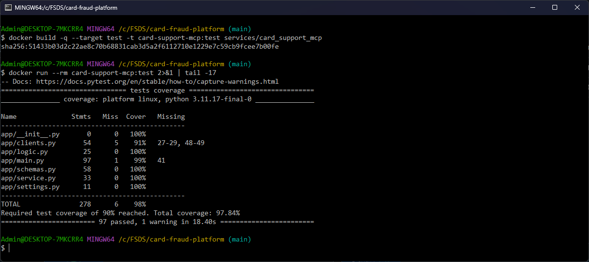
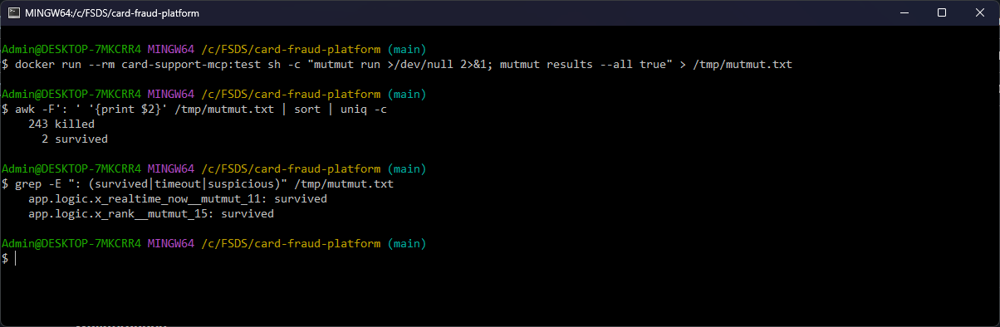

# Tests

Layer 2's two APIs (Scoring API, Drift API) first, then Layer 3's MCP server
([below](#layer-3-the-card-support-mcp-server)). Both Layer 2 services test in their own Docker build stage
(`docker build --target test services/scoring_api`), so the tests run against the exact dependency pins of the image. Coverage gate: `--cov-fail-under=90` in `pytest.ini`.

| Service | Tests | Coverage |
|---|---:|---:|
| Scoring API | 95 | 100% |
| Drift API | 52 | 100% |


## What each technique catches

### Fakes over mocks

The scorer gets fake feature / model / log objects (`tests/conftest.py`) that implement the
same small interfaces as the real clients and can be told to fail or hang. The real clients are tested against
recorded HTTP (respx) and a patched Kafka producer. No test needs Redis, KServe or Kafka.

The price of fakes: the first live run found a bug no test could see. `import feast` (only the real
`FeatureClient` does it) sets `PROMETHEUS_MULTIPROC_DIR` in the process, and `Instrumentator.expose()` then served
an empty multiprocess directory: `/metrics` answered 200 with no body. The endpoint now renders the app's registry
itself, and `test_metrics_survive_feast_multiprocess_env` sets that variable to pin the behaviour.

### Equivalence partitioning and boundary values

With `pytest.mark.parametrize`:

| Input | Partitions / boundaries tested |
|---|---|
| score vs thresholds | 0 and 1, inside each partition, just below / at / just above `t_low` and `t_high` |
| threshold config | `t_low > t_high`, < 0, > 1 rejected; `(0,0)`, `(0,1)`, `(1,1)`, equal thresholds accepted |
| amount (fallback) | 1, inside, just below / at / above 2,000,000 VND, the largest valid amount |
| request schema | amount -1 / 0 / 1 / 10 bn / 10 bn + 1, currency `VND` / `USD` / lower case / 2 or 4 letters, channel valid / unknown / empty, id lengths 0 / 1 / 64 / 65, device absent / 64 / 65 |
| drift batch | 0 / 1 / 1,000 / 1,001 events; score -0.01 / 0 / 1 / 1.01 |
| PSI level | 0.1 and 0.25 exactly and either side |

### Property-based tests (hypothesis)

Rules that must hold for *any* input, with hypothesis generating the cases:

- idempotency: scoring the same request twice gives the same response; the drift report over the same data is the
  same twice;
- monotonicity: a higher score never gives a milder decision, for any pair of thresholds;
- totality: every request gets a decision, whichever dependency fails.

### Mutation testing (mutmut 3.8)

Mutation runs cover the code changed in this phase only (`setup.cfg`): `policy.py`, `scorer.py` of the
Scoring API, `psi.py`, `store.py` of the Drift API. mutmut flips operators and constants (`>=` -> `>`, `0.25` ->
`1.25`, ...) and reruns the tests; a mutant that survives is a line no test really checks.

```bash
docker build --target test -t fraud/drift-api:test services/drift_api
docker run --rm -w /app fraud/drift-api:test sh -c "mutmut run --max-children 2 && mutmut results"
```

| Service | First run | Survivors | After |
|---|---|---|---|
| Drift API | 104 / 116 killed | 13 | **106 / 106** |
| Scoring API | 88 / 108 killed | 20 | **106 / 106** |

mutmut 3 runs the tests on a copy of the code with every function behind a trampoline: the coverage gate of
`pytest.ini` failed that run, so `setup.cfg` empties `addopts` for it (and uses the 3.x key names, the 2.x
`paths_to_mutate` is deprecated). What the survivors were:

- Real gaps, with tests added: PSI had no exact-value test: `|` -> `&` over the bins, `+=` -> `=`, and the defaults
  for a bin missing on one side all survived (now three exact cases, one of them the docs example 0.416). A
  fallback event *followed by* a counted one (`continue` -> `break`), TTL set on a key other than the bucket, bucket
  names (`// 61`), the request passed to the feature store, stage latency labels and values, the fallback log line,
  and the prediction log's timestamps (python mode writes `2026-10-16 09:30:00`, not ISO).
- Dead code, deleted: `b.decode() if isinstance(b, bytes) else b`: redis-py without `decode_responses` always
  returns bytes, so the other branch could never run.
- Equivalent mutants, marked `# pragma: no mutate`: `pipeline(transaction=False)` -> `True` / `None` (MULTI or not, the
  same counts) and the response half of the prediction log record (every field is JSON-native in either dump mode).
  `int(clock // 60)` -> `int(clock / 60)` was equivalent too; `int(clock) // 60` makes that mutant produce a float
  bucket name, which the bucket-name test catches.

### Load test (locust)

`services/scoring_api/locustfile.py`, real card ids so Redis lookups hit, report in `docs/images/locust_report.html`.

Run 2026-10-19 (locust 2.31.8 in a container on the compose network, 5,000 real card ids from the live period;
fallbacks counted from the API's `fraud_decisions_total{fallback="true"}` before and after each run):

```bash
docker run --rm --network fraud_default -e CARDS_FILE=/w/cards.txt -v <repo>/services/scoring_api/locustfile.py:/w/locustfile.py \
    -v <cards.txt>:/w/cards.txt -v <repo>/docs/images:/out locustio/locust:2.31.8 -f /w/locustfile.py \
    --host http://scoring-api:8000 --headless -u 3 -r 3 -t 2m --html /out/locust_report.html
```

| Run | Users | Requests | Throughput | p50 / p95 / p99 | HTTP failures | Fallback decisions |
|---|---:|---:|---:|---:|---:|---:|
| SLA ([report](images/locust_report.html)) | 3 | 4,109 | 34.5 req/s | 31 / 50 / **77 ms** | 0 | 9 (0.2%) |
| Overload ([report](images/locust_overload.html)) | 20 | 3,463 | 58.0 req/s | 290 / 410 / 490 ms | 0 | 641 (18%) |


- Within one worker's capacity (~45 req/s, see [serving.md](serving.md)) the API meets the design's p99 < 100 ms.
- Overloaded, it never answers with an error: requests past their 200 ms budget get the fallback rule, as designed.
  More throughput is more replicas (KEDA on requests per second, Module 2), not a longer budget.
- Right after the overload, 100 serial requests: 21 ms median, 0% fallback. Before the `asyncio.shield` fix the
  API stayed at 100% fallback after a burst until it was restarted.

```bash
docker build --target test services/scoring_api          # pytest + coverage gate
docker build --target test services/drift_api
```

## Layer 3: the card support MCP server

`services/card_support_mcp` is the Web API the agents call: card data from the online feature store by `card_id`,
policy chunks from the RAG knowledge base by `chunk_id`, a policy search and a payment score, served as REST and as
MCP tools. Its tests follow the pattern of the two APIs above. They run in the image's `test` stage, and Jenkins runs
them, the coverage gate and the mutation test on every change to the service ([cicd.md](cicd.md#mcp-server)).

```bash
docker build --target test -t card-support-mcp:test services/card_support_mcp
docker run --rm card-support-mcp:test                      # pytest + coverage gate (pytest.ini)
```

| Service | Tests | Coverage |
|---|---:|---:|
| Card support MCP server | 97 | 97.84% |

The two commands run from Git Bash on 2026-10-21, on the current code:



From the console log of Jenkins build #10 of `card-support-mcp` (commit `a1d4e12`), stage "Unit tests + coverage gate":

```text
[2026-10-21T09:13:33.528Z] Name              Stmts   Miss  Cover   Missing
[2026-10-21T09:13:33.528Z] -----------------------------------------------
[2026-10-21T09:13:33.528Z] app/__init__.py       0      0   100%
[2026-10-21T09:13:33.528Z] app/clients.py       54      5    91%   27-29, 48-49
[2026-10-21T09:13:33.528Z] app/logic.py         25      0   100%
[2026-10-21T09:13:33.528Z] app/main.py          97      1    99%   41
[2026-10-21T09:13:33.528Z] app/schemas.py       58      0   100%
[2026-10-21T09:13:33.528Z] app/service.py       33      0   100%
[2026-10-21T09:13:33.528Z] app/settings.py      11      0   100%
[2026-10-21T09:13:33.528Z] -----------------------------------------------
[2026-10-21T09:13:33.528Z] TOTAL               278      6    98%
[2026-10-21T09:13:33.528Z] Required test coverage of 90% reached. Total coverage: 97.84%
[2026-10-21T09:13:33.528Z] ======================== 97 passed, 1 warning in 7.65s =========================
```


The lines left uncovered are the constructors that
open the real Feast repos (`clients.py` 27-29, 48-49) and `build_service` (`main.py` 41), which wires them. They need
the registry database and Redis, so the pipeline's smoke test exercises them on the deployed release instead.

### Fixtures and mocks

[`tests/conftest.py`](../services/card_support_mcp/tests/conftest.py) has fakes of the four adapters (feature store,
knowledge base, embedder, scoring API), and each can be told to fail. The `service` fixture wires the service with
them at a fixed clock. `make_client` builds the real FastAPI app (REST and MCP) on any service, with its own
Prometheus registry so tests never share counters. On top of these,
[`test_api.py`](../services/card_support_mcp/tests/test_api.py) checks the status codes (200, 404 for an unknown id,
422 for a malformed one, 503 when a dependency fails), the `/healthz` and `/readyz` probes, the tool-call metrics and
the MCP side: `tools/list` returns the four tools with their input schemas, `tools/call` returns their results, and
bad arguments or a failing dependency come back as MCP tool errors.

The real adapters are tested in [`test_clients.py`](../services/card_support_mcp/tests/test_clients.py) against respx
mocks of the HTTP services (the embedder must send the query instruction and the API key, a 500 must raise) and
against a stand-in Feast store.

### Equivalence partitioning and boundary values

`pytest.mark.parametrize` tables in [`test_logic.py`](../services/card_support_mcp/tests/test_logic.py) (the tool
rules) and [`test_schemas.py`](../services/card_support_mcp/tests/test_schemas.py) (what pydantic lets through to the
stores):

| Input | Partitions / boundaries tested |
|---|---|
| age of the last real-time count | no timestamp; 0, 90 s; 600 / 601 s (10-minute window); 3600 / 3601 s (1-hour window); -120 s (replayed data ahead of the clock counts as age 0) |
| `rank` k | 0 and -1 rejected; 1, 2, 3 and 4 with 3 candidates (above the candidate count it returns all of them) |
| cosine | same direction, orthogonal, opposite, zero vector, different lengths; equal scores ordered by id |
| `amount_vnd` | -1 and 0 rejected; 1 and 10,000,000,000 accepted; 10,000,000,001 rejected |
| currency, channel | `USD` accepted; `usd`, `US`, `USDT` rejected; `pos`, `atm` accepted, `wire` rejected |
| `card_id` | empty rejected, 64 characters accepted, 65 rejected, `card 1; drop` rejected |
| search question, k | length 2 rejected, 3 and 500 accepted, 501 rejected; k 0 rejected, 1 and 10 accepted, 11 rejected |
| `chunk_id` | `card_terms#4.2`, `faq#3`, `fee_schedule#10` accepted; no `#`, upper case, empty or three-level section, 41-character document name rejected |

### Property-based tests (hypothesis + crosshair)

[`test_properties.py`](../services/card_support_mcp/tests/test_properties.py) states rules for any input:

- idempotency: ranking the same candidates twice gives the same answer, so an agent that asks again gets the same
  chunks;
- ranking does not depend on the order the candidates arrive in (the order Feast returns is not trusted);
- the ranking is best first, never longer than k, with scores within [-1, 1];
- a real-time count is either the stored value or 0, for any age up to a day either side of now.

One more rule, that a younger timestamp is never less fresh than an older one, runs on hypothesis's crosshair backend
(`@settings(backend="crosshair")`, package `hypothesis-crosshair`). Crosshair executes `realtime_now` symbolically and
uses a solver to reach its branches, so the window edges at 600 and 3,600 seconds get tested on purpose.

### Mutation testing (mutmut 3.8)

The Jenkins stage "Mutation test" runs mutmut after the unit tests and fails the build below 80% killed. The stage
only runs when a commit changed the service (`changeset 'services/card_support_mcp/**'`) or someone starts it by hand,
and [`setup.cfg`](../services/card_support_mcp/setup.cfg) limits mutation to the two modules that hold the tool rules,
`app/logic.py` and `app/service.py`. `main.py`, `clients.py`, `schemas.py` and `settings.py` are wiring and
declarations, listed under `do_not_mutate`.

```bash
docker run --rm card-support-mcp:test sh -c "mutmut run >/dev/null 2>&1; mutmut results --all true"
```

Run from Git Bash on 2026-10-21 (results saved to a temp file, then counted per status):



The same mutation test in Jenkins build #10, stage "Mutation test":

```text
[2026-10-21T09:13:34.825Z] + docker run --rm card-support-mcp:test-a1d4e12 sh -c mutmut run >/dev/null 2>&1; mutmut results --all true
[2026-10-21T09:13:52.789Z] + grep -c :  mutmut.txt
[2026-10-21T09:13:52.789Z] + total=245
[2026-10-21T09:13:52.789Z] + grep -c : killed mutmut.txt
[2026-10-21T09:13:52.789Z] + killed=243
[2026-10-21T09:13:52.789Z] + echo mutation score: 243 / 245 killed
[2026-10-21T09:13:52.789Z] mutation score: 243 / 245 killed
[2026-10-21T09:13:52.789Z] + grep -E : (survived|timeout|suspicious) mutmut.txt
[2026-10-21T09:13:52.789Z]     app.logic.x_realtime_now__mutmut_11: survived
[2026-10-21T09:13:52.789Z]     app.logic.x_rank__mutmut_15: survived
[2026-10-21T09:13:52.789Z] + [ 245 -gt 0 ]
[2026-10-21T09:13:52.789Z] + [ 99 -ge 80 ]
```

243 of 245 mutants are killed (99.2%). The two survivors, one in `realtime_now` and one in `rank`, were read by hand
and are equivalent mutants: neither changes anything the tools return.

### Load test (locust)

[`locustfile.py`](../services/card_support_mcp/locustfile.py) plays an agent working a chat: card lookups, chunk
reads, policy searches and payment scores over REST, plus the same card lookup over MCP (`tools/call get_card_data`)
so the cost of the MCP layer shows next to the REST call. Run 2026-10-20 inside the cluster against the service
(`http://card-support-mcp:8000`), 10 users for 2 minutes, report in
[`locust_card_support_mcp.html`](images/locust_card_support_mcp.html):

| Request | Requests | Median | p95 | p99 |
|---|---:|---:|---:|---:|
| `GET /v1/cards/{id}` | 1,594 | 7 ms | 22 ms | 39 ms |
| `GET /v1/chunks/{id}` | 386 | 5 ms | 22 ms | 39 ms |
| `POST /v1/score` | 777 | 37 ms | 88 ms | 160 ms |
| `POST /v1/search` | 1,177 | 240 ms | 360 ms | 470 ms |
| MCP `get_card_data` | 749 | 33 ms | 60 ms | 85 ms |
| All | 4,683 | 30 ms | 300 ms | 370 ms |

That is 39.1 requests per second with 0 failures. Search is the slow tool because it embeds the question on the
llama.cpp embedding server, which runs on the CPU, before the vector lookup. The same card lookup takes 33 ms at the
median over MCP and 7 ms over REST, so the JSON-RPC layer adds about 26 ms.

The agents were load-tested the same way, one customer chat per A2A `message/send` to the coordinator through the
gateway ([`agents/locustfile.py`](../agents/locustfile.py)): 6 users for 4 min 51 s gave 37 conversations, 0 failures,
34 s median and 85 s p95 ([`locust_agents_a2a.html`](images/locust_agents_a2a.html)). The KEDA scaling run, 6 users for
3 min 41 s with 31 conversations and 0 failures, is in
[`locust_agents_scaling.html`](images/locust_agents_scaling.html). A conversation takes tens of seconds because the
coordinator waits for the sub-agents, and each of them makes its own LLM calls, all on one GPU.
